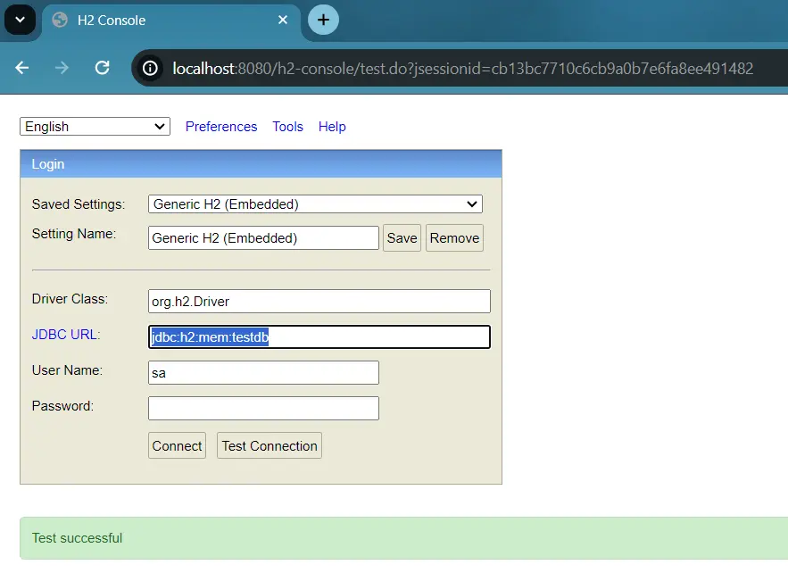
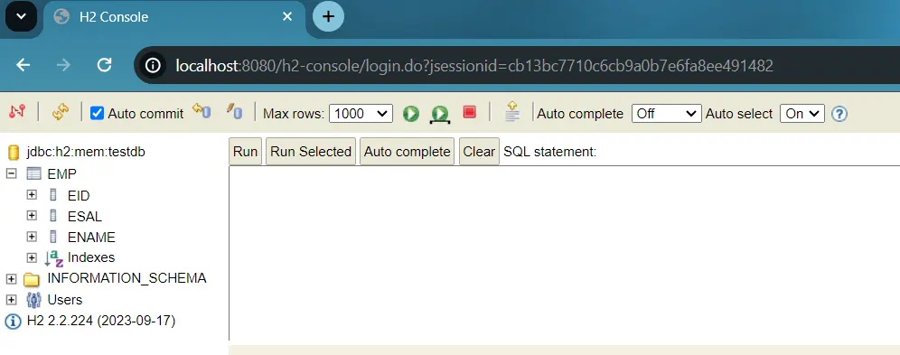
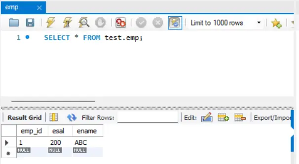

# Spring Data JPA Introduction

**Spring Data JPA Introduction** | First let us see the difference between JDBC, JPA, Hibernate, and Spring Data JPA.

- [JDBC vs JPA vs Hibernate vs Spring Data JPA](#1-jdbc-vs-jpa-vs-hibernate-vs-spring-data-jpa)
- [Spring Data JPA](#2-spring-data-jpa)
- [JPA Annotations](#3-jpa-annotations)
- [Example of Using H2 Database](#4-example-of-using-h2-database)
- [Spring Data JPA (DB Operations)](#5-spring-data-jpa-db-operations)
- [Spring Data JPA Example using MySQL](#6-spring-data-jpa-example-using-mysql)
- [Hibernate Vs Spring Data JPA](#7-hibernate-vs-spring-data-jpa)
- [Repository Annotation](#8-repository-annotation)

---

## 1. JDBC vs JPA vs Hibernate vs Spring Data JPA

- 🗄️ **JDBC** works based on SQL Query, given by the Programmer.
- 📜 **JPA** (Specification given by Sun/Oracle), generates all SQLs based on operations.
- ⚙️ For a Specification, we must follow one implementation i.e. **Hibernate**.
- 🔧 Even in Hibernate, the programmer has to do code manually for operations, transactions, pooling, etc.
- 🚀 In **Spring Data JPA**, code is automated. It internally follows Hibernate with the JPA concept.


| Feature | JDBC 🗄️ | JPA + Hibernate ⚙️ | Spring Data JPA 🚀 |
|---------|---------|-------------------|-------------------|
| **SQL Coding** | ✅ Manual SQL required | ❌️ SQL auto-generated | ❌️ SQL auto-generated |
| **Lines of Code** | Many | Fewer than JDBC | Fewest |
| **Error Rate** | Higher | Lower | Lowest |
| **Standalone?** | ✅ Yes | ❌️ Needs Hibernate impl | ❌️ Built on Hibernate |

- ⚖️ If we compare JDBC-Project and JPA-Project, the number of lines of code inside JPA is less. Even error rate also. Whereas in JDBC manual SQL coding is required.
- 📦 We cannot write code using only JPA, internally one implementation must be there.
- 📉 In JPA also some coding lines exist. Spring Data JPA can reduce them into a few lines.
- 🔑 The difference between JPA (with Hibernate) and Spring Data JPA is the number of lines of code only. Spring Data JPA reduces coding lines.

---

## 2. Spring Data JPA

- 💡 Programmers need not define code for basic database operations. Just provide model class/entity class and primary key with data type.
- 🗄️ It supports embedded databases like H2, HyperSQL (HSQL), and Apache Derby, so no download & installation is required. They are embedded/InMemory database/RAM database. Therefore, it is used only for development purposes, never used in production.
- 🔍 It also supports custom query programming using [Query methods (findBy)](./08_Query_Method_in_Spring_Data_JPA.md), and [@Query(JPQL/HQL, SQL)](./05_HQLJPQL_in_Spring_Data_JPA.md).

---

## 3. JPA Annotations

| Annotation 🏷️ | Purpose 📋 | Details 🛠️ |
|---------------|-----------|------------|
| `@Entity` | Maps class to database table | Required on every JPA entity class |
| `@Id` | Indicates the primary key | Marks the PK field |
| `@Table` | Provide table details like name | Optional — if not provided, class-name becomes table name |
| `@Column` | Provide column details like column-name | Optional — if not provided, variable-name becomes column name |

---

## 4. Example of Using H2 Database

Use the spring starter to create the project and add the following dependencies: Spring Data JPA, [Lombok](../01_core_spring_boot/07_Project_Lombok_Annotations_With_Examples.md), Spring Web, and H2 database. To work with the H2 database, its dependency is required.

**H2 Dependency:**

Maven (`pom.xml`):
```xml
<dependency>
    <groupId>com.h2database</groupId>
    <artifactId>h2</artifactId>
    <scope>runtime</scope>
</dependency>
```

Gradle (`build.gradle`):
```groovy
runtimeOnly 'com.h2database:h2'
```

**Model class:**

```java
import jakarta.persistence.Column;
import jakarta.persistence.Entity;
import jakarta.persistence.Id;
import jakarta.persistence.Table;
import lombok.Data;

@Data
@Entity
@Table(name = "emp")
public class Employee {
    @Id
    @Column(name = "eid")
    private Integer empId;

    @Column(name = "ename")
    private String empName;

    @Column(name = "esal")
    private Double empSal;
}
```

🔧 **Configuration** (`application.properties`):

```properties
spring.h2.console.enabled=true
spring.datasource.url=jdbc:h2:mem:testdb

spring.jpa.show-sql=true
```

Run the application and enter the URL as: http://localhost:8080/h2-console/
Click on Connect (if failed modify JDBC URL=`jdbc:h2:mem:testdb`).



After the successful connection, we can see the tables.



---

## 5. Spring Data JPA (DB Operations)

### Datasource Connection Properties

```properties
spring.datasource.url=
spring.datasource.username=
spring.datasource.password=

# optional
spring.datasource.driver-class-name=
```

### JPA Properties

```properties
spring.jpa.hibernate.ddl-auto=update

# optional
spring.jpa.show-sql=true
spring.jpa.properties.hibernate.format_sql=true
spring.jpa.database-platform=org.hibernate.dialect.MySQLDialect
```

> ⚠️ **Do not copy `MySQL8Dialect` from older tutorials.** Version-specific dialect classes (`MySQL8Dialect`, `PostgreSQL95Dialect`, `Oracle12cDialect`) are **deprecated in Hibernate 6** — there is now one class per product (`MySQLDialect`, `PostgreSQLDialect`) and the server version is auto-detected from the JDBC connection. In practice, **omit `database-platform` entirely** and let Hibernate resolve it; set it only when you connect through a proxy that hides the real server version. See [`../../1_interview_questions/13_Hibernate_Interview_Questions.md`](../../1_interview_questions/13_Hibernate_Interview_Questions.md) Q7 (Hibernate configuration files) for the full legacy-property table.

### Property Explanation

| Property 🏷️ | Description 📋 |
|-------------|---------------|
| **`show-sql`** | Boolean property (default `false`). If set to `true`, the generated SQL is displayed in the console. |
| **`database-platform`** / Dialect | A class that generates SQL queries when we perform DB operations. Dialect classes exist in `org.hibernate.dialect`. Every database has its own dialect. Adding dialect is optional — Spring configures it based on the given database. |
| **`ddl-auto`** | Controls table creation behavior: `create`, `update`, `validate`, `create-drop` |

### ddl-auto Options

| Option ⚙️ | Behavior 📋 |
|-----------|------------|
| **`create`** | Creates new tables on startup. If old tables exist, drops them first and creates new ones. |
| **`update`** | Checks for old tables. If they exist, uses them; otherwise creates new tables. |
| **`validate`** (or `none`) | Application will not create/drop/alter. Programmer must define manual SQL queries. |
| **`create-drop`** | Drop tables if they exist → Create new tables → Perform DB operations → Drop tables again on shutdown. |

> 📝 **Note:** For `ddl-auto`, `validate` (or `none`) is the default value for external databases. If we use embedded DB (like H2), the default is `create-drop`.

💡 **Dialect Insight:** SQL queries are database-dependent. If we write one SQL query for Oracle, it may/may not work for SQL Server DB. Dialect solves the above problem by generating queries at runtime. So, the dialect is different for every DB.

---

## 6. Spring Data JPA Example using MySQL

For your Module (e.g., Employee, Admin, Student, etc.) you do not have to define operations code. Just define an interface that must implement one of the below interfaces:

| Interface 🏷️ | Link 🔗 |
|-------------|---------|
| **`CrudRepository<T, ID>`** | [CrudRepository in Spring Data JPA](./02_CrudRepository_Examples_in_Spring_Data_JPA.md) |
| **`PagingAndSortingRepository<T, ID>`** | [PagingAndSortingRepository](./03_PagingAndSortingRepository_in_Spring_Data_JPA.md) |
| **`JpaRepository<T, ID>`** | [JpaRepository in Spring Data JPA](./04_JpaRepository_in_Spring_Data_JPA.md) |

At the runtime, a class will be generated which will contain all the database operation logic.

🗂️ **Coding files needed:**

- 📄 Model class / Entity class
- 💾 Repository Interface
- 🧪 Runner class for testing operations

### MySQL Setup

In this example, we will use a MySQL table.

```sql
mysql> show databases;
mysql> create database test;
mysql> use test;
mysql> show tables;
mysql> select * from emp;
```

Use the spring starter to create a new project and add the following dependencies: Spring Data JPA, [Lombok](../01_core_spring_boot/07_Project_Lombok_Annotations_With_Examples.md), and MySQL database.

### Implementation Steps

1️⃣ **Configure Properties** (`application.properties`):

```properties
# datasource properties
spring.datasource.url=jdbc:mysql://localhost:3306/test
spring.datasource.username=root
spring.datasource.password=root

# jpa properties
spring.jpa.show-sql=true
spring.jpa.hibernate.ddl-auto=update
spring.jpa.properties.hibernate.format_sql=true
```

2️⃣ **Define the Entity Class:**

```java
package com.knowprogram.demo.model;

import jakarta.persistence.Column;
import jakarta.persistence.Entity;
import jakarta.persistence.GeneratedValue;
import jakarta.persistence.GenerationType;
import jakarta.persistence.Id;
import jakarta.persistence.Table;
import lombok.Data;

@Data
@Entity
@Table(name = "emp")
public class Employee {
    @Id
    @GeneratedValue(strategy = GenerationType.IDENTITY)
    private Integer empId;

    @Column(name = "ename")
    private String empName;

    @Column(name = "esal")
    private Double empSal;
}
```

> 🔑 **Key Point:** Which DataType can be used to create the primary key variable in Hibernate/JPA? Any class that is serializable can be used as the primary key.

3️⃣ **Define the Repository:**

- `T` = Model class name = `Employee`
- `ID` = DataType of Primary Key = `Integer`

```java
package com.knowprogram.demo.repository;

import org.springframework.data.jpa.repository.JpaRepository;
import com.knowprogram.demo.model.Employee;

public interface EmployeeRepository extends JpaRepository<Employee, Integer> {

}
```

4️⃣ **Write the Runner Class:**

```java
package com.knowprogram.demo.runner;

import org.springframework.beans.factory.annotation.Autowired;
import org.springframework.boot.CommandLineRunner;
import org.springframework.stereotype.Component;

import com.knowprogram.demo.model.Employee;
import com.knowprogram.demo.repository.EmployeeRepository;

@Component
public class TestRunner implements CommandLineRunner {

    @Autowired
    private EmployeeRepository employeeRepository;

    @Override
    public void run(String... args) throws Exception {
        Employee emp = new Employee();
        emp.setEmpName("ABC");
        emp.setEmpSal(200.0);
        employeeRepository.save(emp);
    }
}
```

📤 **Output (Generated SQL):**

```sql
Hibernate:
    drop table if exists emp
Hibernate:
    create table emp (
        emp_id integer not null auto_increment,
        esal float(53),
        ename varchar(255),
        primary key (emp_id)
    ) engine=InnoDB
Hibernate:
    insert
    into
        emp
        (ename, esal)
    values
        (?, ?)
```



---

## 7. Hibernate Vs Spring Data JPA

If we use Hibernate we have to write code manually.

**Hibernate 5 with JPA (Manual Code):**

```java
// Hibernate 5 with JPA
try {
    EntityManagerFactory emf = HibernateUtil.getEmf();
    EntityManager em = emf.createEntityManager();
    EntityTransaction et = em.getTransaction();
    et.begin();
    Employee obj = new Employee();
    ...
    em.persist(obj);
    et.commit();
} catch(Exception e) {
    sysout(e);
    et.rollback();
}
```

In Hibernate, the programmer is writing code for operations manually. Now the same code is going to be generated by Spring Data JPA. But it is asking for two inputs:

- 📄 Model class Name = `T` = `Employee`
- 🔑 PrimaryKey DataType = `ID` = `Integer`

**Spring Data JPA (Automated):**

```java
public interface EmployeeRepository extends CrudRepository<Employee, Integer> {
}
```

At runtime, one class is generated using your inputs — this is called a **Proxy** (Dynamic Proxy).

**Generated Proxy class (simplified):**

```java
class $1 implements EmployeeRepo {
    public <S extends Employee> S save(S entity) {
        Assert.notNull(entity, "Entity must not be null.");
        if (entityInformation.isNew(entity)) {
            em.persist(entity);
            return entity;
        } else {
            return em.merge(entity);
        }
    }
}
```

📝 **Note:**
- `<S extends Employee>` means: `Employee` object or its sub-class objects are allowed.
- `<S super Employee>` means: `Employee` objects or its superclass objects are allowed.

---

## 8. Repository Annotation

We actually don't need to add `@Repository` to the `EmployeeRepository` interface. Stereotype annotations (`@Component`, `@Service`, `@Repository`, `@Controller`, and `@RestController`) are never applied on interfaces and abstract classes — they are used on concrete classes. This is because the Spring framework creates instances of these classes to manage as beans, and you can't instantiate an interface or abstract class directly.

Spring Data JPA recognizes it as a repository based on it extending `CrudRepository`, `JpaRepository`, or other repository interfaces. Spring will automatically manage it as a repository bean, handling all the annotations and configurations behind the scenes. Therefore we don't need `@Repository` in the `EmployeeRepository` interface.

> 💡 **Then when can we use the `@Repository` annotation?**

You'd use the `@Repository` annotation mainly on **custom repository implementations** or DAO (Data Access Object) classes that you manually define.

**Custom Repository Implementation:**

```java
@Repository
public class CustomEmployeeRepositoryImpl implements CustomEmployeeRepository {
    @PersistenceContext
    private EntityManager em;

    @Override
    public List<Employee> findEmployeesCustom() {
        // Custom query logic
        return em.createQuery("FROM Employee").getResultList();
    }
}
```

🔑 **Key Takeaway:** `@Repository` is particularly useful when you're writing custom repository logic. For Spring Data repositories like `EmployeeRepository`, Spring Data handles it all for you — no need to add the annotation explicitly.
