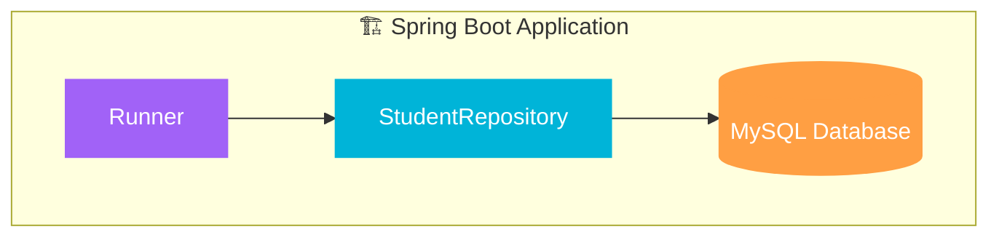
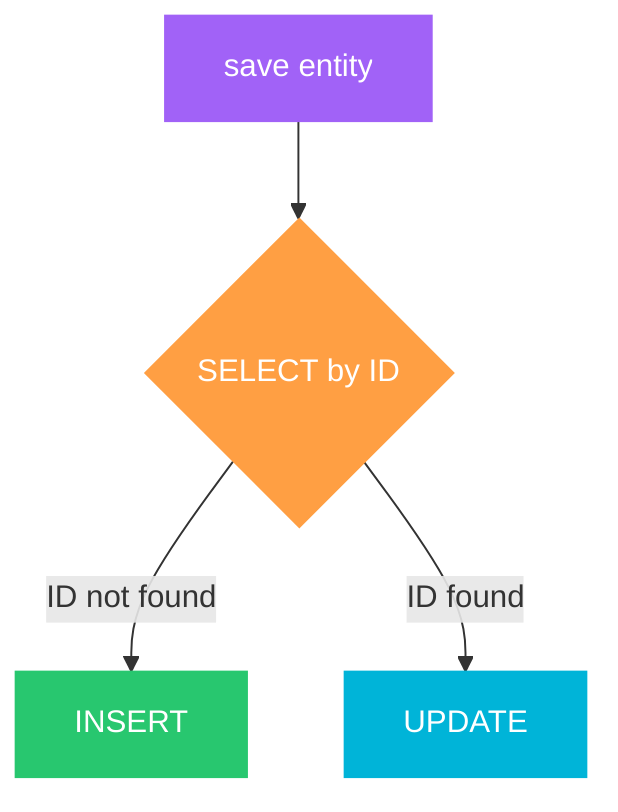

# CrudRepository Examples in Spring Data JPA

**CrudRepository Examples in Spring Data JPA** | We will see the commonly used methods of the `CrudRepository` along with examples. Create a Spring Boot project and include the following dependencies: Spring Data JPA, [Lombok](../01_core_spring_boot/07_Project_Lombok_Annotations_With_Examples.md), MySQL Driver.

- [Project Setup](#1-project-setup)
- [save() Method](#2-save-method)
- [saveAll() Method](#3-saveall-method)
- [findById() Method](#4-findbyid-method)
- [existsById() Method](#5-existsbyid-method)
- [findAll() Method](#6-findall-method)
- [findAllById() Method](#7-findallbyid-method)
- [count() Method](#8-count-method)
- [deleteById() Method](#9-deletebyid-method)
- [delete() Method](#10-delete-method)
- [deleteAll(Iterable) Method](#11-deletealliterable-method)
- [deleteAll() Method](#12-deleteall-method)

---

## 1. Project Setup



🔧 **Configuration** (`application.yml`):

```yaml
spring:
  datasource:
    url: jdbc:mysql://localhost:3306/test
    username: root
    password: root
  jpa:
    show-sql: true
    hibernate:
      ddl-auto: update
#    properties:
#      hibernate:
#        format_sql: true
```

🏷️ **Entity class:**

```java
package com.knowprogram.demo.model;

import jakarta.persistence.Entity;
import jakarta.persistence.Id;
import jakarta.persistence.Table;
import lombok.AllArgsConstructor;
import lombok.Data;
import lombok.NoArgsConstructor;

@Entity
@Data
@NoArgsConstructor
@AllArgsConstructor
public class Student {
    @Id
    private Integer id;

    private String name;

    private Double fee;
}
```

💾 **Repository:**

```java
package com.knowprogram.demo.repository;

import org.springframework.data.repository.CrudRepository;

import com.knowprogram.demo.model.Student;

public interface StudentRepository extends CrudRepository<Student, Integer> {

}
```

🧪 **Runner for testing:**

```java
package com.knowprogram.demo.runner;

import org.springframework.boot.CommandLineRunner;
import org.springframework.stereotype.Component;

@Component
public class TestRunner implements CommandLineRunner {

    @Override
    public void run(String... args) throws Exception {
        System.out.println("TestRunner.run()");
        // code
    }

}
```

After running the application, it will create the table and execute the `run()` method.

📤 **Output:**

```sql
Hibernate: create table student (id integer not null auto_increment, fee float(53), name varchar(255), primary key (id)) engine=InnoDB
TestRunner.run()
```

---

## 2. save() Method

The `save(s)` method behaves like **either insert or update**. It supports taking Model class objects and even their sub-class objects.

📝 **Method signature:** `<S extends T> S save(S entity);`

This method first executes a `SELECT` query with a given ID in the object. It checks whether the given ID exists or not. If the ID does not exist in the DB table then it performs an `INSERT`, else an `UPDATE`.



🛠️ **Example:**

```java
package com.example.demo.model.runner;

import org.springframework.beans.factory.annotation.Autowired;
import org.springframework.boot.CommandLineRunner;
import org.springframework.stereotype.Component;

import com.example.demo.model.Student;
import com.example.demo.model.repo.StudentRepository;

@Component
public class TestRunner implements CommandLineRunner {

    @Autowired
    private StudentRepository studentRepository;

    @Override
    public void run(String... args) throws Exception {
        Student s1 = new Student(10, "A", 2.2);
        studentRepository.save(s1); // **save**

        Student s2 = new Student(10, "B", 2.2);
        studentRepository.save(s2); // **update**
    }
}
```

📤 **Output:**

```sql
Hibernate: select s1_0.id,s1_0.fee,s1_0.name from student s1_0 where s1_0.id=?
Hibernate: insert into student (fee,name,id) values (?,?,?)
Hibernate: select s1_0.id,s1_0.fee,s1_0.name from student s1_0 where s1_0.id=?
Hibernate: update student set fee=?,name=? where id=?
```

For the `save(s1)` method call it first executes the select query. Since the record is not found therefore it inserts the record. On the `save(s2)` method call again it executes the select query and finds the record therefore it updates the existing record.

💡 **Tip:** Instead of calling `save()` each time and making multiple database calls, use `saveAll()` for bulk insert.

<details>
<summary>🤔 Doubt: Does save() always do 2 DB round trips (SELECT + INSERT/UPDATE), or can it be 1?</summary>

**It depends on whether the entity is in the persistence context (1st-level cache) or not.**

`SimpleJpaRepository.save()` source:

```java
@Transactional
public <S extends T> S save(S entity) {
    if (entityInformation.isNew(entity)) {
        em.persist(entity);   // INSERT
        return entity;
    } else {
        return em.merge(entity);  // SELECT + UPDATE (maybe)
    }
}
```

The `isNew()` check is **pure Java** — it just checks if `@Id` is `null` (for objects) or `0` (for primitives). No DB query here.

**Round trips breakdown:**

| Scenario | What happens | DB round trips |
|---|---|---|
| `id == null` (new entity) | `persist()` → INSERT | **1** |
| `id != null` + entity in **1st-level cache** (same session) | `merge()` uses cached version → UPDATE | **1** |
| `id != null` + entity **not in persistence context** (detached) | `merge()` → SELECT first, then UPDATE | **2** |

**The common case in REST APIs:**

In a typical stateless web request, entities are always **detached** — the persistence context from a previous request is already closed. So `save()` on an entity with an ID set always does **2 round trips**: SELECT + INSERT/UPDATE. This matches the SQL output above.

**How to avoid the extra SELECT for updates:**

Use `@Modifying` + `@Query` to go directly to UPDATE — 1 round trip, no SELECT:

```java
@Modifying
@Query("UPDATE Student s SET s.name = :name WHERE s.id = :id")
int updateName(@Param("id") Integer id, @Param("name") String name);
```

---

</details>
<br/>

<details>
<summary>🤔 Doubt: In industry, which is used more for updates — save() or @Modifying + @Query?</summary>

**`save()` is used more commonly** for typical CRUD. Both have their place depending on the scenario.

**`save()` — standard choice for most updates:**

Natural fit for REST APIs: fetch entity → modify fields → save. Works well when updating multiple fields and the extra SELECT is not a bottleneck.

```java
// Typical service layer pattern
Student student = studentRepository.findById(id)
        .orElseThrow(() -> new RuntimeException("Not found"));
student.setName(newName);
student.setFee(newFee);
studentRepository.save(student);  // entity already in persistence context → merge = no extra SELECT
```

> ✅ When `findById()` and `save()` run in the **same transaction**, the entity is already in the 1st-level cache — so `merge()` skips the SELECT entirely. Effectively only 1 extra round trip total, not 2.

**`@Modifying + @Query` — used for specific scenarios:**

| Scenario | Why |
|---|---|
| Bulk updates (`UPDATE ... WHERE status = ?`) | Avoids loading thousands of entities into memory |
| Partial field update (e.g. just `lastLoginAt`) | No need to fetch the full entity |
| High-frequency hot paths (audit timestamps, counters) | Performance-critical, avoids SELECT overhead |
| Batch jobs / admin operations | Efficiency over convenience |

```java
@Modifying
@Query("UPDATE Student s SET s.fee = :fee WHERE s.id = :id")
int updateFee(@Param("id") Integer id, @Param("fee") Double fee);
```

⚠️ **Important caveat:** `@Modifying` bypasses the persistence context — the 1st-level cache won't reflect the change. Use `clearAutomatically = true` to avoid stale reads within the same transaction:

```java
@Modifying(clearAutomatically = true)
@Query("UPDATE Student s SET s.fee = :fee WHERE s.id = :id")
int updateFee(@Param("id") Integer id, @Param("fee") Double fee);
```

**Summary:**

| | `save()` | `@Modifying @Query` |
|---|---|---|
| Typical CRUD (single entity) | ✅ Standard choice | Overkill |
| Bulk update (many rows) | ❌️ N round trips + N entities in memory | ✅ Single query |
| Partial field update | Works but fetches full entity | ✅ Targeted |
| Cache consistency | ✅ Automatic | ⚠️ Need `clearAutomatically = true` |

---

</details>
<br/>

**Inserting a few more records for upcoming examples:**

```java
studentRepository.save(new Student(101, "A", 2.2));
studentRepository.save(new Student(102, "B", 3.2));
studentRepository.save(new Student(103, "C", 4.2));
studentRepository.save(new Student(104, "D", 5.2));
```

---

## 3. saveAll() Method

This method is used to insert/update multiple rows at a time. `Iterable` is the supertype for collections, so we can choose any one Collection.

📝 **Method signature:** `<S extends T> Iterable<S> saveAll(Iterable<S> entities);`

🛠️ **Example:**

```java
studentRepository.saveAll(
    List.of(
        new Student(105, "A", 5.1),
        new Student(106, "B", 6.1),
        new Student(107, "C", 7.1),
        new Student(108, "D", 8.1)
    )
);
```

📤 **Output:**

```sql
Hibernate: select s1_0.id,s1_0.fee,s1_0.name from student s1_0 where s1_0.id=?
Hibernate: select s1_0.id,s1_0.fee,s1_0.name from student s1_0 where s1_0.id=?
Hibernate: select s1_0.id,s1_0.fee,s1_0.name from student s1_0 where s1_0.id=?
Hibernate: select s1_0.id,s1_0.fee,s1_0.name from student s1_0 where s1_0.id=?
Hibernate: insert into student (fee,name,id) values (?,?,?)
Hibernate: insert into student (fee,name,id) values (?,?,?)
Hibernate: insert into student (fee,name,id) values (?,?,?)
Hibernate: insert into student (fee,name,id) values (?,?,?)
```

📝 **Note:** The `List.of()` method was introduced in JDK 9. For older versions you can use `Arrays.asList()` method.

<details>
<summary>🤔 Doubt: How many DB round trips does saveAll() make? Does it batch or call save() per entity?</summary>

**`saveAll()` internally just loops and calls `save()` for each entity** — no special batch magic by default.

```java
// SimpleJpaRepository source
@Transactional
public <S extends T> List<S> saveAll(Iterable<S> entities) {
    List<S> result = new ArrayList<>();
    for (S entity : entities) {
        result.add(save(entity));   // calls save() for each
    }
    return result;
}
```

And `save()` itself:

```java
@Transactional
public <S extends T> S save(S entity) {
    if (entityInformation.isNew(entity)) {
        em.persist(entity);   // INSERT
        return entity;
    } else {
        return em.merge(entity);  // SELECT + UPDATE (for detached entities)
    }
}
```

The `isNew()` check is **just a Java null/zero check on the `@Id` field** — no DB query for this step.

**Round trips for N entities:**

| Scenario | Round trips |
|---|---|
| N new entities (`id = null`) | **N** INSERTs |
| N detached entities (`id` set, not in persistence context) | **2N** (N SELECTs + N UPDATEs) |

This matches what you see in the SQL output above — 4 SELECTs then 4 INSERTs for 4 new entities.

**Fixing it — Hibernate JDBC Batching:**

```properties
spring.jpa.properties.hibernate.jdbc.batch_size=50
spring.jpa.properties.hibernate.order_inserts=true
spring.jpa.properties.hibernate.order_updates=true
```

With batching, N INSERTs are grouped into `ceil(N/50)` round trips instead of N.

**Critical catch — `IDENTITY` strategy kills batching:**

```java
@Id
@GeneratedValue(strategy = GenerationType.IDENTITY)  // ← breaks batching
private Long id;
```

With `IDENTITY`, Hibernate needs the DB-generated ID back **immediately after each INSERT** (to assign to the entity), so it cannot batch. Fix: switch to `SEQUENCE` strategy:

```java
@Id
@GeneratedValue(strategy = GenerationType.SEQUENCE, generator = "student_seq")
@SequenceGenerator(name = "student_seq", allocationSize = 50)
private Long id;
```

**Summary:**

| Config | N new entities | N detached entities |
|---|---|---|
| Default (no batching) | N round trips | 2N round trips |
| `batch_size=50` + SEQUENCE | `ceil(N/50)` round trips | Still 2N (SELECTs aren't batched) |
| `batch_size=50` + IDENTITY | Still N (batching disabled) | Still 2N |

For bulk updates, a `@Modifying @Query` bypasses the SELECT entirely and is the most efficient approach.

---

</details>
<br/>

<details>
<summary>🤔 Doubt: Is saveAll() just clean code over save(), or is there a real difference?</summary>

**At the Java layer, yes — `saveAll()` is essentially a convenience wrapper.** But there is one meaningful difference: the `@Transactional` boundary.

**Calling `save()` N times manually (no outer transaction):**

```java
// Each save() has its own @Transactional → N separate transactions
studentRepository.save(s1);  // transaction 1 — commit
studentRepository.save(s2);  // transaction 2 — commit
studentRepository.save(s3);  // transaction 3 — commit
```

**Calling `saveAll()` with N entities:**

```java
// ONE @Transactional wraps the entire loop → single transaction, single commit
studentRepository.saveAll(List.of(s1, s2, s3));
```

**Comparison:**

| | `save()` called N times | `saveAll()` |
|---|---|---|
| Code | Manual loop | Clean, single call |
| Transactions | N separate transactions | 1 transaction |
| Commit overhead | N commits | 1 commit |
| DB round trips per entity | Same | Same |
| Failure behaviour | Partial save possible (some committed before failure) | All-or-nothing rollback |
| JDBC batching | No | No (unless configured separately) |

**Key takeaway:** `saveAll()` is not just cleaner code — the single transaction boundary is a real behavioural difference. If `save()` is called N times without an outer `@Transactional`, a failure midway leaves some records inserted and some not. With `saveAll()`, it's all-or-nothing.

DB round trips per entity remain identical in both cases — batching only kicks in with explicit Hibernate JDBC batch config.

---

</details>
<br/>

---

## 4. findById() Method

This method is used to fetch data from DB using the primary key value. The given ID may or may not exist in DB, therefore the return type is `Optional<T>`.

📝 **Method signature:** `Optional<T> findById(ID id);`

Java 8 introduced the `Optional<T>` class to avoid `NullPointerException` and handle null values. Dynamic data (UI/DB/File) may be null, so before processing it, a null check must be done.

🛠️ **Example (ID exists):**

```java
Optional<Student> optional = studentRepository.findById(105);
if (optional.isPresent()) {
    Student student = optional.get();
    System.out.println(student);
} else {
    System.out.println("Data Not Found");
}
```

📤 **Output:**

```sql
Hibernate: select s1_0.id,s1_0.fee,s1_0.name from student s1_0 where s1_0.id=?
Student(id=105, name=A, fee=5.1)
```

🔍 **Example (ID does not exist):**

```java
Optional<Student> optional = studentRepository.findById(109);
```

📤 **Output:**

```sql
Hibernate: select s1_0.id,s1_0.fee,s1_0.name from student s1_0 where s1_0.id=?
Data not found
```

🚨 **Throwing exceptions:**

```java
Student student = studentRepository.findById(109)
                  .orElseThrow(() -> new Exception("ID Not Found"));
System.out.println(student);
```

Also see: [Global Exception handling in Spring Boot](../03_spring_rest/07_Exception_Handling_in_Spring_Boot_REST.md)

---

## 5. existsById() Method

If a given ID exists in the database table then it returns `true`, else it returns `false`.

📝 **Method signature:** `boolean existsById(ID id);`

🛠️ **Example:**

```java
boolean exist = studentRepository.existsById(10);
System.out.println(exist);
```

📤 **Output:**

```sql
Hibernate: select count(*) from student s1_0 where s1_0.id=?
true
```

> 💡 **Tip:** What are cursors in Java and which one was added in JDK 1.8? `Enumerator`, `Iterator`, `ListIterator`, and `SplitIterator`. The `SplitIterator` was introduced in the JDK 1.8 version.

---

## 6. findAll() Method

This method is used to fetch all rows from the database table.

- 🗄️ **SQL:** `SELECT * FROM <TABLE-NAME>;`
- 📝 **Method signature:** `Iterable<T> findAll();`

It will fetch data from the database table using the select query into `List<T>` Collection, casted to `Iterable`, that supports reading data.

🛠️ **Example:**

```java
Iterable<Student> iterable = studentRepository.findAll();
iterable.forEach(System.out::println);
```

📤 **Output:**

```sql
Hibernate: select s1_0.id,s1_0.fee,s1_0.name from student s1_0
Student(id=10, name=B, fee=2.2)
Student(id=101, name=A, fee=2.2)
Student(id=102, name=B, fee=3.2)
Student(id=103, name=C, fee=4.2)
Student(id=104, name=D, fee=5.2)
Student(id=105, name=A, fee=5.1)
Student(id=106, name=B, fee=6.1)
Student(id=107, name=C, fee=7.1)
Student(id=108, name=D, fee=8.1)
```

🔄 **Different ways to display the data:**

```java
Iterable<Student> itb = studentRepository.findAll();
System.out.println(itb.getClass().getName()); // ArrayList

Iterable<Student> itb = studentRepository.findAll();
System.out.println(itb.getClass().getName()); // ArrayList

// Different ways to display the record
// Java 8 - Method Reference
itb.forEach(System.out::println);
System.out.println("--------------------");

// Java 8 - Lambda Expression
itb.forEach(s -> System.out.println(s));
System.out.println("--------------------");

// Iterator
Iterator<Student> itr = itb.iterator();
while (itr.hasNext()) {
   Student s = itr.next();
   System.out.println(s);
}
System.out.println("--------------------");

// For Each Loop
for (Student s : itb) {
   System.out.println(s);
}
```

| Method 🛠️ | Style 📋 | Java Version ☕ |
|-----------|---------|----------------|
| **`forEach(System.out::println)`** | Method Reference | Java 8+ |
| **`forEach(s -> System.out.println(s))`** | Lambda Expression | Java 8+ |
| **`iterator()` + `while` loop** | Iterator | Java 1.2+ |
| **`for-each` loop** | Enhanced For Loop | Java 5+ |

---

## 7. findAllById() Method

To fetch randomly selected rows using the `IN` operator, use this method.

- 🗄️ **SQL:** `SELECT * FROM student WHERE sid IN (_, _, _);`

🛠️ **Example:**

```java
Iterable<Student> itb = studentRepository.findAllById(List.of(105, 106));
itb.forEach(System.out::println);
```

📤 **Output:**

```sql
Hibernate: select s1_0.id,s1_0.fee,s1_0.name from student s1_0 where s1_0.id in (?,?)
```

---

## 8. count() Method

This method is used to calculate the total number of rows in the database table.

- 🗄️ **SQL:** `SELECT COUNT(*) FROM student;`
- 📝 **Method signature:** `long count();`

🛠️ **Example:**

```java
long count = studentRepository.count();
System.out.println(count);
```

📤 **Output:**

```sql
Hibernate: select count(*) from student s1_0
9
```

---

## 9. deleteById() Method

This method is used to delete one row based on the primary key (ID).

📝 **Method signature:** `void delete(T entity);`

This method checks whether the given ID exists in the DB table using `findById()` internally. If it exists then it calls the `delete(obj)` method, else it throws `EmptyResultDataAccessException`.

🛠️ **Example:**

```java
studentRepository.deleteById(105);
```

📤 **Output:**

```sql
Hibernate: select s1_0.id,s1_0.fee,s1_0.name from student s1_0 where s1_0.id=?
Hibernate: delete from student where id=?
```

---

## 10. delete() Method

This method takes an object having the primary key. If the given ID exists in DB it will delete, else does nothing.

📝 **Method signature:** `void delete(T entity);`

> ⚠️ **Note:** If the ID does not exist, it will not throw any exception or error.

🛠️ **Example:**

```java
Student student = studentRepository.findById(107)
           .orElseThrow(() -> new Exception("ID Not Found"));
studentRepository.delete(student);
```

📤 **Output:**

```sql
Hibernate: select s1_0.id,s1_0.fee,s1_0.name from student s1_0 where s1_0.id=?
Hibernate: select s1_0.id,s1_0.fee,s1_0.name from student s1_0 where s1_0.id=?
Hibernate: delete from student where id=?
```

---

## 11. deleteAll(Iterable) Method

It takes a list of objects with the primary key. If the given object ID matches a table row then it will delete that row, else does nothing -- no exception, no error.

📝 **Method signature:** `void deleteAll(Iterable<? extends T> entities);`

🛠️ **Example:**

```java
Iterable<Student> selectedStudents = studentRepository.findAllById(List.of(106, 107));
System.out.println(selectedStudents);
studentRepository.deleteAll(selectedStudents);
```

📤 **Output:**

```sql
Hibernate: select s1_0.id,s1_0.fee,s1_0.name from student s1_0 where s1_0.id in (?,?)
[Student(id=106, name=B, fee=6.1), Student(id=107, name=C, fee=7.1)]
Hibernate: select s1_0.id,s1_0.fee,s1_0.name from student s1_0 where s1_0.id=?
Hibernate: select s1_0.id,s1_0.fee,s1_0.name from student s1_0 where s1_0.id=?
Hibernate: delete from student where id=?
Hibernate: delete from student where id=?
```

🔍 **Another example:** In the database, ID 108 exists therefore `deleteAll` will delete that record, but ID 109 does not exist therefore it will not do anything for ID 109.

```java
studentRepository.deleteAll(List.of(new Student(108, "", 1.0), new Student(109, "", 1.0)));
```

📤 **Output:**

```sql
Hibernate: select s1_0.id,s1_0.fee,s1_0.name from student s1_0 where s1_0.id=?
Hibernate: select s1_0.id,s1_0.fee,s1_0.name from student s1_0 where s1_0.id=?
Hibernate: delete from student where id=?
```

---

## 12. deleteAll() Method

It will delete all rows in the database table.

📝 **Method signature:** `void deleteAll();`

🛠️ **Example:**

```java
studentRepository.deleteAll();
```

📤 **Output:**

```sql
Hibernate: select s1_0.id,s1_0.fee,s1_0.name from student s1_0
Hibernate: delete from student where id=?
Hibernate: delete from student where id=?
Hibernate: delete from student where id=?
Hibernate: delete from student where id=?
```

---

## 13. CrudRepository Methods Summary

| Method 🛠️ | Purpose 📋 | Return Type 📦 |
|-----------|-----------|---------------|
| **`save(S entity)`** | Insert or update a single entity | `S` |
| **`saveAll(Iterable<S>)`** | Bulk insert/update multiple entities | `Iterable<S>` |
| **`findById(ID id)`** | Fetch one record by primary key | `Optional<T>` |
| **`existsById(ID id)`** | Check if record exists by ID | `boolean` |
| **`findAll()`** | Fetch all rows from the table | `Iterable<T>` |
| **`findAllById(Iterable<ID>)`** | Fetch selected rows using `IN` clause | `Iterable<T>` |
| **`count()`** | Count total rows in the table | `long` |
| **`deleteById(ID id)`** | Delete one row by ID (throws if not found) | `void` |
| **`delete(T entity)`** | Delete by entity object (no error if missing) | `void` |
| **`deleteAll(Iterable)`** | Delete multiple rows by entity list | `void` |
| **`deleteAll()`** | Delete all rows in the table | `void` |
