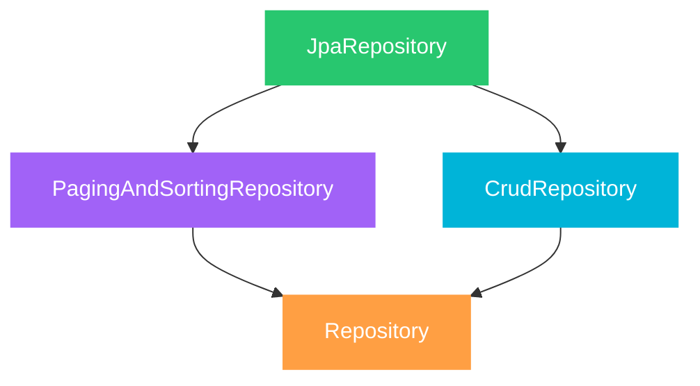
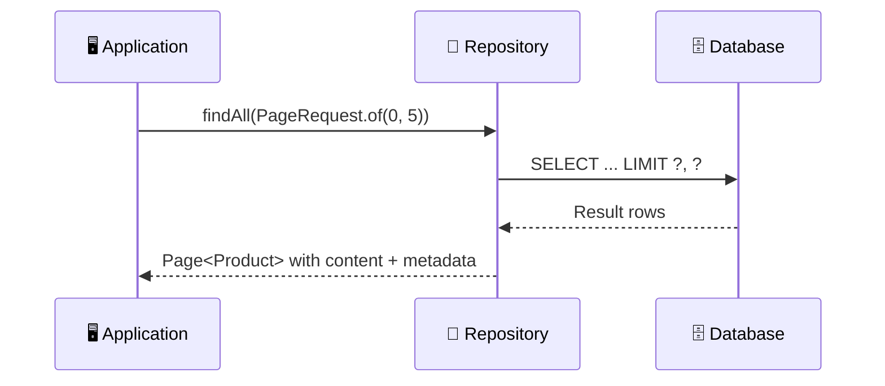

# PagingAndSortingRepository in Spring Data JPA

**PagingAndSortingRepository in Spring Data JPA** | The `PagingAndSortingRepository` has two methods for pagination and sorting. It does not implement [CrudRepository](./02_CrudRepository_Examples_in_Spring_Data_JPA.md).

---

## 1. PagingAndSortingRepository Interface

The `PagingAndSortingRepository` provides two core methods for pagination and sorting:

```java
public interface PagingAndSortingRepository<T, ID> extends Repository<T, ID> {
    Iterable<T> findAll(Sort sort);
    Page<T> findAll(Pageable pageable);
}
```



> 📝 **Note:** `PagingAndSortingRepository` does **not** extend `CrudRepository`. To get both CRUD and paging/sorting capabilities, extend both interfaces or use [JpaRepository](./04_JpaRepository_in_Spring_Data_JPA.md).

---

## 2. Sorting in Spring Data JPA

In SQL, `ORDER BY` columns `[ASC|DESC]` fetches data in a sorting order.

**SQL examples:**

```sql
select * from student order by sfee desc;
select * from student order by sfee; -- default is ASC
```

To do sorting, an enum `Direction` is provided that has two possible values: `ASC` and `DESC`. The default value is `ASC`. This enum is part of the `org.springframework.data.domain.Sort` class.

**Sort class structure:**

```java
class Sort {
    static Sort by(String... properties) {___}

    static Sort by(Direction direction, String... properties) {___}

    static enum Direction {
        ASC, DESC;
    }
}
```

🧠 **In Simple Words:**
Using the static method `by()` we can create a `Sort` object and pass it to the `findAll(Sort)` method, which gets data in sorting order.

---

## 3. Project Setup

Create a Spring Starter project with the following dependencies:

- 🏷️ [Lombok](../01_core_spring_boot/07_Project_Lombok_Annotations_With_Examples.md)
- 💾 Spring Data JPA
- 🗄️ MySQL Driver

🔧 **Configuration** (`application.yml`):

```yaml
spring:

## 4. DB Details
  datasource:
    url: jdbc:mysql://localhost:3306/test
    username: root
    password: root

## 5. JPA Details
  jpa:
    show-sql: true
    hibernate:
      ddl-auto: update
    properties:
      hibernate:
        format_sql: true
```

---

## 6. Entity Class

**Entity class:**

```java
@Entity
@Data
@AllArgsConstructor
@NoArgsConstructor
public class Product {
   @Id
   private Integer pid;
   private String pcode;
   private Double pcost;
   private String pvendor;
}
```

---

## 7. Repository Interface

`PagingAndSortingRepository` does not implement `CrudRepository`. To perform CRUD operations and pagination we can extend our repository from both `CrudRepository` and `PagingAndSortingRepository` (or [JpaRepository](./04_JpaRepository_in_Spring_Data_JPA.md)).

**Repository:**

```java
public interface ProductRepository extends CrudRepository<Product, Integer>,
      PagingAndSortingRepository<Product, Integer> {
}
```

---

## 8. Inserting Sample Data

**Runner class to insert data:**

```java
@Component
public class ProductRunner implements CommandLineRunner {

   @Autowired
   private ProductRepository productRepository;

   @Override
   public void run(String... args) throws Exception {
      productRepository.saveAll(List.of(new Product(101, "PEN", 25.0, "A"),
            new Product(102, "MOUSE", 125.0, "B"),
            new Product(103, "KYBRD", 250.0, "A"),
            new Product(104, "BTL", 180.0, "B")));
   }
}
```

---

## 9. Sorting Examples

For sorting, we call the method given in `PagingAndSortingRepository`: `Iterable<T> findAll(Sort sort);`

**TestRunner class with sorting:**

```java
package com.example.demo.model.runner;

import org.springframework.beans.factory.annotation.Autowired;
import org.springframework.boot.CommandLineRunner;
import org.springframework.data.domain.Sort;
import org.springframework.data.domain.Sort.Direction;
import org.springframework.stereotype.Component;

import com.example.demo.model.Product;
import com.example.demo.model.repo.ProductRepository;

@Component
public class TestRunner implements CommandLineRunner {

    @Autowired
    private ProductRepository productRepository;

    @Override
    public void run(String... args) throws Exception {
        productRepository.findAll().forEach(System.out::println);

        // select * from product order by pcode asc
        Sort sort = Sort.by("pcode");
        Sort sort1 = Sort.by(Direction.ASC, "pcode");
        Sort sort2 = Sort.by("pcode").ascending();

        // select * from product order by pcode desc
        Sort sort3 = Sort.by("pcode").descending();
        Sort sort4 = Sort.by(Direction.DESC, "pcode");

        // SELECT * FROM Product ORDER BY pcode ASC, pcost ASC;
        Sort sort5 = Sort.by("pcode", "pcost");
        // SELECT * FROM Product ORDER BY pcode DESC, pcost DESC;
        Sort sort6 = Sort.by(Direction.DESC, "pcode", "pcost");

        Iterable<Product> iterable = productRepository.findAll(sort);
        iterable.forEach(System.out::println);
    }
}
```

| Sort Expression 🏷️ | SQL Equivalent 💾 | Direction 🔀 |
|---------------------|-------------------|-------------|
| `Sort.by("pcode")` | `ORDER BY pcode ASC` | ⬆️ ASC (default) |
| `Sort.by(Direction.ASC, "pcode")` | `ORDER BY pcode ASC` | ⬆️ ASC |
| `Sort.by("pcode").ascending()` | `ORDER BY pcode ASC` | ⬆️ ASC |
| `Sort.by("pcode").descending()` | `ORDER BY pcode DESC` | ⬇️ DESC |
| `Sort.by(Direction.DESC, "pcode")` | `ORDER BY pcode DESC` | ⬇️ DESC |
| `Sort.by("pcode", "pcost")` | `ORDER BY pcode ASC, pcost ASC` | ⬆️ ASC |
| `Sort.by(Direction.DESC, "pcode", "pcost")` | `ORDER BY pcode DESC, pcost DESC` | ⬇️ DESC |

---

## 10. Multiple Sort Criteria

Assume we need to sort by `pcost` in descending order and by `pcode` in ascending order if `pcost` values are the same:

**Mixed-direction sort:**

```java
// SELECT * FROM PRODUCT ORDER BY pcost DESC, pcode ASC;
Sort sort7 = Sort.by(Sort.Order.desc("pcost"), Sort.Order.asc("pcode"));
```

💡 **Tip:** Use `Sort.Order.desc()` and `Sort.Order.asc()` when you need different directions for different columns in the same sort.

---

## 11. Different Ways to Create a Sort Object

There are multiple ways to create a `Sort` object. Below all produce the same result:

**All equivalent approaches:**

```java
// Using Direction enum
Sort sort = Sort.by(Direction.DESC, "pcode");

// Using Sort with method chaining
Sort sort = Sort.by("pcode").descending();

// Using Sort.Order and Sort.by
Sort.Order order = new Sort.Order(Sort.Direction.DESC, "pcode");
Sort sort = Sort.by(order);

// Using Sort.by with varargs
Sort sort = Sort.by(new Sort.Order(Sort.Direction.DESC, "pcode"));

// Using Sort.Order directly in Sort.by
Sort sort = Sort.by(Sort.Order.desc("pcode"));
```

---

## 12. Pagination in Spring Data JPA

Pagination is the process of fetching database table data page by page in equally divided parts.

We need to call the method given in `PagingAndSortingRepository`: `Page<T> findAll(Pageable pageable);`

Here `Pageable` is the input passed by the programmer for pagination. The `Pageable` interface has an implementation class `PageRequest`. They are given in the `org.springframework.data.domain` package.

**PageRequest factory methods:**

```java
Pageable pageable = PageRequest.of(pageSize);                                    // default pageNum=0
Pageable pageable = PageRequest.of(pageNum, pageSize);
Pageable pageable = PageRequest.of(pageNum, pageSize, sort);
Pageable pageable = PageRequest.of(pageNum, pageSize, direction, String... properties);
```



---

## 13. Pagination Example

**Runner class with pagination:**

```java
package com.example.demo.model.runner;

import java.util.List;

import org.springframework.beans.factory.annotation.Autowired;
import org.springframework.boot.CommandLineRunner;
import org.springframework.data.domain.Page;
import org.springframework.data.domain.PageRequest;
import org.springframework.data.domain.Pageable;
import org.springframework.stereotype.Component;

import com.example.demo.model.Product;
import com.example.demo.model.repo.ProductRepository;

@Component
public class ProductDataSortRunner implements CommandLineRunner {

    @Autowired
    private ProductRepository productRepository;

    @Override
    public void run(String... args) throws Exception {
        Pageable pageable = PageRequest.of(0, 5);
        Page<Product> page = productRepository.findAll(pageable);

        // read content
        List<Product> products = page.getContent();
        System.out.println(products);

        // meta data
        System.out.println("First page: " + page.isFirst());
        System.out.println("Last page: " + page.isLast());
        System.out.println("Has next page: " + page.hasNext());
        System.out.println("Has previous page: " + page.hasPrevious());
        System.out.println("Empty page?: " + page.isEmpty());
        System.out.println("Page size: " + page.getSize());
        System.out.println("Page number: " + page.getNumber());
        System.out.println("Total pages?: " + page.getTotalPages());
        System.out.println("Total rows?: " + page.getTotalElements());
    }
}
```

📤 **Hibernate Output:**

```sql
Hibernate:
    select
        p1_0.pid,
        p1_0.pcode,
        p1_0.pcost,
        p1_0.pvendor
    from
        product p1_0
    limit
        ?, ?
```

📤 **Console Output:**

```
[Product(pid=101, pcode=PEN, pcost=25.0, pvendor=A),
 Product(pid=102, pcode=MOUSE, pcost=125.0, pvendor=B),
 Product(pid=103, pcode=KYBRD, pcost=250.0, pvendor=A),
 Product(pid=104, pcode=BTL, pcost=180.0, pvendor=B)]

First page: true
Last page: true
Has next page: false
Has previous page: false
Empty page?: false
Page size: 5
Page number: 0
Total pages?: 1
Total rows?: 4
```

| Page Method 🏷️ | Return Type 📋 | Description 📖 |
|----------------|---------------|----------------|
| `getContent()` | `List<T>` | Returns the page content as a list |
| `isFirst()` | `boolean` | Whether this is the first page |
| `isLast()` | `boolean` | Whether this is the last page |
| `hasNext()` | `boolean` | Whether a next page exists |
| `hasPrevious()` | `boolean` | Whether a previous page exists |
| `isEmpty()` | `boolean` | Whether the page has no content |
| `getSize()` | `int` | Returns the size of the page |
| `getNumber()` | `int` | Returns the page number (0-based) |
| `getTotalPages()` | `int` | Returns total number of pages |
| `getTotalElements()` | `long` | Returns total number of rows |

---

## 14. Pagination with Sorting

We can also pass `Sort` objects to `PageRequest` to fetch data based on a given sorting order.

**Using `PageRequest.of(pageNum, pageSize, sort)`:**

```java
Sort sort = Sort.by(Sort.Direction.DESC, "pcode");
Page<Product> page = productRepository.findAll(PageRequest.of(0, 5, sort));
```

**Using `PageRequest.of(pageNum, pageSize, direction, String... properties)`:**

```java
String[] properties = { "pcode", "pcost" };
Page<Product> page = productRepository.findAll(
                 PageRequest.of(0, 5, Sort.Direction.DESC, properties));
```

📤 **Hibernate Output:**

```sql
Hibernate:
    select
        p1_0.pid,
        p1_0.pcode,
        p1_0.pcost,
        p1_0.pvendor
    from
        product p1_0
    order by
        p1_0.pcode desc,
        p1_0.pcost desc
    limit
        ?, ?
```

> 🔑 **Key Point:** Combining pagination with sorting is common in real-world applications, especially for REST APIs that need to return sorted, paginated results to the client.
