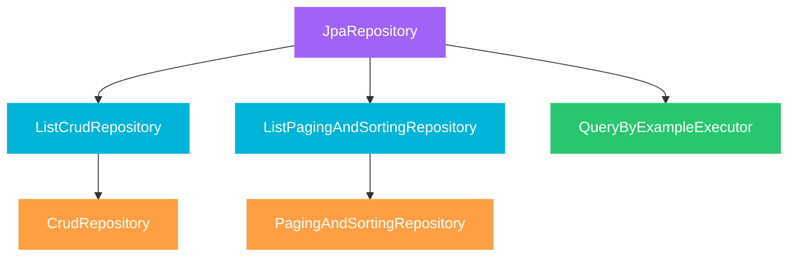

# JpaRepository in Spring Data JPA

**JpaRepository in Spring Data JPA** | JpaRepository internally extends [PagingAndSortingRepository](./03_PagingAndSortingRepository_in_Spring_Data_JPA.md) and [CrudRepository](./02_CrudRepository_Examples_in_Spring_Data_JPA.md). Therefore, CRUD operations and PageAndSort are also available in JpaRepository. It also has JPA concepts like Date and Time, Lobs (BLOB, CLOB), Collection Mapping, Association Mapping, Joins, Component Mapping, etc.

- [Custom Query Approaches](#1-custom-query-approaches)
- [JpaRepository Interface Definition](#2-jparepository-interface-definition)
- [Working with Date and Time in Spring Data JPA](#3-working-with-date-and-time-in-spring-data-jpa)
- [LOB (Large Objects) in Spring Data JPA](#4-lob-large-objects-in-spring-data-jpa)
- [Collections Mapping in Spring Data JPA](#5-collections-mapping-in-spring-data-jpa)

---

## 1. Custom Query Approaches

In `JpaRepository` we can define custom queries using one of the following approaches:

1. [findBy](./08_Query_Method_in_Spring_Data_JPA.md)
2. [@Query](./05_HQLJPQL_in_Spring_Data_JPA.md)

🔗 **Key capabilities of JpaRepository:**

- 🔄 Perform association mapping (one-to-one / one-to-many / many-to-one / many-to-many) with Joins for data fetch
- 📊 Perform standard projections (selecting only specific columns) for data fetch using custom queries
- 🗄️ Perform function/procedure calls using Data JPA

---

## 2. JpaRepository Interface Definition

In `CrudRepository` and `PagingAndSortingRepository`, `findAll()` methods return `Iterable`, but the `JpaRepository` interface extends **ListCrudRepository** and **ListPagingAndSortingRepository** which **return List**.

**JpaRepository interface signature:**

```java
public interface JpaRepository<T, ID> extends ListCrudRepository<T, ID>,
  ListPagingAndSortingRepository<T, ID>, QueryByExampleExecutor<T> {
}
```



📝 **Note:** Because `JpaRepository` extends `ListCrudRepository` and `ListPagingAndSortingRepository`, all `findAll()` methods return `List` instead of `Iterable`.

---

## 3. Working with Date and Time in Spring Data JPA

The annotation `@Temporal` needs input from the enum `TemporalType` which has 3 possible values:

| TemporalType 🏷️ | Format 📋 | Example 🛠️ |
|------------------|-----------|-------------|
| **DATE** | Date only | `2024-06-04` |
| **TIME** | Time only | `07:06:57` |
| **TIMESTAMP** | Date + Time | `2024-06-04 07:06:57.878` |

💡 **Tip:** If we did not specify any format in the code, the **default** storage is **TIMESTAMP**.

We can use the variable of type `java.util.Date` class that internally maps with different types based on enum selection.

### Project Setup

🔧 **Dependencies:** Lombok, Spring Data JPA, MySQL Driver.

1️⃣ **Entity class:**

```java
@Entity
@Data
@AllArgsConstructor
@NoArgsConstructor
public class Product {
   @Id
   private Integer pid;
   private String pcode;
   private Double pcost;

   @Temporal(TemporalType.DATE)
   private Date dteA;

   @Temporal(TemporalType.TIME)
   private Date dteB;

   @Temporal(TemporalType.TIMESTAMP)
   private Date dteC;
}
```

2️⃣ **Repository:**

```java
public interface ProductRepository extends JpaRepository<Product, Integer> { }
```

3️⃣ **Configuration** (`application.properties`):

```properties
spring.datasource.url=jdbc:mysql://localhost:3306/test
spring.datasource.username=root
spring.datasource.password=root
spring.jpa.show-sql=true
spring.jpa.hibernate.ddl-auto=update
spring.jpa.properties.hibernate.format_sql=true
```

4️⃣ **Runner class to insert data:**

```java
@Component
public class ProductRunner implements CommandLineRunner {

   @Autowired
   private ProductRepository productRepository;

   @Override
   public void run(String... args) throws Exception {
      productRepository.save(new Product(100, "ABC", 500.0, new Date(),
                new Date(), new Date()));
      productRepository.findAll().forEach(System.out::println);
   }

}
```

📤 **Output:**

```
Product(pid=100, pcode=ABC, pcost=500.0, dteA=2024-06-04, dteB=07:06:57, dteC=2024-06-04 07:06:57.878)
```

### Formatting java.util.Date

See more Date and Time Patterns [here](https://docs.oracle.com/javase/7/docs/api/java/text/SimpleDateFormat.html).

**SimpleDateFormat example:**

```java
import java.text.SimpleDateFormat;
import java.util.Date;
public class Test {
   public static void main(String[] args) {
      Date dte = new Date();
      SimpleDateFormat sdf= new SimpleDateFormat("MMM dd,YYYY hh:mm:ss SSS");
      String pattern = sdf.format(dte);
      System.out.println(pattern);
   }
}
```

---

## 4. LOB (Large Objects) in Spring Data JPA

`@Lob` annotation is given in Spring Data JPA to work with BLOB and CLOB.

| LOB Type 🏷️ | Java Mapping 💻 | Use Case 📋 |
|-------------|-----------------|-------------|
| **BLOB** | `byte[] + @Lob` | Images, Audio, Videos, PDFs, Docs, etc. |
| **CLOB** | `char[] + @Lob` | Large Text Data |

### Entity with LOB Fields

**Model class:**

```java
@Entity
@Data
@AllArgsConstructor
@NoArgsConstructor
public class Product {
   @Id
   private Integer pid;
   private String pcode;
   private Double pcost;

   @Lob
   @Column(columnDefinition = "LONGBLOB")
   private byte[] img;

   @Lob
   private char[] data;
}
```

⚠️ **Caution:** If we don't specify `@Column(columnDefinition = "LONGBLOB")`, MySQL will take `TINYBLOB`.

### MySQL BLOB Size Reference

| BLOB Type 🗄️ | Max Size 📦 |
|-------------|------------|
| **TINYBLOB** | Up to 255 bytes |
| **BLOB** (or TEXT) | Up to 65,535 bytes (64 KB) |
| **MEDIUMBLOB** | Up to 16,777,215 bytes (16 MB) |
| **LONGBLOB** | Up to 4,294,967,295 bytes (4 GB) |

### Runner Class for LOB Data

**Runner class:**

```java
@Component
public class ProductRunner implements CommandLineRunner {

   @Autowired
   private ProductRepository productRepository;

   @Override
   public void run(String... args) throws Exception {
      FileInputStream fis = new FileInputStream("C:/Users/Know/Downloads/img.webp");
      byte[] img = new byte[fis.available()];
      fis.read(img);

      String dataStr = "Lorem Ipsum is simply dummy text of the printing"+
                                " and typesetting industry.";
      char[] data = dataStr.toCharArray();
      fis.close();

      productRepository.save(new Product(100, "ABC", 500.0, img, data));
   }

}
```

---

## 5. Collections Mapping in Spring Data JPA

Data JPA supports storing collection data in database tables. In the model class, all primitives are stored in one table (parent table), and for every collection variable one child table is created.

🗂️ **Supported Types:** `List`, `Set`, and `Map`.

### Example Student Fields

| Field 🏷️ | Type 💻 |
|----------|---------|
| **studentId** | `Integer` |
| **studentMarks** | `List` |
| **studentSubjects** | `Set` |
| **studentLabs** | `Map` |

📝 **Note:** Every collection variable in the model class is mapped with one database table (child table).

### Index-Based vs Non-Index-Based Collections

| Category 📋 | Types 💻 | Columns Created 🗄️ |
|-------------|---------|-------------------|
| **Index-based** | `List`, `Map` | Key Column, Element Column, Index Column (3 columns) |
| **Non-Index-based** | `Set` | Key Column, Element Column (2 columns) |

🔑 **Key Points:**

- 📊 When we add data, the `List` gets an index number starting from zero by default
- 🔑 The `Map` key behaves like an index (it is unique)
- 🚫 The `Set` never contains such a format

> ⚠️ **Warning:** By default, the JPA provider will treat the `List` as a `Set`, so it will only create two columns: one for the key and one for the element. If we want to include an index column while working with `List`, we must use **`@OrderColumn`**.

### Required and Optional Annotations

| Annotation 🏷️ | Required? ✅ | Purpose 📋 |
|---------------|-------------|-----------|
| `@ElementCollection` | ✅ Required | Marks one collection variable as one child table |
| `@CollectionTable` | Optional | Customize table name and join column |
| `@Column` | Optional | Customize element column name |
| `@OrderColumn` | Optional | Add index column for `List` |
| `@MapKeyColumn` | Optional | Customize map key column name |

### Basic Collection Mapping Example

1️⃣ **Entity class (basic annotations):**

```java
package com.knowprogram.demo;

import java.util.List;
import java.util.Map;
import java.util.Set;

import jakarta.persistence.Column;
import jakarta.persistence.ElementCollection;
import jakarta.persistence.Entity;
import jakarta.persistence.Id;
import jakarta.persistence.Table;
import lombok.Data;

@Entity
@Data
@Table
@NoArgsConstructor
@AllArgsConstructor
public class Student {
   @Id
   @Column(name = "sid")
   private Integer stdId;

   @Column(name = "sname")
   private String stdName;

   @Column(name = "sfee")
   private Double stdFee;

   @ElementCollection
   private Set<String> subjects;

   @ElementCollection
   @OrderColumn(name = "position")
   private List<Integer> marks;

   @ElementCollection
   private Map<String, String> labExam;
}
```

2️⃣ **Repository:**

```java
package com.knowprogram.demo;

import org.springframework.data.jpa.repository.JpaRepository;

public interface StudentRepository extends JpaRepository<Student, Integer> {
}
```

📤 **Output (table creation SQL):**

```sql
Hibernate:
    create table student (
        sid integer not null,
        sfee float(53),
        sname varchar(255),
        primary key (sid)
    ) engine=InnoDB
Hibernate:
    create table student_lab_exam (
        student_sid integer not null,
        lab_exam varchar(255),
        lab_exam_key varchar(255) not null,
        primary key (student_sid, lab_exam_key)
    ) engine=InnoDB
Hibernate:
    create table student_marks (
        student_sid integer not null,
        marks integer,
        position integer not null,
        primary key (student_sid, position)
    ) engine=InnoDB
Hibernate:
    create table student_subjects (
        student_sid integer not null,
        subjects varchar(255)
    ) engine=InnoDB
Hibernate:
    alter table student_lab_exam
       add constraint FKnd651khr8av5me3l4wd3le5gy
       foreign key (student_sid)
       references student (sid)
Hibernate:
    alter table student_marks
       add constraint FKle2pr6bv9wdq2jsodbasd8ohx
       foreign key (student_sid)
       references student (sid)
Hibernate:
    alter table student_subjects
       add constraint FKpua58lpobui850uek8l76lubl
       foreign key (student_sid)
       references student (sid)
```

### Customized Collection Mapping

We can also specify the column names, table names, element columns, and index columns as follows:

**Entity class (customized annotations):**

```java
@Entity
@Data
@Table
@NoArgsConstructor
@AllArgsConstructor
public class Student {
   @Id
   @Column(name = "sid")
   private Integer stdId;

   @Column(name = "sname")
   private String stdName;

   @Column(name = "sfee")
   private Double stdFee;

   @ElementCollection
   @CollectionTable(name = "std_sub_tab",
         joinColumns = @JoinColumn(name = "sid")
   )
   @Column(name = "subj")
   private Set<String> subjects;

   @ElementCollection
   @CollectionTable(name = "std_marks_tab",
         joinColumns = @JoinColumn(name = "sid")
   )
   @Column(name = "mrks")
   @OrderColumn(name = "position")
   private List<Integer> marks;

   @ElementCollection
   @CollectionTable(name = "std_lab_exam",
         joinColumns = @JoinColumn(name = "sid")
   )
   @Column(name = "grade")
   @MapKeyColumn(name = "lname")
   private Map<String, String> labExam;
}
```

📤 **Output (customized table creation SQL):**

```sql
Hibernate:
    create table std_lab_exam (
        sid integer not null,
        grade varchar(255),
        lname varchar(255) not null,
        primary key (sid, lname)
    ) engine=InnoDB
Hibernate:
    create table std_marks_tab (
        sid integer not null,
        marks integer,
        position integer not null,
        primary key (sid, position)
    ) engine=InnoDB
Hibernate:
    create table std_sub_tab (
        sid integer not null,
        subjects varchar(255)
    ) engine=InnoDB
Hibernate:
    create table student (
        sid integer not null,
        sfee float(53),
        sname varchar(255),
        primary key (sid)
    ) engine=InnoDB
```

### Inserting Collection Data

**Runner class:**

```java
@Component
public class TestDataRunner implements CommandLineRunner {

   @Autowired
   private StudentRepository studentRepository;

   @Override
   public void run(String... args) throws Exception {
      studentRepository.save(
         new Student(10, "SAM", 300.0,
            Set.of("ENG", "MAT", "SCI"),
            List.of(90, 75, 80),
            Map.of("CD", "A+", "Java", "A", "CHEM", "B+")
         )
      );
   }
}
```

### Verifying Data in MySQL

💾 **Database Tables and Data:**

```sql
mysql> show databases;
mysql> use test;
mysql> show tables;
mysql> select * from student;
+-----+------+-------+
| sid | sfee | sname |
+-----+------+-------+
|  10 |  300 | SAM   |
+-----+------+-------+

mysql> select * from std_sub_tab;
+-----+------+
| sid | subj |
+-----+------+
|  10 | MAT  |
|  10 | SCI  |
|  10 | ENG  |
+-----+------+

mysql> select * from std_marks_tab;
+-----+------+-----------+
| sid | mrks | position  |
+-----+------+-----------+
|  10 |   90 |     0     |
|  10 |   75 |     1     |
|  10 |   80 |     2     |
+-----+------+-----------+

mysql> select * from std_lab_exam;
+-----+-------+-------+
| sid | grade | lname |
+-----+-------+-------+
|  10 | A+    | CD    |
|  10 | B+    | CHEM  |
|  10 | A     | Java  |
+-----+-------+-------+
```

<details>
<summary>🤔 Doubt: Is @ElementCollection (Collection Mapping) actually used in real microservice projects?</summary>

**Short answer: used rarely, and with caution.** There is a critical hidden performance problem that makes it unsuitable for most high-traffic microservices.

**Where it IS used in real projects:**

| Use Case | Example |
|---|---|
| Tags / labels on an entity | `Set<String> tags` on a Product in a catalog service |
| Roles on a user | `Set<String> roles` on a User entity in a small auth service |
| Multiple contact numbers | `List<String> phoneNumbers` on a Contact entity |
| Notification preferences | `Map<String, String> notificationPrefs` on a User |
| Metadata / config per entity | `Map<String, String> metadata` on a loan application |

**The hidden performance problem — delete-all + re-insert on every update:**

When you update even a single element in an `@ElementCollection`, Hibernate **deletes all rows** in the child table and re-inserts everything from scratch:

```sql
-- You add ONE new tag, Hibernate does this:
DELETE FROM product_tags WHERE product_id = ?    -- deletes ALL tags
INSERT INTO product_tags VALUES (?, ?)            -- re-inserts ALL
INSERT INTO product_tags VALUES (?, ?)
INSERT INTO product_tags VALUES (?, ?)
```

In high-traffic microservices this causes unnecessary DB load on every update.

**What teams actually use instead:**

| Scenario | Preferred approach |
|---|---|
| Simple string list (small, rarely updated) | `@ElementCollection` — acceptable |
| JSON key-value metadata | `@Column(columnDefinition = "JSON")` + Jackson — very common in modern microservices |
| Collection of complex objects | `@OneToMany` with a proper entity |
| Tags at scale | Separate `tags` table with `@ManyToMany` |

**JSON column approach (common in fintech/microservices):**

```java
@Column(columnDefinition = "JSON")
private String metadata;  // stored as JSON string, deserialized with Jackson
```

This gives full flexibility without the delete-all-reinsert problem, and works well for dynamic key-value data.

Loan applications often carry dynamic metadata — KYC flags, document types, custom fields per product type. Storing those as `Map<String, String>` via `@ElementCollection` would trigger the delete-all-reinsert problem on every loan update. A JSON column or a dedicated `loan_metadata` table with `@OneToMany` is the production-safe choice.

**TL;DR:** `@ElementCollection` is fine for small, rarely-updated primitive collections. For anything dynamic, frequently updated, or at scale — use a JSON column or a proper `@OneToMany` entity.

---

</details>
<br/>

---
