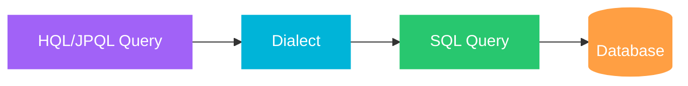

# HQL/JPQL in Spring Data JPA

**HQL/JPQL in Spring Data JPA** | Repository interfaces have provided pre-defined methods to do database operations like `findAll()`, `save()`, `deleteById()`, etc. We can also define our query using the concept of "Custom Query".

- [Custom Query Approaches](#1-custom-query-approaches)
- [HQL/JPQL Overview](#2-hqljpql-overview)
- [SQL vs HQL/JPQL Conversion Rules](#3-sql-vs-hqljpql-conversion-rules)
- [Project Setup](#4-project-setup)
- [Custom Query Using @Query](#5-custom-query-using-query)
- [Select Query Return Types](#6-select-query-return-types)
- [Passing Parameters to Query](#7-passing-parameters-to-query)
- [Positional vs Named Parameters](#8-positional-vs-named-parameters)
- [Named Parameters Example](#9-named-parameters-example)

---

## 1. Custom Query Approaches

Custom queries can be implemented using two approaches:

| Approach 🏷️ | Purpose 📋 | Supports Non-SELECT? ⚙️ |
|-------------|-----------|--------------------------|
| **`@Query`** | Used for both SELECT and non-SELECT (update/delete) operations | ✅ Yes |
| **`findBy`** | Used for only SELECT operations | ❌️ No |

Here we will see defining custom query using `@Query`. Also see: [Custom query method (findBy)](./08_Query_Method_in_Spring_Data_JPA.md).

---

## 2. HQL/JPQL Overview

The HQL/JPQL (Hibernate Query Language / JPA Query Language) concept is used to define custom queries that are database independent. We write HQL/JPQL, dialect converts it into SQL queries. SQL queries are database-dependent. So, recommended to use HQL/JPQL. Even `@Query` supports Pure SQL queries / Native SQL.



| Feature | SQL 🅰️ | HQL/JPQL 🅱️ |
|---------|--------|-------------|
| **References** | Table name and column names | Class name and variable name |
| **Database dependency** | ✅ Database-dependent | ❌️ Database-independent |
| **Recommended** | ❌️ Not preferred | ✅ Recommended |

---

## 3. SQL vs HQL/JPQL Conversion Rules

To convert SQL query to HQL/JPQL query, replace `tableName` with `className`, and `columnName` with `variableName`.

**Conversion example:**

```sql
SQL:      select eid, ename from emptab where esal > ?
HQL/JPQL: select empId, empName from Employee where empSal > ?0
```

🔑 **Key Rules:**

- 🔤 **Case sensitivity:** SQL is case-insensitive but HQL/JPQL is partially case-sensitive. In HQL/JPQL, Java words are case-sensitive (class, variable, package) whereas SQL words are case-insensitive (`select`, `where`, `from`, etc).
- 🚫 **No `*` symbol in HQL/JPQL** because HQL/JPQL is Java and `*` indicates multiply, not all columns. Instead, use alias naming.

**Select all example:**

```sql
SQL:      select * from emptab;
HQL/JPQL: select e from Employee e;
```

- 📦 **Package name is optional** when using Model class name in HQL/JPQL.

**Package name example:**

```sql
SQL:
select eid, ename from emptab where esal>?

HQL/JPQL:
select empId, empName from com.knowprogram.demo.entity.Employee where empSal > ?0
select empId, empName from Employee where empSal > ?0
```

- 🔢 **Positional parameters:** Parameters are allowed in HQL/JPQL, but we can also use `?0`, `?1`, `?2` in place of simple `?` symbols.
- 🏷️ **Named parameters:** Syntax — `:name`
- ✏️ **Non-select operations:** HQL/JPQL also supports UPDATE and DELETE.

---

## 4. Project Setup

🔧 **Configuration** (`application.properties`):

```properties
spring.datasource.url=jdbc:mysql://localhost:3306/test
spring.datasource.username=root
spring.datasource.password=root
spring.jpa.show-sql=true
spring.jpa.hibernate.ddl-auto=update
spring.jpa.properties.hibernate.format_sql=true
```

**Entity class:**

```java
@Entity
@Data
@AllArgsConstructor
@NoArgsConstructor
public class Employee {
   @Id
   private Integer empId;
   private String empName;
   private Double empSal;
}
```

**Repository interface:**

```java
public interface EmployeeRepository extends JpaRepository<Employee, Integer> { }
```

**Runner class (insert data):**

```java
@Component
public class EmployeeInsertRunner implements CommandLineRunner {

   @Autowired
   private EmployeeRepository employeeRepository;

   @Override
   public void run(String... args) throws Exception {
      employeeRepository.saveAll(
               List.of(new Employee(10, "A", 2.2),
                  new Employee(11, "B", 3.2),
                  new Employee(12, "C", 4.2)
               )
            );
   }
}
```

📝 **Note:** Run the application, it will create the table and insert some data.

---

## 5. Custom Query Using @Query

For Custom Query follow the below steps:

1️⃣ **Add one abstract method** in the Repository Interface.
2️⃣ **Provide `@Query("HQL/JPQL")`** over the abstract method.
3️⃣ **Call this method** in the Runner class for testing.

**Repository with custom queries:**

```java
public interface EmployeeRepository extends JpaRepository<Employee, Integer> {

   @Query("SELECT e FROM Employee e")
   List<Employee> getAllEmps();

   @Query("SELECT e.empName FROM Employee e")
   List<String> getAllEmpNames();

   @Query("SELECT e.empId, e.empName FROM Employee e")
   List<Object[]> getAllEmpIdAndNames();

}
```

**Runner class (testing custom queries):**

```java
@Component
public class EmployeeInsertRunner implements CommandLineRunner {

   @Autowired
   private EmployeeRepository employeeRepository;

   @Override
   public void run(String... args) throws Exception {
      List<Employee> employees = employeeRepository.getAllEmps();
      employees.forEach(System.out::println);

      List<String> empNames = employeeRepository.getAllEmpNames();
      empNames.forEach(System.out::println);

      List<Object[]> list = employeeRepository.getAllEmpIdAndNames();
      list.stream().map(obj -> obj[0] + " - " + obj[1]).forEach(System.out::println);

      Iterator<Object[]> itr = list.iterator();
      while (itr.hasNext()) {
         Object[] object = itr.next();
         System.out.println(object[0] + " - " + object[1]);
      }

      for (Object[] object : list) {
         System.out.println(object[0] + " - " + object[1]);
      }
   }

}
```

---

## 6. Select Query Return Types

| Columns Selected 📋 | Return Type 🏷️ | Example 🛠️ |
|---------------------|---------------|------------|
| **All columns** | `List<T>` | `List<Employee>` |
| **One column** | `List<DataType>` | `List<String>` |
| **Multiple columns** | `List<Object[]>` | `List<Object[]>` |

---

## 7. Passing Parameters to Query

We can pass parameters either through positional parameters or named parameters.

- 🔢 **Positional parameters** denoted as `?position`. **Position number starts from one (1)**. In old versions (Spring Data JPA 2.x) it used to start from zero.

```sql
... where column operator ?1 .. column operator ?2 .. column operator ?3
```

- 🏷️ **Named parameters** denoted as `:name`.

> 💡 **Tip:** If our query returns single row data then `List` is not required — we can use return type as `T`, data type, `Object[]`, but we should use `Object` (later cast to `Object[]`).

> 📝 **Note:** In the case of positional parameters, the param name can be any name but data type and position order must match.

**Repository with parameters:**

```java
public interface EmployeeRepository extends JpaRepository<Employee, Integer> {

   // using parameters
   @Query("SELECT e FROM Employee e WhERE e.empSal < ?1")
   List<Employee> getAllEmpsBySal(Double empSal);

   // List not required if query returns one row data
   @Query("SELECT e FROM Employee e WHERE e.empId = ?1")
   Employee getOneEmpsById(Integer empId);

   // we can use Object in place of Object[] for return type, later down cast
   @Query("SELECT e.empName, e.empSal FROM Employee e WHERE e.empId = ?1 OR e.empName = ?2")
   Object getOneEmpNameSalByIdOrName(Integer eid, String ename);
   // parameter name can be any name

   @Query("SELECT e FROM Employee e ORDER BY e.empName DESC")
   List<Employee> getAllEmpsSorted();

}
```

**Runner class (testing parameters):**

```java
@Component
public class EmployeeInsertRunner implements CommandLineRunner {

   @Autowired
   private EmployeeRepository employeeRepository;

   @Override
   public void run(String... args) throws Exception {
      List<Employee> list = employeeRepository.getAllEmpsBySal(120.0);
      list.forEach(System.out::println);

      Employee emp = employeeRepository.getOneEmpsById(10);
      System.out.println(emp);

      Object employee = employeeRepository.getOneEmpNameSalByIdOrName(10, "A");
      System.out.println(employee);
      Object[] obj = (Object[]) employee;
      System.out.println(obj[0] + " - " + obj[1]);

      employeeRepository.getAllEmpsSorted().forEach(System.out::println);
   }
}
```

---

## 8. Positional vs Named Parameters

If the query gets modified with a parameter, then it may affect position numbers in the query and the params order in the method.

⚠️ **Caution:** Positional parameters are fragile when queries change.

**Problem with positional parameters:**

```java
// old query
select * from emptab where esal>?1 and eid<?2
List<T> m1(Double a, Integer b);

// modified query
select * from emptab where esal>?1 or ename=?2 and eid<?3
List<T> m1(Double a, String m, Integer b)
```

These modifications will create problems, therefore instead of using numbers we can use names i.e. named parameters. Syntax — `:name`

**Positional vs named parameter comparison:**

```java
// positional parameter
@Query("SELECT e FROM Employee WHERE e.empId = ?1")
List<Employee> m1(Integer id);

// named parameter
@Query("SELECT e FROM Employee WHERE e.empId= :eid")
List<Employee> m1(Integer eid);
// parameter name and named parameter must match
```

**Multiple parameters comparison:**

```java
// positional parameter
@Query("SELECT e FROM Employee WHERE e.empId = ?1 and e.empName = ?2")
List m1(String name, Integer id);

// named parameter
@Query("SELECT e FROM Employee WHERE e.empId = :eid and e.empName = :ename")
List m1(Integer eid, String ename);
```

💡 **Tip:** While defining the method, we don't need to follow the order for passing param names but names must match with named params. The below query is also valid:

```java
@Query("SELECT e FROM Employee WHERE e.empId = :eid and e.empName = :ename")
List m1(String ename, Integer eid);
```

---

## 9. Named Parameters Example

**Repository with named parameters:**

```java
public interface EmployeeRepository extends JpaRepository<Employee, Integer> {

   @Query("SELECT e FROM Employee e WHERE e.empName=:ename or e.empSal >=:esal")
   List<Employee> getEmpsByNamedParam(Double esal, String ename);

   // in operator takes multiple values
   @Query("SELECT e FROM Employee e WHERE e.empId in (:eids)")
   List<Employee> getEmpsBySelectedIds(List<Integer> eids);
}
```

**Runner class (testing named parameters):**

```java
@Component
public class EmployeeInsertRunner implements CommandLineRunner {

   @Autowired
   private EmployeeRepository employeeRepository;

   @Override
   public void run(String... args) throws Exception {
      employeeRepository.getEmpsByNamedParam(3.2, "A")
         .forEach(System.out::println);

      employeeRepository.getEmpsBySelectedIds(
         List.of(10, 55, 36, 12)
      ).forEach(System.out::println);
   }
}
```
