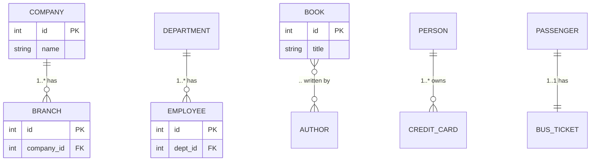
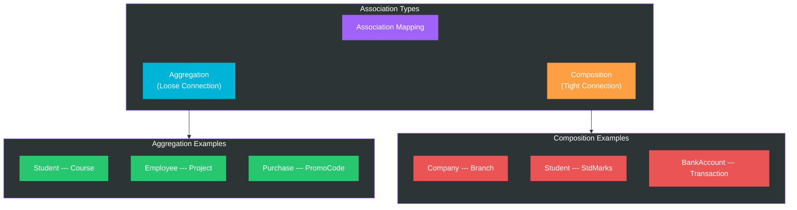
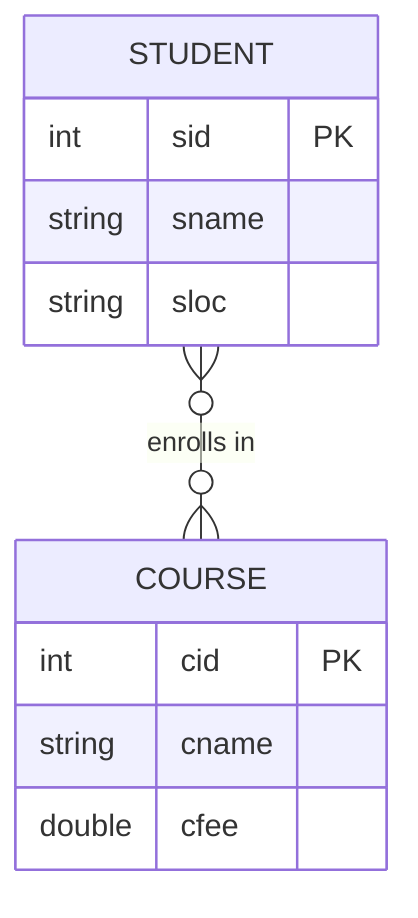
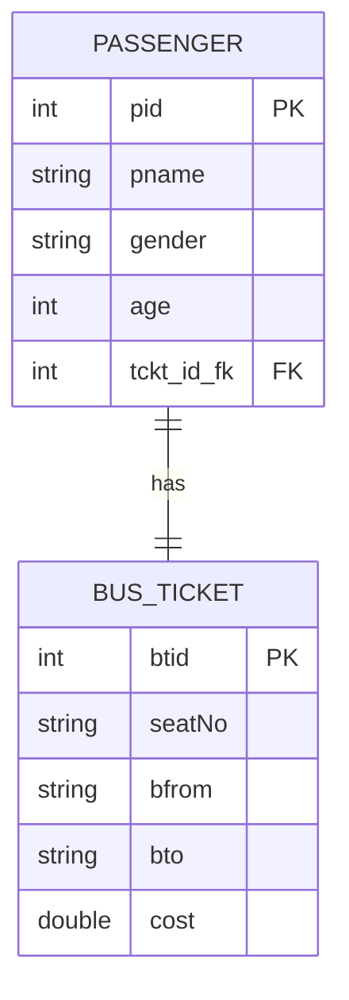

# Association Mapping in Spring Data JPA

**Association Mapping in Spring Data JPA** | We will discuss one-to-one, one-to-many, many-to-one, and many-to-many association mappings through examples.

- [Multiplicity](#1-multiplicity)
- [Primary Key and Foreign Key](#2-primary-key-and-foreign-key)
- [HAS-A Relation Examples](#3-has-a-relation-examples)
- [Multiplicity Types in Java](#4-multiplicity-types-in-java)
- [Association Mapping Implementation Steps](#5-association-mapping-implementation-steps)
- [Many-To-One Example](#6-many-to-one-example)
- [One-To-Many Example](#7-one-to-many-example)
- [Aggregation And Composition](#8-aggregation-and-composition)
- [Cascading](#9-cascading)
- [FetchType](#10-fetchtype)
- [Many-To-Many Example](#11-many-to-many-example)
- [One-To-One Example](#12-one-to-one-example)

<details>
<summary>🤔 <strong>Doubt: Association Mapping is avoided in high-traffic microservices — is it still interview-relevant?</strong></summary>

**Yes — highly relevant for interviews, even if avoided in production microservices.**

**Why it's avoided in high-traffic microservices:**

- Each service owns its own DB — joining across services via JPA associations is not possible
- `@OneToMany` / `@ManyToMany` with eager fetch = N+1 queries at scale
- Teams prefer explicit queries, DTOs, or API calls between services over ORM-managed joins
- Simpler schema = easier migrations, less Hibernate magic to debug

**Why interviews still ask it heavily:**

| Reason | Detail |
|---|---|
| Tests ORM depth | N+1 problem, lazy vs eager, cascade types — standard SDE II questions |
| Tests JPA internals | Bidirectional vs unidirectional, `mappedBy`, `@JoinColumn` ownership |
| Monolith context still exists | Many companies still run monoliths or modular monoliths — associations are daily use there |
| LLD / schema design | Interviewers ask "how would you model this?" — knowing associations shows DB design thinking |
| Hibernate interview Q&A | `FetchType.LAZY` vs `EAGER`, `CascadeType.ALL` pitfalls — very commonly asked |

**What interviewers actually ask:**

- What is the N+1 problem and how do you fix it? (`JOIN FETCH` / `@EntityGraph`)
- Difference between `@JoinColumn` and `mappedBy`
- When would you use `CascadeType.ALL` vs `CascadeType.MERGE`?
- Lazy loading outside a transaction — `LazyInitializationException`?
- `@OneToMany` vs `@ManyToMany` — when to use which?

**Bottom line:** Know associations deeply for interviews. In system design or microservices rounds, proactively mentioning *"in a microservices setup we'd avoid JPA joins across service boundaries and prefer explicit queries or service calls"* impresses interviewers — it shows production awareness beyond just knowing the API.

---

</details>
<br/>

---

## 1. Multiplicity

**Multiplicity** is the concept of connecting multiple tables using primary-key and foreign-key relationships. One table's primary key is taken as another table's foreign key.

There are 4 types of Multiplicity:

- 🔗 **1...1** (One-to-One)
- 🔗 **1...\*** (One-to-Many)
- 🔗 **\*...1** (Many-to-One)
- 🔗 **\*...\*** (Many-to-Many)

All of these are used based on requirements, but **One-to-Many** and **Many-to-Many** are the most commonly used.

🔑 **Key Points:**

- The `*` (many) side always gets the **foreign key column**.
- For `*...*` (Many-to-Many), one extra table is created called a **Join Table** with 2 foreign key columns:
  - 🗝️ `JoinColumn` — 1st table's primary key becomes child table's 1st foreign key.
  - 🗝️ `inverseJoinColumn` — 2nd table's primary key becomes child table's 2nd foreign key.



---

## 2. Primary Key and Foreign Key

📝 **Important points on primary key and foreign key:**

- 🔑 **Primary Key**
  - No duplicates are allowed in the table.
  - Value cannot be null.
  - It is also called the ID Column / Unique column.
- 🗝️ **Foreign Key**
  - This column is always used to link another table (link with primary key). One table's primary key will be another table's foreign key.
  - The foreign key can accept null values, even duplicates.
  - Value cannot be inserted if it does not exist in its primary key column.

💡 **Tip:** Foreign key placement rules:

- For `1...*` and `*...1` — create a foreign key column at the many side.
- For `*...*` — create one extra table with two foreign key columns.
- For `1...1` — model it as `*...1` with a UNIQUE constraint on the FK column. This enforces one-to-one at the DB level. The recommended JPA approach is `@ManyToOne` + `@JoinColumn(unique = true)`:

  ```java
  @ManyToOne
  @JoinColumn(name = "passport_id", unique = true)
  private Passport passport;
  ```

  > ⚠️ Using `@OneToOne` directly **does** create a FK column on the owning side — the claim that "no foreign key will get created" is incorrect. The `@OneToOne` owning side always creates a FK. The non-owning side (with `mappedBy`) creates no extra column, but the FK exists on the other table.

<details>
<summary>🤔 Doubt: If @OneToOne exists, why is @ManyToOne + unique constraint recommended instead?</summary>

The reason comes down to **lazy loading and performance**.

**Problem with `@OneToOne` — non-owning side cannot be lazily loaded:**

This is a well-known Hibernate limitation. Even if you explicitly set `fetch = FetchType.LAZY` on the non-owning side (`mappedBy`), Hibernate **ignores it** and fires the SELECT eagerly:

```java
@OneToOne(mappedBy = "passport", fetch = FetchType.LAZY)  // LAZY is ignored
private Passport passport;  // SELECT fires even if you never access this field
```

With `@ManyToOne(fetch = FetchType.LAZY)`, lazy loading works correctly — the SELECT only fires when you actually access the field.

**Why Hibernate can't lazily load `@OneToOne` non-owning side:**

To return a proxy object for lazy loading, Hibernate needs to know whether the association is `null` or not — without hitting the DB. For `@ManyToOne`, the FK column is on the same table, so Hibernate can check immediately. For `@OneToOne` non-owning side, the FK is on the other table — Hibernate must query that table to even know if a record exists, which defeats lazy loading.

**Comparison:**

| | `@OneToOne` | `@ManyToOne` + `unique = true` |
|---|---|---|
| FK created | ✅ | ✅ |
| UNIQUE enforced at DB level | Only if added manually | ✅ explicit |
| Lazy loading (non-owning side) | ❌️ ignored by Hibernate | ✅ works correctly |
| Extra SELECT on load | ✅ always fires | ❌️ only when accessed |

**TL;DR:** `@OneToOne` non-owning side always fires an extra SELECT regardless of `FetchType.LAZY`. `@ManyToOne` + `unique = true` avoids this, gives proper lazy loading, and is the production-safe pattern for 1...1 relationships.

---

</details>
<br/>

---

## 3. HAS-A Relation Examples

In English, if we use "having", "had", "has" then in Java it is a **HAS-A** relation. For example: One Person is having many (multiple) Credit Cards.

| Example 📋 | Relation 🔗 |
|------------|------------|
| **Employee --- Person** | IS-A |
| **Car --- Engine** | HAS-A |
| **Company --- Branch** | HAS-A |
| **Department --- Employee** | HAS-A |
| **Book --- Author** | HAS-A |
| **Student --- Course** | HAS-A |
| **Person --- Credit Card** | HAS-A |

🧠 **In Simple Words:**

- 🏢 One Company can have many branches and one branch can have only one Company (**One-to-Many**).
- 🏗️ One Department can have many Employees and one Employee can belong to only one department (**One-to-Many**).
- 📚 One Book can have many Authors and one Author can have written many Books (**Many-to-Many**).
- 🎓 One Student can join many courses and one course can have many students (**Many-to-Many**).
- 💳 One Person can have many credit cards but one credit card can belong to only one person (**One-to-Many**).

---

## 4. Multiplicity Types in Java

- 🔗 **1...\* (One-to-Many)** — One row in one (parent) table is connected with multiple rows in another (child) table.
- 🔗 **\*...1 (Many-to-One)** — Many rows in the parent table are connected to one row in the child table.

Multiplicity is divided into 2 types in Java:

| Non-Collection 🅰️ | Collection 🅱️ |
|-------------------|--------------|
| **1...1** | **1...\*** |
| **\*...1** | **\*...\*** |

- 📦 **Non-Collection based** — Do not use Collection (`Child is 1`)
- 📦 **Collection-based** — Use Collection: `List`/`Set` (`Child is many (*)`)

---

## 5. Association Mapping Implementation Steps

1️⃣ **Write two Model classes** and apply the HAS-A Relation between Model classes.

2️⃣ **Check for Collection/Non-Collection Type.** If Collection type then modify HAS-A variable as a collection variable.

3️⃣ **Apply Multiplicity Annotation:**

| Multiplicity 🔗 | Annotation 🏷️ | Note 📝 |
|-----------------|---------------|---------|
| **1...1** | `@ManyToOne` + Unique | Use `*...1` with unique constraint |
| **1...\*** | `@OneToMany` | Collection type |
| **\*...1** | `@ManyToOne` | Non-collection type |
| **\*...\*** | `@ManyToMany` | Collection type |

4️⃣ **Provide JoinColumn** (foreign key column) or **JoinTable** (`JoinColumn` + `JoinColumn`).

🔧 **Configuration** (`application.properties`):

```properties
spring.datasource.url=jdbc:mysql://localhost:3306/test
spring.datasource.username=root
spring.datasource.password=root
spring.jpa.show-sql=true
spring.jpa.hibernate.ddl-auto=update
spring.jpa.properties.hibernate.format_sql=true
```

---

## 6. Many-To-One Example

Consider **Product** and **Vendor**. One vendor can have many products, but one product can belong to one vendor.

- ⚙️ Define `Vendor` Model class with fields `vid`, `vcode`, and `vloc`.
- ⚙️ Define `Product` Model class with fields `pid`, `pcode`, `pcost`, `pmodel`, and `vob` (Vendor).
- 🔗 Create (HAS-A) variable of `Vendor` inside `Product`.
- 📦 It is a non-collection type, keeping the HAS-A variable as it is.
- 🏷️ Apply `@ManyToOne` annotation on the HAS-A variable.
- 🗝️ Apply `@JoinColumn(name="__")` on the HAS-A variable.
- 💾 Define Repository Interfaces for both model classes.
- 🚀 Define Runner class for Data Insert.
- 🔍 Check database tables finally for results.

**Vendor Model:**

```java
@Entity
@Data
@NoArgsConstructor
@AllArgsConstructor
@Table(name = "ven_tab")
public class Vendor {

   @Id
   @Column(name = "vid_col")
   private Integer vid;

   @Column(name = "vcode_col")
   private String vcode;

   @Column(name = "vloc_col")
   private String vloc;
}
```

**Product Model (with HAS-A relation):**

```java
@Entity
@Data
@NoArgsConstructor
@AllArgsConstructor
@Table(name = "prod_tab")
public class Product {

   @Id
   @Column(name = "pid_col")
   private Integer pid;

   @Column(name = "pcode_col")
   private String pcode;

   @Column(name = "pcost_col")
   private Double pcost;

   @Column(name = "pmodel_col")
   private String pmodel;

   @ManyToOne
   @JoinColumn(name = "vid_fk")
   private Vendor vob;
}
```

**Repository Interfaces:**

```java
public interface ProductRepository extends JpaRepository<Product, Integer> { }

public interface VendorRepository extends JpaRepository<Vendor, Integer> { }
```

**Runner class:**

```java
@Component
public class DataInsertRunner implements CommandLineRunner {

   @Autowired
   private ProductRepository productRepository;

   @Autowired
   private VendorRepository vendorRepository;

   @Override
   public void run(String... args) throws Exception {
      // first insert vendor
      Vendor vendor1 = new Vendor(101, "ABC", "LOC-1");
      Vendor vendor2 = new Vendor(102, "DEF", "LOC-2");
      vendorRepository.saveAll(List.of(vendor1, vendor2));

      // then insert product
      Product product1 = new Product(10, "PEN", 20.0, "A", vendor1);
      Product product2 = new Product(11, "BOOK", 40.0, "B", vendor1);
      Product product3 = new Product(12, "BTL", 80.0, "A", vendor2);
      Product product4 = new Product(13, "INK", 50.0, "B", vendor2);
      productRepository.saveAll(List.of(product1, product2, product3, product4));
   }

}
```

Run the application, it will create the table and insert the data.

📤 **Output:**

```sql
mysql> use test;
mysql> show tables;
+----------------+
| Tables_in_test |
+----------------+
| prod_tab       |
| ven_tab        |
+----------------+

mysql> select * from ven_tab;
+---------+-----------+----------+
| vid_col | vcode_col | vloc_col |
+---------+-----------+----------+
|     101 | ABC       | LOC-1    |
|     102 | DEF       | LOC-2    |
+---------+-----------+----------+

mysql> select * from prod_tab;
+---------+-----------+-----------+------------+--------+
| pid_col | pcode_col | pcost_col | pmodel_col | vid_fk |
+---------+-----------+-----------+------------+--------+
|      10 | PEN       |        20 | A          |    101 |
|      11 | BOOK      |        40 | B          |    101 |
|      12 | BTL       |        80 | A          |    102 |
|      13 | INK       |        50 | B          |    102 |
+---------+-----------+-----------+------------+--------+
```

📝 **Note:** We can use any column name for `@JoinColumn` (it need not be the same name as the child table primary key column). Writing `@JoinColumn` is optional. If we do not provide this then the Join Column name is `hasAVariableName_PrimaryKeyColumnNameInChildTable`.

**Default JoinColumn example:**

```java
@ManyToOne
@JoinColumn
private Vendor vob; // default column name = vob_vid_col
```

In the product table, if we don't declare the name of the HAS-A variable column then the default name will be `hasAVariableName_primaryKeyColumnNameOfChildTable` i.e. `vob_vid_col`.

> ⚠️ **Warning:** If we do not provide `@ManyToOne` then an exception is raised:  
> `MappingException: Could not determine type for: com.knowprogram.demo.entity.Vendor.`

---

## 7. One-To-Many Example

Consider the **Department** and **Employee** table. One Department can have many employees but one Employee belongs to only one Department.

- ⚙️ Define `Employee` Model class with fields `eid`, `ename`, and `esal`.
- ⚙️ Define `Dept` Model class with fields `did`, `deptCode`, `adminName`, and `emps` (Employee).
- 🔗 Create (HAS-A) variable of `Employee` inside `Dept`.
- 📦 It is a collection type, modified HAS-A variable as `List`.
- 🏷️ Apply `@OneToMany` annotation on HAS-A variable.
- 🗝️ Apply `@JoinColumn(name="__")` on HAS-A variable.
- 💾 Define Repository Interfaces for both model classes.
- 🚀 Define Runner class for Data Insert.
- 🔍 Check Database Tables finally for results.

**Employee Model:**

```java
@Data
@NoArgsConstructor
@AllArgsConstructor
@Entity
@Table(name = "emptab")
public class Employee {
   @Id
   @Column(name = "eid_col")
   private Integer eid;

   @Column(name = "ename_col")
   private String ename;

   @Column(name = "esal_col")
   private Double esal;
}
```

**Department Model (with HAS-A relation):**

```java
@Data
@NoArgsConstructor
@AllArgsConstructor
@Entity
@Table(name = "depttab")
public class Department {
   @Id
   @Column(name = "did_col")
   private Integer did;

   @Column(name = "dcode_col")
   private String deptCode;

   @Column(name = "aname_col")
   private String adminName;

   @OneToMany
   @JoinColumn(name = "did_fk")
   private List<Employee> emps;
}
```

**Repository Interfaces:**

```java
public interface DepartmentRepository extends JpaRepository<Department, Integer> { }

public interface EmployeeRepository extends JpaRepository<Employee, Integer> { }
```

**Runner class:**

```java
@Component
public class DataInsertRunner implements CommandLineRunner {

   @Autowired
   private EmployeeRepository employeeRepository;

   @Autowired
   private DepartmentRepository departmentRepository;

   @Override
   public void run(String... args) throws Exception {
      Employee e1 = new Employee(10, "A", 3.3);
      Employee e2 = new Employee(11, "B", 4.3);
      Employee e3 = new Employee(12, "C", 5.3);
      Employee e4 = new Employee(13, "D", 6.3);
      employeeRepository.saveAll(List.of(e1, e2, e3, e4));

      Department d1 = new Department(521, "DEV", "SAM", Arrays.asList(e1, e2));
      Department d2 = new Department(522, "QA", "SYED", Arrays.asList(e3, e4));
      departmentRepository.saveAll(List.of(d1, d2));
   }

}
```

💾 **Table created as follows:**

```sql
Hibernate:
    create table depttab (
        did_col integer not null,
        aname_col varchar(255),
        dcode_col varchar(255),
        primary key (did_col)
    ) engine=InnoDB
Hibernate:
    create table emptab (
        eid_col integer not null,
        ename_col varchar(255),
        esal_col float(53),
        did_fk integer,
        primary key (eid_col)
    ) engine=InnoDB
Hibernate:
    alter table emptab
       add constraint FKbyy30h26o280gpceycn79rcq3
       foreign key (did_fk)
       references depttab (did_col)
```

### How the Data Will Be Inserted

1️⃣ **First, 4 rows will be inserted in the emp table with the foreign key as null.**

```sql
insert
into
    emptab
    (ename_col, esal_col, eid_col)
values
    (?, ?, ?)
```

```
+---------+-----------+----------+--------+
| eid_col | ename_col | esal_col | did_fk |
+---------+-----------+----------+--------+
|      10 | A         |      3.3 |   null |
|      11 | B         |      4.3 |   null |
|      12 | C         |      5.3 |   null |
|      13 | D         |      6.3 |   null |
+---------+-----------+----------+--------+
```

2️⃣ **Then 2 rows will be inserted in the dept table.**

```sql
insert
into
    depttab
    (aname_col, dcode_col, did_col)
values
    (?, ?, ?)
```

```
+---------+-----------+-----------+
| did_col | aname_col | dcode_col |
+---------+-----------+-----------+
|     521 | SAM       | DEV       |
|     522 | SYED      | QA        |
+---------+-----------+-----------+
```

3️⃣ **Later emp table foreign key will be updated with the dept table primary key.**

```sql
update
    emptab
set
    did_fk=?
where
    eid_col=?
```

```
+---------+-----------+----------+--------+
| eid_col | ename_col | esal_col | did_fk |
+---------+-----------+----------+--------+
|      10 | A         |      3.3 |    521 |
|      11 | B         |      4.3 |    521 |
|      12 | C         |      5.3 |    522 |
|      13 | D         |      6.3 |    522 |
+---------+-----------+----------+--------+
```

---

## 8. Aggregation And Composition

The association can be categorized into two types:

- 🔓 **Aggregation** — Loose connection
- 🔒 **Composition** — Tight connection



### Aggregation

🔓 **Aggregation: A child can exist without parent data.**

```
Student ------<> Course
Employee ---------<> Project
```

The Course table can have data without Students, Students may join later. Or if we delete one student we should not delete the course. Similarly, the project can exist even if we delete one Employee/all Employees.

**Students Table:**

| sid | sname | sloc |
|-----|-------|------|
| **10** | A | ABC |
| **20** | B | XYZ |

**Course Table:**

| cid | cname | cfee |
|-----|-------|------|
| **1** | Java | 50 |
| **2** | Python | 50 |

If we delete the Student row then we need not delete Course because that is accessed by other students. Even a course can exist without Students.

### Composition

🔒 **Composition: Child and Parent are connected in a strong manner. The child has no meaning without the parent.**

```
Company -----<> Branch
Student --------<> StdMarks
```

Only Branch table data has no meaning without its Company data. Similarly, StdMarks table has no meaning without Student data.

**StdMarks Table:**

| Subject | Marks | SID |
|---------|-------|-----|
| **MATH** | 75 | 1 |
| **ENG** | 76 | 1 |

Suppose we delete the record from the Student table where `sid = 10` then StdMarks table data where `sid=10` will have no meaning. Marks can't exist without Students. Therefore if we delete the Student table record then we must also delete related entries in the StdMarks table.

> 🔑 **Key Point:** By default (if we don't specify), every association is considered an **aggregation** (loose connection). We can achieve composition through **Cascading**.

### More Examples

- 🔒 **BankAccount --- Transaction** => Composition: If we delete the BankAccount data then there is no meaning of the Transaction table data for that bank account.
- 🔒 **College --- Branch** => Composition: If we delete the College data then there is no meaning of the Branch table data for that College.
- 🔓 **Purchase --- PromoCode** => Aggregation.

```
Purchase                PromoCode
10 TXA 58               58 CB50
11 TXB 58               59 AB25
12 TXC 58
```

---

## 9. Cascading

If we define Association Mapping in Data JPA, by default every type is **Aggregation**. To make it **Composition**, use the Cascading concept.

🧠 **In Simple Words:**
If we perform any operation on the parent class object and then also apply the same operation on its connected child class objects (without writing operation code over child objects), it is called **Cascading** (Composition).

Cascading is implemented using the `CascadeType` enum:

```java
public enum CascadeType {
    ALL,
    PERSIST,
    MERGE,
    REMOVE,
    REFRESH,
    DETACH
}
```

| CascadeType 🏷️ | Purpose 📋 |
|-----------------|-----------|
| **`ALL`** | All operations |
| **`PERSIST`** | Save |
| **`MERGE`** | Update |
| **`REMOVE`** | Delete |
| **`REFRESH`** | Refresh |
| **`DETACH`** | Detach |

💡 **Tip:** Among these, `ALL` and `PERSIST` are the most commonly used.

### Cascading in ManyToOne Example

In the **ManyToOne Example** code (first drop the related table in the database), if we remove/comment the `saveAll()` method call for vendors and run the application:

```java
// comment this code
// vendorRepository.saveAll(List.of(vendor1, vendor2));
```

Then it throws an exception:

> ⚠️ `jakarta.persistence.EntityNotFoundException: Unable to find com.knowprogram.demo.entity.Vendor with id 101`

Now let us cascade the Vendor, meaning when we save the Product then also save the Vendor (if it does not already exist).

**Product Model (with Cascade):**

```java
@Entity
@Data
@NoArgsConstructor
@AllArgsConstructor
@Table(name = "prod_tab")
public class Product {

    @Id
    @Column(name = "pid_col")
    private Integer pid;

    @Column(name = "pcode_col")
    private String pcode;

    @Column(name = "pcost_col")
    private Double pcost;

    @Column(name = "pmodel_col")
    private String pmodel;

    @ManyToOne(cascade = CascadeType.ALL)
    @JoinColumn(name = "vid_fk")
    private Vendor vob;
}
```

📤 **Output:** Now when we run the application, while saving the Product data, first Spring Data JPA will insert the Vendor table data.

```sql
Hibernate: insert into ven_tab (vcode_col,vloc_col,vid_col) values (?,?,?)
Hibernate: insert into prod_tab (pcode_col,pcost_col,pmodel_col,vid_fk,pid_col) values (?,?,?,?,?)
Hibernate: insert into prod_tab (pcode_col,pcost_col,pmodel_col,vid_fk,pid_col) values (?,?,?,?,?)
Hibernate: insert into ven_tab (vcode_col,vloc_col,vid_col) values (?,?,?)
Hibernate: insert into prod_tab (pcode_col,pcost_col,pmodel_col,vid_fk,pid_col) values (?,?,?,?,?)
Hibernate: insert into prod_tab (pcode_col,pcost_col,pmodel_col,vid_fk,pid_col) values (?,?,?,?,?)
```

### Cascading in OneToMany Example

Similarly in the **One-To-Many** Example code, if we save the department then it should also save the employees. Remove the `saveAll()` method call for employees from the runner class, add the Cascade into the `Department` class, and run the application.

**Department Model (with Cascade):**

```java
@Data
@NoArgsConstructor
@AllArgsConstructor
@Entity
@Table(name = "depttab")
public class Department {
    @Id
    @Column(name = "did_col")
    private Integer did;

    @Column(name = "dcode_col")
    private String deptCode;

    @Column(name = "aname_col")
    private String adminName;

    @OneToMany(cascade = CascadeType.ALL)
    @JoinColumn(name = "did_fk")
    private List<Employee> emps;
}
```

**Comment this line in Runner class:**

```java
// employeeRepository.saveAll(List.of(e1, e2, e3, e4));
```

📤 **Output:** First, it will insert the department and then insert its related employee data.

```sql
Hibernate: insert into dept_tab (aname_col,dcode_col,did_col) values (?,?,?)
Hibernate: insert into emp_tab (ename_col,esal_col,eid_col) values (?,?,?)
Hibernate: insert into emp_tab (ename_col,esal_col,eid_col) values (?,?,?)
Hibernate: insert into dept_tab (aname_col,dcode_col,did_col) values (?,?,?)
Hibernate: insert into emp_tab (ename_col,esal_col,eid_col) values (?,?,?)
Hibernate: insert into emp_tab (ename_col,esal_col,eid_col) values (?,?,?)
Hibernate: update emp_tab set did_fk=? where eid_col=?
Hibernate: update emp_tab set did_fk=? where eid_col=?
Hibernate: update emp_tab set did_fk=? where eid_col=?
Hibernate: update emp_tab set did_fk=? where eid_col=?
```

---

## 10. FetchType

This concept is used for SELECT operations from DB using Id. When we fetch parent data, we can either get its child data (**EAGER**) or only the parent data (**LAZY**).

```java
public enum FetchType {

    /** Defines that data can be lazily fetched. */
    LAZY,

    /** Defines that data must be eagerly fetched. */
    EAGER
}
```

In the OneToMany Example, in the runner class add this code at the end to fetch the department. You can comment on the existing code for saving the data (optional):

```java
// fetch data
List<Department> departments = departmentRepository.findAll();
System.out.println(departments);
```

### LAZY Fetch

🐢 **LAZY: On fetching Parent Data, do not fetch child data.**

```sql
Hibernate:
    select
        d1_0.did_col,
        d1_0.aname_col,
        d1_0.dcode_col
    from
        depttab d1_0
    where
        d1_0.did_col=?
```

### EAGER Fetch

⚡ **EAGER: On fetching Parent Data, also fetch child data.**

```java
@OneToMany(cascade = CascadeType.ALL, fetch = FetchType.EAGER)
@JoinColumn(name = "did_fk")
private List<Employee> emps;
```

```sql
Hibernate:
    select
        d1_0.did_col,
        d1_0.aname_col,
        d1_0.dcode_col,
        e1_0.did_fk,
        e1_0.eid_col,
        e1_0.ename_col,
        e1_0.esal_col
    from
        depttab d1_0
    left join
        emptab e1_0
            on d1_0.did_col=e1_0.did_fk
    where
        d1_0.did_col=?
```

🔑 **Key Rules:**

- If the child is many type (`1...*` / `*...*`) then the default is **LAZY**.
- If the child is one type (`1...1` / `*...1`) then the default is **EAGER**.

| Multiplicity 🔗 | Default Fetch Type ⚡ |
|-----------------|---------------------|
| **One-To-One** | EAGER |
| **One-To-Many** | LAZY |
| **Many-To-One** | EAGER |
| **Many-To-Many** | LAZY |

---

## 11. Many-To-Many Example

One extra table is created called a **JoinTable** with 2 columns: `JoinColumn` and `InverseJoinColumn`.

🧠 **In Simple Words:** Student --- Course. One Student can join many Courses and one Course can have many Students.



**Implementation Steps:**

1. Write two Model classes and apply HAS-A Relation between Model classes.
2. Check for Collection/Non-Collection Type. If Collection type then modify HAS-A variable as Collection variable.
3. Apply Multiplicity Annotation `@ManyToMany`.
4. Provide `JoinColumn` (FK Column) or `JoinTable` (`JoinColumn` + `JoinColumn`).

**Course Model:**

```java
@Entity
@Data
@NoArgsConstructor
@AllArgsConstructor
public class Course {
    @Id
    private Integer cid;
    private String cname;
    private Double cfee;
}
```

**Student Model (with HAS-A relation):**

```java
@Data
@NoArgsConstructor
@AllArgsConstructor
@Entity
public class Student {
    @Id
    private Integer sid;
    private String sname;
    private String sloc;

    @ManyToMany(cascade = CascadeType.ALL)
    @JoinTable(name = "stdcrstb",
        joinColumns = @JoinColumn(name = "sidFk"),
        inverseJoinColumns = @JoinColumn(name = "cidFk")
    )
    private List<Course> cobs;
}
```

**Repository Interfaces:**

```java
public interface CourseRepository extends JpaRepository<Course, Integer> { }

public interface StudentRepository extends JpaRepository<Student, Integer> { }
```

**Runner class:**

```java
@Component
public class DataInsertRunner implements CommandLineRunner {

    @Autowired
    private StudentRepository studentRepository;

    @Override
    public void run(String... args) throws Exception {
        Course c1 = new Course(58, "Java", 500.0);
        Course c2 = new Course(59, "UI", 400.0);
        Course c3 = new Course(60, "AWS", 300.0);

        Student s1 = new Student(1, "A", "ABC", List.of(c1, c2));
        Student s2 = new Student(2, "B", "XYZ", List.of(c2, c3));

        studentRepository.saveAll(List.of(s1, s2));
    }
}
```

💾 **Tables created as follows:**

```sql
Hibernate:
    create table course (
        cid integer not null,
        cfee float(53),
        cname varchar(255),
        primary key (cid)
    ) engine=InnoDB
Hibernate:
    create table stdcrstb (
        sid_fk integer not null,
        cid_fk integer not null
    ) engine=InnoDB
Hibernate:
    create table student (
        sid integer not null,
        sloc varchar(255),
        sname varchar(255),
        primary key (sid)
    ) engine=InnoDB
Hibernate:
    alter table stdcrstb
       add constraint FK6s2ki7ej66jt5s6igq6i430ia
       foreign key (cid_fk)
       references course (cid)
Hibernate:
    alter table stdcrstb
       add constraint FKcewl79jgi749y64i75kkpgy7a
       foreign key (sid_fk)
       references student (sid)
```

First, it will insert data into the Student and Course table then it will insert into the `stdcrstb` table.

📤 **Output:**

```sql
mysql> show tables;
+----------------+
| Tables_in_test |
+----------------+
| course         |
| stdcrstb       |
| student        |
+----------------+

mysql> select * from course;
+-----+------+-------+
| cid | cfee | cname |
+-----+------+-------+
|  58 |  500 | Java  |
|  59 |  400 | UI    |
|  60 |  300 | AWS   |
+-----+------+-------+

mysql> select * from student;
+-----+------+-------+
| sid | sloc | sname |
+-----+------+-------+
|   1 | ABC  | A     |
|   2 | XYZ  | B     |
+-----+------+-------+

mysql> select * from stdcrstb;
+--------+--------+
| sid_fk | cid_fk |
+--------+--------+
|      1 |     58 |
|      1 |     59 |
|      2 |     59 |
|      2 |     60 |
+--------+--------+
```

---

## 12. One-To-One Example

**Parent table one row is connected to Child table one row (at max).** Example: Passenger --- BusTicket.

**Use Many-To-One and apply unique condition (`unique=true`).**
`1...1` = (unique) `*...1`



> 💡 **Why can't we take `1...*` and apply unique for `1...1`?**  
> Yes, we can do that. But One-To-One and Many-To-One are non-collection based whereas One-To-Many is collection-based. Therefore we have to use a `List` that will hold only one value. It becomes a memory waste.

**BusTicket Model:**

```java
@Data
@NoArgsConstructor
@AllArgsConstructor
@Entity
public class BusTicket {
    @Id
    private Integer btid;
    private String seatNo;
    private String bfrom;
    private String bto;
    private Double cost;
}
```

**Passenger Model (with HAS-A relation):**

```java
@Entity
@Data
@NoArgsConstructor
@AllArgsConstructor
public class Passenger {
    @Id
    private Integer pid;
    private String pname;
    private String gender;
    private Integer age;

    @ManyToOne(cascade = CascadeType.ALL)
    @JoinColumn(name = "tckt_id_fk", unique = true)
    private BusTicket ticket;
}
```

**Repository Interfaces:**

```java
public interface BusTicketRepository extends JpaRepository<BusTicket, Integer> { }

public interface PassengerRepository extends JpaRepository<Passenger, Integer> { }
```

**Runner class:**

```java
@Component
public class DataInsertRunner implements CommandLineRunner {

    @Autowired
    private PassengerRepository passengerRepository;

    @Override
    public void run(String... args) throws Exception {
        BusTicket busTicket1 = new BusTicket(110, "A01", "ABC", "XYZ", 50.0);
        BusTicket busTicket2 = new BusTicket(111, "A02", "ABC", "XYZ", 60.0);
        BusTicket busTicket3 = new BusTicket(112, "A03", "ABC", "XYZ", 70.0);

        Passenger passenger1 = new Passenger(85, "A", "M", 21, busTicket1);
        Passenger passenger2 = new Passenger(86, "B", "M", 22, busTicket2);
        Passenger passenger3 = new Passenger(87, "C", "W", 23, busTicket3);

        passengerRepository.saveAll(List.of(passenger1, passenger2, passenger3));
    }
}
```

💾 **Table created as follows:**

```sql
Hibernate:
    create table bus_ticket (
        btid integer not null,
        bfrom varchar(255),
        bto varchar(255),
        cost float(53),
        seat_no varchar(255),
        primary key (btid)
    ) engine=InnoDB
Hibernate:
    create table passenger (
        pid integer not null,
        age integer,
        gender varchar(255),
        pname varchar(255),
        tckt_id_fk integer,
        primary key (pid)
    ) engine=InnoDB
Hibernate:
    alter table passenger
       drop index UKetijr8ax2svla8rlih5r7s7hy
Hibernate:
    alter table passenger
       add constraint UKetijr8ax2svla8rlih5r7s7hy unique (tckt_id_fk)
Hibernate:
    alter table passenger
       add constraint FKtenmo5unfkkef877g6bj0bt9f
       foreign key (tckt_id_fk)
       references bus_ticket (btid)
```

📤 **Data inserted:**

```sql
Hibernate: insert into bus_ticket (bfrom,bto,cost,seat_no,btid) values (?,?,?,?,?)
Hibernate: insert into passenger (age,gender,pname,tckt_id_fk,pid) values (?,?,?,?,?)
Hibernate: insert into bus_ticket (bfrom,bto,cost,seat_no,btid) values (?,?,?,?,?)
Hibernate: insert into passenger (age,gender,pname,tckt_id_fk,pid) values (?,?,?,?,?)
Hibernate: insert into bus_ticket (bfrom,bto,cost,seat_no,btid) values (?,?,?,?,?)
Hibernate: insert into passenger (age,gender,pname,tckt_id_fk,pid) values (?,?,?,?,?)
```

```sql
mysql> show tables;
+----------------+
| Tables_in_test |
+----------------+
| bus_ticket     |
| passenger      |
+----------------+

mysql> select * from passenger;
+-----+------+--------+-------+------------+
| pid | age  | gender | pname | tckt_id_fk |
+-----+------+--------+-------+------------+
|  85 |   21 | M      | A     |        110 |
|  86 |   22 | M      | B     |        111 |
|  87 |   23 | W      | C     |        112 |
+-----+------+--------+-------+------------+

mysql> select * from bus_ticket;
+------+-------+------+------+---------+
| btid | bfrom | bto  | cost | seat_no |
+------+-------+------+------+---------+
|  110 | ABC   | XYZ  |   50 | A01     |
|  111 | ABC   | XYZ  |   60 | A02     |
|  112 | ABC   | XYZ  |   70 | A03     |
+------+-------+------+------+---------+
```
