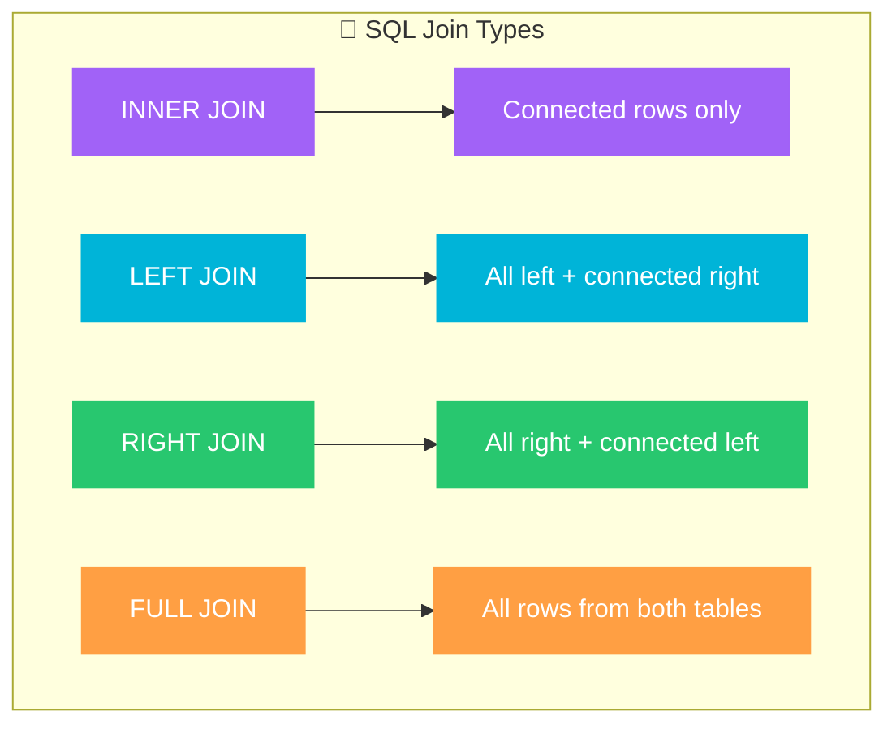
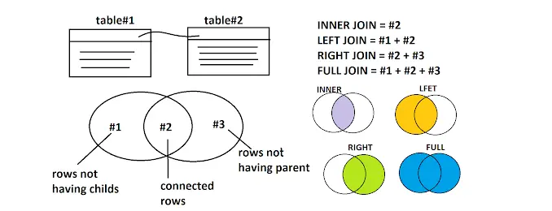
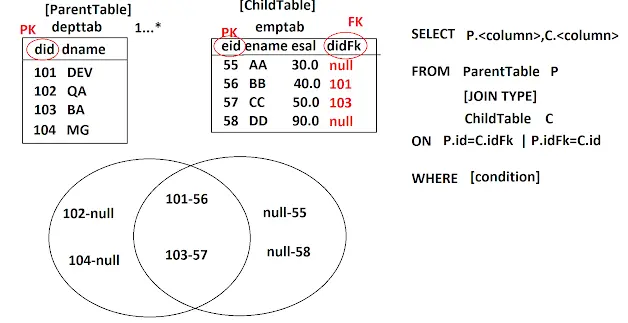
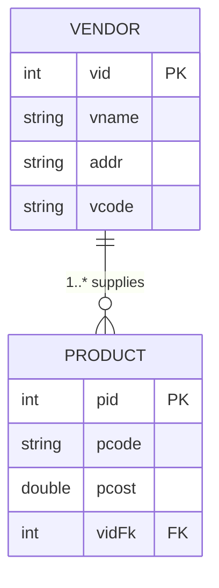
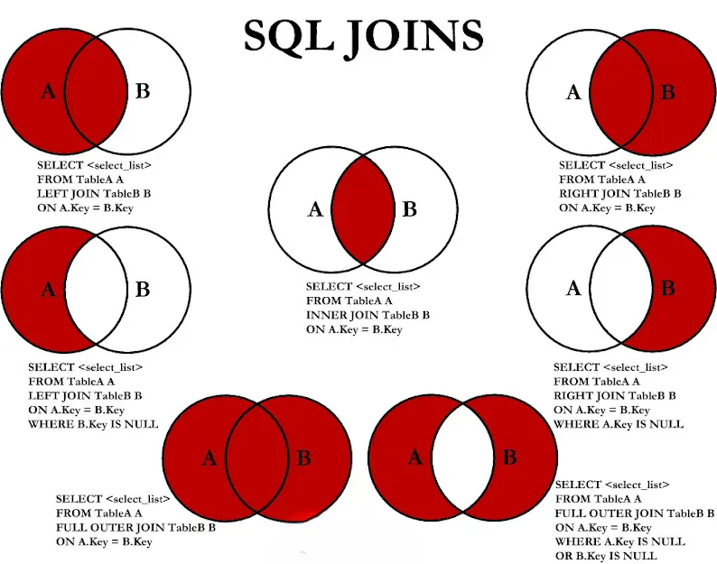
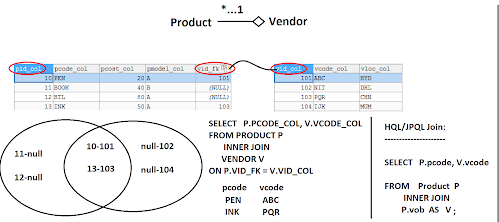
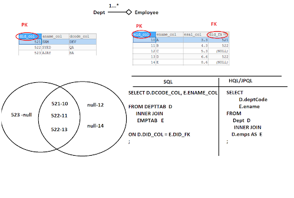

# Working With JOINS in Spring Data JPA

**Working With JOINS in Spring Data JPA** | Before seeing JOINS in Spring Data JPA, let us see in short how JOIN works in SQL.

- [SQL Joins](#1-sql-joins)
- [SQL Join Examples with Tables](#2-sql-join-examples-with-tables)
- [Product-Vendor Join Scenarios](#3-product-vendor-join-scenarios)
- [Spring Data JPA Join Example – 1](#4-spring-data-jpa-join-example-1)
- [Spring Data JPA Join Example – 2](#5-spring-data-jpa-join-example-2)

---

## 1. SQL Joins

🔗 **SQL Joins** are used to fetch data (`SELECT`) from multiple tables (2 or more tables) using a single query (one SQL query).

| Join Type 🔗 | Description 📋 |
|--------------|----------------|
| **Equal Join** | Matches rows based on equality condition |
| **Cross Join** | Cartesian product of both tables |
| **Self Join** | Table joined with itself |
| **JOIN / INNER JOIN** | Rows which are connected in both tables |
| **LEFT OUTER JOIN / LEFT JOIN** | All left side table rows and connected right side table rows |
| **RIGHT OUTER JOIN / RIGHT JOIN** | All right side table rows and connected left side table rows |
| **FULL OUTER JOIN / FULL JOIN** | All rows from both tables |



🔑 **Key Points:**

- ⚙️ Among these, Spring Data JPA only supports **INNER** and **OUTER** Joins. It does not support Equal, Cross, and Self joins.
- 📝 The word `OUTER` is optional. i.e. `LEFT OUTER JOIN` and `LEFT JOIN` are the same.
- 🔗 **Condition for using Joins:** One table's primary key must be used as another table's foreign key i.e. two tables must have a relation (`1…1` / `1…*` / `*…1` / `*…*`).





---

## 2. SQL Join Examples with Tables

Consider the given `depttab` and `emptab` tables and write SQL queries for given JOINS.

**Create and populate tables:**

```sql
-- Create the Parent Table (depttab)
CREATE TABLE depttab (
    did INT PRIMARY KEY,
    dname VARCHAR(50)
);

-- Create the Child Table (emptab)
CREATE TABLE emptab (
    eid INT PRIMARY KEY,
    ename VARCHAR(50),
    esal DECIMAL(10, 2),
    didFk INT,
    FOREIGN KEY (didFk) REFERENCES depttab(did)
);

-- Insert Records into depttab
INSERT INTO depttab (did, dname) VALUES
(101, 'DEV'),
(102, 'QA'),
(103, 'BA'),
(104, 'MG');

-- Insert Records into emptab
INSERT INTO emptab (eid, ename, esal, didFk) VALUES
(55, 'AA', 30.00, NULL),
(56, 'BB', 40.00, 101),
(57, 'CC', 50.00, 103),
(58, 'DD', 90.00, NULL);
```

📤 **depttab output:**

```sql
mysql> select * from depttab;
+-----+-------+
| did | dname |
+-----+-------+
| 101 | DEV   |
| 102 | QA    |
| 103 | BA    |
| 104 | MG    |
+-----+-------+
```

📤 **emptab output:**

```sql
mysql> select * from emptab;
+-----+-------+-------+-------+
| eid | ename | esal  | didFk |
+-----+-------+-------+-------+
|  55 | AA    | 30.00 |  NULL |
|  56 | BB    | 40.00 |   101 |
|  57 | CC    | 50.00 |   103 |
|  58 | DD    | 90.00 |  NULL |
+-----+-------+-------+-------+
```

### Inner JOIN Example

**Query:**

```sql
mysql > SELECT *
    FROM depttab d
    INNER JOIN emptab e
    ON d.did = e.didFk;
```

📤 **Output:**

```sql
+-----+-------+-----+-------+-------+-------+
| did | dname | eid | ename | esal  | didFk |
+-----+-------+-----+-------+-------+-------+
| 101 | DEV   |  56 | BB    | 40.00 |   101 |
| 103 | BA    |  57 | CC    | 50.00 |   103 |
+-----+-------+-----+-------+-------+-------+
```

### RIGHT JOIN Example

Fetch the dept name and emp name using RIGHT JOIN.

**Query:**

```sql
mysql > SELECT d.dname, e.ename
    FROM depttab d
    RIGHT JOIN emptab e
    ON d.did = e.didFk;
```

📤 **Output:**

```sql
+-------+-------+
| dname | ename |
+-------+-------+
| NULL  | AA    |
| DEV   | BB    |
| BA    | CC    |
| NULL  | DD    |
+-------+-------+
```

### LEFT JOIN Example

Print `ename`, `esal`, and `dname` using LEFT JOIN.

**Query:**

```sql
mysql > SELECT e.ename , e.esal, d.dname
    FROM depttab d
    LEFT JOIN emptab e
    ON d.did = e.didFk;
```

📤 **Output:**

```sql
+-------+-------+-------+
| ename | esal  | dname |
+-------+-------+-------+
| BB    | 40.00 | DEV   |
| NULL  |  NULL | QA    |
| CC    | 50.00 | BA    |
| NULL  |  NULL | MG    |
+-------+-------+-------+
```

### LEFT JOIN with NULL Filter

Print all departments that do not have employees.

**Query:**

```sql
mysql > SELECT e.ename , e.esal, d.dname
    FROM depttab d
    LEFT JOIN emptab e
    ON d.did = e.didFk
    WHERE e.didFk is null;
```

📤 **Output:**

```sql
+-------+------+-------+
| ename | esal | dname |
+-------+------+-------+
| NULL  | NULL | QA    |
| NULL  | NULL | MG    |
+-------+------+-------+
```

---

## 3. Product-Vendor Join Scenarios

Product and Vendor are connected via **Many-To-One** i.e. 1 vendor can have many products.



🧠 **In Simple Words:** `Product ————<> Vendor` — one vendor supplies many products, but each product belongs to one vendor.

- **Product:** `pid`, `pcode`, `pcost`, `vidFk`
- **Vendor:** `vid`, `vname`, `addr`, `vcode`

💡 **Which join to use?**

| Scenario 📋 | Join Type 🔗 |
|-------------|-------------|
| **Display all products having vendor links** | ✅ INNER JOIN |
| **Display all products and their vendor names** | ✅ LEFT JOIN |
| **Display all vendors and their product names** | ✅ RIGHT JOIN |



---

## 4. Spring Data JPA Join Example – 1

### SQL vs HQL/JPQL Join Syntax

**SQL JOINS syntax:**

```sql
SELECT <P>.<COLUMN> , <C>.<COLUMN>
FROM <PARENT-TABLE> <P>
    [JOIN - TYPE ]
    <CHILD-TABLE> <C>
ON <P>.<PK> = <C>.<FK> | <P>.<FK> = <C>.<PK>
WHERE <CONDITION>;
```

**HQL/JPQL JOINS syntax:**

```sql
SELECT <P>.<VARIABLES> , <C>.<VARIABLES>
FROM <PARENT-CLASS> <P>
    [JOIN - TYPE ]
    <P>.<HAS-A VARIABLE> AS <C>
WHERE <CONDITION>;
```

Here `<P>` and `<C>` are alias names given for model classes.

**Model classes:**

```java
// child class
class Project {
    Integer pid;
    String pcode;
}

// parent class
class Employee {
    Integer eid;
    String ename;

    @ManyToOne
    @JoinColumn(name = "_")
    Project pob;
}
```

**HQL/JPQL syntax for Inner JOIN:**

```sql
SELECT e.ename, p.pcode
FROM Employee e
    INNER JOIN
    e.Product AS p
```

**To fetch employees who are not connected to the project:**

```sql
SELECT e.ename, p.pcode
FROM Employee e
    LEFT OUTER JOIN
    e.Product AS p
WHERE p IS NULL;
```

🔑 **Key Points:**

- 🔄 HQL/JPQL syntax is the same for collection/non-collection type. But the output is different.
- ⚙️ HQL/JPQL will be finally converted to SQL by dialect.
- 💾 SQL is database-dependent whereas HQL/JPQL is database-independent.
- 🏷️ The word `AS` indicates an alias name (Also Known As) which is optional.
- 📝 Words related to SQL are case-insensitive (`SELECT`, `FROM`, `WHERE`).
- ☕ Words related to Java are case-sensitive (`Employee`, `empId`...).
- 🔗 `INNER JOIN` and `JOIN` get the same result. Word `INNER` is optional.
- ⚠️ A few databases and Data JPA do not support `FULL JOIN`. This means there is less join that gets all rows from DB tables. In that case, better use `findAll()`.

### Project Setup

Create a Spring Starter project using dependencies: Spring Web, Spring Data JPA, and MySQL Driver.

🔧 **Configuration** (`application.properties`):

```properties
spring.datasource.url=jdbc:mysql://localhost:3306/test
spring.datasource.username=root
spring.datasource.password=root
spring.jpa.show-sql=true
spring.jpa.hibernate.ddl-auto=update
spring.jpa.properties.hibernate.format_sql=true
spring.jpa.database-platform: org.hibernate.dialect.MySQLDialect
```

> ⚠️ **Hibernate 6:** version-specific dialects (`MySQL8Dialect`) are deprecated — one class per product now, version auto-detected. Best practice is to **omit `database-platform` altogether**.

### Model Classes and Repositories

**Vendor entity:**

```java
@Entity
@Data
@NoArgsConstructor
@AllArgsConstructor
@Table(name = "ven_tab")
public class Vendor {

    @Id
    @Column(name = "vid_col")
    private Integer vid;

    @Column(name = "vcode_col")
    private String vcode;

    @Column(name = "vloc_col")
    private String vloc;
}
```

**Product entity:**

```java
@Entity
@Data
@NoArgsConstructor
@AllArgsConstructor
@Table(name = "prod_tab")
public class Product {

    @Id
    @Column(name = "pid_col")
    private Integer pid;

    @Column(name = "pcode_col")
    private String pcode;

    @Column(name = "pcost_col")
    private Double pcost;

    @Column(name = "pmodel_col")
    private String pmodel;

    @ManyToOne(cascade = CascadeType.ALL)
    @JoinColumn(name = "vid_fk")
    private Vendor vob;
}
```

**Repositories:**

```java
public interface ProductRepository extends JpaRepository<Product, Integer> { }

public interface VendorRepository extends JpaRepository<Vendor, Integer> { }
```

**Data insert runner:**

```java
@Component
public class DataInsertRunner implements CommandLineRunner {

    @Autowired
    private ProductRepository productRepository;

    @Autowired
    private VendorRepository vendorRepository;

    @Override
    public void run(String... args) throws Exception {
        // first insert vendor
        Vendor vendor1 = new Vendor(101, "ABC", "HYD");
        Vendor vendor2 = new Vendor(102, "DEF", "DHL");
        Vendor vendor3 = new Vendor(103, "PQR", "CHN");
        Vendor vendor4 = new Vendor(104, "IJK", "MUM");
        vendorRepository.saveAll(List.of(vendor1, vendor2, vendor3, vendor4));

        // then insert product
        Product product1 = new Product(10, "PEN", 20.0, "A", vendor1);
        Product product2 = new Product(11, "BOOK", 40.0, "B", null);
        Product product3 = new Product(12, "BTL", 80.0, "A", null);
        Product product4 = new Product(13, "INK", 50.0, "A", vendor2);
        productRepository.saveAll(List.of(product1, product2, product3, product4));
    }
}
```



### INNER JOIN Query

Let us see some code examples on Joins.

**Repository with INNER JOIN:**

```java
public interface ProductRepository extends JpaRepository<Product, Integer> {

    @Query("SELECT p.pcode, v.vcode FROM Product p INNER JOIN p.vob v")
    public List<Object[]> getProductAndVendorCodes();
}
```

**Test runner:**

```java
@Component
public class TestRunnner implements CommandLineRunner {

    @Autowired
    private ProductRepository productRepository;

    @Override
    public void run(String... args) throws Exception {
        List<Object[]> list = productRepository.getProductAndVendorCodes();
        for (Object[] obj : list) {
            System.out.println(obj[0] + " " + obj[1]);
        }
    }
}
```

🖥️ **Generated Query:**

```sql
Hibernate:
    select
        p1_0.pcode_col,
        v1_0.vcode_col
    from
        prod_tab p1_0
    join
        ven_tab v1_0
            on v1_0.vid_col=p1_0.vid_fk
```

📤 **Output:**

```
PEN ABC
INK DEF
```

### LEFT OUTER JOIN Query

**Repository with LEFT OUTER JOIN:**

```java
@Query("SELECT p.pcode, v.vcode FROM Product p LEFT OUTER JOIN p.vob v")
public List<Object[]> getProductAndVendorCodes();
```

🖥️ **Generated Query:**

```sql
Hibernate:
    select
        p1_0.pcode_col,
        v1_0.vcode_col
    from
        prod_tab p1_0
    left join
        ven_tab v1_0
            on v1_0.vid_col=p1_0.vid_fk
```

📤 **Output:**

```
PEN ABC
BOOK null
BTL null
INK DEF
```

> ⚠️ **Warning:** If you are using the Oracle database then you may get an exception: `QuerySyntaxException: expecting "join", found 'OUTER'`. In that case, you can use Dialect: `Oracle9iDialect`, `Oracle10gDialect`.

### RIGHT OUTER JOIN Query

**Repository with RIGHT OUTER JOIN:**

```java
@Query("SELECT p.pcode, v.vcode FROM Product p RIGHT OUTER JOIN p.vob v")
public List<Object[]> getProductAndVendorCodes();
```

🖥️ **Generated Query:**

```sql
Hibernate:
    select
        p1_0.pcode_col,
        v1_0.vcode_col
    from
        prod_tab p1_0
    right join
        ven_tab v1_0
            on v1_0.vid_col=p1_0.vid_fk
```

📤 **Output:**

```
PEN ABC
INK DEF
null PQR
null IJK
```

### FULL OUTER JOIN Query

**Repository with FULL OUTER JOIN:**

```java
@Query("SELECT p.pcode, v.vcode FROM Product p FULL OUTER JOIN p.vob v")
public List<Object[]> getProductAndVendorCodes();
```

🚨 **Error:** `Caused by: java.sql.SQLSyntaxErrorException: You have an error in your SQL syntax; check the manual that corresponds to your MySQL server version for the right syntax to use near 'full join ven_tab v1_0 on v1_0.vid_col=p1_0.vid_fk' at line 1`

> 📝 **Note:** `FULL JOIN` is not supported by a few databases and Data JPA. It is a meaningless join that gets all rows from database tables. In that case, better use `findAll()`.

---

## 5. Spring Data JPA Join Example – 2

### Model Classes

**Employee entity:**

```java
@Data
@NoArgsConstructor
@AllArgsConstructor
@Entity
@Table(name = "emptab")
public class Employee {
    @Id
    @Column(name = "eid_col")
    private Integer eid;

    @Column(name = "ename_col")
    private String ename;

    @Column(name = "esal_col")
    private Double esal;
}
```

**Department entity (One-To-Many):**

```java
@Data
@NoArgsConstructor
@AllArgsConstructor
@Entity
@Table(name = "depttab")
public class Department {
    @Id
    @Column(name = "did_col")
    private Integer did;

    @Column(name = "dcode_col")
    private String deptCode;

    @Column(name = "aname_col")
    private String adminName;

    @OneToMany(cascade = CascadeType.ALL, fetch = FetchType.LAZY)
    @JoinColumn(name = "did_fk")
    private List<Employee> emps;
}
```

### Repositories

**DepartmentRepository with join queries:**

```java
public interface DepartmentRepository extends JpaRepository<Department, Integer> {

    // @Query("SELECT d.deptCode, e.ename FROM Department d INNER JOIN d.emps e")
    // @Query("SELECT d.deptCode, e.ename FROM Department d LEFT JOIN d.emps e")
    @Query("SELECT d.deptCode, e.ename FROM Department d RIGHT JOIN d.emps e")
    public List<Object[]> getDeptEmpData();
}
```

**EmployeeRepository:**

```java
public interface EmployeeRepository extends JpaRepository<Employee, Integer> { }
```

### Data Insert and Fetch Runners

**Data insert runner:**

```java
@Component
@Order(1)
public class DataInsertRunner implements CommandLineRunner {

    @Autowired
    private DepartmentRepository departmentRepository;

    @Autowired
    private EmployeeRepository employeeRepository;

    @Override
    public void run(String... args) throws Exception {
        Employee e1 = new Employee(10, "A", 3.3);
        Employee e2 = new Employee(11, "B", 4.3);
        Employee e3 = new Employee(12, "C", 5.3);
        Employee e4 = new Employee(13, "D", 6.6);
        Employee e5 = new Employee(14, "E", 8.6);
        employeeRepository.saveAll(List.of(e1, e2, e3, e4, e5));

        Department d1 = new Department(521, "DEV", "SAM", Arrays.asList(e1, e2));
        Department d2 = new Department(522, "QA", "SYED", Arrays.asList(e3, e4));
        Department d3 = new Department(523, "BA", "AJAY", null);
        departmentRepository.saveAll(List.of(d1, d2, d3));
    }
}
```



**Data fetch runner:**

```java
@Component
@Order(2)
public class DataFetchRunner implements CommandLineRunner {

    @Autowired
    private DepartmentRepository departmentRepository;

    @Override
    public void run(String... args) throws Exception {
        List<Object[]> list = departmentRepository.getDeptEmpData();
        for (Object[] obj : list) {
            System.out.println(obj[0] + " " + obj[1]);
        }
    }
}
```
