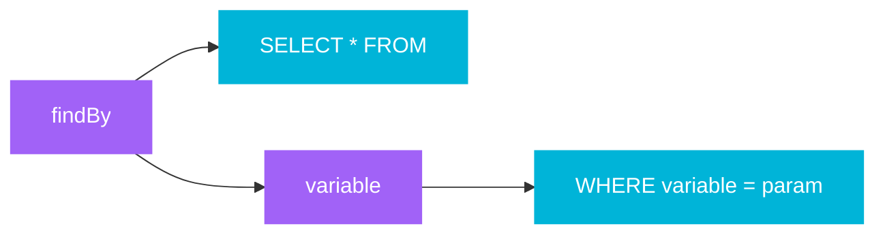
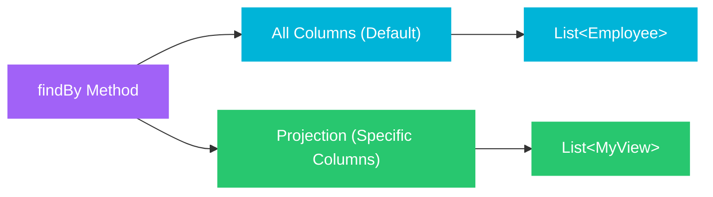

# Query Method in Spring Data JPA

**Query Method in Spring Data JPA** | `findBy` is an abstract method that derives a query at runtime based on details in the method name.

- [Introduction to findBy](#1-introduction-to-findby)
- [findBy vs @Query](#2-findby-vs-query)
- [findBy Syntax and Query Formation](#3-findby-syntax-and-query-formation)
- [findBy Example in Spring Boot Data JPA](#4-findby-example-in-spring-boot-data-jpa)
- [More findBy Examples](#5-more-findby-examples)
- [Projections using findBy in Spring Data JPA](#6-projections-using-findby-in-spring-data-jpa)

---

## 1. Introduction to findBy

`findBy` is an abstract method written inside a Repository interface. Spring Data JPA derives the SQL query at runtime based on the method name.

- 🌐 Supports both SQL (MySQL/Oracle) and NoSQL (MongoDB) databases
- 🔍 Best suitable for simple queries
- 📖 Supports only `SELECT` operations
- ⚙️ No manual query is required

---

## 2. findBy vs @Query

| Feature | `findBy` 🅰️ | `@Query` 🅱️ |
|---------|------------|------------|
| **Database Support** | ✅ SQL + NoSQL | ❌️ SQL only |
| **Operations** | ❌️ SELECT only | ✅ SELECT + non-SELECT |
| **Query Writing** | ✅ Auto-derived (no manual query) | ❌️ Custom/manual query required |
| **Complexity** | Simple queries | Complex queries |
| **Best For** | Quick, straightforward lookups | Advanced filtering and operations |

🧠 **In Simple Words:** Use `findBy()` for simple tasks, and `@Query` for complex tasks.

---

## 3. findBy Syntax and Query Formation

The `findBy` method must be written inside a Repository interface.

**General syntax:**

```java
ReturnType findBy<VariableNameConditions>(<DataTypes> <params>);
```

**Simple syntax (without condition):**

```java
ReturnType findBy<VariableName>(<params>);
```



🛠️ **Example with Employee class:**

```java
class Employee {
    Integer empId;
    String empName;
    Double empSal;
}
```

**Valid findBy methods:**

```java
List<Employee> findByempName(String en); // valid
List<Employee> findByEmpName(String empName); // valid + following naming convention
```

This is internally converted to SQL: `SELECT * FROM Employee WHERE empName = ?`

**More examples:**

```java
List<Employee> findByEmpSal(double empSal);
// Generated SQL: SELECT * FROM Employee WHERE empSal = ?

List<Employee> findByEmpIdAndEmpName(Integer empId, double empSal);
// Generated SQL: SELECT * FROM Employee WHERE empId = ? AND empSal = ?
```

> ⚠️ **Caution:** For complex queries like `SELECT * FROM Employee WHERE empId >= ? OR empName IS NOT NULL AND empSal IN (_, _, _)`, the `findBy` method becomes very lengthy:
>
> ```java  
> List<Employee> findByEmpIdAndEmpNameIsNotNullAndEmpSalIn(Integer empId, List<Double> sals)  
> ```
>
> This is not a standard practice. Use `@Query` instead for such cases.

---

## 4. findBy Example in Spring Boot Data JPA

🔧 **Configuration** (`application.yml`):

```yaml
spring:
  datasource:
    password: root
    url: jdbc:mysql://localhost:3306/test
    username: root
  jpa:
    database-platform: org.hibernate.dialect.MySQLDialect   # Hibernate 6: MySQL8Dialect is deprecated; omitting this entirely is preferred
    show-sql: true
    hibernate:
      ddl-auto: update
    properties:
      hibernate:
        format_sql: true
```

1️⃣ **Define the Entity class:**

```java
@Data
@NoArgsConstructor
@AllArgsConstructor
@Entity
public class Employee {
    @Id
    private Integer empId;
    private String empName;
    private Double empSal;
    private String empDept;
}
```

2️⃣ **Define the Repository interface:**

```java
public interface EmployeeRepository extends JpaRepository<Employee, Integer> {
    // place findBy methods here
    List<Employee> findByEmpDept(String empDept);
}
```

3️⃣ **Runner class to insert data:**

```java
@Component
@Order(1)
public class DataInsertRunner implements CommandLineRunner {

    @Autowired
    private EmployeeRepository employeeRepository;

    @Override
    public void run(String... args) throws Exception {
        employeeRepository.saveAll(
            List.of(
                new Employee(10, "SAM", 500.0, "DEV"),
                new Employee(11, "RAM", 600.0, "DEV"),
                new Employee(12, "SYED", 450.0, "QA"),
                new Employee(13, "VINAY", 280.0, "QA"),
                new Employee(14, "JAI", 120.0, "DEV"),
                new Employee(15, "SUN", 590.0, "BA")
            )
        );
    }
}
```

4️⃣ **Runner class to test findBy:**

```java
@Component
@Order(2)
public class TestRunner implements CommandLineRunner {

    @Autowired
    private EmployeeRepository employeeRepository;

    @Override
    public void run(String... args) throws Exception {
        employeeRepository.findByEmpDept("DEV").forEach(System.out::println);
    }
}
```

💾 **Generated SQL query:**

```sql
Hibernate:
    select
        e1_0.emp_id,
        e1_0.emp_dept,
        e1_0.emp_name,
        e1_0.emp_sal
    from
        employee e1_0
    where
        e1_0.emp_dept=?
```

📤 **Output:**

```
Employee(empId=10, empName=SAM, empSal=500.0, empDept=DEV)
Employee(empId=11, empName=RAM, empSal=600.0, empDept=DEV)
Employee(empId=14, empName=JAI, empSal=120.0, empDept=DEV)
```

---

## 5. More findBy Examples

### Comparison Operators

| SQL Operator 🗄️ | findBy Keyword 🏷️ | Description 📋 |
|-----------------|-------------------|---------------|
| **`<`** | `LessThan` | Less than |
| **`<=`** | `LessThanEqual` | Less than or equal |
| **`>`** | `GreaterThan` | Greater than |
| **`>=`** | `GreaterThanEqual` | Greater than or equal |
| **`BETWEEN`** | `Between` | Between two values |

```java
// SELECT * FROM EMPLOYEE WHERE EMPSAL <= empSal
List<Employee> findByEmpSalLessThanEqual(Double empSal);

// SELECT * FROM EMPLOYEE WHERE EMPSAL > empSal
List<Employee> findByEmpSalGreaterThan(Double empSal);

// SELECT * FROM EMPLOYEE WHERE EMPSAL BETWEEN empSal1 AND empSal2
List<Employee> findByEmpSalBetween(Double empSal1, Double empSal2);
```

### Equality and Set Operators

| SQL Operator 🗄️ | findBy Keyword 🏷️ | Description 📋 |
|-----------------|-------------------|---------------|
| **`!=`** | `Not` | Not equal |
| **`IN`** | `In` | In a list of values |
| **`NOT IN`** | `NotIn` | Not in a list of values |

```java
// SELECT * FROM EMPLOYEE WHERE EMPDEPT != ?
List<Employee> findByEmpDeptNot(String empDept);

// SELECT * FROM EMPLOYEE WHERE EMPID IN (_, _, _, ..)
List<Employee> findByEmpIdIn(List<Integer> ids);

// SELECT * FROM EMPLOYEE WHERE EMPID NOT IN (_, _, _, ..)
List<Employee> findByEmpIdNotIn(List<Integer> ids);
```

### AND and OR

```java
// SELECT * FROM EMPLOYEE WHERE EMPSAL >= ? AND EmpDept != ?
List<Employee> findByEmpSalGreaterThanEqualAndEmpDeptNot(Double empSal, String empDept);

// SELECT * FROM EMPLOYEE WHERE EMPSAL >= ? OR EmpDept != ?
List<Employee> findByEmpSalGreaterThanEqualOrEmpDeptNot(Double empSal, String empDept);
```

### IS NULL and IS NOT NULL

```java
// SELECT * FROM EMPLOYEE WHERE EMPNAME IS NULL
List<Employee> findByEmpNameIsNull();

// SELECT * FROM EMPLOYEE WHERE EMPNAME IS NOT NULL
List<Employee> findByEmpNameIsNotNull();
```

### Like, NotLike, StartingWith, EndingWith, Containing

| findBy Keyword 🏷️ | SQL Equivalent 🗄️ | Pattern 📋 |
|-------------------|-------------------|-----------|
| **`Like`** | `LIKE 'exp'` | Exact pattern match |
| **`NotLike`** | `NOT LIKE 'exp'` | Negated pattern match |
| **`StartingWith`** | `LIKE 'exp%'` | Starts with value |
| **`EndingWith`** | `LIKE '%exp'` | Ends with value |
| **`Containing`** | `LIKE '%exp%'` | Contains value |

```java
// SELECT * FROM EMPLOYEE WHERE EMPNAME LIKE 'exp'
List<Employee> findByEmpNameLike(String expression);

// SELECT * FROM EMPLOYEE WHERE EMPNAME NOT LIKE 'exp'
List<Employee> findByEmpNameNotLike(String expression);

// SELECT * FROM EMPLOYEE WHERE EMPNAME LIKE 'exp%'
List<Employee> findByEmpNameStartingWith(String expression);

// SELECT * FROM EMPLOYEE WHERE EMPNAME LIKE '%exp'
List<Employee> findByEmpNameEndingWith(String expression);

// SELECT * FROM EMPLOYEE WHERE EMPNAME LIKE '%exp%'
List<Employee> findByEmpNameContaining(String expression);
```

### IsTrue and IsFalse

Assume `Employee` also has a column `deleted` of type `Boolean`. Then to find deleted and non-deleted employees:

```java
// SELECT * FROM EMPLOYEE WHERE deleted = false
List<Employee> findByDeletedFalse();

// SELECT * FROM EMPLOYEE WHERE deleted = true
List<Employee> findByDeletedTrue();

// SELECT * FROM EMPLOYEE WHERE EMPID = id AND deleted = false
List<Employee> findByEmpIdAndDeletedFalse(Integer id);
```

### Complete Repository Code

**Repository interface:**

```java
public interface EmployeeRepository extends JpaRepository<Employee, Integer> {

    List<Employee> findByEmpDept(String empDept);

    // SELECT * FROM EMPLOYEE WHERE EMPSAL<=empSal
    List<Employee> findByEmpSalLessThanEqual(Double empSal);

    // SELECT * FROM EMPLOYEE WHERE EMPSAL>empSal
    List<Employee> findByEmpSalGreaterThan(Double empSal);

    // SELECT * FROM EMPLOYEE WHERE EMPSAL between empSal1 and empSal2
    List<Employee> findByEmpSalBetween(Double empSal1, Double empSal2);

    // SELECT * FROM EMPLOYEE WHERE EMPDEPT != ?
    List<Employee> findByEmpDeptNot(String empDept);

    // SELECT * FROM EMPLOYEE WHERE EMPDID IN (_,_,_,_,..)
    List<Employee> findByEmpIdIn(List<Integer> ids);

    // SELECT * FROM EMPLOYEE WHERE EMPDID NOT IN (_,_,_,_,..)
    List<Employee> findByEmpIdNotIn(List<Integer> ids);

    // SELECT * FROM EMPLOYEE WHERE EMPSAL>=? and EmpDept!=?
    List<Employee> findByEmpSalGreaterThanEqualAndEmpDeptNot(Double empSal, String empDept);

    // SELECT * FROM EMPLOYEE WHERE EMPSAL>=? or EmpDept!=?
    List<Employee> findByEmpSalGreaterThanEqualOrEmpDeptNot(Double empSal, String empDept);

    // SELECT * FROM EMPLOYEE WHERE EMPNAME IS NULL
    List<Employee> findByEmpNameIsNull();

    // SELECT * FROM EMPLOYEE WHERE EMPNAME IS NOT NULL
    List<Employee> findByEmpNameIsNotNull();

    // SELECT * FROM EMPLOYEE WHERE EMPNAME like 'exp'
    List<Employee> findByEmpNameLike(String expression);

    // SELECT * FROM EMPLOYEE WHERE EMPNAME like 'exp'
    List<Employee> findByEmpNameNotLike(String expression);

    // SELECT * FROM EMPLOYEE WHERE EMPNAME like 'exp%'
    List<Employee> findByEmpNameStartingWith(String expression);

    // SELECT * FROM EMPLOYEE WHERE EMPNAME like '%exp'
    List<Employee> findByEmpNameEndingWith(String expression);

    // SELECT * FROM EMPLOYEE WHERE EMPNAME like '%exp%'
    List<Employee> findByEmpNameContaining(String expression);

}
```

**Test runner:**

```java
@Component
@Order(2)
public class TestRunner implements CommandLineRunner {

    @Autowired
    private EmployeeRepository employeeRepository;

    @Override
    public void run(String... args) throws Exception {
        employeeRepository.findByEmpDept("DEV").forEach(System.out::println);
        employeeRepository.findByEmpSalLessThanEqual(300.0).forEach(System.out::println);
        employeeRepository.findByEmpSalGreaterThan(300.0).forEach(System.out::println);
        employeeRepository.findByEmpSalBetween(300.0, 500.0).forEach(System.out::println);
        employeeRepository.findByEmpDeptNot("DEV").forEach(System.out::println);
        employeeRepository.findByEmpIdIn(Arrays.asList(10, 12, 14, 16, 18, 20, 22)).forEach(System.out::println);
        employeeRepository.findByEmpIdNotIn(Arrays.asList(12, 14, 18, 20, 22)).forEach(System.out::println);
        employeeRepository.findByEmpSalGreaterThanEqualAndEmpDeptNot(120.0, "QA").forEach(System.out::println);
        employeeRepository.findByEmpSalGreaterThanEqualOrEmpDeptNot(120.0, "QA").forEach(System.out::println);
        employeeRepository.findByEmpNameIsNull().forEach(System.out::println);
        employeeRepository.findByEmpNameIsNotNull().forEach(System.out::println);
        employeeRepository.findByEmpNameNotLike("S%").forEach(System.out::println);
        employeeRepository.findByEmpNameLike("S%").forEach(System.out::println);
        employeeRepository.findByEmpNameStartingWith("S").forEach(System.out::println);
        employeeRepository.findByEmpNameLike("%M").forEach(System.out::println);
        employeeRepository.findByEmpNameEndingWith("M").forEach(System.out::println);
        employeeRepository.findByEmpNameLike("%A%").forEach(System.out::println);
        employeeRepository.findByEmpNameContaining("A").forEach(System.out::println);
    }
}
```

---

## 6. Projections using findBy in Spring Data JPA

Instead of fetching all columns, **fetching only some specific columns is known as projection**.

By default, `findBy` fetches all columns data (`List<Entity>`). With Projections, we can get only specific columns (`List<CustomType>`).



### Steps to Implement Projections

1️⃣ **Define an inner interface inside the Repository** that contains getter methods for the columns to be projected:

```java
interface <CustomType> {
    DataType get<VariableName>();
}
```

2️⃣ **Use this interface as the return type for the findBy method:**

```java
List<CustomType> findBy<VariablesConditions>(<Params>);
```

3️⃣ **Call the method inside Runner/Service for testing.**

### Projection Example

**Entity class:**

```java
@Data
@NoArgsConstructor
@AllArgsConstructor
@Entity
public class Student {
    @Id
    private Integer stdId;
    private String stdName;
    private Double stdFee;
    private String stdCourse;
}
```

**Repository with projection interfaces:**

```java
public interface StudentRepository extends JpaRepository<Student, Integer> {

    interface MyView {
        String getStdName();
        Double getStdFee();
    }

    // SQL: SELECT stdName, stdFee FROM Student WHERE stdId <= ?
    List<MyView> findByStdIdLessThanEqual(Integer sid);

    interface MyViewTwo {
        String getStdName();
        String getStdCourse();
    }

    // SQL: SELECT stdName, stdCourse FROM Student WHERE stdName IS NOT NULL
    List<MyViewTwo> findByStdNameIsNotNull();
}
```

**Data insert runner:**

```java
@Component
@Order(3)
public class DataInsertRunner2 implements CommandLineRunner {

    @Autowired
    private StudentRepository studentRepository;

    @Override
    public void run(String... args) throws Exception {
        studentRepository.saveAll(
            List.of(
                new Student(101, "A", 300.0, "JAVA"),
                new Student(102, "N", 400.0, "UI"),
                new Student(103, "B", 500.0, "JAVA"),
                new Student(104, "G", 800.0, "AWS")
            )
        );
    }
}
```

**Test runner:**

```java
@Component
@Order(4)
public class TestRunner2 implements CommandLineRunner {

    @Autowired
    private StudentRepository studentRepository;

    @Override
    public void run(String... args) throws Exception {
        List<MyView> list = studentRepository.findByStdIdLessThanEqual(200);
        for (MyView m : list) {
            System.out.println(m.getStdName() + " -" + m.getStdFee());
        }

        studentRepository.findByStdNameIsNotNull().stream()
                .map(ob -> ob.getStdName() + "-" + ob.getStdCourse())
                .forEach(System.out::println);
    }
}
```

💾 **Generated SQL and output:**

```sql
Hibernate:
    select
        s1_0.std_name,
        s1_0.std_fee
    from
        student s1_0
    where
        s1_0.std_id<=?
```

```
A -300.0
N -400.0
B -500.0
G -800.0
```

```sql
Hibernate:
    select
        s1_0.std_name,
        s1_0.std_course
    from
        student s1_0
    where
        s1_0.std_name is not null
```

```
A-JAVA
N-UI
B-JAVA
G-AWS
```

📝 **Note:** Projections are useful for performance optimization -- fetching only the required columns reduces data transfer and memory usage.
