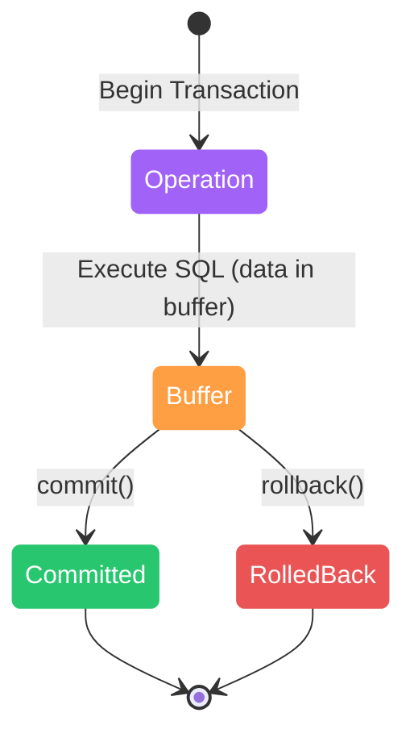
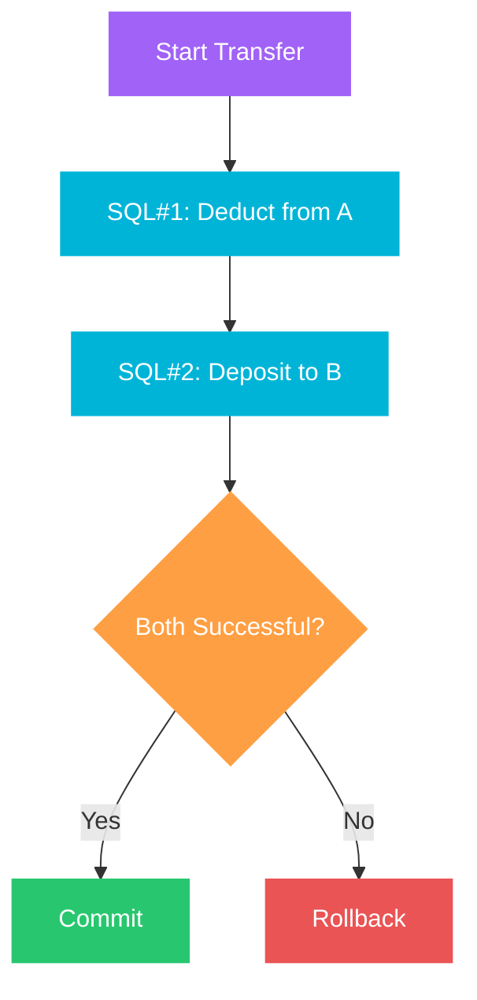
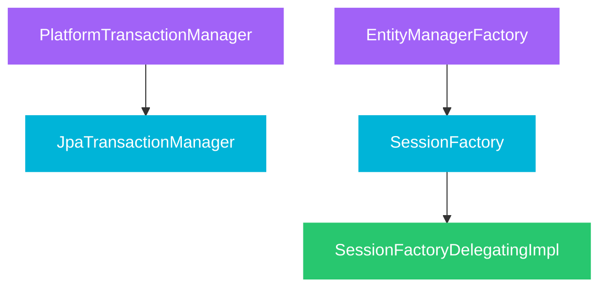
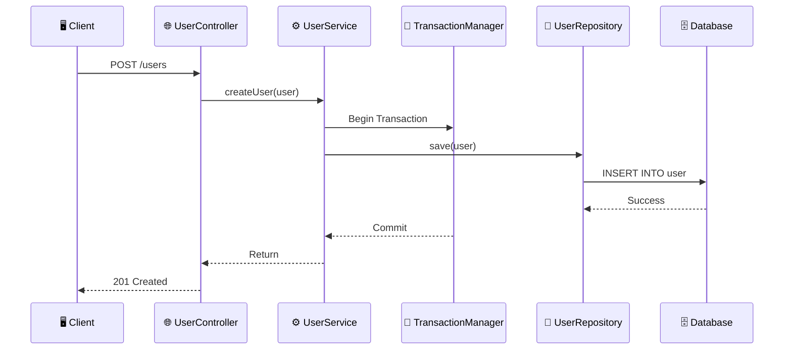

# @Transactional in Spring Data JPA

**@Transactional in Spring Data JPA** | Transactions are a database concept (not specific to Spring Boot) with two core operations: commit and rollback. Spring Data JPA simplifies transaction management using the `@Transactional` annotation.

- [Understanding Transactions](#1-understanding-transactions)
- [When Are Transactions Required](#2-when-are-transactions-required)
- [Commit and Rollback](#3-commit-and-rollback)
- [MySQL Transaction Examples](#4-mysql-transaction-examples)
- [Transaction Management Use Case — Bank Transfer](#5-transaction-management-use-case-bank-transfer)
- [Transactions in JDBC, Hibernate, and Spring](#6-transactions-in-jdbc-hibernate-and-spring)
- [Spring Data JPA Transaction Management](#7-spring-data-jpa-transaction-management)
- [@Transactional Key Concepts](#8-transactional-key-concepts)
- [How Does It Work](#9-how-does-it-work)
- [Full Implementation Example](#10-full-implementation-example)

---

## 1. Understanding Transactions

Transactions are a **database concept** (not specific to Spring Boot). A transaction groups one or more operations into a single logical unit with two possible outcomes:

- ✅ **Commit** — Save the changes permanently to the database.
- ↩️ **Rollback** — Cancel all changes and leave the database unaffected.



🧠 **In Simple Words:**
Buffers are part of RAM only. Data first goes to a buffer, and only a `commit` persists it to the actual database. A `rollback` discards the buffered data entirely.

---

## 2. When Are Transactions Required

For every **non-select** operation, transactions are required:

| Operation 🏷️ | SQL Command 💾 | Transaction Needed? ✅ |
|--------------|---------------|----------------------|
| **save(obj)** | `INSERT` | ✅ Yes |
| **update(obj)** | `UPDATE` | ✅ Yes |
| **delete(obj)** | `DELETE` | ✅ Yes |
| **findAll() / findById()** | `SELECT` | ❌️ No |

📝 **Note:** Transactions are **not** required for select operations since they only read data without modifying the database.

---

## 3. Commit and Rollback

- ✅ **Commit** — Updates data from the buffer to the database (saves it). By default in most databases, autocommit is enabled.
- ↩️ **Rollback** — Cancels the operation/data from the buffer and does not affect the database.

---

## 4. MySQL Transaction Examples

The following example demonstrates commit and rollback behavior in MySQL. After running these examples, don't forget to `set autocommit` back to `1`.

**Setup and insert with rollback:**

```sql
mysql> use test;
mysql> show tables;
mysql> drop table student;
mysql> create table student(sid int, sname varchar(20), sfee double, scourse varchar(20));
mysql> set autocommit = 0;

mysql> select * from student;
Empty set (0.00 sec)

mysql> insert into student values(10, 'a', 330, 'JAVA');
mysql> select * from student;
+------+-------+------+---------+
| sid  | sname | sfee | scourse |
+------+-------+------+---------+
|   10 | a     |  330 | JAVA    |
+------+-------+------+---------+
1 row in set (0.00 sec)

mysql> rollback;
Query OK, 0 rows affected (0.01 sec)

mysql> select * from student;
Empty set (0.00 sec)
```

⚠️ **Caution:** After the `rollback`, the inserted row is gone because it was never committed.

**Insert with commit, then another insert with rollback:**

```sql
mysql> insert into student values(10, 'a', 330, 'JAVA');
mysql> insert into student values(11, 'B', 430, 'JAVA');
mysql> commit;
Query OK, 0 rows affected (0.01 sec)

mysql> select * from student;
+------+-------+------+---------+
| sid  | sname | sfee | scourse |
+------+-------+------+---------+
|   10 | a     |  330 | JAVA    |
|   11 | B     |  430 | JAVA    |
+------+-------+------+---------+
2 rows in set (0.00 sec)

mysql> insert into student values(12, 'C', 530, 'JAVA');
Query OK, 1 row affected (0.00 sec)

mysql> select * from student;
+------+-------+------+---------+
| sid  | sname | sfee | scourse |
+------+-------+------+---------+
|   10 | a     |  330 | JAVA    |
|   11 | B     |  430 | JAVA    |
|   12 | C     |  530 | JAVA    |
+------+-------+------+---------+
3 rows in set (0.00 sec)

mysql> rollback;
Query OK, 0 rows affected (0.01 sec)

mysql> select * from student;
+------+-------+------+---------+
| sid  | sname | sfee | scourse |
+------+-------+------+---------+
|   10 | a     |  330 | JAVA    |
|   11 | B     |  430 | JAVA    |
+------+-------+------+---------+
2 rows in set (0.00 sec)

mysql> set autocommit = 1;
```

🔑 **Key Point:** The committed rows (10, 11) survived the rollback, but the uncommitted row (12) was discarded.

---

## 5. Transaction Management Use Case — Bank Transfer

When performing business operations with **connected queries**, transaction management is essential. Consider a `BankAccount` table:

```
+------+-------+------+
| aid  | aname | bal  |
+------+-------+------+
|  101 | A     | 1000 |
|  102 | B     | 2000 |
+------+-------+------+
```

💰 **Scenario:** Transfer 200.0 from account A to account B.

- 200 must be **deducted** from account A (SQL#1)
- 200 must be **deposited** to account B (SQL#2)
- If one fails, **both** must be rolled back

**The two SQL operations:**

```sql
SQL#1: UPDATE Account SET bal = bal - 200 WHERE accId = 101;
-- Balance becomes 800

SQL#2: UPDATE Account SET bal = bal + 200 WHERE accId = 102;
-- Balance becomes 2200
```

**Transaction logic:**

```
execute SQL#1 && SQL#2
if
    both success: commit
else
    any one fail: rollback
```



**MySQL demo — failed transfer (wrong account ID):**

```sql
mysql> use test;
mysql> set autocommit = 0;
mysql> create table account(aid int, aname varchar(10), bal double);
Query OK, 0 rows affected (0.03 sec)

mysql> insert into account values(101, 'A', 1000.0);
Query OK, 1 row affected (0.00 sec)

mysql> insert into account values(102, 'B', 2000.0);
Query OK, 1 row affected (0.00 sec)

mysql> commit;
Query OK, 0 rows affected (0.01 sec)

mysql> select * from account;
+------+-------+------+
| aid  | aname | bal  |
+------+-------+------+
|  101 | A     | 1000 |
|  102 | B     | 2000 |
+------+-------+------+
2 rows in set (0.00 sec)

mysql> update account set bal = bal - 200.0 where aid = 101;
Query OK, 1 row affected (0.01 sec)
Rows matched: 1  Changed: 1  Warnings: 0

mysql> update account set bal = bal + 200.0 where aid = 105;
Query OK, 0 rows affected (0.00 sec)
Rows matched: 0  Changed: 0  Warnings: 0

mysql> select * from account;
+------+-------+------+
| aid  | aname | bal  |
+------+-------+------+
|  101 | A     |  800 |
|  102 | B     | 2000 |
+------+-------+------+
2 rows in set (0.00 sec)

mysql> rollback;
Query OK, 0 rows affected (0.01 sec)

mysql> select * from account;
+------+-------+------+
| aid  | aname | bal  |
+------+-------+------+
|  101 | A     | 1000 |
|  102 | B     | 2000 |
+------+-------+------+
2 rows in set (0.00 sec)
```

⚠️ **Caution:** The second update targeted account `105` (wrong ID), so no rows were affected. The rollback restored account A's balance back to 1000.

**MySQL demo — successful transfer:**

```sql
mysql> update account set bal = bal - 200.0 where aid = 101;
Query OK, 1 row affected (0.00 sec)
Rows matched: 1  Changed: 1  Warnings: 0

mysql> update account set bal = bal + 200.0 where aid = 102;
Query OK, 1 row affected (0.00 sec)
Rows matched: 1  Changed: 1  Warnings: 0

mysql> commit;
Query OK, 0 rows affected (0.00 sec)

mysql> select * from account;
+------+-------+------+
| aid  | aname | bal  |
+------+-------+------+
|  101 | A     |  800 |
|  102 | B     | 2200 |
+------+-------+------+
2 rows in set (0.00 sec)

mysql> set autocommit = 1;
```

✅ Both operations succeeded, so the commit persisted the correct balances.

---

## 6. Transactions in JDBC, Hibernate, and Spring

### JDBC Approach

In JDBC, transaction management is manual using `Connection` methods:

```java
try {
    Connection con = DriverManager.getConnection(..);
    con.setAutoCommit(false);

    SQL#1 (Prepared Stmt)
    SQL#2 (Prepared Stmt)

    con.commit(); // inform db to save results in tables from buffer
} catch (SQLException exp) {
    con.rollback(); // cancel data from buffer
}
```

### Hibernate Approach

In Hibernate, transactions are managed via the `Transaction` API:

```java
Transaction tx = null;
try {
    tx = session.beginTx();
    // operations..
    tx.commit();
} catch (Exception ex) {
    tx.rollback();
}
```

### Spring Framework Approach

In the Spring framework, write your logic inside a method and apply `@Transactional`:

```java
@Transactional
void m1() {
    ......
}
```

Then internally Spring AOP code is executed for the method:

```java
afterReturningAdvice() // success
{
    tx.commit()
}
afterThrowingAdvice() // fail
{
    tx.rollback();
}
```

| Approach 🏷️ | Transaction Handling ⚙️ | Boilerplate 📝 |
|-------------|------------------------|---------------|
| **JDBC** | Manual `setAutoCommit(false)` + `commit()`/`rollback()` | ❌️ High |
| **Hibernate** | `session.beginTx()` + `commit()`/`rollback()` | ⚠️ Medium |
| **Spring** | `@Transactional` annotation | ✅ Minimal |
| **Spring Data JPA** | Auto-managed by `PlatformTransactionManager` | ✅ None |

---

## 7. Spring Data JPA Transaction Management

In Spring Data JPA, we **don't need to write code for transaction management**. Spring Data JPA provides `PlatformTransactionManager` out of the box.

**Transaction Manager hierarchy:**

```
PlatformTransactionManager (I)
  └── JpaTransactionManager (C)
```

**Entity Manager hierarchy:**

```
EntityManagerFactory (I)
  └── SessionFactory (I)
      └── SessionFactoryDelegatingImpl (C)
```



---

## 8. @Transactional Key Concepts

- 🔄 **Transaction** — A sequence of operations performed as a single logical unit of work.
- 🛡️ **ACID Properties** — Transactions must be Atomic, Consistent, Isolated, and Durable.
- 🏷️ **@Transactional Annotation** — Spring provides the `@Transactional` annotation to manage transactions declaratively.

| ACID Property 🔑 | Description 📋 |
|-----------------|---------------|
| **Atomic** | All operations succeed or all fail — no partial execution |
| **Consistent** | Database moves from one valid state to another |
| **Isolated** | Concurrent transactions do not interfere with each other |
| **Durable** | Once committed, changes persist even after system failure |

---

## 9. How Does It Work

### Configuration

Spring Boot **automatically configures** a transaction manager based on the data source. For JPA, it typically configures a `JpaTransactionManager`. You can customize the transaction manager bean if needed.

### Annotation Usage

The `@Transactional` annotation can be applied at the **method level** or the **class level**. When applied at the class level, it applies to all public methods of the class.

**Service class with @Transactional:**

```java
@Service
public class UserService {

    @Autowired
    private UserRepository userRepository;

    @Transactional
    public void createUser(User user) {
        userRepository.save(user);
    }

    @Transactional(readOnly = true)
    public User getUser(Long id) {
        return userRepository.findById(id).orElse(null);
    }
}
```

> 💡 **Tip:** Use `readOnly = true` for select operations. This optimizes performance by telling the persistence provider that no modifications will be made.

### Propagation and Isolation

The `@Transactional` annotation provides several attributes to control transaction behavior:

| Attribute 🏷️ | Values 📋 | Description ⚙️ |
|-------------|----------|---------------|
| **propagation** | `REQUIRED` (default), `REQUIRES_NEW`, `NESTED` | Defines how transactions relate to each other |
| **isolation** | `READ_COMMITTED`, `READ_UNCOMMITTED`, `REPEATABLE_READ`, `SERIALIZABLE` | Defines the isolation level of the transaction |

### Rollback Rules

By default, transactions are rolled back on `RuntimeException` and `Error` but **not** on checked exceptions. You can customize this behavior using `rollbackFor` and `noRollbackFor` attributes.

**Custom rollback configuration:**

```java
@Transactional(rollbackFor = Exception.class)
public void updateUser(User user) throws Exception {
    userRepository.save(user);
    if (someCondition) {
        throw new Exception("Forced rollback");
    }
}
```

⚠️ **Caution:** Without `rollbackFor = Exception.class`, checked exceptions will **not** trigger a rollback by default.

---

## 10. Full Implementation Example

1️⃣ **Define the Entity:**

```java
@Entity
@Getter
@Setter
@NoArgsConstructor
public class User {
    @Id
    @GeneratedValue(strategy = GenerationType.IDENTITY)
    private Long id;
    private String name;
    private String email;
}
```

2️⃣ **Create the Repository:**

```java
public interface UserRepository extends JpaRepository<User, Long> { }
```

3️⃣ **Write the Service with @Transactional:**

```java
@Service
public class UserService {

    @Autowired
    private UserRepository userRepository;

    @Transactional
    public void createUser(User user) {
        userRepository.save(user);
        // Additional logic here
    }

    @Transactional(readOnly = true)
    public User getUser(Long id) {
        return userRepository.findById(id).orElse(null);
    }

    @Transactional
    public void updateUserEmail(Long userId, String newEmail) {
        User user = userRepository.findById(userId)
            .orElseThrow(() -> new EntityNotFoundException("User not found"));
        user.setEmail(newEmail);
        userRepository.save(user);
    }
}
```

4️⃣ **Build the Controller:**

```java
@RestController
@RequestMapping("/users")
public class UserController {

    @Autowired
    private UserService userService;

    @PostMapping
    public ResponseEntity<User> createUser(@RequestBody User user) {
        userService.createUser(user);
        return ResponseEntity.status(HttpStatus.CREATED).body(user);
    }

    @GetMapping("/{id}")
    public ResponseEntity<User> getUser(@PathVariable Long id) {
        User user = userService.getUser(id);
        return ResponseEntity.ok(user);
    }

    @PutMapping("/{id}/email")
    public ResponseEntity<User> updateUserEmail(@PathVariable Long id, @RequestBody String newEmail) {
        userService.updateUserEmail(id, newEmail);
        return ResponseEntity.ok(userService.getUser(id));
    }
}
```



> 🔑 **Key Concept:** The `@Transactional` annotation on the service method triggers Spring AOP to wrap the method in a transaction. On success, it auto-commits. On `RuntimeException`, it auto-rolls back.
