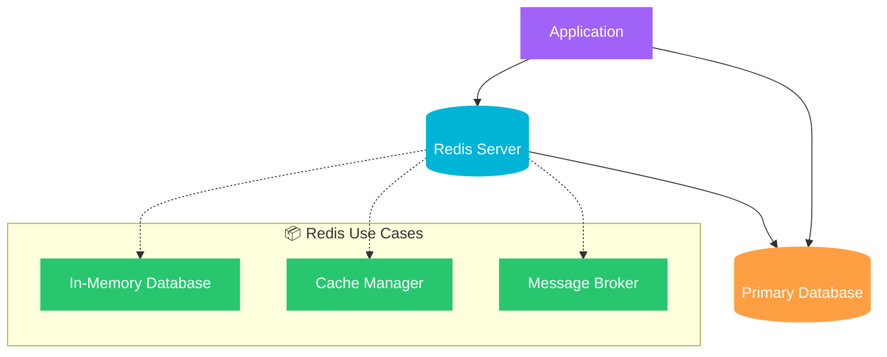
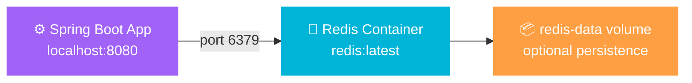
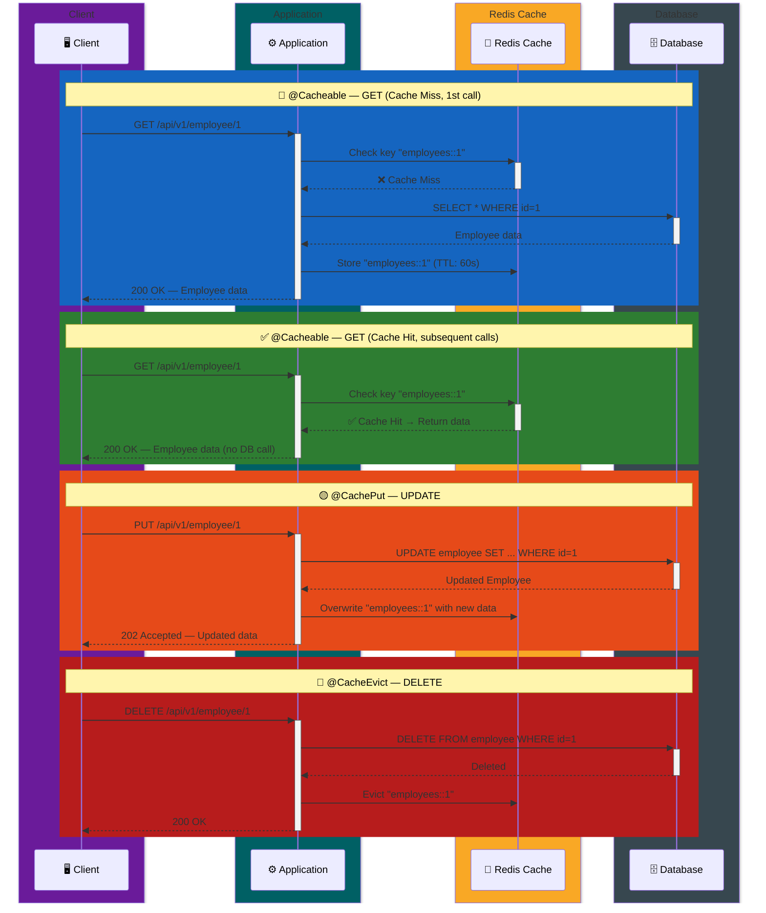

# Redis Cache with Spring Data JPA

**Redis Cache with Spring Data JPA** | Redis is an open source software which can be used as an in-memory database, cache manager, and message broker (MQ).

- [1. Introduction to Redis](#1-introduction-to-redis)
- [2. Running Redis with Docker](#2-running-redis-with-docker)
- [3. Gradle Dependencies](#3-gradle-dependencies)
- [4. Redis Connection Setup](#4-redis-connection-setup)
- [5. Redis as Database Example](#5-redis-as-database-example)
- [6. Redis as Cache Example](#6-redis-as-cache-example)
- [7. Example Without Cache](#7-example-without-cache)
- [8. Introducing Redis Cache to the Application](#8-introducing-redis-cache-to-the-application)

---

## 1. Introduction to Redis

🧠 **In Simple Words:**
Redis is like an empty memory. We don't have to write SQL queries — no tables, no sequences, no joins. Data is stored as plain string format, List, Set, or we can perform **Hash operations**. It includes in-built services for transaction management, clear memory, and more.



---

## 2. Running Redis with Docker

Instead of installing Redis locally, the easiest way to get Redis running is via Docker. Redis exposes port **6379** by default.



**Option 1 — Simple run (no persistence):**

```bash
docker run --name redis-local -p 6379:6379 -d redis
```

| Flag | Meaning |
|------|---------|
| `--name redis-local` | Container name for easy reference |
| `-p 6379:6379` | Map host port → container port |
| `-d` | Detached mode (run in background) |

**Option 2 — With password:**

```bash
docker run --name redis-local -p 6379:6379 -d redis redis-server --requirepass "secret"
```

Update `application.properties` to include the password:

```properties
spring.redis.host=localhost
spring.redis.port=6379
spring.redis.password=secret
```

**Option 3 — With named volume (data persists across restarts) - Recommended:**

```bash
docker run --name redis-local -p 6379:6379 -v redis-data:/data -d redis redis-server --appendonly yes
```

<details>
<summary>💡 What does <code>--appendonly yes</code> mean?</summary>

Enables Redis **AOF (Append Only File)** persistence mode. Every write command (`SET`, `DEL`, `HSET`, etc.) is appended to a log file (`appendonly.aof`) on disk in real time. On restart, Redis replays this file to reconstruct the full dataset.

**Without it** — Redis runs purely in-memory. Container restart = all data lost.

**With it** — writes flow to both memory and the AOF log:

```
Client → SET employees::1 {...}
                ↓
        Redis Memory  +  appendonly.aof (on disk)
                               ↓ on restart
                          Redis replays log → data restored
```

**AOF vs RDB (the two Redis persistence modes):**

| | AOF (`--appendonly yes`) | RDB (default snapshots) |
|---|---|---|
| How | Logs every write command | Periodic full snapshots |
| Data loss risk | Minimal (last ~1 sec) | More (last snapshot interval) |
| Restart recovery | Replay all commands | Load snapshot file |
| File | `appendonly.aof` | `dump.rdb` |
| Performance | Slightly slower writes | Faster writes |

**Why it pairs with `-v redis-data:/data`:**
The volume mounts at `/data` — that's where Redis writes `appendonly.aof`. Without the volume, the file lives inside the container and is lost when the container is removed. Together they give **true persistence across container restarts and removals**.

> For local dev/testing, the simple `docker run -d redis` is sufficient. Use AOF + volume when you need data to survive restarts.

**Verify via Redis CLI:**

Open Redis CLI inside the Docker container:

```bash
docker exec -it redis-local redis-cli
```

</details>
<br/>

**Useful Docker commands:**

```bash
# Check container is running
docker ps

# Stop Redis
docker stop redis-local

# Start again
docker start redis-local

# Open Redis CLI inside the container
docker exec -it redis-local redis-cli

# Test connection in Redis CLI
127.0.0.1:6379> PING
# PONG

# List all cached keys
127.0.0.1:6379> KEYS *

# Get TTL remaining for a key
127.0.0.1:6379> TTL employees::1

# Delete a specific key manually
127.0.0.1:6379> DEL employees::1
```

💡 **Tip:** Use `KEYS *` in `redis-cli` after calling your Spring Boot API to verify that cache entries (`employees::1`, `employees::2`, etc.) are being created correctly.

---

## 3. Gradle Dependencies

The full `build.gradle` for this application (`build.gradle`):

```groovy
plugins {
    id 'org.springframework.boot' version '3.4.3'
    id 'io.spring.dependency-management' version '1.1.7'
    id 'java'
}

group = 'org.example'
version = '1.0-SNAPSHOT'

repositories {
    mavenCentral()
}

dependencies {
    // Spring Web — REST controllers
    implementation 'org.springframework.boot:spring-boot-starter-web'

    // Spring Data JPA — ORM, repository, @Transactional
    implementation 'org.springframework.boot:spring-boot-starter-data-jpa'

    // MySQL Driver — JDBC connection to MySQL
    runtimeOnly 'com.mysql:mysql-connector-j'

    // Spring Data Redis — @Cacheable, RedisTemplate, LettuceConnectionFactory
    implementation 'org.springframework.boot:spring-boot-starter-data-redis'

    // Lombok — @Data, @NoArgsConstructor, @AllArgsConstructor
    compileOnly 'org.projectlombok:lombok'
    annotationProcessor 'org.projectlombok:lombok'

    // Actuator — verify cache via /actuator/caches
    implementation 'org.springframework.boot:spring-boot-starter-actuator'

    // DevTools — hot reload during development
    runtimeOnly 'org.springframework.boot:spring-boot-devtools'

    // Testing
    testImplementation 'org.springframework.boot:spring-boot-starter-test'
}

test {
    useJUnitPlatform()
}
```

| Dependency | Scope | Why needed |
|---|---|---|
| `spring-boot-starter-web` | `implementation` | REST API (`@RestController`, `@GetMapping`, etc.) |
| `spring-boot-starter-data-jpa` | `implementation` | JPA/Hibernate ORM, `JpaRepository` |
| `mysql-connector-j` | `runtimeOnly` | JDBC driver for MySQL |
| `spring-boot-starter-data-redis` | `implementation` | Redis client (Lettuce), `@Cacheable`, `RedisTemplate` |
| `lombok` | `compileOnly` + `annotationProcessor` | Boilerplate reduction (`@Data`, constructors) |
| `spring-boot-starter-actuator` | `implementation` | `/actuator/caches` endpoint to inspect cache state |
| `spring-boot-devtools` | `runtimeOnly` | Auto-restart on class changes during dev |
| `spring-boot-starter-test` | `testImplementation` | JUnit 5, Mockito, AssertJ bundled together |

> ⚠️ **Plugin requirement:** `io.spring.dependency-management` applies the Spring Boot BOM, which provides versions for all `spring-boot-starter-*` and `lombok` dependencies. Without it, Gradle cannot resolve versions and the build will fail.

💡 **Tip:** In STS/Eclipse, use `CTRL + Shift + T`, type `RedisConnectionFactory`. Open the `RedisConnectionFactory` interface and press `F4` to see implementation classes.

`RedisConnectionFactory (I)` has two implementation classes:

- 🕰️ **`JedisConnectionFactory`** — Old driver
- 🚀 **`LettuceConnectionFactory`** — New driver (recommended)

<details>
<summary>💡 Jedis vs Lettuce — which one to use?</summary>

**Always use `LettuceConnectionFactory`** for modern Spring Boot apps.

| | Lettuce ✅ | Jedis ❌️ |
|---|---|---|
| **I/O model** | Non-blocking (Netty) | Blocking |
| **Thread safety** | Single shared connection, inherently thread-safe | One connection per thread — needs connection pool |
| **Reactive support** | Yes (Spring WebFlux, Project Reactor) | No |
| **Spring Boot default** | Yes — auto-configured out of the box | Must explicitly add `jedis` dependency |
| **Connection pooling** | Optional (`LettucePoolingClientConfiguration`) | Required for thread safety (Apache Commons Pool) |
| **Maintenance** | Actively maintained | Mostly maintenance mode |

**Rule of thumb:**

> Jedis was the dominant Redis client before Lettuce matured. Spring kept `JedisConnectionFactory` for backwards compatibility. New projects should never reach for it.

</details>

---

## 4. Redis Connection Setup

To create a connection between the application and Redis database, use `RedisConnectionFactory(I)` which has 2 implementation classes: `JedisConnectionFactory` and `LettuceConnectionFactory`. Also provide properties for Redis (host and port).

**Configuration class:**

```java
@Configuration
public class AppConfig {

    @Bean
    public RedisConnectionFactory cf() {
        return new LettuceConnectionFactory();
    }
}
```

🔧 **Configuration** (`application.properties`):

```properties
# redis key-val (properties)
spring.redis.host=localhost
spring.redis.port=6379
```

---

## 5. Redis as Database Example

Let us see Redis as a database. While using Redis as cache, internally Redis will work as a database to store the information.

📦 **Dependencies:**

- `Lombok`
- `Spring Data Redis (Access + Driver)`

⚠️ **Note:** If `spring-boot-starter-data-jpa` is on the classpath but no database URL is configured, Spring Boot will fail to start with `Failed to configure a DataSource`. Since this example uses only Redis (no SQL database), exclude `DataSourceAutoConfiguration` in the main class:

```java
@SpringBootApplication(exclude = DataSourceAutoConfiguration.class)
public class Main {
    public static void main(String[] args) {
        SpringApplication.run(Main.class, args);
    }
}
```

🔧 **Configuration** (`application.properties`):

```properties
# redis key-val (properties)
spring.redis.host=localhost
spring.redis.port=6379
```

**Model class** (must implement `Serializable`):

```java
@Data
@NoArgsConstructor
@AllArgsConstructor
public class Student implements Serializable {
    private static final long serialVersionUID = 1L;
    private Integer stdId;
    private String stdName;
    private Double stdFee;
}
```

Spring configuration file will contain Redis connection and Redis template.

**Configuration class:**

```java
@Configuration
public class AppConfig {

    // Redis connection
    @Bean
    public RedisConnectionFactory redisConnectionFactory() {
        return new LettuceConnectionFactory();
    }

    // Redis template
    @Bean
    public RedisTemplate<String, Student> redisTemplate() {
        RedisTemplate<String, Student> template = new RedisTemplate<>();
        template.setConnectionFactory(redisConnectionFactory());
        // keys and hash-keys stored as plain strings
        template.setKeySerializer(new StringRedisSerializer());
        template.setHashKeySerializer(new StringRedisSerializer());
        // values and hash-values stored as readable JSON
        template.setValueSerializer(new Jackson2JsonRedisSerializer<>(Student.class));
        template.setHashValueSerializer(new Jackson2JsonRedisSerializer<>(Student.class));
        return template;
    }
}
```

⚠️ **Without serializers**, `RedisTemplate` uses Java's default binary serialization — keys and values appear as garbled bytes (`\xac\xed\x00\x05...`) in `redis-cli`. Always configure serializers explicitly.

| Serializer | Applied to | Result in redis-cli |
|---|---|---|
| `StringRedisSerializer` | Key, Hash key | `STUDENT`, `1`, `2` |
| `Jackson2JsonRedisSerializer` | Value, Hash value | `{"stdId":"1","stdName":"Alice","stdFee":1000.0}` |
| Default (none set) | Everything | Binary garbage — `\xac\xed\x00\x05...` |

> 💡 Run `FLUSHALL` in `redis-cli` to clear old binary-serialized data before restarting the app after this fix.

<details>
<summary>💡 Why did we configure <code>RedisTemplate&lt;String, Student&gt;</code>?</summary>

`RedisTemplate` is the primary class Spring provides to interact with Redis — similar to how `JdbcTemplate` is used for SQL. Without it, you have no way to read/write data to Redis from Java code.

**Why `<String, Student>` specifically?**

```
RedisTemplate<K,      V      >
               ↑      ↑
               Key    Value
```

- `String` — Redis keys are always strings (`"STUDENT"`, `"employees::1"`, etc.)
- `Student` — the value type you're storing in Redis

This type-safety tells Spring how to **serialize/deserialize** data when talking to Redis.

**Why configure it as a `@Bean`?**

Spring only auto-configures `RedisTemplate<Object, Object>` (generic). Injecting the generic one and working with `Student` objects loses type safety and risks `ClassCastException` at runtime. By defining your own `@Bean` you tell Spring:
1. Use the Lettuce connection we configured
2. Keys are `String`, values are `Student` — serialize/deserialize accordingly

> **Note:** In the `@EnableCaching` / `@Cacheable` approach (Section 8), you **don't need this bean** — Spring manages serialization automatically via `RedisCacheManager`. The manual `RedisTemplate` bean is only needed when interacting with Redis directly via `HashOperations`, `ValueOperations`, etc., as done in this section.

</details>

<br/>

Define one interface to perform the operations. `StudentDaoImpl` uses `HashOperations` where:

| Parameter 🏷️ | Type 📋 | Example 🛠️ |
|--------------|---------|------------|
| **H (HRef)** | `String` | `"STUDENT"` |
| **HK (key)** | `Integer` | `stdId` |
| **HV (val)** | `Student` | Student object |

**DAO Interface:**

```java
public interface IStudentDao {
    void addStudent(Student s);

    void modifyStudent(Student s);

    Student getOneStudent(Integer id);

    Map<Integer, Student> getAllStudent();

    void removeStudent(Integer id);
}
```

**DAO Implementation:**

```java
@Repository
public class StudentDaoImpl implements IStudentDao {

    private final String KEY = "STUDENT";

    @Autowired
    private RedisTemplate<String, Student> redisTemplate;

    private HashOperations<String, Integer, Student> opr;

    @PostConstruct
    public void init() {
        this.opr = redisTemplate.opsForHash();
    }

    @Override
    public void addStudent(Student s) {
        // create new record in HashMemory if given id not exist
        opr.putIfAbsent(KEY, s.getStdId(), s);
    }

    @Override
    public void modifyStudent(Student s) {
        // update data with given ID
        opr.put(KEY, s.getStdId(), s);
    }

    @Override
    public Student getOneStudent(Integer id) {
        // read one record based on HashRef and ID
        return opr.get(KEY, id);
    }

    @Override
    public Map<Integer, Student> getAllStudent() {
        // hashRef, get all rows as Map
        return opr.entries(KEY);
    }

    @Override
    public void removeStudent(Integer id) {
        // hashRef, key
        opr.delete(KEY, id);
    }
}
```

<details>
<summary>💡 Why not <code>@Resource(name = "redisTemplate")</code>?</summary>

The original approach used:

```java
@Resource(name = "redisTemplate")
private HashOperations<String, Integer, Student> opr;
```

This injects by **bean name** (a string). It works but is fragile — if the bean name changes, it silently breaks at runtime.

The preferred approach uses `@Autowired` (type-based) + `@PostConstruct`:

```java
@Autowired
private RedisTemplate<String, Student> redisTemplate;

private HashOperations<String, Integer, Student> opr;

@PostConstruct
public void init() {
    this.opr = redisTemplate.opsForHash();
}
```

`@PostConstruct` runs once after Spring finishes injecting all dependencies — so by the time `init()` is called, `redisTemplate` is fully wired and `opsForHash()` can safely be called to get the `HashOperations` instance.

| | `@Resource(name=...)` | `@Autowired` + `@PostConstruct` |
|---|---|---|
| Wiring | By bean name (string) | By type |
| Refactor-safe | ❌️ Breaks if bean name changes | ✅ |
| Preferred | No | Yes |

</details>

**Runner class (test):**

```java
@Component
public class RedisOprTest implements CommandLineRunner {

    @Autowired
    private IStudentDao dao;

    @Override
    public void run(String... args) throws Exception {
        dao.addStudent(new Student(101, "SAM", 500.25));
        dao.addStudent(new Student(102, "SYED", 800.25));
        dao.addStudent(new Student(103, "Rocco", 600.25));

        dao.getAllStudent().forEach((k, v) -> System.out.println(k + "-" + v));

        dao.removeStudent(101);
        dao.modifyStudent(new Student(103, "Jerry", 600.25));

        System.out.println("After remove & modify:-");
        dao.getAllStudent().forEach((k, v) -> System.out.println(k + "-" + v));
    }

}
```

📤 **Output:**

```
103-Student(stdId=103, stdName=Rocco, stdFee=600.25)
102-Student(stdId=102, stdName=SYED, stdFee=800.25)
101-Student(stdId=101, stdName=SAM, stdFee=500.25)
After remove & modify:-
103-Student(stdId=103, stdName=Jerry, stdFee=600.25)
102-Student(stdId=102, stdName=SYED, stdFee=800.25)
```

**Verify via Redis CLI:**

Open Redis CLI inside the Docker container:

```bash
docker exec -it redis-local redis-cli
```

```bash
# 1. Check the hash "STUDENT" exists
127.0.0.1:6379> EXISTS STUDENT
# (integer) 1

# 2. List all field-value pairs in the STUDENT hash (all students)
127.0.0.1:6379> HGETALL STUDENT
# Returns serialized field-value pairs for each student

# 3. Get a specific student by ID (field = stdId)
127.0.0.1:6379> HGET STUDENT 102
# Returns serialized Student(stdId=102, stdName=SYED, stdFee=800.25)

# 4. Check student 101 was deleted (removeStudent)
127.0.0.1:6379> HEXISTS STUDENT 101
# (integer) 0  ← 0 means not found, confirmed deleted

# 5. Verify student 103 was modified (stdName changed to Jerry)
127.0.0.1:6379> HGET STUDENT 103
# Returns serialized Student(stdId=103, stdName=Jerry, stdFee=600.25)

# 6. Count total entries in the hash
127.0.0.1:6379> HLEN STUDENT
# (integer) 2  ← 101 deleted, so only 102 and 103 remain
```

| Command | What it checks |
|---|---|
| `EXISTS STUDENT` | Hash key was created |
| `HGETALL STUDENT` | All students stored in hash |
| `HGET STUDENT 102` | Fetch one student by ID |
| `HEXISTS STUDENT 101` | Confirm deletion of student 101 |
| `HGET STUDENT 103` | Confirm name updated to Jerry |
| `HLEN STUDENT` | Total count = 2 after delete |

---

## 6. Redis as Cache Example

Cache is a temporary memory. It is used between the server (application) and database. This is used to reduce network calls if we are trying to fetch the same data multiple times from the database.



⚠️ **Caution:** Do not implement cache for all modules. Select modules which are actually mostly used. For example, in a Gmail app multiple modules exist like inbox, sent, drafts, etc. Among them, inbox is the most frequently used.

Cache supports 3 operations:

| Annotation 🏷️ | Purpose 📋 | Usage 🛠️ |
|---------------|-----------|----------|
| **`@Cacheable`** | Fetch data from database to application and store in cache | Read operations |
| **`@CachePut`** | Update data at cache while it is updating in database | Update operations |
| **`@CacheEvict`** | Remove data at cache while it is removing in database | Delete operations |

🔑 **Syntax:** `@Cache___(value="CACHE-REGION", key="#Variable")`

These operations are applied to a selected **region**. A region is an area/memory part of the cache created for one module. For example: `EMP-REG`, `STD-REG`, etc.

📝 **Note:** Unlike Hibernate, Spring Data JPA does not support `SessionFactory` and therefore 1st level cache (Session) and 2nd level cache (SessionFactory Cache) are not supported since Spring Boot 2.x. Spring Data JPA works with its own cache managers.

---

## 7. Example Without Cache

Let us first see an application example without using cache.

📦 **Dependencies:**

- 🏷️ Lombok
- 💾 Spring Data JPA
- 🗄️ MySQL Driver
- 🌐 Spring Web
- 🔧 Spring Boot DevTools
- 📊 Spring Boot Actuator

🔧 **Configuration** (`application.properties`):

```properties
# MySQL
spring.datasource.url=jdbc:mysql://localhost:3306/test
spring.datasource.username=root
spring.datasource.password=root

# JPA
spring.jpa.show-sql=true
spring.jpa.hibernate.ddl-auto=update
spring.jpa.properties.hibernate.format_sql=true

# Actuator
management.endpoints.web.exposure.include=*
```

**Model class:**

```java
@Data
@NoArgsConstructor
@AllArgsConstructor
@Entity
public class Employee implements Serializable {
    private static final long serialVersionUID = 1L;
    @Id
    @GeneratedValue(strategy = GenerationType.IDENTITY)
    private Integer id;
    private String empName;
    private Double empSal;
}
```

**Repository:**

```java
public interface EmployeeRepository extends JpaRepository<Employee, Integer> { }
```

**Service Interface:**

```java
public interface IEmployeeService {
    public Employee saveEmployee(Employee e);

    public Employee updateEmployee(Integer empId, Employee e);

    public void deleteEmployee(Integer id);

    public List<Employee> getAllEmployees();

    public Employee getOneEmployee(Integer id);
}
```

**Exception class:**

```java
@ResponseStatus(value= HttpStatus.NOT_FOUND)
public class ResourceNotFoundException extends RuntimeException {

    private static final long serialVersionUID = 1L;

    public ResourceNotFoundException(String message) {
        super(message);
    }
}
```

**Service Implementation:**

```java
@Service
public class EmployeeServiceImpl implements IEmployeeService {

    @Autowired
    private EmployeeRepository employeeRepository;

    @Override
    public Employee saveEmployee(Employee e) {
        return employeeRepository.save(e);
    }

    @Override
    public Employee updateEmployee(Integer empId, Employee e) {
        Employee employee = getOneEmployee(empId);
        employee.setEmpName(e.getEmpName());
        employee.setEmpSal(e.getEmpSal());
        return employeeRepository.save(e);
    }

    @Override
    public void deleteEmployee(Integer empId) {
        Employee employee = getOneEmployee(empId);
        employeeRepository.delete(employee);
    }

    @Override
    public List<Employee> getAllEmployees() {
        return employeeRepository.findAll();
    }

    @Override
    public Employee getOneEmployee(Integer empId) {
        return employeeRepository.findById(empId)
                .orElseThrow(() -> new ResourceNotFoundException("Employee Not Found"));
    }

}
```

**REST Controller:**

```java
@RestController
@RequestMapping("/api/v1/employee")
public class EmployeeRestContoller {

    @Autowired
    private IEmployeeService service;

    @PostMapping
    public ResponseEntity<Employee> saveEmployee(@RequestBody Employee e) {
        return new ResponseEntity<Employee>(service.saveEmployee(e), HttpStatus.CREATED);
    }

    @GetMapping
    public ResponseEntity<List<Employee>> getAllEmployees() {
        return ResponseEntity.ok(service.getAllEmployees());
    }

    @GetMapping("/{eid}")
    public ResponseEntity<Employee> getOneEmployee(@PathVariable Integer eid) {
        return new ResponseEntity<>(service.getOneEmployee(eid), HttpStatus.FOUND);
    }

    @PutMapping("/{eid}")
    public ResponseEntity<Employee> updateEmployee(@PathVariable Integer eid,
                       @RequestBody Employee employee) {
        return new ResponseEntity<>(service.updateEmployee(eid, employee),
                       HttpStatus.ACCEPTED);
    }

    @DeleteMapping("/{eid}")
    public ResponseEntity<Void> deleteEmployee(@PathVariable Integer eid) {
        service.deleteEmployee(eid);
        return ResponseEntity.ok().build();
    }

}
```

Created some entries in the database using the following SQL:

```sql
INSERT INTO employee (emp_name, emp_sal) VALUES ('SAM', 200.0);
INSERT INTO employee (emp_name, emp_sal) VALUES ('AJAY', 400.0);
INSERT INTO employee (emp_name, emp_sal) VALUES ('SYED', 600.0);
```

The `findAll()` gives:

```bash
curl -X GET http://localhost:8080/api/v1/employee
```

📤 **Output:**

```json
[
    {
        "id": 1,
        "empName": "SAM",
        "empSal": 200.0
    },
    {
        "id": 2,
        "empName": "AJAY",
        "empSal": 400.0
    },
    {
        "id": 3,
        "empName": "SYED",
        "empSal": 600.0
    }
]
```

Whenever we try to fetch a particular employee, each time the application makes a call to the database:

```bash
curl -X GET http://localhost:8080/api/v1/employee/1
```

🖥️ **Console Output:**

```sql
Hibernate:
    select
        e1_0.id,
        e1_0.emp_name,
        e1_0.emp_sal
    from
        employee e1_0
    where
        e1_0.id=?
```

---

## 8. Introducing Redis Cache to the Application

1️⃣ **Step 1 — Add the `Spring Data Redis (Access + Driver)` dependency (`build.gradle`):**

```groovy
implementation 'org.springframework.boot:spring-boot-starter-data-redis'
```

2️⃣ **Step 2 — Enable caching in the starter class (`@EnableCaching`):**

```java
@SpringBootApplication
@EnableCaching
public class RedisAsCacheDemoApplication {

    public static void main(String[] args) {
        SpringApplication.run(RedisAsCacheDemoApplication.class, args);
    }

}
```

3️⃣ **Step 3 — Add Redis properties (`application.properties`):**

```properties
spring.cache.type=redis
```

| Property | Value | Explanation |
|---|---|---|
| `spring.cache.type` | `redis` | Tells Spring Boot to use Redis as the cache provider instead of the default in-memory cache |

> ⚠️ `spring.cache.redis.time-to-live` and `spring.cache.redis.cache-null-values` are intentionally omitted — TTL and serialization are configured programmatically in `AppConfig` (Step 4) for full control.

4️⃣ **Step 4 — Configure `RedisCacheManager` with JSON serialization (`AppConfig`):**

By default, Spring Cache uses Java binary serialization — values stored in Redis appear as garbled bytes (`\xac\xed\x00\x05...`). Configure `RedisCacheManager` with `GenericJackson2JsonRedisSerializer` to store values as readable JSON.

```java
import com.fasterxml.jackson.annotation.JsonTypeInfo;
import com.fasterxml.jackson.databind.ObjectMapper;
import com.fasterxml.jackson.databind.jsontype.impl.LaissezFaireSubTypeValidator;
import org.springframework.context.annotation.Bean;
import org.springframework.context.annotation.Configuration;
import org.springframework.data.redis.cache.RedisCacheConfiguration;
import org.springframework.data.redis.cache.RedisCacheManager;
import org.springframework.data.redis.connection.RedisConnectionFactory;
import org.springframework.data.redis.serializer.GenericJackson2JsonRedisSerializer;
import org.springframework.data.redis.serializer.RedisSerializationContext;
import org.springframework.data.redis.serializer.StringRedisSerializer;

import java.time.Duration;

@Configuration
public class AppConfig {

    @Bean
    public RedisCacheManager cacheManager(RedisConnectionFactory redisConnectionFactory) {
        ObjectMapper objectMapper = new ObjectMapper();
        objectMapper.activateDefaultTyping(
                LaissezFaireSubTypeValidator.instance,
                ObjectMapper.DefaultTyping.NON_FINAL,
                JsonTypeInfo.As.PROPERTY
        );

        GenericJackson2JsonRedisSerializer jsonSerializer =
                new GenericJackson2JsonRedisSerializer(objectMapper);

        RedisCacheConfiguration cacheConfig = RedisCacheConfiguration.defaultCacheConfig()
                .entryTtl(Duration.ofSeconds(60))
                .serializeKeysWith(
                        RedisSerializationContext.SerializationPair.fromSerializer(new StringRedisSerializer()))
                .serializeValuesWith(
                        RedisSerializationContext.SerializationPair.fromSerializer(jsonSerializer));

        return RedisCacheManager.builder(redisConnectionFactory)
                .cacheDefaults(cacheConfig)
                .build();
    }
}
```

| Config | What it does |
|---|---|
| `StringRedisSerializer` for keys | Keys stored as plain strings — `employees::1` |
| `GenericJackson2JsonRedisSerializer` for values | Values stored as JSON — `{"@class":"...","id":1,...}` |
| `entryTtl(Duration.ofSeconds(60))` | Cache entries expire after 60 seconds |
| `activateDefaultTyping(...)` | Embeds `@class` field in JSON so Spring can deserialize back to the correct type |

<details>
<summary>💡 Why <code>GenericJackson2JsonRedisSerializer</code> and not <code>Jackson2JsonRedisSerializer</code>?</summary>

| | `Jackson2JsonRedisSerializer` | `GenericJackson2JsonRedisSerializer` |
|---|---|---|
| Tied to a specific class | Yes — must declare `new Jackson2JsonRedisSerializer<>(Employee.class)` | No — works with any type |
| Embeds `@class` in JSON | No | Yes — needed for correct deserialization |
| Suitable for `@Cacheable` | ❌️ Only if caching a single type | ✅ Works across multiple cached types |

Use `GenericJackson2JsonRedisSerializer` for `@Cacheable` — the cache manager doesn't know the type at configuration time.

</details>
<br/>

5️⃣ **Step 5 — Add cache annotations to `EmployeeServiceImpl`:**

📝 **Note:** The `key` parameter and method parameter must have the same name.

| Method | Annotation | Behaviour |
|---|---|---|
| `getOneEmployee()` | `@Cacheable` | Fetches from cache on subsequent calls — no DB hit |
| `saveEmployee()` | `@CachePut(key = "#result.id")` | Caches the saved entity using the DB-generated `id` from the returned object |
| `updateEmployee()` | `@CachePut` | Always hits DB and overwrites the cache entry |
| `deleteEmployee()` | `@CacheEvict` | Deletes from DB and removes the cache entry |
| `getAllEmployees()` | none | Returns all records — caching a list is risky (stale data) |

```java
import org.springframework.beans.factory.annotation.Autowired;
import org.springframework.cache.annotation.CacheEvict;
import org.springframework.cache.annotation.CachePut;
import org.springframework.cache.annotation.Cacheable;
import org.springframework.stereotype.Service;

import java.util.List;

@Service
public class EmployeeServiceImpl implements IEmployeeService {

    @Autowired
    private EmployeeRepository employeeRepository;

    @Override
    @CachePut(value = "employees", key = "#result.id")
    public Employee saveEmployee(Employee e) {
        return employeeRepository.save(e);
    }

    @Override
    @CachePut(value = "employees", key = "#empId")
    public Employee updateEmployee(Integer empId, Employee e) {
        Employee employee = getOneEmployee(empId);
        employee.setEmpName(e.getEmpName());
        employee.setEmpSal(e.getEmpSal());
        return employeeRepository.save(employee);
    }

    @Override
    @CacheEvict(value = "employees", key = "#empId")
    public void deleteEmployee(Integer empId) {
        Employee employee = getOneEmployee(empId);
        employeeRepository.delete(employee);
    }

    @Override
    public List<Employee> getAllEmployees() {
        return employeeRepository.findAll();
    }

    @Override
    @Cacheable(value = "employees", key = "#empId")
    public Employee getOneEmployee(Integer empId) {
        return employeeRepository.findById(empId)
                .orElseThrow(() -> new ResourceNotFoundException("Employee Not Found"));
    }

}
```

The `#result` refers to the return value of the method, which has the DB-generated `id` already set.

Now when we try to fetch a particular employee, for the first time the application makes a call to the database and stores the result into the cache for the given time (`time-to-live`):

```bash
# 1st call — Cache Miss, hits DB and stores in cache
curl -X GET http://localhost:8080/api/v1/employee/1

# 2nd call — Cache Hit, no DB query fired (check console — no Hibernate SELECT)
curl -X GET http://localhost:8080/api/v1/employee/1
```

> 💡 **Tip:** If we have an employee with child entities (like one-to-one, many-to-many, collection type) and we want to delete child data also, then we have to provide `allEntries=true`:

```java
@CacheEvict(value = "employees", allEntries = true)
```

🔍 **Verifying Cache with redis-cli:**

```bash
# List all keys
127.0.0.1:6379> KEYS *
# 1) "employees::1"

# Check type — @Cacheable stores as String (not Hash)
127.0.0.1:6379> TYPE employees::1
# string

# Get the cached value (JSON string)
127.0.0.1:6379> GET employees::1
# "{\"@class\":\"org.example.Employee\",\"id\":1,\"empName\":\"SAM\",\"empSal\":200.0}"

# Check TTL remaining (in seconds)
127.0.0.1:6379> TTL employees::1
# (integer) 42  ← out of 60s

# After DELETE /employee/1 — key should be gone
127.0.0.1:6379> EXISTS employees::1
# (integer) 0
```

> ⚠️ **Common mistake:** `HGET` / `HGETALL` won't work on `employees::1` — those are Hash commands. `@Cacheable` stores values as **String** keys, not Redis Hashes. Use `GET` instead.

| Key | Redis Type | Stored by |
|---|---|---|
| `employees::1` | `string` | `@Cacheable` — Spring Cache serializes value as JSON string |
| `STUDENT` | `hash` | `HashOperations.putIfAbsent()` — Section 5 |

TTL return values:

| Return | Meaning |
|---|---|
| `> 0` | Seconds remaining before expiry |
| `-1` | Key exists but has no expiry set |
| `-2` | Key does not exist (expired or never created) |

🔍 **Verifying Cache with Actuator:**

```bash
# View all active caches
curl -X GET http://localhost:8080/actuator/caches

# View all actuator endpoints
curl -X GET http://localhost:8080/actuator
```

**Full CRUD curl reference:**

```bash
# CREATE
curl -X POST http://localhost:8080/api/v1/employee -H "Content-Type: application/json" -d '{"empName":"SAM","empSal":200.0}'

# GET ALL
curl -X GET http://localhost:8080/api/v1/employee

# GET ONE (1st call hits DB, 2nd call hits cache)
curl -X GET http://localhost:8080/api/v1/employee/1

# UPDATE (updates DB + overwrites cache via @CachePut)
curl -X PUT http://localhost:8080/api/v1/employee/1 -H "Content-Type: application/json" -d '{"empName":"SAM UPDATED","empSal":999.0}'

# DELETE (deletes from DB + evicts cache via @CacheEvict)
curl -X DELETE http://localhost:8080/api/v1/employee/1
```

---

Next: 66_Redis_Advanced_Production_Patterns.md