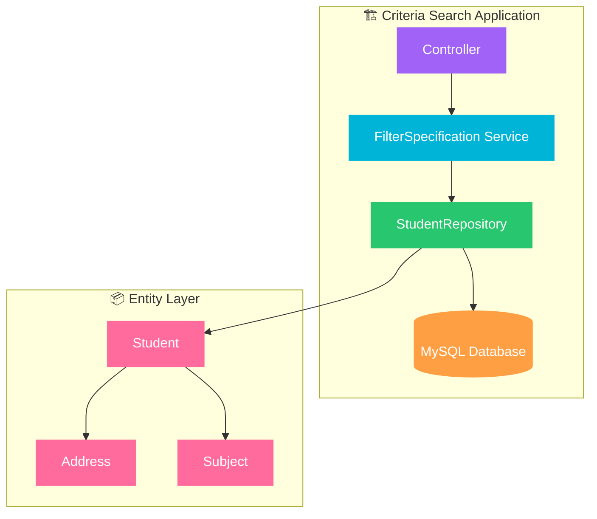
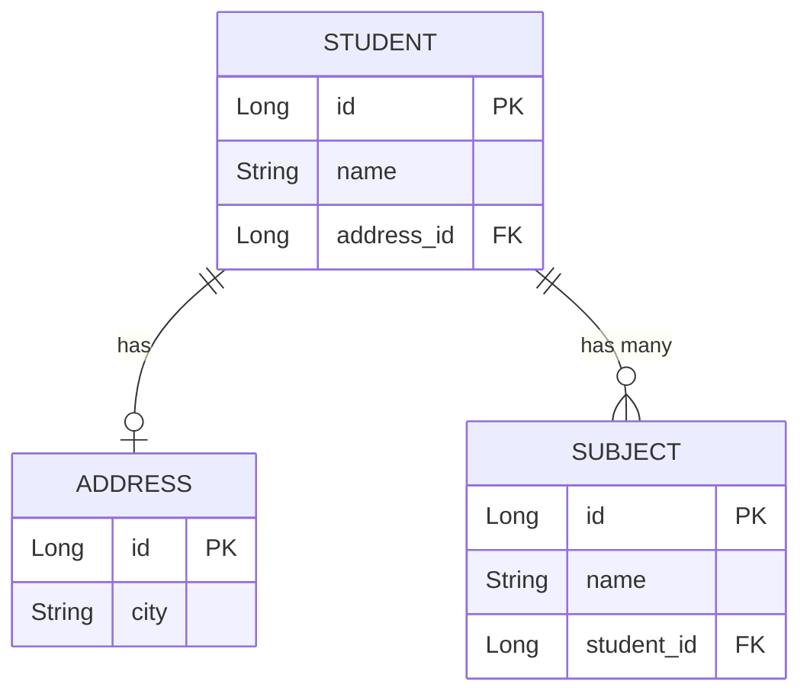

# Search Specification | Criteria API in Spring Boot

**Search Specification | Criteria API in Spring Boot** | Criteria API helps us to create dynamic queries using Spring Data JPA Specifications for flexible, reusable search filters.

- [Project Setup](#1-project-setup)
- [Entity Classes](#2-entity-classes)
- [Repository and Controller Setup](#3-repository-and-controller-setup)
- [Data Initialization](#4-data-initialization)
- [Query Method Examples](#5-query-method-examples)
- [Search Specification](#6-search-specification)
- [Criteria API Basic Example](#7-criteria-api-basic-example)
- [List of Criteria using AND](#8-list-of-criteria-using-and)
- [Adding List of Criteria Using OR/AND Operator](#9-adding-list-of-criteria-using-orand-operator)
- [EQUAL and LIKE Operator](#10-equal-and-like-operator)
- [IN Operator Example](#11-in-operator-example)
- [Greater Than And Less Than](#12-greater-than-and-less-than)
- [BETWEEN Operation](#13-between-operation)
- [Join Tables Predicates](#14-join-tables-predicates)
- [Pagination Example With Criteria API](#15-pagination-example-with-criteria-api)

---

## 1. Project Setup

Create a Spring starter project with the following **dependencies**: Spring Web, [Lombok](../01_core_spring_boot/07_Project_Lombok_Annotations_With_Examples.md), MySQL Driver, and Spring Data JPA. See the complete code on **[GitHub](https://github.com/Know-Program/Spring-Boot-Examples/tree/main/CriteriaSearchSpecification)**.



🔧 **Configuration** (`application.properties`):

```properties
spring.datasource.url=jdbc:mysql://localhost:3306/criteria
spring.datasource.username=root
spring.datasource.password=root
spring.jpa.show-sql=true
spring.jpa.properties.hibernate.format_sql=true
spring.jpa.hibernate.ddl-auto=update
spring.jackson.serialization.FAIL_ON_EMPTY_BEANS=false
```

---

## 2. Entity Classes



**Address entity:**

```java
@Getter
@Setter
@Entity
@Table(name = "address")
public class Address {

   @Id
   @GeneratedValue(strategy = GenerationType.IDENTITY)
   @Column(name = "id")
   private Long addressId;

   private String city;
}
```

**Subject entity:**

```java
@Getter
@Setter
@Entity
@Table(name="subject")
public class Subject {

   @Id
   @GeneratedValue(strategy = GenerationType.IDENTITY)
   private Long id;

   private String name;

   @JsonBackReference
   @ManyToOne(fetch = FetchType.LAZY)
   @JoinColumn(name = "student_id", referencedColumnName = "id")
   private Student studentId;

}
```

**Student entity:**

```java
@Entity
@Getter
@Setter
@Table(name = "student")
public class Student {

   @Id
   @GeneratedValue(strategy = GenerationType.IDENTITY)
   private Long id;

   @Column(unique = true)
   private String name;

   @OneToOne(fetch = FetchType.LAZY)
   @JoinColumn(name = "address_id", referencedColumnName = "id")
   private Address address;

   @JsonManagedReference
   @OneToMany(mappedBy = "studentId",
                cascade = CascadeType.ALL, fetch = FetchType.LAZY)
   private Set<Subject> subjects;
}
```

---

## 3. Repository and Controller Setup

**Repository interfaces:**

```java
public interface StudentRepository extends JpaRepository<Student, Long> {}
public interface AddressRepository extends JpaRepository<Address, Long> {}
```

**Controller (initial setup):**

```java
@RestController
@RequestMapping("/filter")
public class FilterController {

   @Autowired
   private StudentRepository studentRepository;
}
```

---

## 4. Data Initialization

After running the application, it will create the tables. Before moving ahead, let us first initialize some data. Run it only once.

**DataLoader class:**

```java
@Component
public class DataLoader implements CommandLineRunner {

   @Autowired
   private StudentRepository studentRepository;

   @Autowired
   private AddressRepository addressRepository;

   @Override
   public void run(String... args) throws Exception {
      // Create and save addresses
      Address address1 = createAndSaveAddress("New York City");
      Address address2 = createAndSaveAddress("Chicago");
      Address address3 = createAndSaveAddress("Houston");

      // Create and save students with subjects
      createAndSaveStudent("Rocco", address1, "JAVA", "Spring Boot", "JUnit");
      createAndSaveStudent("Jerry", address2, "Angular", "CSS", "Javascript");
      createAndSaveStudent("William", address3, "Git", "Jenkins", "Jira");
   }

   private Address createAndSaveAddress(String city) {
      Address address = new Address();
      address.setCity(city);
      return addressRepository.save(address);
   }

   private void createAndSaveStudent(String studentName, Address address,
               String... subjects) {
      Student student = new Student();
      student.setName(studentName);
      student.setAddress(address);
      Set<Subject> subjectSet = new HashSet<>();
      for (String subjectName : subjects) {
         Subject subject = new Subject();
         subject.setName(subjectName);
         subject.setStudentId(student);
         subjectSet.add(subject);
      }
      student.setSubjects(subjectSet);
      studentRepository.save(student); // This will cascade and save subjects as well
   }

}
```

| Student 🎓 | City 🏙️ | Subjects 📚 |
|------------|---------|-------------|
| **Rocco** | New York City | JAVA, Spring Boot, JUnit |
| **Jerry** | Chicago | Angular, CSS, Javascript |
| **William** | Houston | Git, Jenkins, Jira |

---

## 5. Query Method Examples

For basic searching, we can write [query methods](./08_Query_Method_in_Spring_Data_JPA.md). For example, to search for a Student based on a given name we can define the `findByName(String name)` method in the `StudentRepository` interface.

**Repository with query methods:**

```java
public interface StudentRepository extends JpaRepository<Student, Long> {

   // select * from student where name = ?
   Student findByName(String name);

   // aggregation
   // Find students by Address.city
   List<Student> findByAddressCity(String city);

   // aggregation
   // Find students by Subjects.name
   List<Student> findBySubjectsName(String subjectName);
}
```

**Controller with query method endpoints:**

```java
@RestController
@RequestMapping("/filter")
public class FilterController {

   @Autowired
   private StudentRepository studentRepository;

   @GetMapping("/{name}")
   public Student getStudentByName(@PathVariable(name = "name") String name) {
      return studentRepository.findByName(name);
   }

   @GetMapping("/city/{CITY}")
   public List<Student> getStudentByCityName(@PathVariable(name = "CITY") String city) {
      return studentRepository.findByAddressCity(city);
   }

   @GetMapping("/subject/{SUB}")
   public List<Student> getStudentBySubjectsName(
              @PathVariable(name = "SUB") String subject) {
      return studentRepository.findBySubjectsName(subject);
   }
}
```

---

## 6. Search Specification

Now one question may arise: if the query method is already there, **why do we need specification?** Let us assume we want a new filter based on student name and address city. Similarly, we want to find Students based on id and name with the LIKE operation. So, **for every scenario, we have to create a different method or query**. Instead of that, we can implement specifications. We can use those specifications everywhere.

| Approach | Flexibility 🔄 | Reusability ♻️ | Dynamic? ⚡ |
|----------|---------------|---------------|------------|
| **Query Methods** | ❌️ Fixed queries only | ❌️ One method per filter | ❌️ No |
| **Specifications** | ✅ Highly flexible | ✅ Reusable across entities | ✅ Yes |

Our repository interface should implement `JpaSpecificationExecutor<T>`, where `T` represents the entity class.

**StudentRepository with Specification support:**

```java
package com.knowprogram.demo.repository;

import org.springframework.data.jpa.repository.JpaRepository;
import org.springframework.data.jpa.repository.JpaSpecificationExecutor;

import com.knowprogram.demo.entity.Student;

public interface StudentRepository extends JpaRepository<Student, Long>,
     JpaSpecificationExecutor<Student> {
}
```

📝 **Note:** The `JpaSpecificationExecutor` interface provides the following methods:

```java
public interface JpaSpecificationExecutor<T> {
    Optional<T> findOne(Specification<T> spec);
    List<T> findAll(Specification<T> spec);
    Page<T> findAll(Specification<T> spec, Pageable pageable);
    List<T> findAll(Specification<T> spec, Sort sort);
    long count(Specification<T> spec);
    boolean exists(Specification<T> spec);
    long delete(Specification<T> spec);
    <S extends T, R> R findBy(Specification<T> spec,
            Function<FluentQuery.FetchableFluentQuery<S>, R> queryFunction);
}
```

🛠️ **Example in Controller:**

```java
@PostMapping("/specification")
public List<Student> getStudents() {
    Specification<Student> specification = new Specification<Student>() {

        @Override
        public Predicate toPredicate(Root<Student> root, CriteriaQuery<?> query,
             CriteriaBuilder criteriaBuilder) {
            // return criteriaBuilder.equal(root.get("name"), "Rocco");
            return criteriaBuilder.equal(root.get("id"), "2");
        }

    };

    List<Student> all = studentRepository.findAll(specification);
    return all;
}
```

🌐 **API URL:** `{{url}}/filter/specification` where `{{url}}` represents `http://localhost:8080`.

---

## 7. Criteria API Basic Example

In the previous example, we had hardcoded the column name and search value. But we can make it dynamic and then we can pass column names and values to search based on any column.

1️⃣ **Create the DTO classes:**

**SearchRequestDto:**

```java
package com.knowprogram.demo.dto;

import lombok.Getter;
import lombok.Setter;

@Getter
@Setter
public class SearchRequestDto {
    private String column;
    private String value;
}
```

**RequestDto:**

```java
package com.knowprogram.demo.dto;

import lombok.Getter;
import lombok.Setter;

@Getter
@Setter
public class RequestDto {
   private SearchRequestDto searchRequestDto;
}
```

2️⃣ **Create the FilterSpecification service:**

Since we want it for all entities of our project therefore we have used `<T>`.

```java
package com.knowprogram.demo.service;

import org.springframework.data.jpa.domain.Specification;

import com.knowprogram.demo.dto.SearchRequestDto;

import jakarta.persistence.criteria.CriteriaBuilder;
import jakarta.persistence.criteria.CriteriaQuery;
import jakarta.persistence.criteria.Predicate;
import jakarta.persistence.criteria.Root;

@Service
public class FilterSpecification<T> {
   public Specification<T> getSearchSpecification(SearchRequestDto
                                              searchRequestDto) {
      return new Specification<T>() {

         private static final long serialVersionUID = 1L;

         @Override
         public Predicate toPredicate(Root<T> root, CriteriaQuery<?> query,
                              CriteriaBuilder criteriaBuilder) {
            return criteriaBuilder.equal(root.get(searchRequestDto.getColumn()),
                              searchRequestDto.getValue());
         }

      };
   }

}
```

3️⃣ **Update the Controller:**

```java
package com.knowprogram.demo.controller;

import java.util.List;

import org.springframework.beans.factory.annotation.Autowired;
import org.springframework.data.jpa.domain.Specification;
import org.springframework.web.bind.annotation.PostMapping;
import org.springframework.web.bind.annotation.RequestBody;
import org.springframework.web.bind.annotation.RequestMapping;
import org.springframework.web.bind.annotation.RestController;

import com.knowprogram.demo.dto.RequestDto;
import com.knowprogram.demo.entity.Student;
import com.knowprogram.demo.repository.StudentRepository;
import com.knowprogram.demo.service.FilterSpecification;

@RestController
@RequestMapping("/filter")
public class FilterController {

   @Autowired
   private StudentRepository studentRepository;

   @Autowired
   private FilterSpecification<Student> studentFilterSpecification;

   @PostMapping("/specification")
   public List<Student> getStudents(@RequestBody RequestDto requestDto) {
      Specification<Student> searchSpecification = studentFilterSpecification
            .getSearchSpecification(requestDto.getSearchRequestDto());
      return studentRepository.findAll(searchSpecification);
   }
}
```

Now, we can test with dynamic columns and values (`POST` - `{{url}}/filter/specification`).

📥 **Find Student where id is 3:**

```json
{
    "searchRequestDto": {
        "column": "id",
        "value": "3"
    }
}
```

📥 **Find Student whose name is "Rocco":**

```json
{
    "searchRequestDto": {
        "column": "name",
        "value": "Rocco"
    }
}
```

---

## 8. List of Criteria using AND

Let us assume we want to combine multiple columns like filters based on ID and name. For that, we should modify `RequestDto` to `List<SearchRequestDto>` as follows:

**Updated RequestDto:**

```java
public class RequestDto {
   private List<SearchRequestDto> searchRequestDto;
}
```

In `FilterSpecification` overload the existing `getSearchSpecification()` method and let us use the lambda expression to create a new `Specification`.

**FilterSpecification with AND support:**

```java
@Service
public class FilterSpecification<T> {

   // getSearchSpecification(SearchRequestDto searchRequestDtos) method

   public Specification<T> getSearchSpecification(List<SearchRequestDto>
                       searchRequestDtos) {
      return (root, query, criteriaBuilder) -> {
         List<Predicate> predicates = new ArrayList<>();
         for (SearchRequestDto requestDto : searchRequestDtos) {
            Predicate equal = criteriaBuilder.equal(root.get(requestDto.getColumn()),
                        requestDto.getValue());
            predicates.add(equal);
         }
         return criteriaBuilder.and(predicates.toArray(new Predicate[0]));
      };
   }
}
```

No change in the controller.

📥 **Request Body:**

```json
{
    "searchRequestDto": [
        {
            "column": "id",
            "value": "2"
        },
        {
            "column": "name",
            "value": "Jerry"
        }
    ]
}
```

---

## 9. Adding List of Criteria Using OR/AND Operator

To work with AND/OR operator dynamically, modify `RequestDto` as follows:

**Updated RequestDto with GlobalOperator:**

```java
@Getter
@Setter
public class RequestDto {
   private List<SearchRequestDto> searchRequestDto;

   private GlobalOperator globalOperator;

   public enum GlobalOperator {
      AND, OR;
   }
}
```

**Updated FilterSpecification:**

```java
@Service
public class FilterSpecification<T> {
   public Specification<T> getSearchSpecification(List<SearchRequestDto>
            searchRequestDtos, GlobalOperator globalOperator) {
      return (root, query, criteriaBuilder) -> {
         List<Predicate> predicates = new ArrayList<>();
         for (SearchRequestDto requestDto : searchRequestDtos) {
            Predicate equal = criteriaBuilder.equal(root.get(requestDto.getColumn()),
                 requestDto.getValue());
            predicates.add(equal);
         }

         if (globalOperator.equals(GlobalOperator.AND)) {
            return criteriaBuilder.and(predicates.toArray(new Predicate[0]));
         } else {
            return criteriaBuilder.or(predicates.toArray(new Predicate[0]));
         }
      };
   }
}
```

**Updated Controller:**

```java
@PostMapping("/specification")
public List<Student> getStudents(@RequestBody RequestDto requestDto) {
   Specification<Student> searchSpecification = studentFilterSpecification
      .getSearchSpecification(requestDto.getSearchRequestDto(),
          requestDto.getGlobalOperator());
   return studentRepository.findAll(searchSpecification);
}
```

📥 **Request Body (OR example):**

```json
{
    "searchRequestDto": [
        {
            "column": "id",
            "value": "2"
        },
        {
            "column": "name",
            "value": "Rocco"
        }
    ],
    "globalOperator": "OR"
}
```

---

## 10. EQUAL and LIKE Operator

Now let us add functionality for the EQUAL and LIKE operator. For each column, we can map the operation.

**Updated SearchRequestDto with Operation enum:**

```java
@Getter
@Setter
public class SearchRequestDto {
    private String column;
    private String value;

    private Operation operation;

    public enum Operation {
        EQUAL, LIKE;
    }
}
```

**Updated FilterSpecification with switch-case:**

```java
@Service
public class FilterSpecification<T> {
   public Specification<T> getSearchSpecification(List<SearchRequestDto>
                 searchRequestDtos, GlobalOperator globalOperator) {

      return (root, query, criteriaBuilder) -> {
         List<Predicate> predicates = new ArrayList<>();
         for (SearchRequestDto requestDto : searchRequestDtos) {

            switch (requestDto.getOperation()) {
            case EQUAL:
               Predicate equal = criteriaBuilder.equal(root.get(requestDto.getColumn()),
                           requestDto.getValue());
               predicates.add(equal);
               break;

            case LIKE:
               Predicate like = criteriaBuilder.like(root.get(requestDto.getColumn()),
                     "%" + requestDto.getValue() + "%");
               predicates.add(like);
               break;

            default:
               throw new IllegalArgumentException("Unexpected Value for Operation: "
                        + requestDto.getOperation());
            }

         }

         if (globalOperator.equals(GlobalOperator.AND)) {
            return criteriaBuilder.and(predicates.toArray(new Predicate[0]));
         } else {
            return criteriaBuilder.or(predicates.toArray(new Predicate[0]));
         }

      };
   }

}
```

📥 **Request Body (LIKE with OR):**

```json
{
    "searchRequestDto": [
        {
            "column": "name",
            "value": "e",
            "operation":"LIKE"
        },
        {
            "column": "name",
            "value": "i",
            "operation":"LIKE"
        }
    ],
    "globalOperator": "OR"
}
```

📥 **Another example (LIKE + EQUAL with OR):**

```json
{
    "searchRequestDto": [
        {
            "column": "name",
            "value": "i",
            "operation":"LIKE"
        },
        {
            "column": "id",
            "value": "1",
            "operation":"EQUAL"
        }
    ],
    "globalOperator": "OR"
}
```

> ⚠️ **Caution:** The LIKE operator is only applicable for `String` type values but not for integer or double. The current code allows specifying LIKE for integers, which leads to a runtime error. To resolve this, add a type check:

**LIKE with type safety:**

```java
case LIKE:
    if (root.get(requestDto.getColumn()).getJavaType() == String.class) {
        Predicate like = criteriaBuilder.like(root.get(requestDto.getColumn()),
                 "%" + requestDto.getValue() + "%");
        predicates.add(like);
    } else {
        throw new IllegalArgumentException("LIKE operator is only applicable to String values");
    }
    break;
```

---

## 11. IN Operator Example

Add `IN` operation in the `Operation` enum of `SearchRequestDto` class:

**Updated Operation enum:**

```java
public enum Operation {
    EQUAL, LIKE, IN;
}
```

In the `FilterSpecification` class, in the `getSearchSpecification()` method, add one more case statement:

**IN case statement:**

```java
case IN:
    // assume input is string and separated by comma: "name1,name2,name3"
    String[] values = requestDto.getValue().split(",");
    Predicate in = root.get(requestDto.getColumn()).in(Arrays.asList(values));
    predicates.add(in);
    break;
```

📥 **Request Body:**

```json
{
    "searchRequestDto": [
        {
            "column": "name",
            "value": "Jerry,William",
            "operation": "IN"
        }
    ],
    "globalOperator": "OR"
}
```

---

## 12. Greater Than And Less Than

Let us add support for greater than and less than operations in the `Operation` enum of `SearchRequestDto` class:

**Updated Operation enum:**

```java
public enum Operation {
    EQUAL, LIKE, IN, GREATER_THAN, LESS_THAN;
}
```

In the `FilterSpecification` class, in the `getSearchSpecification()` method, add two more case statements:

**GREATER_THAN and LESS_THAN case statements:**

```java
case GREATER_THAN:
    Predicate greaterThan = criteriaBuilder.greaterThan(root.get(requestDto.getColumn()),
                     requestDto.getValue());
    predicates.add(greaterThan);
    break;

case LESS_THAN:
    Predicate lessThan = criteriaBuilder.lessThan(root.get(requestDto.getColumn()),
                     requestDto.getValue());
    predicates.add(lessThan);
    break;
```

📥 **Request Body:**

```json
{
    "searchRequestDto": [
        {
            "column": "id",
            "value": "2",
            "operation": "GREATER_THAN"
        }
    ],
    "globalOperator": "OR"
}
```

---

## 13. BETWEEN Operation

Let us add support for the between operation in the `Operation` enum of `SearchRequestDto` class:

**Updated Operation enum:**

```java
public enum Operation {
    EQUAL, LIKE, IN, GREATER_THAN, LESS_THAN, BETWEEN;
}
```

**BETWEEN case statement:**

```java
case BETWEEN:
   // assume input is "10, 20"
   String[] boundryValues = requestDto.getValue().split(",");
   // both boundryValues will be inclusive
   Predicate between = criteriaBuilder.between(
        root.get(requestDto.getColumn()), boundryValues[0], boundryValues[1]);
   predicates.add(between);
   break;
```

📥 **Request Body:**

```json
{
    "searchRequestDto": [
        {
            "column": "id",
            "value": "2,3",
            "operation": "BETWEEN"
        }
    ],
    "globalOperator": "OR"
}
```

---

## 14. Join Tables Predicates

Assuming we want to combine `Student` and `Address` tables then we can do that as follows. Modify the `SearchRequestDto`:

**Updated SearchRequestDto with joinTable:**

```java
public class SearchRequestDto {
   String column;
   String value;
   Operation operation;
   String joinTable; // for joining the tables

   public enum Operation {
      EQUAL, LIKE, IN, GREATER_THAN, LESS_THAN, BETWEEN, JOIN;
   }
}
```

💡 **Tip:** The join is constructed like this: `criteriaBuilder.equal(root.join("joinTableName").get("attribute from join table"), "value");`

**JOIN case statement:**

```java
case JOIN:
   Predicate join = criteriaBuilder.equal(
      root.join(requestDto.getJoinTable()).get(requestDto.getColumn()),
      requestDto.getValue()
   );
   predicates.add(join);
   break;
```

📥 **Request Body:**

```json
{
    "searchRequestDto": [
        {
            "column": "city",
            "value": "Chicago",
            "joinTable":"address",
            "operation": "JOIN"
        }
    ],
    "globalOperator": "OR"
}
```

---

## 15. Pagination Example With Criteria API

To add pagination support we don't need to modify anything in the `FilterSpecification` class. Instead while calling the `findAll()` method on `StudentRepository` interface we have to pass the `Pageable` object. See more about [Pageable in Spring Data JPA](./03_PagingAndSortingRepository_in_Spring_Data_JPA.md).

**Controller with pagination support:**

```java
@PostMapping("/specification")
public Page<Student> getStudents(@RequestBody RequestDto requestDto,
    @RequestParam(required = false, defaultValue = "10") Integer pageSize,
    @RequestParam(required = false, defaultValue = "0") Integer pageNo,
    @RequestParam(required = false, defaultValue = "id") String sortBy,
    @RequestParam(required = false, defaultValue = "DESC") String sortOrder) {

    Sort sort = sortOrder.equalsIgnoreCase("DESC") ?
             Sort.by(sortBy).descending() : Sort.by(sortBy).ascending();
    Pageable pageable = PageRequest.of(pageNo, pageSize, sort);

    Specification<Student> searchSpecification = studentFilterSpecification
       .getSearchSpecification(requestDto.getSearchRequestDto(),
          requestDto.getGlobalOperator());
    return studentRepository.findAll(searchSpecification, pageable);
}
```

| Parameter 🏷️ | Default Value ⚙️ | Description 📋 |
|--------------|-----------------|---------------|
| **pageSize** | `10` | Number of records per page |
| **pageNo** | `0` | Page number (zero-based) |
| **sortBy** | `id` | Column to sort by |
| **sortOrder** | `DESC` | Sort direction (`ASC` or `DESC`) |

🌐 **Sample API Call:** `{{url}}/filter/specification?pageNo=0&pageSize=2&sortBy=name&sortOrder=ASC`

📥 **Request Body:**

```json
{
    "searchRequestDto": [
        {
            "column": "id",
            "value": "1,3",
            "operation": "BETWEEN"
        }
    ],
    "globalOperator": "OR"
}
```

📤 **Sample Response:**

```json
{
    "totalPages": 2,
    "totalElements": 3,
    "size": 2,
    "content": [
        {
            "id": 2,
            "name": "Jerry",
            "address": {},
            "subjects": []
        },
        {
            "id": 1,
            "name": "Rocco",
            "address": {},
            "subjects": []
        }
    ],
    "number": 0,
    "sort": {
        "empty": false,
        "sorted": true,
        "unsorted": false
    },
    "first": true,
    "last": false,
    "pageable": {
        "pageNumber": 0,
        "pageSize": 2,
        "sort": {
            "empty": false,
            "sorted": true,
            "unsorted": false
        },
        "offset": 0,
        "paged": true,
        "unpaged": false
    },
    "numberOfElements": 2,
    "empty": false
}
```

---

🔗 **Reference:** https://www.youtube.com/playlist?list=PLoyb0HJlmv_lvsJv02JKe7hz45oB3qlgX
