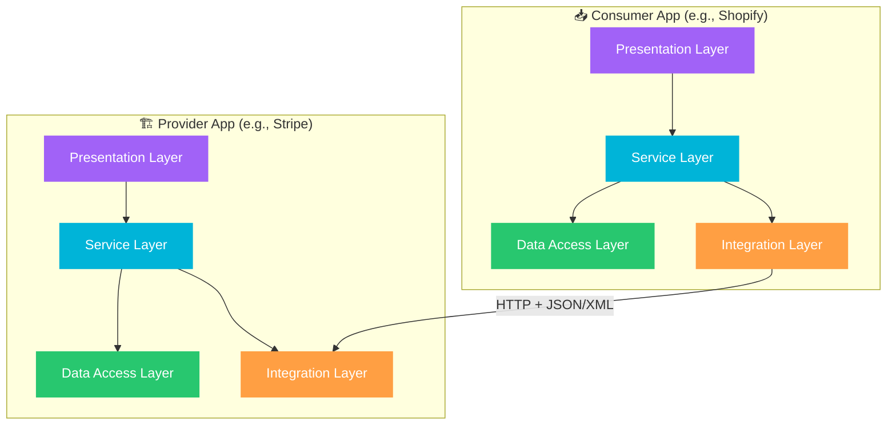
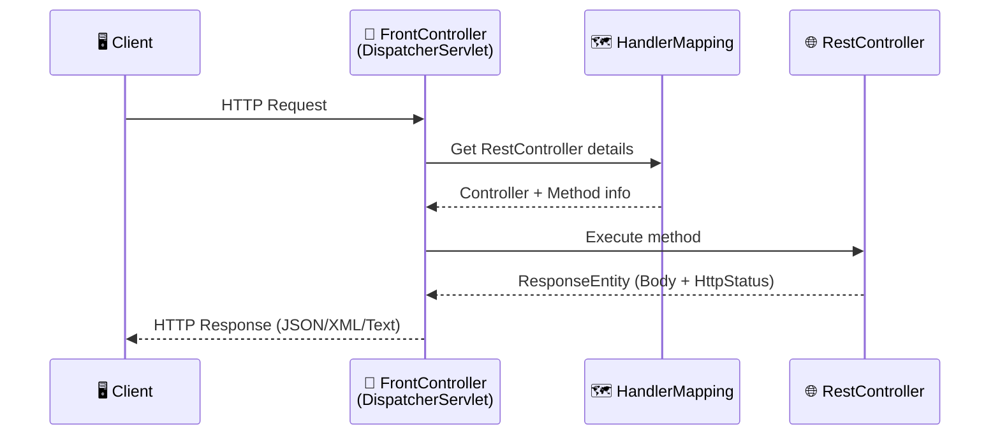

# Spring REST Introduction

**Spring REST Introduction** | We will discuss Spring REST, HttpStatus, ResponseEntity, Request Method, and more.

- [Webservices (REST)](#1-webservices-rest)
- [Spring REST](#2-spring-rest)
- [Request Method](#3-request-method)
- [Response Status](#4-response-status)
- [ResponseEntity](#5-responseentityt)
- [Media Type Annotations](#6-media-type-annotations)
- [Adding XML Support in Spring REST](#7-adding-xml-support-in-spring-rest)
- [Application Example](#8-application-example)

---

## 1. Webservices (REST)

Web services represent the **integration of applications** — linking two or more applications that are running on the same or different servers.

Two different web services can be in different technologies/languages. For example, one web service uses Java and another one uses .NET. Therefore they have to work with a global format (XML/JSON).

- 🌐 Web services are implemented using HTTP Protocol and data in Global Format (XML/JSON).
- 🖥️ Web services are not for UI design — they are used for integration. For UI use: ReactJS, JSF, Thymeleaf, etc.

Web services are two types:

- 📡 **SOAP** web services (XML Concept — Simple Object Access Protocol)
- 🔗 **REST** web services (Representational State Transfer)

🧠 **In Simple Words — REST (Representational State Transfer):**

- **State** = Data
- **Transfer** = Send/Receive
- **Representation** = With Protocol (HTTP) + Global Format (XML/JSON)

REST means the exchange of data between applications using HTTP protocol and data in Global Format.

### Application Layers

To develop any web application we use 3 layers:

1. **PL** — Presentation Layer
2. **SL** — Service Layer
3. **DAL** — Data Access Layer

To create a link (communication) we use a 4th layer:

4. **IL** — Integration Layer

This Integration Layer must be present in two applications:

- 🏗️ One application behaves like the **Service Provider**
- 📥 Another one behaves like the **Service Consumer**

> 💡 **Example:** Shopify is using the service of Stripe. Shopify is a consumer and Stripe is a provider. One application can behave like a consumer for one integration and a producer for another.



---

## 2. Spring REST

To implement REST Webservices, Spring framework has provided a Web API called **Spring REST** (REST API).

Sun has provided an API called **JAX-RS** (rules and guidelines). Implementation with new Annotations API is given by Spring REST.

By using Spring REST we can implement Provider and Consumer Applications:

- 🏗️ **Provider** using: `RestController`
- 📥 **Consumer** using: `RestTemplate`

### Usage Scenarios

| Case 🔢 | Provider 🏗️ | Consumer 📥 | Description 📋 |
|---------|------------|------------|----------------|
| **Case #1** | `RestController` (Boot) | `RestTemplate` (Boot) | Both are different Boot applications integrated via Spring Boot REST |
| **Case #2** | `RestController` (Boot) | Angular / React / Android | Single application designed as frontend and backend |
| **Case #3** | `RestController` (Boot) | .NET Client / PHP Client | Two different applications (Java and non-Java) integrated via Spring Boot REST |

📝 **Note:** In Case #3, the reverse is also possible — the Provider can be .NET/PHP/Python and the Consumer can be `RestTemplate`.

### Provider Workflow Design



The provider workflow works as follows:

1. 📥 Client makes a request to Provider, taken by FC (`DispatcherServlet`).
2. 🗺️ With the help of `HandlerMapping`, FC gets `RestController` details and executes code.
3. 📤 `RestController` gives output in String/Object/Collection format — this is called the **Entity** (Final Output) — placed in the Response object along with HTTP Status.
4. 🔄 `ResponseEntity` is given back to FC, which sends it to the client.
5. 🔀 If Entity is non-String (object or Collection) e.g., `List`, `Student`, `Product[]`, then data is converted into XML or JSON.
6. 📄 If it is a String, it is sent as text format (`text/plain`) as Response Body.

> 🔑 **Key Point:** HTTP Protocol has Request Method (9) and Response Status.

---

## 3. Request Method

| Method 🏷️ | Purpose 📋 | Example 🛠️ |
|-----------|-----------|------------|
| **`GET`** | Fetch resources (data) from the Provider App | `getEmployees()`, `getEmployeeById()` |
| **`POST`** | Create new resource (data) at Provider App | `saveEmployee()`, `createProduct()` |
| **`PUT`** | Modify existing (full data) resources at Provider App | `updateEmployee()`, `modifyEmpData()` |
| **`DELETE`** | Remove existing resource (data) from Provider App | `deleteEmployeeById()` |
| **`PATCH`** | Modify existing (partial data) resource at Provider App | `updateEmployeeMailById()` |
| **`HEAD`** | Retrieve headers only (no body) | — |
| **`TRACE`** | Diagnostic / loop-back test | — |
| **`OPTIONS`** | Describe communication options | — |
| **`CONNECT`** | Establish tunnel to server | — |

> ⚠️ **Caution:** All the above methods are **recommended standards** given to all developers in the world. They are not MUST methods — they are good naming conventions. You *can* create resources using `GET`, delete using `POST`, partial updates using `PUT`, etc., but that is not the correct usage.

🧠 **In Simple Words:** Think of a house — Bedroom and Kitchen are there. You *can* cook in the bedroom and sleep in the kitchen, but that is not the correct usage of those rooms. This is a contract between two developers, so naming standards are recommended to follow.

---

## 4. Response Status

It represents what happened at the server at the end of processing.

| Code Range 🔢 | Category 📋 | Meaning 💡 |
|---------------|------------|-----------|
| **1xx** | Information | Request received, continuing process |
| **2xx** | Success | Request successfully received and processed |
| **3xx** | Redirect | Further action needed to complete the request |
| **4xx** | Client Side Error | Request contains bad syntax or cannot be fulfilled |
| **5xx** | Server Side Error | Server failed to fulfill a valid request |

To define a `RestController` code (class + method), it must have:

- 🔗 One unique path
- 📡 One HTTP Method
- 📦 Must return data in Global Format (JSON/XML)
- 🏷️ HTTP Status

---

## 5. ResponseEntity<T>

**Entity** (Final Output) placed inside Response. This is used as the Controller method return type. Here `T` = Type can be `String` / `Class` / `Collection`.

- 📄 If the return type is **String**, then the HTTP Response is **Text Format** (`Content-Type: text/plain`).
- 📦 If the return type is **non-String**, then the HTTP Response is **JSON** (`Content-Type: application/json`).

> 📝 **Note:** Since Spring Boot version 2.x, it supports only JSON format by default. XML support is not present by default, but we can add an additional dependency to enable it.

### JSON vs XML

**Which is preferred for Object Format in Webservices — JSON or XML?**

✅ **JSON** is preferred because of the following reasons:

- 🔧 Representation is easy `{ key: val }`
- 💾 Needs less memory (compared to XML)
- ⚡ Execution/transfer is very fast
- ❌️ XML is more complex in design if data increases

**XML example:**

```xml
<employee>
  <eid>10</eid>
  <ename>A</ename>
</employee>
```

**JSON example:**

```json
{
  "eid": 10,
  "ename": "A"
}
```

---

## 6. Media Type Annotations

REST has provided two media type annotations:

- 📥 `@RequestBody` (Input MediaType)
- 📤 `@ResponseBody` (Output MediaType)

### @RequestBody

`@RequestBody` reads the HTTP request first. It checks the Header Param `Content-Type`. If the type is non-String (not `text/plain`, e.g., `application/json`, `application/xml`) then the data/content is converted into Object format and given to the Controller method parameter.

> 💡 **Tip:** Spring MVC `@ModelAttribute` (FORM DATA) is the same concept as Spring REST `@RequestBody`.

### @ResponseBody

`@ResponseBody` takes the Controller method return type first. If the type is non-String (e.g., `Employee`, `List`) then data is converted into JSON/XML (based on request type) and placed in the HTTP Response Body Section. It also updates the `Content-Type` header parameter.

> 💡 **Tip:** Spring MVC `Model` is the same concept as Spring REST `@ResponseBody`.

> 📝 **Note:** `@ResponseBody` annotation is optional to apply over the method because internally `@RestController` already applies `@ResponseBody`. It works only for non-String types.

---

## 7. Adding XML Support in Spring REST

The default output type is JSON — `@ResponseBody` converts the return type to JSON data only. XML support is not given by default.

To get XML output in place of JSON:

1️⃣ **Add dependency:**

Maven (`pom.xml`):

```xml
<dependency>
    <groupId>com.fasterxml.jackson.dataformat</groupId>
    <artifactId>jackson-dataformat-xml</artifactId>
</dependency>
```

Gradle (`build.gradle`):

```groovy
implementation 'com.fasterxml.jackson.dataformat:jackson-dataformat-xml'
```

2️⃣ **Provide Header param `Accept` in the request.**

### Accept Header Explained

- 🔑 **What is the `Accept` Header Param?** It is added in the request but specifies what the expected response type is. In simple words, the request is asking: "please accept my expected output type."
- ⚖️ **Difference between `Content-Type` and `Accept`:** `Content-Type` (Request/Response) indicates what data exists in the Body (either request or response). `Accept` (Request) says what the expected response `Content-Type` should be.

> ⚠️ **Warning:** If the application does not support XML and we send `Accept: application/xml`, the FrontController returns HTTP Status **406 Not Acceptable**.

### Accept Header Examples

| Scenario 🔢 | Accept Header 📋 | Condition ⚙️ | Result 📤 |
|-------------|-----------------|-------------|----------|
| **Q#1** | `application/xml` | XML Not Supported | ❌️ 406 Not Acceptable |
| **Q#1** | `application/xml` | XML Supported | ✅ XML Output (200-OK) |
| **Q#2** | `application/xml, application/json` | XML Not Supported | ✅ JSON (200-OK) |
| **Q#2** | `application/xml, application/json` | Both not supported | ❌️ 406 Not Acceptable |
| **Q#3** | `application/xml, */*` | XML, JSON Not Supported | ✅ Any Format (e.g., HTML, TEXT, IMAGE — 200-OK) |
| **Q#3** | `application/xml, */*` | JSON only Supported | ✅ JSON (200-OK) |

**Understanding priority in `Accept` header:**

- `Accept = application/xml, */*` — Requesting XML with 1st priority. If not accepted, any data is fine. The client is ready to take any data.
- `Accept = application/xml, application/json` — Requesting XML as 1st priority, JSON as 2nd priority. If neither is supported, 406 Not Acceptable.

> 🔑 **Key Point:** If the `Accept` Header Param contains `*/*`, the client never gets 406 from the Provider — it will get any one type of response.

---

## 8. Application Example

📦 **Dependencies:** Spring Web, Lombok, DevTools

**Model class:**

```java
@Data
@NoArgsConstructor
@AllArgsConstructor
public class Employee {
   private Integer eid;
   private String ename;
   private Double esal;
}
```

**RestController:**

```java
@RestController
public class EmployeeRestController {
    @GetMapping("/obj")
    public ResponseEntity<Employee> showDataB() {
        Employee body = new Employee(106, "SYED", 600.0);
        return new ResponseEntity<Employee>(body, HttpStatus.OK);
    }

    @GetMapping("/list")
    public ResponseEntity<List<Employee>> showDataD() {
        List<Employee> body = Arrays.asList(
            new Employee(101, "A", 30.0),
            new Employee(102, "B", 31.0),
            new Employee(103, "C", 32.0),
            new Employee(104, "D", 33.0)
        );
        return new ResponseEntity<List<Employee>>(body, HttpStatus.OK);
    }

    @GetMapping("/listb")
    public ResponseEntity<List<String>> showDataE() {
        List<String> body = Arrays.asList("ONE","TWO","ABC");
        return new ResponseEntity<List<String>>(body, HttpStatus.OK);
    }
}
```
