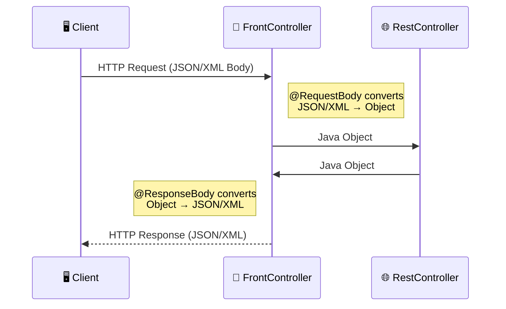
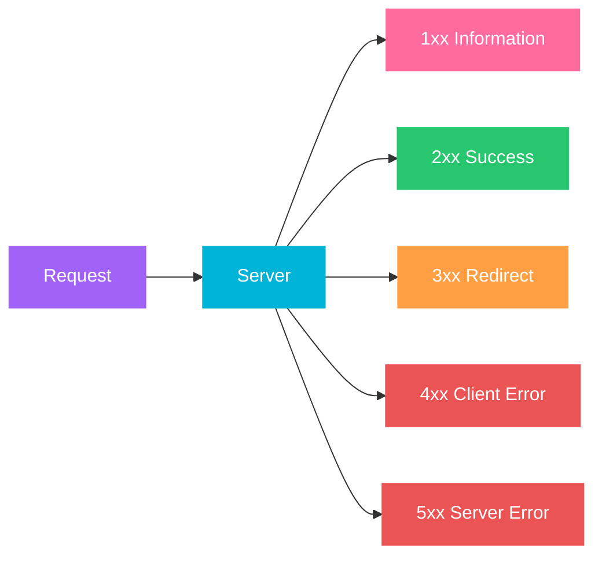

# MediaType Annotations and HttpStatus

**MediaType Annotations and HttpStatus** | Understanding `@RequestBody`, `@ResponseBody`, and HTTP Status codes in Spring REST.

- [RequestBody and ResponseBody in Spring REST](#1-requestbody-and-responsebody-in-spring-rest)
- [Example Application](#2-example-application)
- [Enabling XML Support](#3-enabling-xml-support)
- [Different Combinations of Input and Output](#4-different-combinations-of-input-and-output)
- [HttpStatus](#5-httpstatus)
- [HttpStatus Success Codes](#6-httpstatus-success-codes)
- [Client Side Error Codes](#7-client-side-error-codes)

---

## 1. RequestBody and ResponseBody in Spring REST

- 📤 **`@ResponseBody`** — It is a return type representing non-String. Returns data in JSON/XML format. The object will be converted to JSON/XML.
- 📥 **`@RequestBody`** — It is a parameter (non-String). JSON/XML is converted to an object.

📝 **Note:** Using `@ResponseBody` is optional because `@RestController` will take care of that. But `@RequestBody` annotation must be applied externally.

🔑 **Key Points about `@RequestBody`:**

- 🏷️ `@RequestBody` should be used as the method parameter.
- 🔄 It will read the HTTP Request Body (XML/JSON) and convert it to Object Format.
- 🛠️ Syntax: `@RequestBody ClassName objectName`
- 📡 The end client/consumer must specify one header parameter: `Content-Type:____`
- ⚠️ To send data from consumer to producer, GET request is not supported. (GET request never supports `@RequestBody`).



---

## 2. Example Application

Create a Spring starter project and add the following dependencies: Lombok, Spring Web.

1️⃣ **Model class:**

```java
@Data
@NoArgsConstructor
@AllArgsConstructor
public class Employee {
    private Integer eid;
    private String ename;
    private Double esal;
}
```

2️⃣ **RestController:**

```java
@RestController
@RequestMapping("/employee")
public class EmployeeRestController {

    @PostMapping("/read")
    public ResponseEntity<String> readEmp(@RequestBody Employee employee) {
        return ResponseEntity.ok(employee.toString());
    }
}
```

Start the application. API: `http://localhost:8080/employee/read`

📥 **Request Body (JSON):**

```json
{
  "eid" : 10,
  "ename" : "ABC",
  "esal" : 300.2
}
```

📤 **Output:** It will create the following object: `Employee(eid=10, ename=ABC, esal=300.2)`

💡 **Tip:** Even `{ }` in the request body is a valid JSON, that indicates objects created with default values: `Employee(eid=null, ename=null, esal=null)`

📥 **XML Input (Postman):**

In the postman, in the body change the type to XML and try to send the below data:

```xml
<Employee>
  <eid>101</eid>
  <ename>ABC</ename>
  <esal>250.0</esal>
</Employee>
```

🚨 If we try to send XML Input using `@RequestBody` but the application is not supporting XML, then FrontController returns HTTP Status 415 Unsupported MediaType.

📤 **Error Response:**

```json
{
    "timestamp": "2024-06-21T01:15:18.107+00:00",
    "status": 415,
    "error": "Unsupported Media Type",
    "trace": "org.springframework.web.HttpMediaTypeNotSupportedException: Content-Type 'application/xml;charset=UTF-8' is not supported...",
    "message": "Content-Type 'application/xml;charset=UTF-8' is not supported.",
    "path": "/employee/read"
}
```

⚠️ **Caution:** If output XML (`@ResponseBody`) is not supported then you get 406 -- Not Acceptable.

---

## 3. Enabling XML Support

To enable XML support, add the XML dependency in `pom.xml` file, and restart the application:

**Dependency:**

Maven (`pom.xml`):

```xml
<dependency>
  <groupId>com.fasterxml.jackson.dataformat</groupId>
  <artifactId>jackson-dataformat-xml</artifactId>
</dependency>
```

Gradle (`build.gradle`):

```groovy
implementation 'com.fasterxml.jackson.dataformat:jackson-dataformat-xml'
```

---

## 4. Different Combinations of Input and Output

| Accept (Input) 📥 | Return (Output) 📤 |
|--------------------|---------------------|
| **JSON** | JSON |
| **XML** | JSON |
| **XML** | XML |
| **JSON** | XML |

1️⃣ **Updated Model class:**

```java
@Data
@NoArgsConstructor
@AllArgsConstructor
public class Employee {
    private Integer eid;
    private String ename;
    private Double esal;
    private Double hra;
    private Double ta;
}
```

2️⃣ **Updated RestController:**

```java
@RestController
@RequestMapping("/employee")
public class EmployeeRestController {

    @PostMapping("/read")
    public ResponseEntity<Employee> readEmp(@RequestBody Employee employee) {
        var sal = employee.getEsal();
        var hra = sal * 10 / 100.0;
        var ta = sal * 6 / 100.0;

        employee.setHra(hra);
        employee.setTa(ta);

        return ResponseEntity.ok(employee);
    }
}
```

📥 **Sample XML Input:**

```xml
<Employee>
  <eid>101</eid>
  <ename>AA</ename>
  <esal>1000.0</esal>
</Employee>
```

📥 **Sample JSON Input:**

```json
{
  "eid" : 999,
  "ename" : "SYED",
  "esal" : 500.0
}
```

### Case 1: Accept JSON and Return JSON

It is the default one. In body => raw => JSON.

### Case 2: Accept XML and Return JSON

In body => raw => XML. Send the XML data, it will return JSON data.

### Case 3: Accept XML and Return XML

In Headers mention `KEY=Accept` and `VALUE=application/xml`. In body => raw => XML.

### Case 4: Accept JSON and Return XML

In Headers mention `KEY=Accept` and `VALUE=application/xml`. In body => raw => JSON.

> 📝 **Note:** At a time only one type of input/output is supported.

---

## 5. HttpStatus

- 💡 It indicates what is the final response status for a request.
- 🌐 It is a global type i.e. every language can understand.
- 🔢 It is the combination of Number and Code (message).
- 📡 For every request, one response is given.
- 🏷️ For every response, one status code is provided.
- 📂 These are categorized into 5 types.

| Category 🏷️ | Code Range 🔢 | Description 📋 | Sample Codes 🛠️ |
|-------------|--------------|----------------|-----------------|
| **Information** | 1xx | Details about processing | 100, 101, 102, ... |
| **Success** | 2xx | Processed successfully | 200, 201, 202, ... |
| **Redirect** | 3xx | Moved from one server/link to another | 300, 301, 302, ... |
| **Client Side Error** | 4xx | User data problem, invalid format | 400, 401, 403, 404, ... |
| **Server Side Error** | 5xx | Issue in code (e.g., `NullPointerException`, `SQLException`) | 500, 501, 502, ... |



---

## 6. HttpStatus Success Codes

| Status Code ✅ | Name 🏷️ | When to Use 📋 |
|---------------|---------|----------------|
| **200** | OK | Request processed successfully (no exception/no error) |
| **201** | CREATED | New data (resource) is created at the server side (e.g., DB row inserted, PDF created) |
| **202** | ACCEPTED | Request accepted for async processing but not yet completed (e.g., bulk job queued) |
| **204** | NO CONTENT | For `void` return type (e.g., delete one record) |

---

## 7. Client Side Error Codes

| Status Code 🚨 | Name 🏷️ | Description 📋 |
|----------------|---------|----------------|
| **400** | BAD REQUEST | Input data type mismatch or required params missing. Ex: `int sid = __URL?sid=ABC` |
| **401** | UNAUTHORIZED | Try to access the URL without login (Security) |
| **403** | FORBIDDEN | Invalid role access (Security). Logged in as Clerk, but trying to access Manager services |
| **404** | NOT FOUND | Entered URL doesn't match with any RestController method |
| **405** | METHOD NOT ALLOWED | Code is GET type but the request is POST type |
| **406** | NOT ACCEPTABLE | Request using `Accept=__` header, Content-Type is not supported |
| **415** | UNSUPPORTED MEDIA TYPE | Request Body MediaType (`Content-Type=__`) is not supported |

> 🔗 **See more:** [HTTP response status codes](https://developer.mozilla.org/en-US/docs/Web/HTTP/Status)
