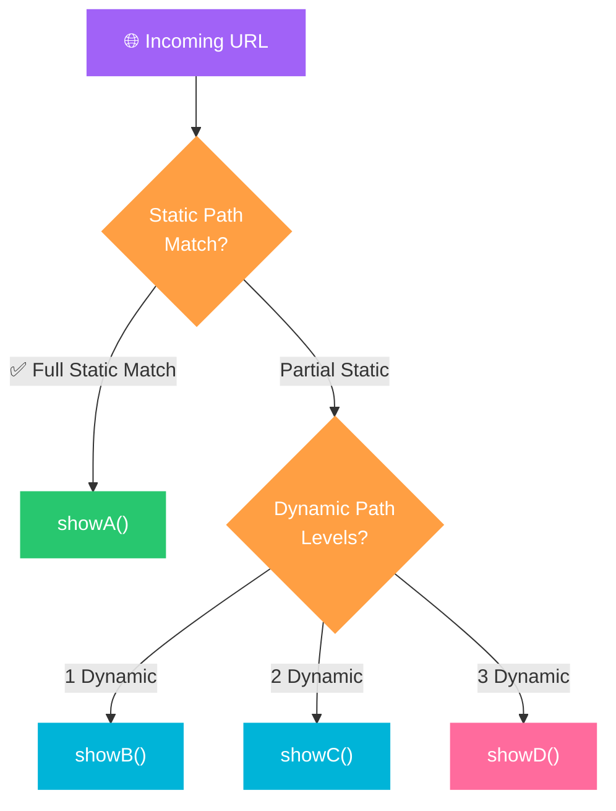

# @RequestParam and @PathVariable in Spring Boot REST

**@RequestParam and @PathVariable in Spring Boot REST** | We will discuss how to pass request parameters to the REST APIs. To pass request parameters `@RequestParam` and `@PathVariable` are used in Spring.

- [RequestParam in Spring Boot REST](#1-requestparam-in-spring-boot-rest)
- [RequestParam Required and Default Value](#2-requestparam-required-and-default-value)
- [PathVariable in Spring Boot REST](#3-pathvariable-in-spring-boot-rest)
- [PathVariable URL Level Matching](#4-pathvariable-url-level-matching)
- [Different Cases with PathVariable](#5-different-cases-with-pathvariable)

---

## 1. RequestParam in Spring Boot REST

Request Parameter format: `URL?key=val&key=val&key=val....`

- 🌐 Data is sent to the application using the URL in `key=val` format.
- 🔄 We can pass multiple key=val, it is not required to follow the order of parameters present in the method declaration.

🏷️ **Reading Data Syntax:**

```java
@RequestParam("key") DataType localVariable

// or
// keyName and variable name are same
@RequestParam DataType key
```

💡 **Tip:** It even supports type conversion (String -> int) based on the data type that you have provided. The default data type is `String`.

Many web apps are using `@RequestParam`, even we can use same in webservices also.

🛠️ **Example — Google Search URL:**

```
https://www.google.com/search
? q=india
& oq=india
& aqs=chrome..69i57j46i275i433j0i131i433l3j0j69i60j69i65.2086j0j7
& sourceid=chrome
& ie=UTF-8
```

⚙️ It internally uses the servlets concept.

```java
@RequestParam("sid") Integer id
```

📜 **Servlets equivalent code:**

```java
String sid = request.getParameter("sid");
Integer id = Integer.parseInt(sid);
```

🛠️ **Request Parameter Example:**

```java
@RestController
public class ProductRestController {

    @GetMapping("/data")
    public String showData(@RequestParam Integer pid, @RequestParam String pcode,
                   @RequestParam Double pcost) {
        return "{ pid :" + pid + ", pcode: " + pcode + ", pcost: " + pcost + " }";
    }

}
```

📡 **URLs:**

- `http://localhost:8080/data?pid=10&pcode=PEN&pcost=300`
- `http://localhost:8080/data?pcode=PEN&pcost=400&pid=101`

📝 **Note:** Here the order of parameters are not important.

---

## 2. RequestParam Required and Default Value

### @RequestParam(required = false, defaultValue = "value")

How can we make `@RequestParam` from required to optional? By default, `@RequestParam` is required (i.e. `required = true`). In `required = true` case, if we did not send data then FrontController returns **400-Bad Request**. But if we want to make it optional, then we have to mention a default value.

🏷️ **Syntax:**

```java
@RequestParam(required = false, defaultValue = "value") DataType localVariable
```

📝 **Note:** The default value must be passed as a string.

🛠️ **Example:**

```java
@RestController
public class ProductRestController {

    @GetMapping("/data")
    public String showData(@RequestParam Integer pid, @RequestParam String pcode,
            @RequestParam(required = false, defaultValue = "100") Double pcost) {
        return "{ pid :" + pid + ", pcode: " + pcode + ", pcost: " + pcost + " }";
    }
}
```

📡 **URL:** `http://localhost:8080/data?pid=10&pcode=PEN`

📤 **Response:** `{ pid :10, pcode: PEN, pcost: 100.0 }`

---

## 3. PathVariable in Spring Boot REST

There are two types of paths:

- 🔗 **Static Path** — It indicates the location (path) given to the resource (Controller#method). Example: `/product/export`, `/employee/save` .. etc.
- 🔀 **Dynamic Path** — It indicates sending data along with the URL as path type without any key (direct value). Example: `/product/{id}`, `/employee/find/{code}`. Here `/{  }` indicates dynamic path (i.e. send data at runtime).

`@PathVariable` is used for dynamic paths.

- 🧹 PathVariables are also called **clean URLs** (no additional symbols `?` `&` as they are overloaded).
- 📋 It must follow the order. It avoids confusion for other devs/users.
- ⚡ Execution is bit faster compared to `@RequestParam`.
- 📉 URL size also gets reduced.

⚖️ **Comparison:**

| Format | URL Example 🌐 |
|--------|----------------|
| **With @RequestParam** | `http://localhost:8080/data?pid=10&pcode=PEN&pcost=300` |
| **With @PathVariable** | `http://localhost:8080/data/10/PEN/300` |

🏷️ **Reading Data Syntax:**

```java
@PathVariable("key") DataType localVariable

// or
// keyName and variable name are same
@PathVariable DataType key
```

💡 **Tip:** It even supports type conversion (String -> int) based on the data type that you have provided. The default data type is `String`.

While adding path in code, we must specify static and dynamic path details using `@___Mapping("___")` annotation.

🔑 **3 Steps:**

1. 1️⃣ **Define Dynamic Path at Method Level.** Example: `@GetMapping("/employee/find/{eid}")`
2. 2️⃣ **Read Path Variable data at Method Param.** Example: `@PathVariable Integer eid`
3. 3️⃣ **Pass data using Request URL.** Example: `http://localhost:8080/employee/find/10`

```mermaid
graph LR
    A["1️⃣ Define Path<br/>@GetMapping(\"/find/{eid}\")"] --> B["2️⃣ Read Variable<br/>@PathVariable Integer eid"]
    B --> C["3️⃣ Request URL<br/>/employee/find/10"]

    classDef purple fill:#A162F7,stroke:#A162F7,color:#fff
    classDef cyan fill:#00b4d8,stroke:#00b4d8,color:#fff
    classDef green fill:#28C76F,stroke:#28C76F,color:#fff

    class A purple
    class B cyan
    class C green
```

---

## 4. PathVariable URL Level Matching

While making the request we must maintain the number of level counts in the code. It should be equal to URL path levels.

🛠️ **Example:** In code: `@GetMapping("/emp/find/data/{code}")`

**@PathVariable URL Matching:**

| URL 🌐 | Result 📋 |
|---------|----------|
| `http://localhost:8080/emp/find/data/A` | ✅ Valid |
| `http://localhost:8080/emp/find/data/A/B` | ❌️ 404 – Not Found |
| `http://localhost:8080/emp/find/data` | ❌️ 404 – Not Found |

**@RequestParam URL Matching (for comparison):**

| URL 🌐 | Result 📋 |
|---------|----------|
| `http://localhost:8080/emp/find/data?code=A` | ✅ Valid |
| `http://localhost:8080/emp/find/data?code=A&dec=B` | ✅ Valid, Additional Param |
| `http://localhost:8080/emp/find/data` | ⚠️ 400 – Bad Request |

---

## 5. Different Cases with PathVariable

### Case 1 — Ambiguous Handler Methods

```java
@GetMapping("/emp/find/{a}")
public String m1(@PathVariable String a) {
   // code
}

@GetMapping("/emp/find/{b}")
public String m1(@PathVariable String b) {
   // code
}
```

📡 **URL:** `http://localhost:8080/emp/find/ABC`

🚨 **Response:** 500 – Internal Server Error. `IllegalStateException: Ambiguous handler methods`

⚠️ **Caution:** Just because of name/datatype change in dynamic path, they are never going to be different URLs.

### Case 2 — Multiple Methods with Same Request URL through Static and Dynamic Path

If a request URL is matched with multiple methods that are defined using PathVariables, then **first priority is given to more static count levels**. (Static means letter to letter should be compared including case {case-sensitive} — full path must be the same). If not, then come to the next level dynamic paths.

🛠️ **Example:**

```java
@RestController
public class ProductRestController {

    @GetMapping("/emp/mode/code")
    public String showA() {
        return "FROM#A";
    }

    @GetMapping("/emp/mode/{code}")
    public String showB(@PathVariable String code) {
        return "FROM#B " + code;
    }

    @GetMapping("/emp/{mode}/{code}")
    public String showC(@PathVariable String mode, @PathVariable String code) {
        return "FROM#C " + mode + "," + code;
    }

    @GetMapping("/{emp}/{mode}/{code}")
    public String showD(@PathVariable String emp, @PathVariable String mode,
                @PathVariable String code) {
        return "FROM#D " + emp + ", " + mode + "," + code;
    }

}
```

📝 **Note:** If we call `http://localhost:8080/emp/mode/code` then `showA()` method will be executed because the path `emp/mode/code` is matched (all static).

We can even have paths with all dynamics (valid).

📝 **Note:** If we call `http://localhost:8080/Emp/Mode/code` then `showD()` will be executed. URL is **case-sensitive**. The `showA()`, `showB()`, `showC()` methods start with `/emp` but the URL contains `/Emp`. The `showD()` method starts with the dynamic path therefore it will be executed.



🔑 **Priority Resolution Table:**

| URL 🌐 | Selected Method 🎯 |
|---------|-------------------|
| `/emp/mode/xyz` | `showB()` |
| `/emp/xyz/xyz` | `showC()` |
| `/emp/Mode/code` | `showC()` |
| `/emp/Mode/xyz` | `showC()` |
| `/xyz/xyz/xyz` | `showD()` |
| `/Emp/xyz/xyz` | `showD()` |
| `/Emp/Mode/xyz` | `showD()` |
