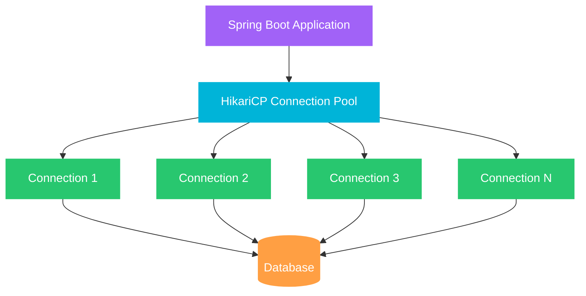

# Hikari Connection Pooling in Spring Boot

**Hikari Connection Pooling in Spring Boot** | Pool is a group of Objects that are of the same type. Example: Admin Pool = Admin Objects, Spring Constant Pool = String Objects, Product Pool = Product Objects, ..etc. Connection Pool = Database Connection.

- [Connection Pooling Overview](#1-connection-pooling-overview)
- [HikariCP in Spring Boot](#2-hikaricp-in-spring-boot)
- [HikariCP Core Classes](#3-hikaricp-core-classes)
- [HikariCP Configuration Properties](#4-hikaricp-configuration-properties)
- [HikariCP Configuration Properties Details](#5-hikaricp-configuration-properties-details)
- [Default Values](#6-default-values)

---

## 1. Connection Pooling Overview

A **pool** is a group of objects that are of the same type, pre-created and ready for reuse. In the context of databases, a **Connection Pool** manages a set of reusable database connections, avoiding the overhead of creating a new connection for every request.



🧠 **In Simple Words:**
Instead of opening and closing a database connection every time, HikariCP keeps a pool of connections ready to use — this is significantly faster and more efficient.

---

## 2. HikariCP in Spring Boot

By default, Spring Boot uses **HikariConfig** which **comes with default auto-configuration**. When we add **Data JPA** or **JDBC API**, the following dependency is added automatically and comes with auto-configuration.

**HikariCP Dependency (auto-included):**

Maven (`pom.xml`):

```xml
<dependency>
  <groupId>com.zaxxer</groupId>
  <artifactId>HikariCP</artifactId>
  <version>3.4.5</version>
  <scope>compile</scope>
</dependency>
```

Gradle (`build.gradle`):

```groovy
implementation 'com.zaxxer:HikariCP:3.4.5'
```

📜 Spring Boot 1.x was supporting Tomcat Connection Pooling, now it is moved to HikariCP (since Spring Boot 2.x).

> ⚠️ **Caution:** Tomcat Connection Pooling is not recommended because it is server-based and if we move from one server to another then it might not work.

---

## 3. HikariCP Core Classes

- ⚙️ **`HikariConfig`(C)** — It comes with all default values for Configuration.
- 💾 **`HikariDataSource`(C)** — It is an implementation class for `DataSource`(I). Here DataSource means Database Connection.

---

## 4. HikariCP Configuration Properties

🔧 **Configuration** (`application.properties`):

```properties
# connection pooling details
spring.datasource.hikari.pool-name=my-hikari-cp

# default started with 10 connections
spring.datasource.hikari.minimum-idle=15

spring.datasource.hikari.idle-timeout=6000000

# should be more than 250 milli seconds; 180000ms = 3 minutes
spring.datasource.hikari.connection-timeout=180000

spring.datasource.hikari.maximum-pool-size=20
```

---

## 5. HikariCP Configuration Properties Details

| Property 🏷️ | Description 📋 | Example Value 🛠️ |
|-------------|---------------|-----------------|
| **`spring.datasource.hikari.pool-name`** | Provide a name to the Connection Pool Object | `my-hikari-cp` |
| **`spring.datasource.hikari.maximum-pool-size`** | Max number of Connections created at Pool (int, cannot be < 1) | `20` |
| **`spring.datasource.hikari.minimum-idle`** | Max number of non-used/no-work connections to be kept in Pool | `15` |
| **`spring.datasource.hikari.connection-timeout`** | Time in milliseconds for a Connection Timeout of a SQL query execution | `180000` (3 min) |
| **`spring.datasource.hikari.idle-timeout`** | Time in milliseconds for idle connection detection | `600000` (10 min) |

📝 **Note:** By default, the Connection Pool starts with 10 connections (`DEFAULT_POOL_SIZE = 10`) and later applies your custom configuration.

---

## 6. Default Values

| Property ⚙️ | Default Value 🕐 |
|-------------|-----------------|
| **IDLE_TIMEOUT** | 10 Minutes |
| **MAX LIFETIME** of a Connection | 30 Minutes |
| **CONNECTION TIMEOUT** | 30 Seconds |
| **VALIDATION_TIMEOUT** (Connection validation) | 5 Seconds |

> 💡 **Tip:** These defaults work well for most applications. Only override them if you have specific performance requirements or database constraints.
