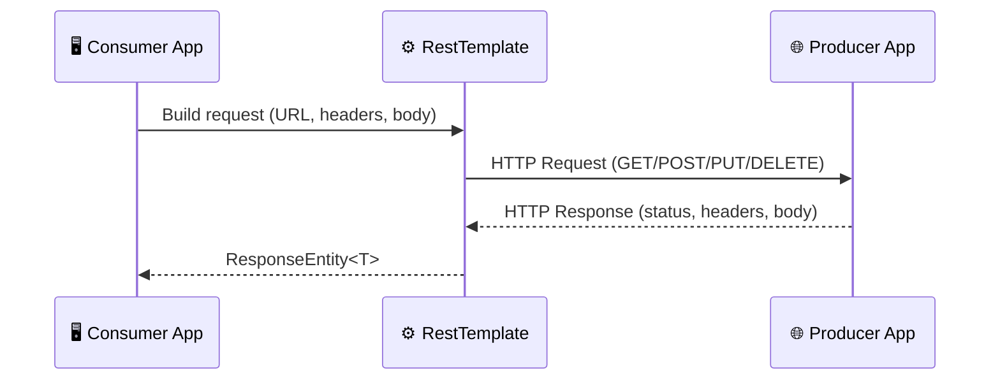
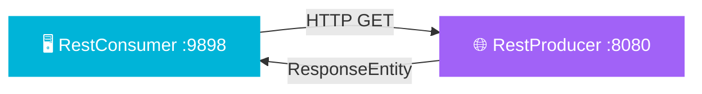

# RestTemplate in Spring Boot

**RestTemplate in Spring Boot** | RestTemplate class is used to make HTTP calls to any web service application (Java and non-Java apps) that reads the final response into `ResponseEntity` or a direct type. It supports auto-type conversion of Input/Output into GlobalFormat (i.e. Object to JSON/XML and JSON/XML to Object).

- [RestTemplate Example in Spring Boot](#1-resttemplate-example-in-spring-boot)
- [RestTemplate POST Example](#2-resttemplate-post-example)
- [RestTemplate exchange() Method](#3-resttemplate-exchange-method)
- [PUT and DELETE Examples](#4-put-and-delete-examples)
- [Auto-Type Conversion Support for ResponseType](#5-auto-type-conversion-support-for-responsetype)

---

`RestTemplate` is the core class in Spring for making synchronous HTTP calls to external services.

- 🌐 We can read header information, body, status code, and more from the response.
- 🔗 `RestTemplate` needs a major input: the **URL** of the target service.
- 📋 All endpoint details must be provided — the endpoint contains the URL, HTTP Method, Input, Output, and Supported Media Type details.
- 📡 Details required to make an HTTP call to a service are called **Endpoint details**.
- ⚙️ `RestTemplate` supports all HTTP Method types (`GET`, `POST`, `PUT`, `DELETE`, etc.).

> ⚠️ **Maintenance Mode:** `RestTemplate` has been in maintenance mode since Spring 5 — no new features, only critical bug fixes. For new applications, prefer **`WebClient`** (reactive-ready, part of `spring-webflux`) or **Spring Cloud OpenFeign** (declarative, ideal for microservices).

🧠 **In Simple Words:**
`RestTemplate` is like a built-in HTTP client that your Spring Boot application uses to talk to other REST services — similar to Postman, but in code.

> 💡 **Use Case:** Movie Booking application (Consumer) calls Bank application (Producer) to process payments.



| Method 🛠️ | HTTP Type 🌐 | Returns 📤 | Use Case 📋 |
|-----------|-------------|-----------|------------|
| **`getForEntity()`** | GET | `ResponseEntity<T>` | Fetch data with full response details |
| **`getForObject()`** | GET | `T` (body only) | Fetch data when only body is needed |
| **`postForEntity()`** | POST | `ResponseEntity<T>` | Create resource with full response |
| **`exchange()`** | Any | `ResponseEntity<T>` | Universal method for all HTTP types |
| **`put()`** | PUT | `void` | Update resource (no response) |
| **`delete()`** | DELETE | `void` | Delete resource (no response) |

---

## 1. RestTemplate Example in Spring Boot

Create a Spring Boot project **RestProducer** with the following dependencies: `Lombok`, `Spring Web`, `Spring Boot DevTools`.

Create another Spring Boot project **RestConsumer** with the following dependencies: `Lombok`, `Spring Web`.

> 📝 **Note:** Assume that both projects are two different servers running on different ports.



### Producer Application

**RestController (Producer):**

```java
package com.knowprogram.demo.rest;

import org.springframework.http.ResponseEntity;
import org.springframework.web.bind.annotation.GetMapping;
import org.springframework.web.bind.annotation.RequestMapping;
import org.springframework.web.bind.annotation.RestController;

@RestController
@RequestMapping("/std")
public class StudentRestController {

    @GetMapping("/data")
    public ResponseEntity<String> showMsg() {
        return ResponseEntity.ok("Hello");
    }
}
```

### Consumer Application

🔧 **Configuration** (`application.properties`):

```properties
server.port=9898
```

> ⚠️ **Caution:** Do not use the same port number for the Producer and Consumer apps. The Consumer app must run on a different port (e.g., `server.port=9898`).

**AppConfig class:**

📝 **Note:** Spring Boot never provides auto-configuration for `RestTemplate` — we must configure it manually as a `@Bean` in the consumer application.

```java
package com.knowprogram.demo.config;

import org.springframework.context.annotation.Bean;
import org.springframework.context.annotation.Configuration;
import org.springframework.web.client.RestTemplate;

@Configuration
public class AppConfig {

    @Bean
    public RestTemplate rt() {
        return new RestTemplate();
    }
}
```

**Runner class (Consumer):**

```java
package com.knowprogram.demo.runner;

import org.slf4j.Logger;
import org.slf4j.LoggerFactory;
import org.springframework.beans.factory.annotation.Autowired;
import org.springframework.boot.CommandLineRunner;
import org.springframework.http.ResponseEntity;
import org.springframework.stereotype.Component;
import org.springframework.web.client.RestTemplate;

@Component
public class RestConsumerOne implements CommandLineRunner {

    private static final Logger log = LoggerFactory.getLogger(RestConsumerOne.class);

    @Autowired
    private RestTemplate rt;

    @Override
    public void run(String... args) throws Exception {
        // 1. define URL of provider
        String url = "http://localhost:8080/std/data";

        // 2. Make call and get response
        ResponseEntity<String> resp = rt.getForEntity(url, String.class);

        // 3. Print details
        log.info("Status ID {} ", resp.getStatusCode().value());
        log.info("Status CODE {} ", resp.getStatusCode());
        log.info("Response Body {}", resp.getBody());
        log.info("Response Header {}", resp.getHeaders());

        // 4. stop server manually
        System.exit(0);
    }

}
```

🏃 **First, run the RestProducer application, then run the RestConsumer application.**

📤 **Output (RestConsumer):**

```
mc.k.demo.runner.RestConsumerOne         Status ID 200
mc.k.demo.runner.RestConsumerOne         Status CODE 200 OK
mc.k.demo.runner.RestConsumerOne         Response Body Hello
mc.k.demo.runner.RestConsumerOne         Response Header [Content-Type:"text/plain;charset=UTF-8", Content-Length:"5", Date:"Tue, 25 Jun 2024 12:09:08 GMT", Keep-Alive:"timeout=60", Connection:"keep-alive"]
```

### Key Points from the Above Example

- 🌐 `ResponseEntity<T> getForEntity(String url, Class<T> class)` — This method is provided by `RestTemplate` to make HTTP calls using GET type. It takes two inputs: URL and Expected Response Type.
- 📦 `String` can hold any type of data like int, Double, boolean, JSON, XML, etc.
- 📤 The above method returns data in `ResponseEntity<T>` that holds all response information.
- 🛑 `System.exit(0)` is used to stop the main thread/server.
- 🔧 By using `getForObject(URL, classType)` we can get only the ResponseBody, not other details.

**Using `getForObject()` instead:**

```java
String body = rt.getForObject(url, String.class);
log.info("Response Body {}", body);
```

---

## 2. RestTemplate POST Example

`postForEntity(url, httpEntity, responseType, pathVariables)` returns `ResponseEntity`.

🧠 **In Simple Words:**
`HttpEntity` = `HttpHeaders` + Body (JSON/XML). It is also called the **request entity** when making calls using POST/PUT methods.

### Producer Code

**Student Model:**

```java
@Data
@AllArgsConstructor
@NoArgsConstructor
public class Student {
    private Integer stdId;
    private String stdName;
    private Double stdFee;
}
```

**RestController (Producer):**

```java
@RestController
@RequestMapping("/std")
public class StudentRestController {

    @GetMapping("/data")
    public ResponseEntity<String> showMsg() {
        return ResponseEntity.ok("Hello");
    }

    @PostMapping("/create")
    public ResponseEntity<String> createStudent(@RequestBody Student student) {
        return ResponseEntity.ok("Student data is " + student);
    }
}
```

### Consumer Code

**Runner class (POST Consumer):**

```java
package com.knowprogram.demo.runner;

import org.slf4j.Logger;
import org.slf4j.LoggerFactory;
import org.springframework.beans.factory.annotation.Autowired;
import org.springframework.boot.CommandLineRunner;
import org.springframework.http.HttpEntity;
import org.springframework.http.HttpHeaders;
import org.springframework.http.MediaType;
import org.springframework.http.ResponseEntity;
import org.springframework.stereotype.Component;
import org.springframework.web.client.RestTemplate;

@Component
public class RestConsumerPostType implements CommandLineRunner {

    private static final Logger log = LoggerFactory.getLogger(RestConsumerPostType.class);

    @Autowired
    private RestTemplate rt;

    @Override
    public void run(String... args) throws Exception {
        // 1. define URL
        String url = "http://localhost:8080/std/create";

        // 2. HttpEntity = header + body
        String body = "{\"stdId\":100,\"stdName\":\"A\",\"stdFee\":300.0}";
        HttpHeaders headers = new HttpHeaders();
        headers.setContentType(MediaType.APPLICATION_JSON);
        HttpEntity<String> request = new HttpEntity<>(body, headers);

        // 3. make request and get response
        // URL, HttpEntity, ResponseType, PathVariable (optional)
        ResponseEntity<String> resp = rt.postForEntity(url, request, String.class);

        // 4. Print details
        log.info("Status ID {} ", resp.getStatusCode().value());
        log.info("Status CODE {} ", resp.getStatusCode());
        log.info("Response Body {}", resp.getBody());
        log.info("Response Header {}", resp.getHeaders());

        // 5. stop server manually
        System.exit(0);
    }
}
```

---

## 3. RestTemplate exchange() Method

`RestTemplate` provides one universal method `exchange()` used to make **any type** of HTTP call (GET/POST/PUT/DELETE) that finally returns `ResponseEntity<T>`.

**Method signature:**

```java
ResponseEntity<T> exchange(url, HttpMethod, HttpEntity, ResponseType, pathVariables)
```

| Parameter 🏷️ | Description 📋 | Example 🛠️ |
|--------------|---------------|------------|
| **`url`** | Target endpoint URL | `"http://localhost:8080/std/create"` |
| **`HttpMethod`** | Enum: GET, POST, PUT, DELETE | `HttpMethod.POST` |
| **`HttpEntity`** | Request body + headers (can be `null` for GET) | `new HttpEntity<>(body, headers)` |
| **`ResponseType`** | Expected response class | `String.class`, `Student.class` |
| **`pathVariables`** | Optional URI variables (varargs) | `101, "abc"` |

> 🔑 **Key Point:** Compared to `postForEntity()` and `getForEntity()`, the `exchange()` method is most commonly used because it can handle **all types** of `HttpMethod`.

**Runner class (exchange with POST):**

```java
package com.knowprogram.demo.runner;

import org.slf4j.Logger;
import org.slf4j.LoggerFactory;
import org.springframework.beans.factory.annotation.Autowired;
import org.springframework.boot.CommandLineRunner;
import org.springframework.http.HttpEntity;
import org.springframework.http.HttpHeaders;
import org.springframework.http.HttpMethod;
import org.springframework.http.MediaType;
import org.springframework.http.ResponseEntity;
import org.springframework.stereotype.Component;
import org.springframework.web.client.RestTemplate;

@Component
public class RestConsumerExchangePost implements CommandLineRunner {

    private static final Logger log =
        LoggerFactory.getLogger(RestConsumerExchangePost.class);

    @Autowired
    private RestTemplate rt;

    @Override
    public void run(String... args) throws Exception {

        // 1. define URL
        String url = "http://localhost:8080/std/create";

        // 2. HttpEntity = header + body
        String body = "{\"stdId\":100,\"stdName\":\"A\",\"stdFee\":300.0}";
        HttpHeaders headers = new HttpHeaders();
        headers.setContentType(MediaType.APPLICATION_JSON);
        HttpEntity<String> requestEntity = new HttpEntity<>(body, headers);

        // 3. make request and get response
        // URL, HttpMethod, HttpEntity, ResponseType, PathVariable (optional)
        ResponseEntity<String> resp =
            rt.exchange(url, HttpMethod.POST, requestEntity, String.class);

        // 4. Print details
        log.info("Status ID {} ", resp.getStatusCode().value());
        log.info("Status CODE {} ", resp.getStatusCode());
        log.info("Response Body {}", resp.getBody());
        log.info("Response Header {}", resp.getHeaders());

        // 5. stop server manually
        System.exit(0);

    }
}
```

---

## 4. PUT and DELETE Examples

The `put()` and `delete()` methods make HTTP calls without issues, but **no response is returned** to the consumer app (they return `void`). Therefore, it is better to use `exchange()` instead of `put()` and `delete()` methods.

### Producer Code

**RestController (PUT and DELETE endpoints):**

```java
@RestController
@RequestMapping("/std")
public class StudentRestController {

    @PutMapping("/modify")
    public ResponseEntity<String> updateStudent(@RequestBody Student student) {
        System.out.println("EXECUTED.........");
        return ResponseEntity.ok("Student data is " + student);
    }

    @DeleteMapping("/remove/{id}")
    public ResponseEntity<String> removeStudent(@PathVariable Integer id) {
        return ResponseEntity.ok("Student removed " + id);
    }
}
```

### Consumer Code — PUT with exchange()

**Runner class (exchange with PUT):**

```java
package com.knowprogram.demo.runner;

import org.slf4j.Logger;
import org.slf4j.LoggerFactory;
import org.springframework.beans.factory.annotation.Autowired;
import org.springframework.boot.CommandLineRunner;
import org.springframework.http.HttpEntity;
import org.springframework.http.HttpHeaders;
import org.springframework.http.HttpMethod;
import org.springframework.http.MediaType;
import org.springframework.http.ResponseEntity;
import org.springframework.stereotype.Component;
import org.springframework.web.client.RestTemplate;

@Component
public class RestConsumerExchangePut implements CommandLineRunner {

    private static final Logger log =
          LoggerFactory.getLogger(RestConsumerExchangePut.class);

    @Autowired
    private RestTemplate rt;

    @Override
    public void run(String... args) throws Exception {

        // 1. define URL
        String url = "http://localhost:8080/std/modify";

        // 2. create HttpEntity = header + body
        HttpHeaders headers = new HttpHeaders();
        // valid JSON ({}:- used to create object with default value)
        String body = "{}";
        headers.setContentType(MediaType.APPLICATION_JSON);
        HttpEntity<String> requestEntity = new HttpEntity<>(body, headers);

        // 3. make request and get response
        // exchange(URL, HttpMethod, HttpEntity, ResponseType, PathVariable (optional))
        ResponseEntity<String> resp =
                 rt.exchange(url, HttpMethod.PUT, requestEntity, String.class);

        // 4. Print details
        log.info("Status ID {} ", resp.getStatusCode().value());
        log.info("Status CODE {} ", resp.getStatusCode());
        log.info("Response Body {}", resp.getBody());
        log.info("Response Header {}", resp.getHeaders());

        // 5. stop server manually
        System.exit(0);

    }
}
```

### Consumer Code — DELETE with exchange()

**Runner class (exchange with DELETE):**

```java
package com.knowprogram.demo.runner;

import org.slf4j.Logger;
import org.slf4j.LoggerFactory;
import org.springframework.beans.factory.annotation.Autowired;
import org.springframework.boot.CommandLineRunner;
import org.springframework.http.HttpMethod;
import org.springframework.http.ResponseEntity;
import org.springframework.stereotype.Component;
import org.springframework.web.client.RestTemplate;

@Component
public class RestConsumerExchangeDelete implements CommandLineRunner {

    private static final Logger log =
          LoggerFactory.getLogger(RestConsumerExchangeDelete.class);

    @Autowired
    private RestTemplate rt;

    @Override
    public void run(String... args) throws Exception {

        // 1. define URL
        String url = "http://localhost:8080/std/remove/{id}";

        // 2. create HttpEntity = header + body
        // no header + body

        // 3. make request and get response
        // exchange(URL, HttpMethod, HttpEntity, ResponseType, PathVariable (optional))
        ResponseEntity<String> resp =
                 rt.exchange(url, HttpMethod.DELETE, null, String.class, 101);

        // 4. Print details
        log.info("Status ID {} ", resp.getStatusCode().value());
        log.info("Status CODE {} ", resp.getStatusCode());
        log.info("Response Body {}", resp.getBody());
        log.info("Response Header {}", resp.getHeaders());

        // 5. stop server manually
        System.exit(0);

    }
}
```

> 💡 **Tip:** We can pass any number of `uriVariables` (`@PathVariable`) as comma-separated values in the `exchange()` method.

---

## 5. Auto-Type Conversion Support for ResponseType

If the producer returns a `String` type output, the consumer can read it into a `String` object. If the producer returns a complex type (Class, `List`/`Set`), then the consumer methods `getForEntity()`, `postForEntity()`, and `exchange()` support **auto-type conversion** of response data (JSON to ClassType/Array).

| Scenario 🔄 | Producer Returns 📤 | Consumer Reads 📥 | Conversion 🔧 |
|-------------|--------------------|--------------------|---------------|
| **Simple String** | `ResponseEntity<String>` | `getForEntity(url, String.class)` | None needed |
| **Single Object** | `ResponseEntity<Employee>` | `getForEntity(url, Employee.class)` | JSON to Object |
| **Single as JSON** | `ResponseEntity<Employee>` | `getForEntity(url, String.class)` | Prints raw JSON |
| **List/Collection** | `ResponseEntity<List<Employee>>` | `getForEntity(url, Employee[].class)` | JSON to Array |
| **List as JSON** | `ResponseEntity<List<Employee>>` | `getForEntity(url, String.class)` | Prints raw JSON |

### Single Object Example

**RestController (Producer):**

```java
@RestController
@RequestMapping("/std")
public class StudentRestController {
    @GetMapping("/one/{id}")
    public ResponseEntity<Student> getOneStudent(@PathVariable Integer id) {
        return ResponseEntity.ok(new Student(id, "Test", 200.0));
    }
}
```

**Student Model (Consumer):**

📝 **Note:** Create the same `Student` model class in the consumer application.

```java
@Data
@AllArgsConstructor
@NoArgsConstructor
public class Student {
    private Integer stdId;
    private String stdName;
    private Double stdFee;
}
```

**Runner class (exchange with ClassType response):**

```java
package com.knowprogram.demo.runner;

import org.slf4j.Logger;
import org.slf4j.LoggerFactory;
import org.springframework.beans.factory.annotation.Autowired;
import org.springframework.boot.CommandLineRunner;
import org.springframework.http.HttpMethod;
import org.springframework.http.ResponseEntity;
import org.springframework.stereotype.Component;
import org.springframework.web.client.RestTemplate;

@Component
public class RestConsumerGetClassType implements CommandLineRunner {

    private static final Logger log =
        LoggerFactory.getLogger(RestConsumerGetClassType.class);

    @Autowired
    private RestTemplate rt;

    @Override
    public void run(String... args) throws Exception {

        // 1. define URL
        String url = "http://localhost:8080/std/one/{id}";

        // 2. make request and get response
        // exchange(URL, HttpMethod, HttpEntity, ResponseType, PathVariable (optional))
        ResponseEntity<Student> resp =
            rt.exchange(url, HttpMethod.GET, null, Student.class, 101);

        // 3. Print details
        log.info("Status ID {} ", resp.getStatusCode().value());
        log.info("Status CODE {} ", resp.getStatusCode());
        log.info("Response Body {}", resp.getBody());
        log.info("Response Header {}", resp.getHeaders());

        // 4. stop server manually
        System.exit(0);

    }
}
```

### List/Collection Example

**RestController (Producer):**

```java
@RestController
@RequestMapping("/std")
public class StudentRestController {
    @GetMapping("/all")
    public ResponseEntity<List<Student>> getAllStudent() {
        return ResponseEntity.ok(
            Arrays.asList(
                new Student(110, "A", 200.0),
                new Student(111, "B", 300.0),
                new Student(112, "C", 400.0)
            )
        );
    }
}
```

**Runner class (exchange with Array response):**

```java
package com.knowprogram.demo.runner;

import java.util.Arrays;

import org.slf4j.Logger;
import org.slf4j.LoggerFactory;
import org.springframework.beans.factory.annotation.Autowired;
import org.springframework.boot.CommandLineRunner;
import org.springframework.http.HttpMethod;
import org.springframework.http.ResponseEntity;
import org.springframework.stereotype.Component;
import org.springframework.web.client.RestTemplate;

@Component
public class RestConsumerGetClassTypeAll implements CommandLineRunner {

    private static final Logger log =
             LoggerFactory.getLogger(RestConsumerGetClassTypeAll.class);

    @Autowired
    private RestTemplate rt;

    @Override
    public void run(String... args) throws Exception {

        // 1. define URL
        String url = "http://localhost:8080/std/all";

        // 2. make request and get response
        // exchange(URL, HttpMethod, HttpEntity, ResponseType, PathVariable (optional))
        ResponseEntity<Student[]> resp =
              rt.exchange(url, HttpMethod.GET, null, Student[].class);

        // 3. Print details
        log.info("Status ID {} ", resp.getStatusCode().value());
        log.info("Status CODE {} ", resp.getStatusCode());
        log.info("Response Body {}", Arrays.asList(resp.getBody()));
        log.info("Response Header {}", resp.getHeaders());

        // 4. stop server manually
        System.exit(0);

    }
}
```

---
