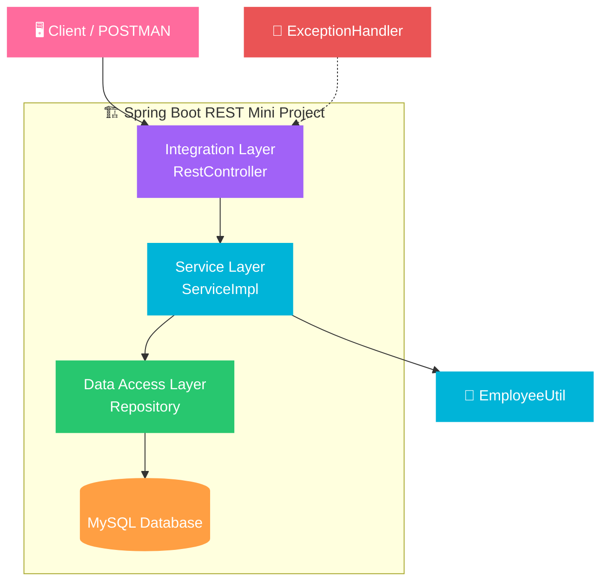
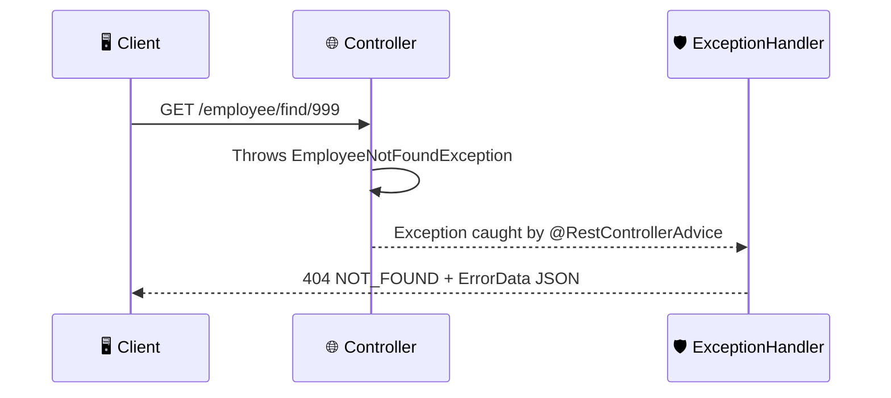

# Spring Boot REST Mini Project

**Spring Boot REST Mini Project** | A complete CRUD application with Project Lombok, POSTMAN testing, exception handling, Swagger UI, unit testing, and connection pooling.

- [Project Overview](#1-project-overview)
- [Architecture and Layers](#2-architecture-and-layers)
- [Dependencies](#3-dependencies)
- [Project Configuration](#4-project-configuration)
- [Model Classes](#5-model-classes)
- [Repository Interface](#6-repository-interface)
- [Utility Class](#7-utility-class)
- [Exception Handling](#8-exception-handling)
- [Service Layer](#9-service-layer)
- [REST Controller](#10-rest-controller)
- [Unit Testing](#11-unit-testing)
- [POSTMAN Request Details](#12-postman-request-details)

---

## 1. Project Overview

This mini project covers the following topics:

- 🏗️ CRUD Application with Spring Boot REST
- 📦 [Project Lombok](../01_core_spring_boot/07_Project_Lombok_Annotations_With_Examples.md) for boilerplate reduction
- 🧪 Test using POSTMAN
- 🚨 [Exception Handling](./07_Exception_Handling_in_Spring_Boot_REST.md) with `@RestControllerAdvice`
- 📡 Swagger UI Config for API documentation
- ✅ [Unit Testing](../08_testing/05_Spring_Boot_Rest_API_Unit_Testing_(JUnit_with_Mockito).md) with MockMvc
- ⚡ [Connection Pooling](./04_Hikari_Connection_Pooling_in_Spring_Boot.md) with HikariCP

> 📝 **Note:** `PUT` is used for full/most-of-the-part updates, while `PATCH` is used for partial updates.

> 🔑 **Key Point:** `@Query` is used for select operations. `@Query` + `@Modifying` is used for non-select operations.

> ⚠️ **Caution:** For custom queries (not predefined JPA methods), `@Transactional` must be applied manually at the service layer. In Spring Data JPA, the `@Transactional` annotation should typically be used at the **service layer** rather than the repository layer.

---

## 2. Architecture and Layers



🏗️ **Module: Employee**

| Component 📋 | Description 🛠️ |
|--------------|----------------|
| **Model class** | `Employee` entity + `ErrorData` for error responses |
| **Repository** | `EmployeeRepository` extending `JpaRepository` |
| **Service Interface** | `IEmployeeService` defining CRUD contracts |
| **ServiceImpl** | `EmployeeServiceImpl` with business logic |
| **RestController** | `EmployeeRestController` handling HTTP requests |
| **Util** | `EmployeeUtil` for salary calculations |
| **Exception** | `EmployeeNotFoundException` + global handler |

---

## 3. Dependencies

| Dependency 📦 | Purpose 📋 |
|---------------|-----------|
| **Lombok** | Reduces boilerplate (getters, setters, constructors) |
| **Spring Data JPA** | ORM and repository abstraction |
| **MySQL Driver** | Database connectivity |
| **Spring Web** | REST API support |
| **Spring Boot DevTools** | Hot reload during development |
| **SpringDoc OpenAPI** | Swagger UI for API documentation |

Maven (`pom.xml`):

```xml
<?xml version="1.0" encoding="UTF-8"?>
<project xmlns="http://maven.apache.org/POM/4.0.0"
    xmlns:xsi="http://www.w3.org/2001/XMLSchema-instance"
    xsi:schemaLocation="http://maven.apache.org/POM/4.0.0 https://maven.apache.org/xsd/maven-4.0.0.xsd">
    <modelVersion>4.0.0</modelVersion>
    <parent>
        <groupId>org.springframework.boot</groupId>
        <artifactId>spring-boot-starter-parent</artifactId>
        <version>3.3.1</version>
        <relativePath /> <!-- lookup parent from repository -->
    </parent>
    <groupId>com.knowprogram</groupId>
    <artifactId>MiniProject</artifactId>
    <version>0.0.1-SNAPSHOT</version>
    <name>MiniProject</name>
    <description>Demo project for Spring Boot</description>
    <url />
    <licenses>
        <license />
    </licenses>
    <developers>
        <developer />
    </developers>
    <scm>
        <connection />
        <developerConnection />
        <tag />
        <url />
    </scm>
    <properties>
        <java.version>17</java.version>
    </properties>
    <dependencies>
        <dependency>
            <groupId>org.springframework.boot</groupId>
            <artifactId>spring-boot-starter-data-jpa</artifactId>
        </dependency>
        <dependency>
            <groupId>org.springframework.boot</groupId>
            <artifactId>spring-boot-starter-web</artifactId>
        </dependency>

        <dependency>
            <groupId>org.springframework.boot</groupId>
            <artifactId>spring-boot-devtools</artifactId>
            <scope>runtime</scope>
            <optional>true</optional>
        </dependency>
        <dependency>
            <groupId>com.mysql</groupId>
            <artifactId>mysql-connector-j</artifactId>
            <scope>runtime</scope>
        </dependency>
        <dependency>
            <groupId>org.projectlombok</groupId>
            <artifactId>lombok</artifactId>
            <optional>true</optional>
        </dependency>
        <dependency>
            <groupId>org.springframework.boot</groupId>
            <artifactId>spring-boot-starter-test</artifactId>
            <scope>test</scope>
        </dependency>
        <dependency>
            <groupId>org.springdoc</groupId>
            <artifactId>springdoc-openapi-starter-webmvc-ui</artifactId>
            <version>2.3.0</version>
        </dependency>
    </dependencies>

    <build>
        <plugins>
            <plugin>
                <groupId>org.springframework.boot</groupId>
                <artifactId>spring-boot-maven-plugin</artifactId>
                <configuration>
                    <excludes>
                        <exclude>
                            <groupId>org.projectlombok</groupId>
                            <artifactId>lombok</artifactId>
                        </exclude>
                    </excludes>
                </configuration>
            </plugin>
        </plugins>
    </build>
</project>
```

Gradle (`build.gradle`):

```groovy
plugins {
    id 'java'
    id 'org.springframework.boot' version '3.3.1'
    id 'io.spring.dependency-management' version '1.1.5'
}

group = 'com.knowprogram'
version = '0.0.1-SNAPSHOT'

java {
    sourceCompatibility = '17'
}

configurations {
    compileOnly {
        extendsFrom annotationProcessor
    }
}

repositories {
    mavenCentral()
}

dependencies {
    implementation 'org.springframework.boot:spring-boot-starter-data-jpa'
    implementation 'org.springframework.boot:spring-boot-starter-web'
    runtimeOnly 'org.springframework.boot:spring-boot-devtools'
    runtimeOnly 'com.mysql:mysql-connector-j'
    compileOnly 'org.projectlombok:lombok'
    annotationProcessor 'org.projectlombok:lombok'
    testImplementation 'org.springframework.boot:spring-boot-starter-test'
    implementation 'org.springdoc:springdoc-openapi-starter-webmvc-ui:2.3.0'
}

tasks.named('test') {
    useJUnitPlatform()
}
```

---

## 4. Project Configuration

🔧 **`application.properties`:**

```properties
# Database details
spring.datasource.url=jdbc:mysql://localhost:3306/test
spring.datasource.username=root
spring.datasource.password=root

# JPA properties
spring.jpa.show-sql=true
spring.jpa.hibernate.ddl-auto=update
spring.jpa.properties.hibernate.format_sql=true

# connection pooling details
spring.datasource.hikari.pool-name=my-hikari-cp
# default stated with 10 connection
spring.datasource.hikari.minimum-idle=15
spring.datasource.hikari.idle-timeout=6000000
# should be more than 250 milli seconds; 180000ms = 3 minute
spring.datasource.hikari.connection-timeout=180000
spring.datasource.hikari.maximum-pool-size=20
```

| Property ⚙️ | Value 📋 | Description 💡 |
|-------------|---------|---------------|
| **`pool-name`** | `my-hikari-cp` | Custom name for HikariCP pool |
| **`minimum-idle`** | `15` | Minimum idle connections (default is 10) |
| **`idle-timeout`** | `6000000` | Time before idle connection is removed |
| **`connection-timeout`** | `180000` | Max wait time for a connection (3 minutes) |
| **`maximum-pool-size`** | `20` | Max number of connections in the pool |

🧪 **`application-test.properties`:**

```properties
# Database details
spring.datasource.url=jdbc:mysql://localhost:3306/test
spring.datasource.username=root
spring.datasource.password=root

# JPA properties
spring.jpa.show-sql=true
spring.jpa.hibernate.ddl-auto=create
spring.jpa.properties.hibernate.format_sql=true
```

> 📝 **Note:** The test profile uses `ddl-auto=create` to start with a fresh schema on each test run, while the main profile uses `ddl-auto=update` to preserve existing data.

---

## 5. Model Classes

1️⃣ **`Employee` Entity:**

```java
package com.knowprogram.demo.model;

@Data
@Entity
@Table(name = "emp_tab")
public class Employee {

    @Id
    @GeneratedValue(strategy = GenerationType.IDENTITY)
    @Column(name = "eid")
    private Integer empId;

    @Column(name = "ename")
    private String empName;

    @Column(name = "email")
    private String empMail;

    @Column(name = "esal")
    private Double empSal;

    @Column(name = "ehra")
    private Double empHra;

    @Column(name = "eta")
    private Double empTa;
}
```

2️⃣ **`ErrorData` Model (for error responses):**

```java
package com.knowprogram.demo.model;

@Data
@NoArgsConstructor
@AllArgsConstructor
public class ErrorData {
    private long timestamp;
    private String module;
    private String message;
}
```

---

## 6. Repository Interface

💾 **`EmployeeRepository`:**

```java
package com.knowprogram.demo.repo;

import com.knowprogram.demo.model.Employee;

public interface EmployeeRepository extends JpaRepository<Employee, Integer> {

    @Modifying
    @Query("UPDATE Employee SET empMail=:email WHERE empId=:id")
    public Integer updateEmployeeMail(@Param("id") Integer id, @Param("email") String email);
}
```

> 💡 **Tip:** The `updateEmployeeMail` method uses `@Query` + `@Modifying` because it is a non-select (UPDATE) operation. This requires `@Transactional` at the service layer. `@Param` maps method parameter names to the `:named` placeholders in `@Query` — import: `org.springframework.data.repository.query.Param`.

---

## 7. Utility Class

🔧 **`EmployeeUtil`:**

```java
package com.knowprogram.demo.util;

import org.springframework.stereotype.Component;

import com.knowprogram.demo.model.Employee;

@Component
public class EmployeeUtil {

    public void calculateDetails(Employee e) {
        var sal = e.getEmpSal();
        e.setEmpHra(sal * 12 / 100.0);
        e.setEmpTa(sal * 3 / 100.0);
    }
}
```

🧠 **In Simple Words:** This utility auto-calculates HRA (12% of salary) and TA (3% of salary) before saving an employee.

---

## 8. Exception Handling

🚨 **Custom Exception:**

```java
package com.knowprogram.demo.exception;

public class EmployeeNotFoundException extends RuntimeException {

    private static final long serialVersionUID = 1L;

    public EmployeeNotFoundException() {
        super();
    }

    public EmployeeNotFoundException(String message) {
        super(message);
    }
}
```

🛡️ **Global Exception Handler:**

```java
package com.knowprogram.demo.handler;

@RestControllerAdvice // afterThrowingAdvice
public class KnowProgramExceptionHandler {

    @ExceptionHandler(EmployeeNotFoundException.class)
    public ResponseEntity<ErrorData> handleEmployeeNotFoundException(EmployeeNotFoundException enfe) {
        return new ResponseEntity<>(
           new ErrorData(System.currentTimeMillis(), "Employee", enfe.getMessage()),
                HttpStatus.NOT_FOUND);
    }
}
```



---

## 9. Service Layer

📋 **`IEmployeeService` Interface:**

```java
package com.knowprogram.demo.service;

import java.util.List;

import com.knowprogram.demo.model.Employee;

public interface IEmployeeService {

    public Integer saveEmployee(Employee e);

    public void updateEmployee(Employee e);

    public void deletedEmployee(Integer id);

    public Employee getOneEmployee(Integer id);

    public List<Employee> getAllEmployees();

    public Integer updateEmployeeMail(Integer id, String email);
}
```

⚙️ **`EmployeeServiceImpl`:**

```java
package com.knowprogram.demo.service;

@Service
public class EmployeeServiceImpl implements IEmployeeService {

    @Autowired
    private EmployeeRepository employeeRepository;

    @Autowired
    private EmployeeUtil employeeUtil;

    @Override
    public Integer saveEmployee(Employee e) {
        employeeUtil.calculateDetails(e);
        return employeeRepository.save(e).getEmpId();
    }

    @Override
    public void updateEmployee(Employee e) {
        getOneEmployee(e.getEmpId()); // validates existence, throws EmployeeNotFoundException if not found
        saveEmployee(e);
    }

    @Override
    public void deletedEmployee(Integer id) {
        Employee e = getOneEmployee(id);
        employeeRepository.delete(e);
    }

    @Override
    public Employee getOneEmployee(Integer id) {
        Optional<Employee> opt = employeeRepository.findById(id);
        if (opt.isPresent()) {
            return opt.get();
        } else {
            throw new EmployeeNotFoundException("Employee " + id + " Not Exist");
        }
    }

    @Override
    public List<Employee> getAllEmployees() {
        return employeeRepository.findAll();
    }

    @Override
    @Transactional
    public Integer updateEmployeeMail(Integer id, String email) {
        return employeeRepository.updateEmployeeMail(id, email);
    }

}
```

> ⚠️ **Caution:** `@Transactional` is applied only on `updateEmployeeMail()` because it uses a custom `@Modifying` query. Predefined JPA methods like `save()`, `delete()`, and `findAll()` handle transactions internally.

---

## 10. REST Controller

🌐 **`EmployeeRestController`:**

```java
package com.knowprogram.demo.controller;

import java.util.List;

import org.springframework.beans.factory.annotation.Autowired;
import org.springframework.http.HttpStatus;
import org.springframework.http.ResponseEntity;
import org.springframework.web.bind.annotation.DeleteMapping;
import org.springframework.web.bind.annotation.GetMapping;
import org.springframework.web.bind.annotation.PatchMapping;
import org.springframework.web.bind.annotation.PathVariable;
import org.springframework.web.bind.annotation.PostMapping;
import org.springframework.web.bind.annotation.PutMapping;
import org.springframework.web.bind.annotation.RequestBody;
import org.springframework.web.bind.annotation.RequestMapping;
import org.springframework.web.bind.annotation.RestController;

import com.knowprogram.demo.exception.EmployeeNotFoundException;
import com.knowprogram.demo.model.Employee;
import com.knowprogram.demo.service.IEmployeeService;

@RestController
@RequestMapping("/employee")
public class EmployeeRestController {

    @Autowired
    private IEmployeeService employeeService;

    // save employee
    @PostMapping("/save")
    public ResponseEntity<String> saveEmployee(@RequestBody Employee employee) {
        ResponseEntity<String> responseEntity = null;
        try {
            Integer id = employeeService.saveEmployee(employee);
            responseEntity = new ResponseEntity<String>("Employee Saved " + id, HttpStatus.CREATED);
        } catch (Exception e) {
            e.printStackTrace();
            responseEntity = new ResponseEntity<String>("Unable to Process save", HttpStatus.INTERNAL_SERVER_ERROR);
        }
        return responseEntity;
    }

    // display all
    @GetMapping("/all")
    public ResponseEntity<?> getAllEmployees() {
        ResponseEntity<?> responseEntity = null;
        try {
            List<Employee> list = employeeService.getAllEmployees();
            responseEntity = ResponseEntity.ok(list);
        } catch (Exception e) {
            e.printStackTrace();
            responseEntity = new ResponseEntity<String>("Unable to fetch data", HttpStatus.INTERNAL_SERVER_ERROR);
        }
        return responseEntity;
    }

    // get one by id
    @GetMapping("/find/{id}")
    public ResponseEntity<?> getOneEmployee(@PathVariable Integer id) {
        ResponseEntity<?> responseEntity = null;
        try {
            Employee employee = employeeService.getOneEmployee(id);
            responseEntity = new ResponseEntity<Employee>(employee, HttpStatus.OK);
        } catch (EmployeeNotFoundException enfe) {
            throw enfe;
        } catch (Exception e) {
            e.printStackTrace();
            responseEntity = new ResponseEntity<String>("Unable to fetch data", HttpStatus.INTERNAL_SERVER_ERROR);
        }
        return responseEntity;
    }

    // remove one
    @DeleteMapping("/remove/{id}")
    public ResponseEntity<String> removeOneEmployee(@PathVariable Integer id) {
        ResponseEntity<String> responseEntity = null;
        try {
            employeeService.deletedEmployee(id);
            responseEntity = ResponseEntity.ok("Employee deleted " + id);
        } catch (EmployeeNotFoundException enfe) {
            throw enfe;
        } catch (Exception e) {
            e.printStackTrace();
            responseEntity = new ResponseEntity<String>("Unable to remove data", HttpStatus.INTERNAL_SERVER_ERROR);
        }
        return responseEntity;
    }

    // update one
    @PutMapping("/update")
    public ResponseEntity<String> updateEmployee(@RequestBody Employee employee) {
        ResponseEntity<String> responseEntity = null;
        try {
            employeeService.updateEmployee(employee);
            responseEntity = new ResponseEntity<String>("Employee Updated", HttpStatus.ACCEPTED);
        } catch (EmployeeNotFoundException enfe) {
            throw enfe;
        } catch (Exception e) {
            e.printStackTrace();
            responseEntity = new ResponseEntity<String>("Unable to Update data", HttpStatus.INTERNAL_SERVER_ERROR);
        }
        return responseEntity;
    }

    // partial update
    @PatchMapping("/modify/{id}/{mail}")
    public ResponseEntity<String> updateEmail(@PathVariable Integer id, @PathVariable String mail) {
        ResponseEntity<String> responseEntity = null;
        try {
            String message = "";
            Integer count = employeeService.updateEmployeeMail(id, mail);
            if (count > 0) {
                message = "Email Updated";
            } else {
                message = "Email Not Updated";
            }
            responseEntity = new ResponseEntity<String>(message, HttpStatus.ACCEPTED);
        } catch (Exception e) {
            e.printStackTrace();
            responseEntity = new ResponseEntity<String>("Unable to Update data", HttpStatus.INTERNAL_SERVER_ERROR);
        }
        return responseEntity;
    }

}
```

| HTTP Method 🌐 | Endpoint 🔗 | Description 📋 | Status Code ✅ |
|----------------|------------|---------------|---------------|
| **POST** | `/employee/save` | Create a new employee | `201 CREATED` |
| **GET** | `/employee/all` | Fetch all employees | `200 OK` |
| **GET** | `/employee/find/{id}` | Fetch one employee by ID | `200 OK` |
| **PUT** | `/employee/update` | Full update of an employee | `202 ACCEPTED` |
| **PATCH** | `/employee/modify/{id}/{mail}` | Partial update (email only) | `202 ACCEPTED` |
| **DELETE** | `/employee/remove/{id}` | Delete an employee by ID | `200 OK` |

---

## 11. Unit Testing

🧪 **`MiniProjectApplicationTests`:**

```java
package com.knowprogram.demo;

import static org.junit.jupiter.api.Assertions.assertEquals;
import static org.junit.jupiter.api.Assertions.assertNotNull;
import static org.junit.jupiter.api.Assertions.fail;

import org.junit.jupiter.api.DisplayName;
import org.junit.jupiter.api.Order;
import org.junit.jupiter.api.Test;
import org.springframework.beans.factory.annotation.Autowired;
import org.springframework.boot.test.autoconfigure.web.servlet.AutoConfigureMockMvc;
import org.springframework.boot.test.context.SpringBootTest;
import org.springframework.boot.test.context.SpringBootTest.WebEnvironment;
import org.springframework.http.HttpStatus;
import org.springframework.http.MediaType;
import org.springframework.mock.web.MockHttpServletResponse;
import org.springframework.test.context.TestPropertySource;
import org.springframework.test.web.servlet.MockMvc;
import org.springframework.test.web.servlet.MvcResult;
import org.springframework.test.web.servlet.request.MockHttpServletRequestBuilder;
import org.springframework.test.web.servlet.request.MockMvcRequestBuilders;

@SpringBootTest(webEnvironment = WebEnvironment.MOCK)
@AutoConfigureMockMvc
@TestPropertySource("classpath:application-test.properties")
public class MiniProjectApplicationTests {

    @Autowired
    private MockMvc mockMvc;

    @Test
    @DisplayName("EMPLOYEE SAVE")
    @Order(1)
    public void testSaveEmployee() throws Exception {
        // 1. prepare http request
        MockHttpServletRequestBuilder request = MockMvcRequestBuilders.post("/employee/save")
                .contentType("application/json")
                .content("{\"empName\":\"A\",\"empSal\":2500.0,\"empMail\":\"a@gm.com\"}");

        // 2. execute request and get result
        MvcResult result = mockMvc.perform(request).andReturn();

        // 3. Read Response from result
        MockHttpServletResponse response = result.getResponse();

        // 4. assert/validate result
        assertEquals(HttpStatus.CREATED.value(), response.getStatus());
        if (!response.getContentAsString().contains("Employee Saved")) {
            fail("Employee Not Created");
        }
    }

    @Test
    @DisplayName("FETCH ONE EMPLOYEE")
    @Order(2)
    public void testGetOneEmployee() throws Exception {
        MockHttpServletRequestBuilder request = MockMvcRequestBuilders.get("/employee/find/1");
        MvcResult result = mockMvc.perform(request).andReturn();
        MockHttpServletResponse response = result.getResponse();
        assertEquals(HttpStatus.OK.value(), response.getStatus());
        assertNotNull(response.getContentAsString());
        assertEquals(MediaType.APPLICATION_JSON_VALUE, response.getContentType());
    }

    @Test
    @DisplayName("FETCH ONE EMPLOYEE NOT EXIST")
    @Order(3)
    public void testGetOneEmployeeNotExist() throws Exception {
        MockHttpServletRequestBuilder request = MockMvcRequestBuilders.get("/employee/find/500");
        MvcResult result = mockMvc.perform(request).andReturn();
        MockHttpServletResponse response = result.getResponse();
        assertEquals(HttpStatus.NOT_FOUND.value(), response.getStatus());
        assertNotNull(response.getContentAsString());
        if (!response.getContentAsString().contains("Not Exist")) {
            fail("Employee exist! Check it once");
        }
    }

    @Test
    @DisplayName("FETCH ALL EMPLOYEE")
    @Order(4)
    public void testGetAllEmployees() throws Exception {
        MockHttpServletRequestBuilder request = MockMvcRequestBuilders.get("/employee/all");
        MvcResult result = mockMvc.perform(request).andReturn();
        MockHttpServletResponse response = result.getResponse();
        assertEquals(HttpStatus.OK.value(), response.getStatus());
        assertNotNull(response.getContentAsString());
        assertEquals(MediaType.APPLICATION_JSON_VALUE, response.getContentType());
    }

    @Test
    @DisplayName("UPDATE EMPLOYEE")
    @Order(6)
    public void testUpdateEmployee() throws Exception {
        MockHttpServletRequestBuilder request = MockMvcRequestBuilders.put("/employee/update")
                .contentType("application/json").content("{\"id\":1,\"name\": \"Farukh\"}");
        MvcResult result = mockMvc.perform(request).andReturn();
        MockHttpServletResponse response = result.getResponse();
        assertEquals(HttpStatus.ACCEPTED.value(), response.getStatus());
        if (!response.getContentAsString().contains("Employee Updated")) {
            fail("Unable to update");
        }
    }

    @Test
    @DisplayName("PATCH EMPLOYEE")
    @Order(5)
    public void testUpdateEmail() throws Exception {
        MockHttpServletRequestBuilder request = MockMvcRequestBuilders.patch("/employee/modify/1/abcd@gmail.com");
        MvcResult result = mockMvc.perform(request).andReturn();
        MockHttpServletResponse response = result.getResponse();
        assertEquals(HttpStatus.ACCEPTED.value(), response.getStatus());
        if (!response.getContentAsString().contains("Email Updated")) {
            fail("Unable to update email");
        }
    }

    @Test
    @DisplayName("DELETE ONE EMPLOYEE BY ID")
    @Order(7)
    public void testRemoveOneEmployee() throws Exception {
        MockHttpServletRequestBuilder request = MockMvcRequestBuilders.delete("/employee/remove/1");
        MvcResult result = mockMvc.perform(request).andReturn();
        MockHttpServletResponse response = result.getResponse();
        assertEquals(HttpStatus.OK.value(), response.getStatus());
        if (!response.getContentAsString().contains("Employee deleted")) {
            fail("Unable to delete");
        }
    }

}
```

| Test Case 🧪 | Order 🔢 | Method 🌐 | Endpoint 🔗 | Expected Status ✅ |
|--------------|---------|----------|------------|-------------------|
| **EMPLOYEE SAVE** | 1 | POST | `/employee/save` | `201 CREATED` |
| **FETCH ONE EMPLOYEE** | 2 | GET | `/employee/find/1` | `200 OK` |
| **FETCH ONE NOT EXIST** | 3 | GET | `/employee/find/500` | `404 NOT_FOUND` |
| **FETCH ALL EMPLOYEE** | 4 | GET | `/employee/all` | `200 OK` |
| **PATCH EMPLOYEE** | 5 | PATCH | `/employee/modify/1/abcd@gmail.com` | `202 ACCEPTED` |
| **UPDATE EMPLOYEE** | 6 | PUT | `/employee/update` | `202 ACCEPTED` |
| **DELETE EMPLOYEE** | 7 | DELETE | `/employee/remove/1` | `200 OK` |

---

## 12. POSTMAN Request Details

### Save Employee (POST)

📥 **Request:**

```
POST {{url}}/employee/save
```

```json
{
    "empName": "SAM",
    "empMail": "sam@gmail.com",
    "empSal": 500.0
}
```

### Update Employee (PUT)

📥 **Request:**

```
PUT {{url}}/employee/update
```

```json
{
    "id": 2,
    "empName": "Farukh"
}
```

### Partial Update - Email (PATCH)

📥 **Request:**

```
PATCH {{url}}/employee/modify/1/abcd@gmail.com
```

### Get All Employees (GET)

📥 **Request:**

```
GET {{url}}/employee/all
```

### Get One Employee (GET)

📥 **Request:**

```
GET {{url}}/employee/find/1
```

### Delete Employee (DELETE)

📥 **Request:**

```
DELETE {{url}}/employee/remove/1
```
