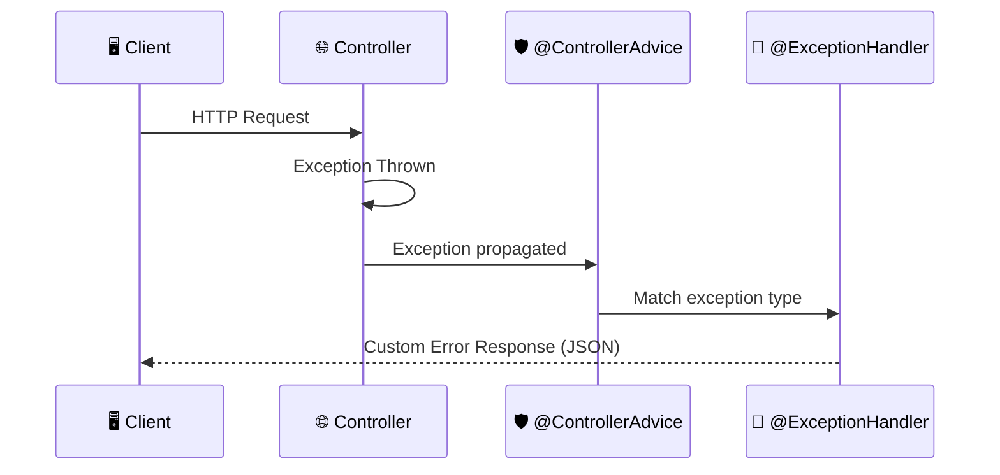
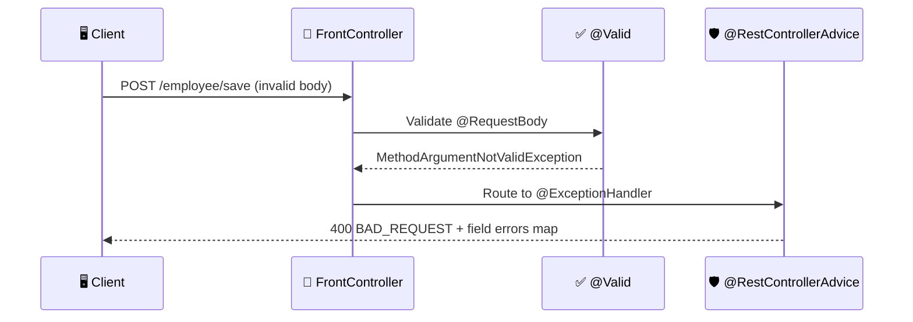

# Exception Handling in Spring Boot REST

**Exception Handling in Spring Boot REST** | Exception Handling in Spring Boot REST can be done in the following ways:

- [Default Error Message (Spring Boot REST) + @ResponseStatus](#1-default-error-message-spring-boot-rest--responsestatus)
- [Customized Error Message – @ControllerAdvice, @ExceptionHandler](#2-customized-error-message--controlleradvice-exceptionhandler)
- [Bean Validation with @Valid](#3-bean-validation-with-valid)

---

## 1. Default Error Message (Spring Boot REST) + @ResponseStatus

In this case, we are using the default message given by `BasicErrorController.error()` method => (`ResponseEntity<T>` type --> JSON) format.

⚠️ **Caution:** Here, we can customize only the Status and message (but not the trace).


📤 **Default Error Response (JSON):**

```json
{
    "timestamp": "2020-09-03T07:56:41.693+00:00",
    "status": 404,
    "error": "Not Found",
    "trace": "....",
    "message": "EMPLOYEE NOT EXIST 50",
    "path": "/find/50"
}
```

📦 **Dependencies:** Spring Web, Lombok, Spring Boot DevTools

1️⃣ **Create the Model class:**

```java
@Data
@NoArgsConstructor
@AllArgsConstructor
public class Employee {
    private Integer eid;
    private String ename;
}
```

2️⃣ **Define the Custom Exception with `@ResponseStatus`:**

```java
@ResponseStatus(code = HttpStatus.NOT_FOUND)
public class EmployeeNotFoundException extends RuntimeException {
    private static final long serialVersionUID = 1L;

    public EmployeeNotFoundException() {
        super();
    }

    public EmployeeNotFoundException(String message) {
        super(message);
    }
}
```

3️⃣ **Build the REST Controller:**

```java
@RestController
public class EmployeeRestController {

    @GetMapping("/find/{id}")
    public ResponseEntity<Employee> getOneEmployee(
            @PathVariable Integer id) {
        if(id!=5)
            throw new EmployeeNotFoundException("EMPLOYEE NOT EXIST " + id);

        return ResponseEntity.ok(new Employee(id,"SAM"));
    }
}
```

📝 **Note:** The `@ResponseStatus` annotation on the exception class tells Spring Boot to use the specified HTTP status code (404 Not Found) in the default error response.

---

## 2. Customized Error Message – @ControllerAdvice, @ExceptionHandler

In this case, we are defining one new Exception Handler class by using annotations:

| Annotation / Type 🏷️ | Level 📋 | Purpose 🛠️ |
|----------------------|---------|------------|
| **`@ControllerAdvice`** | Class level | Intercepts exceptions from all controllers |
| **`@ExceptionHandler`** | Method level | Handles a specific exception type |
| **`ResponseEntity<T>`** | Method return type | Sends customized JSON response |

🧠 **In Simple Words:**
`@ControllerAdvice` tells Spring: while execution, if the application gets any exception in any controller, then come to the class having `@ControllerAdvice`. After that, based on the Exception type, use the appropriate method having `@ExceptionHandler`.



💡 **Tip:** `@RestControllerAdvice` was introduced in Spring Framework 4.3. If we use `@RestControllerAdvice` then we can remove `@ControllerAdvice` (from the class level) and `@ResponseBody` (from the method level).

1️⃣ **Define the Exception class:**

```java
package com.knowprogram.demo.exception;

public class EmployeeNotFoundException extends RuntimeException {
    private static final long serialVersionUID = 1L;

    public EmployeeNotFoundException() {
        super();
    }

    public EmployeeNotFoundException(String message) {
        super(message);
    }
}
```

2️⃣ **Create the Model classes:**

**Employee model:**

```java
package com.knowprogram.demo.model;

@Data
@NoArgsConstructor
@AllArgsConstructor
public class Employee {

    private Integer eid;
    private String ename;
}
```

**ErrorType model:**

```java
@Data
@NoArgsConstructor
@AllArgsConstructor
public class ErrorType {

    private String message;
    private String code;
    private String error;
    private String classType;
}
```

3️⃣ **Build the Exception Handler class:**

```java
//@ControllerAdvice
@RestControllerAdvice
public class MyExceptionHandler {

    @ExceptionHandler(EmployeeNotFoundException.class)
    //@ResponseBody // It converts the response into JSON format
    public ResponseEntity<ErrorType> handleEmpNotFoundEx(
            EmployeeNotFoundException ex)
    {

        return new ResponseEntity<ErrorType>(
                 new ErrorType(
                        ex.getMessage(),
                        "NO_EMP_FOUND",
                        "DATA NOT FOUND FOR GIVEN ID",
                        "Employee"
                ),
                HttpStatus.NOT_FOUND);
    }

}
```

📤 **Sample Response:**

```json
{
    "message": "Employee Not Exist 5",
    "code": "No EMP Found",
    "error": "Data not found for given ID",
    "classType": "Employee"
}
```

---

## 3. Bean Validation with @Valid

Spring Boot auto-includes **Jakarta Bean Validation** (JSR-380) via `spring-boot-starter-web` — no extra dependency needed.

### Common Validation Annotations

| Annotation 🏷️ | Applies To 📋 | Purpose 🛠️ |
|---------------|---------------|------------|
| **`@NotNull`** | Any type | Must not be null |
| **`@NotBlank`** | String | Not null, not empty, not whitespace-only |
| **`@NotEmpty`** | String / Collection | Not null and not empty |
| **`@Size(min, max)`** | String / Collection | Length or size within range |
| **`@Min(value)`** | Number | Value must be >= min |
| **`@Max(value)`** | Number | Value must be <= max |
| **`@Email`** | String | Must be valid email format |
| **`@Pattern(regexp)`** | String | Must match the regex |

### Step 1 — Annotate the Model

```java
@Data
@NoArgsConstructor
@AllArgsConstructor
public class Employee {
    private Integer empId;

    @NotBlank(message = "Name must not be blank")
    @Size(min = 2, max = 50, message = "Name must be 2–50 characters")
    private String empName;

    @Email(message = "Invalid email format")
    @NotBlank(message = "Email must not be blank")
    private String empMail;

    @Min(value = 0, message = "Salary must be non-negative")
    private Double empSal;
}
```

### Step 2 — Add @Valid in the Controller

```java
@PostMapping("/save")
public ResponseEntity<String> saveEmployee(@Valid @RequestBody Employee employee) {
    Integer id = employeeService.saveEmployee(employee);
    return new ResponseEntity<>("Employee Saved " + id, HttpStatus.CREATED);
}
```

> 📝 **Note:** `@Valid` triggers validation on the `@RequestBody`. If validation fails, Spring throws `MethodArgumentNotValidException` **before** the method body executes.

### Step 3 — Handle MethodArgumentNotValidException in @RestControllerAdvice

```java
@RestControllerAdvice
public class GlobalExceptionHandler {

    @ExceptionHandler(MethodArgumentNotValidException.class)
    public ResponseEntity<Map<String, String>> handleValidationErrors(
            MethodArgumentNotValidException ex) {

        Map<String, String> errors = new LinkedHashMap<>();
        ex.getBindingResult().getFieldErrors()
          .forEach(err -> errors.put(err.getField(), err.getDefaultMessage()));

        return new ResponseEntity<>(errors, HttpStatus.BAD_REQUEST);
    }
}
```

📤 **Sample Error Response (400 Bad Request):**

```json
{
    "empName": "Name must not be blank",
    "empMail": "Invalid email format",
    "empSal": "Salary must be non-negative"
}
```



### @Valid vs @Validated

| | `@Valid` 📋 | `@Validated` 📋 |
|---|---|---|
| **Source** | Jakarta Bean Validation | Spring Framework |
| **Supports Groups** | ❌️ No | ✅ Yes |
| **Typical use** | `@RequestBody` validation | Conditional validation (create vs update) |

> 💡 **Tip:** `@Valid` is sufficient for most REST APIs. Use `@Validated` only when you need **validation groups** — different rules for create vs update operations.
