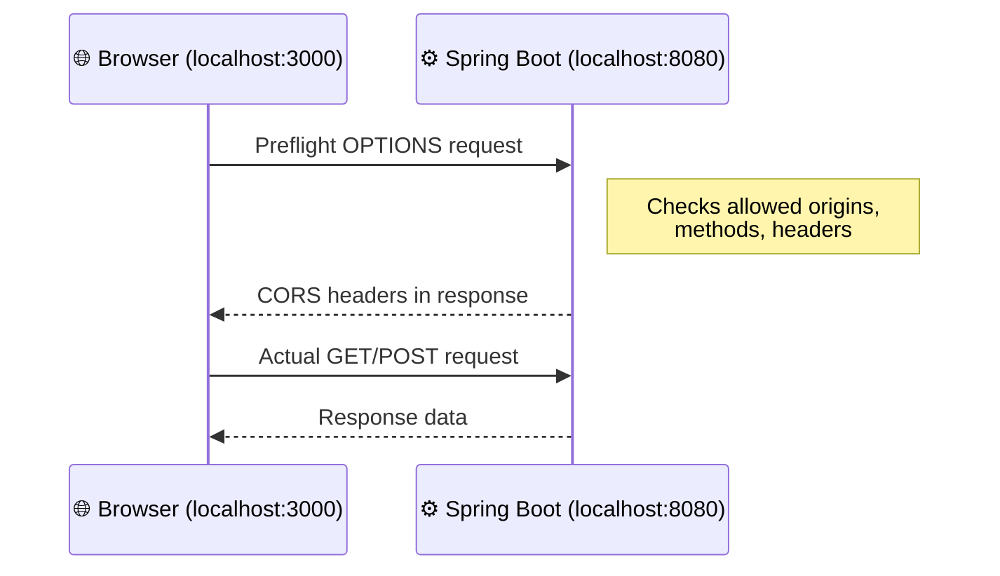
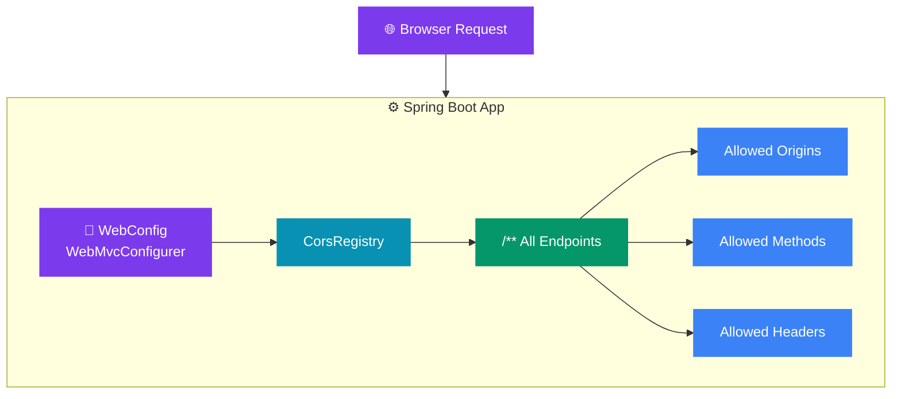

# CORS Configuration in Spring Boot REST

**CORS Configuration in Spring Boot REST** | Cross-Origin Resource Sharing (CORS) controls which external origins can call your REST API. Required whenever a frontend (React, Angular) on a different origin calls your Spring Boot backend.

- [What is CORS and Same-Origin Policy](#1-what-is-cors-and-same-origin-policy)
- [CORS Response Headers](#2-cors-response-headers)
- [@CrossOrigin — Method and Class Level](#3-crossorigin--method-and-class-level)
- [Global CORS Config — WebMvcConfigurer](#4-global-cors-config--webmvcconfigurer)
- [CORS with Spring Security](#5-cors-with-spring-security)
- [Common Mistakes](#6-common-mistakes)

---

## 1. What is CORS and Same-Origin Policy

The **Same-Origin Policy** is a browser security rule that blocks a web page from making HTTP requests to a different origin than the one that served it.

**Origin = Protocol + Domain + Port**

| Compared to `http://app.com:3000` 🌐 | Same Origin? |
|---------------------------------------|--------------|
| `http://app.com:3000/home` | ✅ Same |
| `https://app.com:3000` | ❌️ Different (protocol) |
| `http://api.app.com:3000` | ❌️ Different (subdomain) |
| `http://app.com:8080` | ❌️ Different (port) |

> 💡 **Real-World Example:** React app on `http://localhost:3000` calling Spring Boot on `http://localhost:8080` — different ports = different origin = CORS error without config.



---

## 2. CORS Response Headers

Spring adds these headers to HTTP responses to tell the browser what is permitted:

| Header 🏷️ | Purpose 📋 | Example Value 🛠️ |
|-----------|-----------|-----------------|
| **`Access-Control-Allow-Origin`** | Which origins can access | `http://localhost:3000` or `*` |
| **`Access-Control-Allow-Methods`** | Allowed HTTP methods | `GET, POST, PUT, DELETE, OPTIONS` |
| **`Access-Control-Allow-Headers`** | Allowed request headers | `Content-Type, Authorization` |
| **`Access-Control-Allow-Credentials`** | Allow cookies / auth headers | `true` |
| **`Access-Control-Max-Age`** | Preflight cache duration (seconds) | `3600` |

> ⚠️ **Caution:** You cannot use `Access-Control-Allow-Origin: *` together with `Access-Control-Allow-Credentials: true`. Browsers reject this combination. Use an explicit origin instead of `*` when credentials are needed.

---

## 3. @CrossOrigin — Method and Class Level

`@CrossOrigin` is the simplest way to enable CORS for a specific controller or endpoint.

### On a Method

```java
@RestController
@RequestMapping("/employee")
public class EmployeeRestController {

    @CrossOrigin(origins = "http://localhost:3000")
    @GetMapping("/all")
    public ResponseEntity<List<Employee>> getAllEmployees() {
        // only http://localhost:3000 can call this endpoint
    }
}
```

### On a Class (applies to all methods)

```java
@CrossOrigin(
    origins = {"http://localhost:3000", "https://myapp.com"},
    methods = {RequestMethod.GET, RequestMethod.POST, RequestMethod.PUT,
               RequestMethod.DELETE, RequestMethod.OPTIONS},
    allowedHeaders = {"Content-Type", "Authorization"},
    maxAge = 3600
)
@RestController
@RequestMapping("/employee")
public class EmployeeRestController {
    // all methods in this controller inherit CORS config
}
```

### @CrossOrigin Attributes

| Attribute 🏷️ | Default 📋 | Description 🛠️ |
|--------------|-----------|----------------|
| **`origins`** | `*` (all) | Allowed origin URLs |
| **`methods`** | All HTTP methods | Allowed HTTP methods |
| **`allowedHeaders`** | `*` (all) | Allowed request headers |
| **`allowCredentials`** | `false` | Allow cookies / auth credentials |
| **`maxAge`** | `1800` (30 min) | Preflight response cache in seconds |

> ⚠️ **Caution:** `@CrossOrigin` works for small projects, but managing it across every controller is error-prone. Use global config for production apps.

---

## 4. Global CORS Config — WebMvcConfigurer

Configure CORS once for the entire application using `WebMvcConfigurer`.

```java
@Configuration
public class WebConfig implements WebMvcConfigurer {

    @Override
    public void addCorsMappings(CorsRegistry registry) {
        registry.addMapping("/**")
            .allowedOrigins(
                "http://localhost:3000",
                "https://myapp.com"
            )
            .allowedMethods("GET", "POST", "PUT", "PATCH", "DELETE", "OPTIONS")
            .allowedHeaders("Content-Type", "Authorization")
            .allowCredentials(true)
            .maxAge(3600);
    }
}
```



> 💡 **Tip:** Use `addMapping("/api/**")` to limit CORS only to your API paths, leaving actuator or admin endpoints on a stricter policy.

---

## 5. CORS with Spring Security

When Spring Security is on the classpath, it intercepts requests **before** `WebMvcConfigurer` runs. You must configure CORS inside the security filter chain, or `WebMvcConfigurer` CORS config will be ignored.

```java
@Configuration
@EnableWebSecurity
public class SecurityConfig {

    @Bean
    public SecurityFilterChain filterChain(HttpSecurity http) throws Exception {
        http
            .cors(cors -> cors.configurationSource(corsConfigurationSource()))
            .csrf(csrf -> csrf.disable())
            // ... auth rules
            ;
        return http.build();
    }

    @Bean
    public CorsConfigurationSource corsConfigurationSource() {
        CorsConfiguration config = new CorsConfiguration();
        config.setAllowedOrigins(List.of("http://localhost:3000", "https://myapp.com"));
        config.setAllowedMethods(List.of("GET", "POST", "PUT", "PATCH", "DELETE", "OPTIONS"));
        config.setAllowedHeaders(List.of("Content-Type", "Authorization"));
        config.setAllowCredentials(true);
        config.setMaxAge(3600L);

        UrlBasedCorsConfigurationSource source = new UrlBasedCorsConfigurationSource();
        source.registerCorsConfiguration("/**", config);
        return source;
    }
}
```

> ⚠️ **Caution:** If you have Spring Security and only configure CORS via `WebMvcConfigurer` (without `.cors(...)` in the filter chain), all cross-origin requests will still be blocked by the security filter.

---

## 6. Common Mistakes

| Mistake ❌️ | Fix ✅ |
|-----------|--------|
| Using `allowedOrigins("*")` with `allowCredentials(true)` | Use an explicit origin — e.g. `"http://localhost:3000"` |
| `@CrossOrigin` on most controllers but forgetting one | Use global `WebMvcConfigurer` config instead |
| CORS config in `WebMvcConfigurer` but Spring Security blocks it | Configure `.cors(...)` in `SecurityFilterChain` as well |
| Not including `OPTIONS` in allowed methods | Always add `OPTIONS` — browsers send a preflight OPTIONS before the actual request |
| Not allowing `Authorization` header | Add it to `allowedHeaders` when using JWT tokens |
