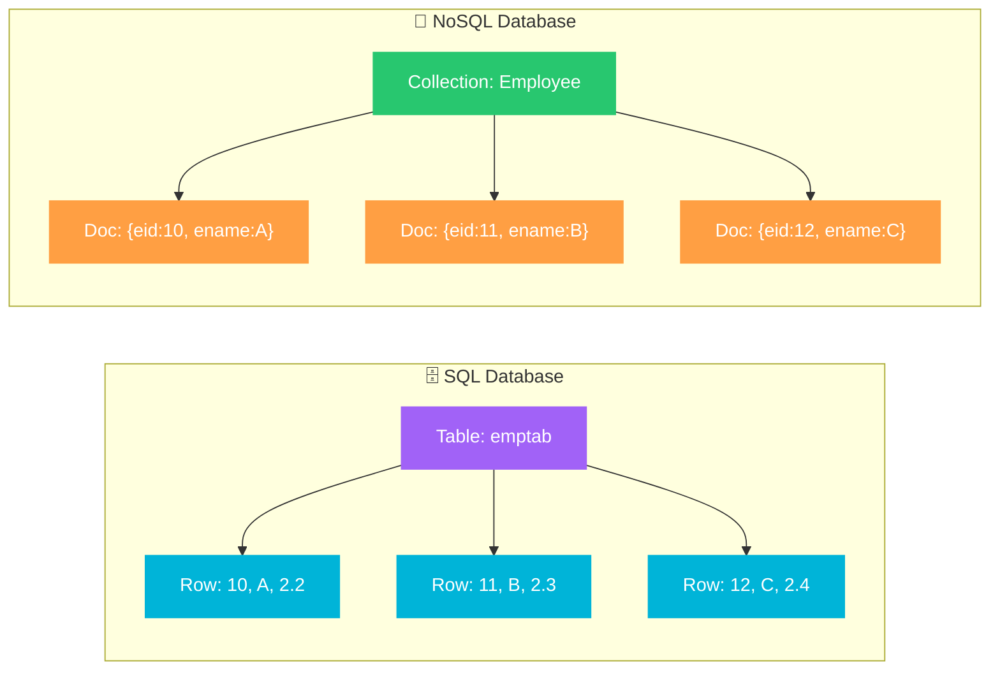
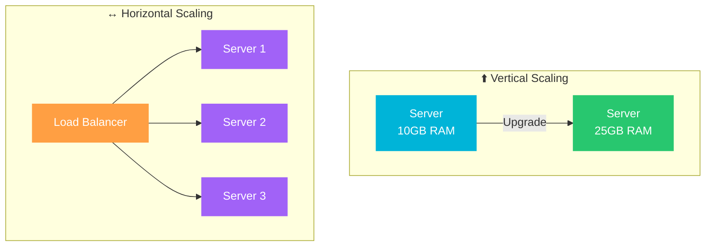
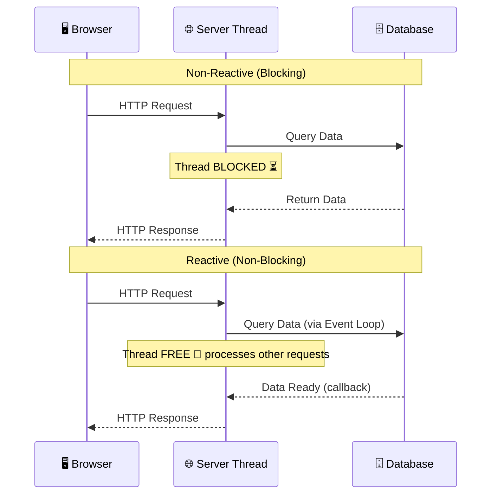

# SQL vs NoSQL Databases

**SQL vs NoSQL Databases** | Major differences between SQL and NoSQL databases. Also see: [Spring Boot with MongoDB Basic Example](./02_Spring_Boot_with_MongoDB_Basic_Example.md)

- [SQL vs NoSQL Comparison](#1-sql-vs-nosql-comparison)
- [Schema: Structured vs Unstructured](#2-schema-structured-vs-unstructured)
- [Scaling of SQL vs NoSQL Database](#3-scaling-of-sql-vs-nosql-database)
- [Reactive Operations](#4-reactive-operations)

---

## 1. SQL vs NoSQL Comparison

| Feature | SQL 🅰️ | NoSQL 🅱️ |
|---------|---------|----------|
| **Operations** | Define one SQL query for every operation | Use commands/functions (SQL queries do not exist) |
| **Structure** | ✅ Structured — execute DDL queries first (create/alter tables), then DML queries (insert/modify data) | ❌️ Unstructured — no need to create/alter any schema; directly perform insert/update/delete/fetch |
| **PL/SQL** | ✅ Supports PL/SQL concepts | ❌️ No such concepts — store/retrieve/modify only |
| **Data Storage** | Tables with rows | Collections with JSON documents |
| **Scaling** | ⚠️ Vertical scaling only | ✅ Both horizontal and vertical scaling |
| **Reactive API** | ❌️ Supports any programming API as client for web apps, but no reactive operations | ✅ Supports web with fully reactive API |

---

## 2. Schema: Structured vs Unstructured

Can we insert a row in a SQL database without creating a table? No. First, we should design the schema (overall tables with relations), then we can perform CRUD operations. We need to modify the schema for additional data inserts. SQL databases entirely depend on schema — this is why they are called **Structured Databases**.

In NoSQL databases like MongoDB, such creation is not required. You can directly insert data, and it auto-creates its schema. This is why NoSQL databases are called **Unstructured Databases**.

🗄️ **SQL DB:** `emptab` (table) example:

```
+------+-------+------+
| eid  | ename | esal |
+------+-------+------+
| 10   | A     | 2.2  |
| 11   | B     | 2.3  |
| 12   | C     | 2.4  |
+------+-------+------+
```

📄 **NoSQL:** Employee (Collection) example:

```json
[
   {"eid": 10, "ename": "A", "esal": 2.2},
   {"eid": 11, "ename": "B", "esal": 2.3},
   {"eid": 12, "ename": "C", "esal": 2.4}
]
```



---

## 3. Scaling of SQL vs NoSQL Database

Scaling is a process of increasing service capacity for a system/application.

There are two types of scaling:

- 📈 **Horizontal scaling** — Create the same instance multiple times. Assume previously the application was running on 1 server; later for horizontal scaling we run the same application on multiple servers.
- 🔧 **Vertical scaling** — Increase system hardware configuration. Assume previously the server has 10 GB RAM, 500 TB HD, and 128 Core CPU. Now for vertical scaling, we upgrade the system to 25 GB RAM, 1000 TB HD, and 256 Core CPU.

💡 **Tip:** In real-time, horizontal and vertical scaling is done in parallel.



### SQL Database Scaling

In the case of SQL databases, only **vertical scaling** is possible. When database data is increasing, we have to increase the system capacity. We cannot break the tables because there will be joining of two tables. We cannot place one table on one server and another table on another server because of joins.

### NoSQL Database Scaling

The NoSQL database supports **both horizontal and vertical scaling**. We can have multiple servers and store a few collections on one server and others on different servers. Direct joins are not applied here — only ID storage will be there.

- 🏗️ For NoSQL, we can manage multiple database instances in microservices. Example: `OrderDatabase`, `ProductsDatabase`, `UserDatabase`.
- ⚙️ In microservices, there will be independent projects and each project can have its own NoSQL database.

| Scaling Type | SQL 🅰️ | NoSQL 🅱️ |
|-------------|---------|----------|
| **Vertical Scaling** | ✅ Supported | ✅ Supported |
| **Horizontal Scaling** | ❌️ Not possible (table joins prevent splitting) | ✅ Supported (collections can be distributed) |
| **Microservices** | ⚠️ Limited — shared database needed | ✅ Independent databases per service |

---

## 4. Reactive Operations

### Server Thread Model

Let us first see the server thread model:

- ⚙️ The server creates one object for a servlet (singleton class).
- 🧵 The server creates one servlet thread for the servlet object that will process requests and give responses.
- ⏳ If any I/O (database call exists) then the thread will be in a **WAITING (Blocked)** state, until data comes back to the server — then it will be unblocked.
- 🔄 Converting the blocking-unblocking process to better resource utilization using a mediator **Event Loop** — in that case, DB and threads become independent and process parallel requests. Such a process is supported by NoSQL databases only.



### Non-Reactive (Blocking) Process

Whenever the browser requests the server, then the server will create a request thread (servlet thread). Now, the server makes a database call — the thread will be **blocked** till data comes back to the server. During the blocking/waiting period, that thread will not perform any other request. Whatever web application or web service we develop comes under this category. It is the behavior of the default web/web services application. It is also called a **non-reactive operation**. We can see more about it in Spring WebFlux (Reactive Web).

📝 **Note:** The asynchronous concept comes under a reactive process between the browser and the server. Whereas the reactive/non-reactive process comes under the relationship between server and database.

### Reactive (Non-Blocking) Process

In the reactive process, instead of waiting/blocking the thread, the thread continues processing other requests. When the data comes back to the server from the database, the same thread or a different thread (whichever is free) can be allocated for that. So, there will be no waiting. Keeping all threads busy for better resource utilization is called a **reactive process**, which uses a mediator **Event Loop** mechanism.

🔑 **Key Point:** To implement reactive operations, both the database and the web application should support the reactive operation.

- 💾 A **reactive database** means it supports the Event Loop mechanism and it never connects to a direct thread. Example: **MongoDB**.
- ❌️ SQL databases do **not** support reactive operations.

> ⚠️ **Caution:** We do not write instance variables inside the servlet class because it is a singleton-multithread design and gives problems with data synchronization.

---
