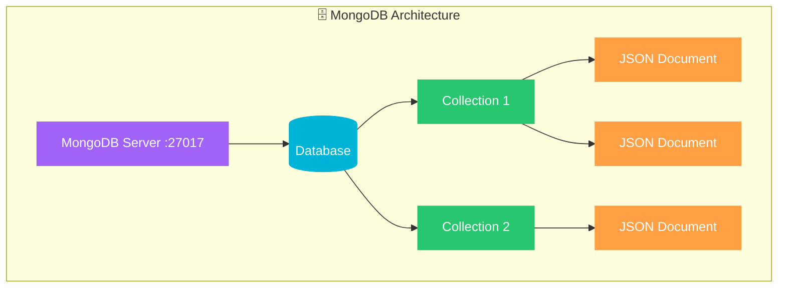

# Spring Boot with MongoDB Basic Example

**Spring Boot with MongoDB Basic Example** | Install the MongoDB database, and let us create a spring boot application to connect the MongoDB and perform some CRUD operations. For all CRUD operations see: [Spring Data JPA Introduction](../02_spring_data_jpa/01_Spring_Data_JPA_Introduction.md). Also see: [SQL v/s NoSQL Databases](./01_SQL_vs_NoSQL_Databases.md)

- [MongoDB Commands](#1-mongodb-commands)
- [MongoDB](#2-mongodb)
- [Spring Boot with MongoDB Basic Example](#3-spring-boot-with-mongodb-basic-example)
- [Spring Data MongoDB Operations](#4-spring-data-mongodb-operations)
- [MongoDB Connection Defaults](#5-mongodb-connection-defaults)

---

## 1. MongoDB Commands

To start MongoDB Server (starts on port number: 27017):

```bash
mongod
```

To start MongoDB client:

```bash
mongosh
```

Or:

```bash
mongo
```

### Client Commands

🖥️ **View current database:**

```bash
db
```

📋 **View all databases:**

```bash
show dbs
```

📂 **Create (if not exist) / enter into database:**

```bash
use <databaseName>
```

It creates a sample database only after creating at least one collection.

🛠️ **Example:**

```bash
use sample
```

The collection is created when we insert data. In SQL databases first we create a table and then insert rows, but in NoSQL inserting the row will create a collection (if not exist) and insert the row.

### Insert Data

📥 **Insert one document:**

```bash
db.<collectionName>.insertOne({ k:v });
```

🛠️ **Example:**

```bash
db.student.insertOne({"sid":10,"sname":"A","sfee":3.2});
```

MongoDB generates one primary key field/key with a HexaDecimal value created with the name `_id: ObjectId("...")`. Here, `_id` behaves like the primary key.

### Query Data

📤 **View all JSON Documents in the collection:**

```bash
db.<collectionName>.find();
```

🛠️ **Example:**

```bash
db.student.find();
```

🎨 **View output in pretty print:**

```bash
db.student.find().pretty();
```

📋 **View all collections that exist in the database:**

```bash
show collections
```

🔍 **Pass conditions for data fetch (where condition):**

```bash
# SQL: select * from student where sid=10
db.student.find({"sid":10}).pretty();

# SQL: select _id, sname from student where sid=11
db.student.find({"sid":11},{"sname":1}).pretty();
```

### Delete Operations

🗑️ **Delete one collection:**

```bash
db.student.drop();
```

💥 **Delete the current database:**

```bash
db.dropDatabase();
```

### Comparison Operators

| Symbol 🔣 | MongoDB Code 💻 |
|-----------|----------------|
| **<** | `{$lt : val}` |
| **<=** | `{$lte: val}` |
| **>** | `{$gt: val}` |
| **>=** | `{$gte: val}` |
| **!=** | `{$ne : val}` |

🛠️ **Examples:**

```bash
# SQL: select * from student where sid>=10
db.student.find({"sid": {$gte:10}}).pretty();

# SQL: select * from student where sid!=10
db.student.find({"sid": {$ne:10}}).pretty();
```

### Insert Methods

To insert data in MongoDB, three methods are available: `insert()`, `insertOne()`, and `insertMany()`. The `insertOne()` is used to insert one record, `insertMany()` is used to insert multiple records at a time. The `insert()` method is deprecated but it can be used to insert either one or multiple records.

📥 **Insert multiple JSON Objects:**

```bash
db.student.insertMany([
   {"sid":202,"sname":"Rocco","sfee":400.2},
   {"sid":203,"sname":"Jerry","sfee":600.2},
   {"sid":204,"sname":"William","sfee":800.2}
]);
```

---

## 2. MongoDB



- 🗄️ MongoDB is a **NoSQL Database**.
- 📦 It stores data in **Collections** (similar to tables).
- 📄 Collections store data in **JSON Format** (Document).
- 🖥️ Queries are called commands/functions.
- ⚙️ Start MongoDB server with `mongod`, then start the Mongo client with `mongo` or `mongosh`.
- 🔓 It is an unstructured database, with no fixed schema.
- 📈 It supports easy scaling (both Horizontal and Vertical).
- 🌐 MongoDB server runs on port **27017** (default).
- 🔑 The primary key type in MongoDB is `String` (must be), with variable name `id`, then only the database generates a Hexadecimal Value (UUID). If we modify the type from `String` to any other, then MongoDB will not generate value — assign it manually.
- 🏷️ `@Id` (`org.springframework.data.annotation`) must be applied on any one variable. If we do not provide it, then the default variable is taken as `id` with default type `String` and MongoDB generates a hexadecimal value.
- 📑 `@Document` annotation is optional. To provide collection details we can use it. If we do not provide a collection name, then the default is the class name (lowercase).
- 💾 To do all database operations in MongoDB, Spring Data API has provided one interface **`MongoRepository<T, ID>`**. Here: T = Model class name, ID = PrimaryKey DataType (e.g., `String`). This interface internally extends two more: `CrudRepository` and `PagingAndSortingRepository`.
- ⚠️ Do not use JPA annotations and concepts (like `@Entity` and `show_sql`, `ddl-auto`, `dialect`, etc.). It is a NoSQL Database.

---

## 3. Spring Boot with MongoDB Basic Example

Create a Spring Boot project with the following dependencies: **lombok**, **Spring Data MongoDB**.

If we add `spring-boot-starter-data-mongodb` (**Spring Data MongoDB**) dependency then our project behaves as a client (MongoDB Client). By default it creates a connection with details: default port = 27017, host = localhost, database = test.


1️⃣ **Configure application.properties:**

```properties
spring.data.mongodb.host=localhost
spring.data.mongodb.port=27017
# if given database not exist then auto-created
spring.data.mongodb.database=kp

#spring.data.mongodb.username=
#spring.data.mongodb.password=
```

In MongoDB, `id` will work as the primary key. It is auto-generated and a hexadecimal value, therefore in the Model class we have to use `String` data type for it.

2️⃣ **Model class (`Book.java`):**

```java
package com.knowprogram.demo.model;

import org.springframework.data.annotation.Id;
import org.springframework.data.mongodb.core.mapping.Document;

import lombok.AllArgsConstructor;
import lombok.Data;
import lombok.NoArgsConstructor;
import lombok.NonNull;
import lombok.RequiredArgsConstructor;

@Data
@NoArgsConstructor
@AllArgsConstructor
@RequiredArgsConstructor
@Document(collection = "booksdata")
public class Book {

    @Id
    private String id;

    @NonNull
    private Integer bookId;

    @NonNull
    private String bookName;

    @NonNull
    private String bookAuthor;

    @NonNull
    private Double bookCost;
}
```

📝 **Note:** In `@Document(collection = "booksdata")`, passing the collection name is optional. If we don't pass it, then the class name will be considered as the collection name.

📝 **Note:** `@Id` (is not from Data JPA) indicates the primary key variable. The variable name recommended is `id` and the datatype is `String`.

3️⃣ **Repository (`BookRepository.java`):**

```java
package com.knowprogram.demo.repo;

import org.springframework.data.mongodb.repository.MongoRepository;

import com.knowprogram.demo.model.Book;

public interface BookRepository extends MongoRepository<Book, String> {

}
```

4️⃣ **Runner class to insert and fetch the data (`MyDataRunner.java`):**

```java
package com.knowprogram.demo.runner;

import java.util.List;

import org.springframework.beans.factory.annotation.Autowired;
import org.springframework.boot.CommandLineRunner;
import org.springframework.stereotype.Component;

import com.knowprogram.demo.model.Book;
import com.knowprogram.demo.repo.BookRepository;

@Component
public class MyDataRunner implements CommandLineRunner {

    @Autowired
    private BookRepository bookRepository;

    @Override
    public void run(String... args) throws Exception {
        bookRepository.save(new Book(2505, "Spring Boot", "A", 500.0));
        bookRepository.save(new Book(2506, "Microservice", "B", 600.0));
        bookRepository.save(new Book(2507, "Angular", "C", 700.0));

        List<Book> bookList = bookRepository.findAll();
        System.out.println(bookList);
    }

}
```

5️⃣ **Verify in MongoDB client:**

```bash
> show dbs
> use kp
> show collections
booksdata
kp> db.booksdata.find().pretty()
```

📤 **Output:**

```json
[
  {
    "_id": "ObjectId('66821bb8b851d804e93637b8')",
    "bookId": 2505,
    "bookName": "Spring Boot",
    "bookAuthor": "A",
    "bookCost": 500,
    "_class": "com.knowprogram.demo.model.Book"
  },
  {
    "_id": "ObjectId('66821bb8b851d804e93637b9')",
    "bookId": 2506,
    "bookName": "Microservice",
    "bookAuthor": "B",
    "bookCost": 600,
    "_class": "com.knowprogram.demo.model.Book"
  },
  {
    "_id": "ObjectId('66821bb8b851d804e93637ba')",
    "bookId": 2507,
    "bookName": "Angular",
    "bookAuthor": "C",
    "bookCost": 700,
    "_class": "com.knowprogram.demo.model.Book"
  }
]
```

### Primary Key Configuration

Which datatype can be used to create the primary key variable in the Model class? `String` (even any other Primitive Type: `Integer`, `Char`, `Boolean`).

How is a collection created in MongoDB if there is no `ddl-auto`? When we perform insert function/commands, then the database creates a collection first if not exist, next inserts the data.

If we provide the `id` field, then we can get the generated ID back to the application, else we cannot see the ID.

```java
@Id
private String id;
```

We can choose a non-string type for the primary key variable, then:

- ❌️ This time ID is **not** generated.
- 🔗 Variable name (`bookId`) is mapped with `_id` key in DB.

```java
@Id
private Integer bookId;
```

🧪 **Validity Examples:**

**Example 1:**

```java
// valid or not?
class Person {
    @Id
    Integer pid;
    String pname;
}
```

> ✅ Valid, but `id` is not generated. We need to provide it.

**Example 2:**

```java
// valid or not?
class Person {
    Integer pid;
    String pname;
}
```

> ✅ Valid, auto-generated `id` with `String` (hexadecimal).

**Example 3:**

```java
// valid or not?
class Person {
    @Id
    String id;
    Integer pid;
    String pname;
}
```

> ✅ Valid, we can even see the generated `id` at the application.

### Custom ID Generation

We can define manual code for the customization of ID.

**Custom ID generator:**

```java
package in.nareshit.raghu;
import java.util.Random;
public interface MyIdGen {
    public static int getId() {
        return new Random().nextInt(999999);
    }
}
```

---

## 4. Spring Data MongoDB Operations

| # | Method 🛠️ | Description 📋 |
|---|-----------|---------------|
| **1** | `save(obj)` | Execute either INSERT or UPDATE (based on ID/PK). The given object is converted into JSON Format and stored in the Collection. |
| **2** | `saveAll(Iterable<T> list)` | Bulk insert/update. Provide a list of objects for insert/update. |
| **3** | `Optional<T> findById(id)` | Fetch one row of data if exists, else null. Read data using `get()` after null check using `isEmpty()`, `isPresent()`. |
| **4** | `List<T> findAll()` | Fetch all rows of data from DB Collection. |
| **5** | `Boolean existsById(ID)` | Find whether the given ID exists in the collection or not. |
| **6** | `List<T> findAllById(Iterable list)` | Fetch selected rows by id. |
| **7** | `void deleteById(id)` | Remove one JSON document by id. |
| **8** | `deleteAll()` | Remove all JSON documents from the Collection. |
| **9** | `count()` | Number of JSON documents from collection. |
| **10** | `Page<T> findAll(Pageable)` | Implement the pagination concept by providing input like page number and page size. |
| **11** | `List<T> findAll(Sort)` | Fetch data by sorting operations. |

---

## 5. MongoDB Connection Defaults

| Property 🔧 | Default Value 📋 |
|-------------|-----------------|
| **host** | `localhost` |
| **port** | `27017` |
| **database** | `test` |
| **username** | `null` (no security by default) |
| **password** | `null` (no security by default) |

> 🔓 **Note:** MongoDB comes with no security concept by default, i.e., username and password are null.
