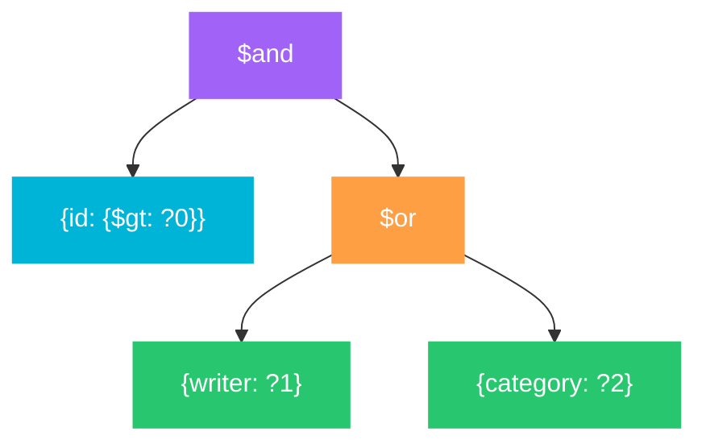

# Custom Query Methods in MongoDB – Spring Boot

**Custom Query Methods in MongoDB – Spring Boot** | `@Query` annotation provides custom queries for MongoDB using abstract methods defined in the Repository interface.

- [Project Setup](#1-project-setup)
- [Model Class](#2-model-class)
- [Repository Interface](#3-repository-interface)
- [Data Insert Runner](#4-data-insert-runner)
- [Fetching a Single Document](#5-fetching-a-single-document)
- [Operators and Symbols](#6-operators-and-symbols)
- [Querying with Comparison Operators](#7-querying-with-comparison-operators)
- [Writing AND / OR Queries](#8-writing-and--or-queries)
- [Complex Nested Queries](#9-complex-nested-queries)
- [Complete Repository Interface](#10-complete-repository-interface)
- [Test Query Runner](#11-test-query-runner)

---

## 1. Project Setup

Create a Spring Starter project with the following dependencies:

- 📦 `Lombok`
- 💾 `Spring Data MongoDB`

🔧 **Configuration** (`application.properties`):

```properties
spring.data.mongodb.host=localhost
spring.data.mongodb.port=27017
# if given database not exist then auto-created
spring.data.mongodb.database=kp
```

---

## 2. Model Class

**Book document class:**

```java
@Data
@AllArgsConstructor
@Document
public class Book {
    @Id
    private Integer id;
    private String title;
    private Integer noOfPages;
    private String writer;
    private String category;
}
```

---

## 3. Repository Interface

**Repository:**

```java
public interface BookRepository extends MongoRepository<Book, Integer> {
    // custom query methods will be placed here
}
```

---

## 4. Data Insert Runner

**DataInsertRunner class:**

```java
@Component
@Order(1)
public class DataInsertRunner implements CommandLineRunner {

    @Autowired
    private BookRepository bookRepository;

    @Override
    public void run(String... args) throws Exception {
        bookRepository.deleteAll();
        bookRepository.saveAll(
            List.of(
                new Book(10, "Core Java", 250, "SAM", "BackEnd"),
                new Book(11, "Adv Java", 260, "SYED", "BackEnd"),
                new Book(12, "Angular", 350, "SAM", "FrontEnd"),
                new Book(13, "HTML", 120, "SYED", "FrontEnd"),
                new Book(14, "Spring Boot", 850, "SYED", "BackEnd"),
                new Book(15, "Microservices", 350, "SAM", "BackEnd"),
                new Book(16, "ReactJS", 180, "RAM", "FrontEnd")
            )
        );
    }

}
```

---

## 5. Fetching a Single Document

When fetching one JSON document, the data may return `null`. Use the `Optional` wrapper to avoid a `NullPointerException`.

❌️ **Bad practice** (but works):

```java
@Query("{ id : ?0 }")
Book getBookById(Integer id);
```

✅ **Good practice:**

```java
@Query("{ id : ?0 }")
Optional<Book> getBookById(Integer id);
```

📝 **Note:** `{ }` inside `@Query` indicates a where condition, and `?` indicates data supplied at runtime.

---

## 6. Operators and Symbols

| Symbol 🔣 | MongoDB Operator 🏷️ |
|-----------|---------------------|
| **<** | `$lt` |
| **<=** | `$lte` |
| **>** | `$gt` |
| **>=** | `$gte` |

---

## 7. Querying with Comparison Operators

**Repository method using `$gte`:**

```java
@Query("{ noOfPages : { $gte : ?0 } }")
// List<Book> getBooksByNoOfPages(Integer noOfPages);
Stream<Book> getBooksByNoOfPages(Integer noOfPages);
```

💡 **Tip:** Returning `Stream<Book>` allows you to chain Java Stream API operations like `filter()`, `sorted()`, and `map()`.

🛠️ **Usage example with Stream API:**

```java
repo.getBooksByNoOfPages(150)
    .filter(ob -> ob.getCategory().equals("BackEnd"))
    .sorted((ob1, ob2) -> ob1.getId().compareTo(ob2.getId()))
    .map(ob -> ob.getTitle() + " is written by :" + ob.getWriter())
    .forEach(System.out::println);
```

---

## 8. Writing AND / OR Queries

### Syntax

- 🔗 **`$or`:** `$or: [ { condition#1 }, { condition#2 }, { condition#3 }, ... ]`
- 🔗 **`$and`:** `$and: [ { condition#1 }, { condition#2 }, { condition#3 }, ... ]`

### SQL to MongoDB Mapping

| SQL Equivalent 🗄️ | MongoDB Query 💾 |
|-------------------|-----------------|
| `where sid=? or sname=?` | `$or: [{sid:?0}, {sname:?1}]` |
| `where sfee=? and (sid=? or sname=?)` | `$and: [{sfee:?0}, $or: [{sid:?0}, {sname:?1}]]` |
| `where sid>? and sfee<=?` | `$and: [ { sid: { $gt: ?0 } }, { sfee: { $lte: ?1 } } ]` |

### AND Query

**Repository method (two equivalent forms):**

```java
// SQL: select * from book where writer=? and category=?
// @Query("{ writer : ?0, category : ?1}")
// or
@Query("{ $and: [ {writer: ?0}, {category: ?1} ] }")
List<Book> getBooksByWriterAndCategory(String writer, String category);
```

📝 **Note:** In MongoDB, multiple conditions inside `{ }` are implicitly ANDed, so both forms above are equivalent.

### OR Query

**Repository method:**

```java
// SQL: select * from book where writer=? or category=?
@Query("{ $or: [ {writer: ?0}, {category: ?1} ] }")
List<Book> getBooksByWriterOrCategory(String writer, String category);
```

---

## 9. Complex Nested Queries

**Between using > and < symbols — combining `$and` with nested `$or`:**

**Repository method:**

```java
// SQL: select * from book where id>? and (writer=? or category=?)
@Query("{ $and: [ {id: {$gt: ?0}}, {$or: [ {writer: ?1}, {category: ?2} ]}] }")
List<Book> getBooksByDataA(Integer id, String writer, String category);
```

🧠 **In Simple Words:** The above query structure, when expanded for readability:

```json
{
  "$and": [
    {
      "id": {
        "$gt": "?0"
      }
    },
    {
      "$or": [
        {
          "writer": "?1"
        },
        {
          "category": "?2"
        }
      ]
    }
  ]
}
```



---

## 10. Complete Repository Interface

**BookRepository (full):**

```java
import org.springframework.data.mongodb.repository.MongoRepository;
import org.springframework.data.mongodb.repository.Query;

public interface BookRepository extends MongoRepository<Book, Integer> {

    // custom query methods
    // SQL: select * from book where id=?
    @Query("{ id: ?0 }")
    Optional<Book> getBooksById(Integer id);

    // SQL: select * from book where writer=? and category=?
    // @Query("{ writer : ?0, category : ?1}")
    // or
    @Query("{ $and: [ {writer: ?0}, {category: ?1} ] }")
    List<Book> getBooksByWriterAndCategory(String writer, String category);

    // SQL: select * from book where noOfPages>?
    @Query("{noOfPages : { $gt: ?0 } }")
    // we can use List<Book> or Stream<Book> in return type
    Stream<Book> getBooksByNoOfPages(Integer noOfPages);

    // SQL: select * from book where writer=? and noOfPages<?
    @Query("{ writer : ?0,  noOfPages : { $lt: ?1 } }")
    List<Book> getBookdByWriterAndNoOfPages(String writer, Integer noOfPages);

    // SQL: select * from book where writer=? or category=?
    @Query("{ $or: [ {writer: ?0}, {category: ?1} ] }")
    List<Book> getBooksByWriterOrCategory(String writer, String category);

    // SQL: select * from book where id>? and (writer=? or category=?)
    @Query("{ $and: [ {id: {$gt: ?0}}, {$or: [ {writer: ?1}, {category: ?2} ]}] }")
    List<Book> getBooksByDataA(Integer id, String writer, String category);
}
```

---

## 11. Test Query Runner

**TestQueryRunner class:**

```java
@Component
@Order(2)
class TestQueryRunner implements CommandLineRunner {

    @Autowired
    private BookRepository repo;

    @Override
    public void run(String... args) throws Exception {

        Optional<Book> book = repo.getBooksById(15);

        if (book.isPresent()) {
            System.out.println(book);
        } else {
            System.out.println("No Data Found");
        }

        repo.getBooksByWriterAndCategory("SAM", "BackEnd")
            .forEach(System.out::println);

        repo.getBooksByNoOfPages(200)
            .forEach(System.out::println);

        repo.getBooksByNoOfPages(200)
            .filter(obj -> obj.getCategory().equals("BackEnd"))
            .sorted((obj1, obj2) -> obj1.getId().compareTo(obj2.getId()))
            .map(obj -> obj.getTitle() + " is writtern by " + obj.getWriter())
            .forEach(System.out::println);

        repo.getBookdByWriterAndNoOfPages("SAM", 500)
            .forEach(System.out::println);

        repo.getBooksByWriterOrCategory("SAM", "BackEnd")
            .forEach(System.out::println);

        repo.getBooksByDataA(12, "SAM", "BackEnd")
            .forEach(System.out::println);

    }

}
```
