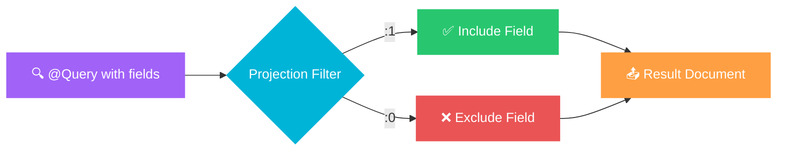

# Projections using MongoDB Query in Spring Boot

**Projections using MongoDB Query in Spring Boot** | By default, the custom query fetches all variables/key data from the collection. But using Projections we can fetch only selected variables/keys from the collection.

- [What are Projections](#1-what-are-projections)
- [Project Setup](#2-project-setup)
- [Model Class](#3-model-class)
- [Repository Interface](#4-repository-interface)
- [Data Setup Runner](#5-data-setup-runner)
- [Projection Examples](#6-projection-examples)
- [Return Types for Projections](#7-return-types-for-projections)
- [Full Repository with All Query Methods](#8-full-repository-with-all-query-methods)
- [Test Runner](#9-test-runner)

---

## 1. What are Projections

By default, a custom query fetches all variables/key data from the collection. Using **Projections**, we can fetch only selected variables/keys. The `fields` attribute in `@Query` controls which fields are returned:

```java
@Query(value = "{ … condition… }", fields = "{ …variable : 1.. }")
```

The `fields` section selects variables for display:

- 1️⃣ **One (`:1`)** — Display the variable
- 0️⃣ **Zero (`:0`)** — Do not display the variable

📝 **Note:** Default values for display:

| Field Type 🏷️ | Default Value 📋 |
|---------------|-----------------|
| **Primary Key Variable** | `1` (shown by default) |
| **Other Variables** | `0` (hidden by default) |



---

## 2. Project Setup

Create a Spring Starter project with the following dependencies:

- 📦 **Lombok** — Reduces boilerplate code
- 💾 **Spring Data MongoDB** — MongoDB integration for Spring Boot

🔧 **Configuration** (`application.properties`):

```properties
spring.data.mongodb.host=localhost
spring.data.mongodb.port=27017
# if given database not exist then auto-created
spring.data.mongodb.database=kp
```

---

## 3. Model Class

**Book entity:**

```java
@Data
@NoArgsConstructor
@AllArgsConstructor
@Document
public class Book {
    @Id
    private Integer bookId;
    private String bookName;
    private String bookAuthor;
    private Double bookCost;
    private String bookType;
}
```

---

## 4. Repository Interface

**BookRepository (basic):**

```java
public interface BookRepository extends MongoRepository<Book, String> { }
```

---

## 5. Data Setup Runner

**MyDataRunner:**

```java
@Component
@Order(1)
public class MyDataRunner implements CommandLineRunner {

    @Autowired
    private BookRepository bookRepository;

    @Override
    public void run(String... args) throws Exception {
        bookRepository.deleteAll();

        bookRepository.save(new Book(2505, "Spring Boot", "A", 500.0, "BackEnd"));
        bookRepository.save(new Book(2506, "Microservice", "B", 600.0, "BackEnd"));
        bookRepository.save(new Book(2507, "Angular", "C", 700.0, "FrontEnd"));
    }

}
```

---

## 6. Projection Examples

### Using List as Return Type

The SQL equivalent: `SELECT bookName, bookAuthor FROM book WHERE bid > ?`

**Repository method:**

```java
@Query(value = "{bookId : {$gt : ?0}}", fields = "{bookName: 1, bookAuthor:1}")
List<Book> getAllBooksByIdProjections(Integer id);
```

**Runner call:**

```java
repo.getAllBooksByIdProjections(100).forEach(System.out::println);
```

📤 **Output:**

```
Book(bookId=2505, bookName=Spring Boot, bookAuthor=A, bookCost=null, bookType=null)
Book(bookId=2506, bookName=Microservice, bookAuthor=B, bookCost=null, bookType=null)
Book(bookId=2507, bookName=Angular, bookAuthor=C, bookCost=null, bookType=null)
```

💡 **Tip:** We used `List<Book>` as the return type, so the unavailable fields like `bookCost` and `bookType` are `null`. We can also use a JSON string for the return type.

### Using List as Return Type

**Repository method:**

```java
@Query(value = "{bookId : {$gt : ?0}}", fields = "{bookName: 1, bookAuthor:1}")
List<String> getAllBooksByIdProjections(Integer id);
```

📤 **Output:**

```
{"_id": 2505, "bookName": "Spring Boot", "bookAuthor": "A"}
{"_id": 2506, "bookName": "Microservice", "bookAuthor": "B"}
{"_id": 2507, "bookName": "Angular", "bookAuthor": "C"}
```

---

## 7. Return Types for Projections

Output (return type of method) for custom query projections is limited to only two types:

| Return Type 🏷️ | Allowed? ✅ | Example 🛠️ |
|----------------|-----------|------------|
| **String** | ✅ Yes | `List<String>`, `String` |
| **ClassType** | ✅ Yes | `List<Book>`, `Book` |
| **Object[]** | ❌️ No | Not supported |
| **Double** | ❌️ No | Not supported |

> 🔑 **Key Point:** `List<String>`, `String`, `List<Book>`, and `Book` are allowed. `Object[]`, `Double`, etc. are **not** allowed.

---

## 8. Full Repository with All Query Methods

**BookRepository (complete):**

```java
package com.knowprogram.demo.repo;

import java.util.List;

import org.springframework.data.mongodb.repository.MongoRepository;
import org.springframework.data.mongodb.repository.Query;

import com.knowprogram.demo.model.Book;

public interface BookRepository extends MongoRepository<Book, String> {
    // SQL: select * from book where bid>?
    @Query("{bookId : {$gt : ?0}}")
    List<Book> getAllBooksById(Integer id);

    // SQL: select bookName, bookAuthor from book where bid>?
    @Query(value = "{bookId : {$gt : ?0}}", fields = "{bookName: 1, bookAuthor:1}")
    List<String> getAllBooksByIdProjections(Integer id);

    // SQL: select bookAuthor fom book where bookType=?
    @Query(value = "{bookType: ?0}", fields = "{bookAuthor:1, _id:0}")
    List<String> getBooksDataA(String bookType);

    // SQL: select bookName, bookAuthor from book where bookName like ?
    @Query(value = "{bookName: {$regex: ?0}}", fields = "{bookName: 1, bookAuthor:1}")
    List<String> getBooksByBookName(String input);

    // SQL: select bookName, bookAuthor from book where bookId In (...)
    @Query(value = "{bookId: {$in: ?0}}", fields = "{bookName: 1, bookAuthor:1}")
    List<String> getBooksByBookIds(List<Integer> ids);

    // SQL: select bookName, bookAuthor from book where bookId In (...)
    @Query(value = "{bookId: {$gt: ?0, $lt: ?1}}", fields = "{bookName: 1, bookAuthor:1}")
    List<String> getBooksByBookIdBetween(Integer gt, Integer lt);

    // SQL: SELECT count(*) FROM BOOK WHERE bookId >?
    @Query(value = "{bookId: {$gt: ?0}}", count = true)
    Integer getBooksCount(Integer id);

    // SQL: SELECT * FROM BOOK WHERE bookId >? order by bookType
    // @Query(value = "{bookId: {$gt:?0}}", sort = "{bookType: 1}") // ascending
    // order
    @Query(value = "{bookId: {$gt:?0}}", sort = "{bookType: -1}") // descending order
    List<Book> getBooksInOrder(Integer id);

    @Query(value = "{bookId: {$gt:?0}}", delete = true)
    Long deleteBooksById(Integer id);
}
```

The repository demonstrates several `@Query` features beyond projections:

| Feature 🏷️ | Attribute 📋 | Example 🛠️ |
|------------|-------------|------------|
| **Projection** | `fields` | `fields = "{bookName: 1, bookAuthor:1}"` |
| **Exclude `_id`** | `fields` with `_id:0` | `fields = "{bookAuthor:1, _id:0}"` |
| **Regex Match** | `$regex` | `{bookName: {$regex: ?0}}` |
| **In List** | `$in` | `{bookId: {$in: ?0}}` |
| **Range** | `$gt`, `$lt` | `{bookId: {$gt: ?0, $lt: ?1}}` |
| **Count** | `count = true` | Returns `Integer` count |
| **Sort** | `sort` | `sort = "{bookType: -1}"` |
| **Delete** | `delete = true` | Returns `Long` deleted count |

---

## 9. Test Runner

**DataTestRunner:**

```java
@Component
@Order(2)
public class DataTestRunner implements CommandLineRunner {

    @Autowired
    private BookRepository repo;

    @Override
    public void run(String... args) throws Exception {
        repo.getAllBooksByIdProjections(100)
            .forEach(System.out::println);

        repo.getBooksDataA("BackEnd")
            .forEach(System.out::println);

        // repo.getBooksByBookName("^S") // starts with ^<input>
        // repo.getBooksByBookName("e$") // ends with <input>$
        repo.getBooksByBookName("o") // containing
            .forEach(System.out::println);

        repo.getBooksByBookIds(Arrays.asList(2505, 2506))
            .forEach(System.out::println);

        repo.getBooksByBookIdBetween(2500, 2900)
            .forEach(System.out::println);

        System.out.println(repo.getBooksCount(2500)); // 3
        System.out.println(repo.getBooksInOrder(2500));
        System.out.println(repo.deleteBooksById(2500));
    }

}
```

> 💡 **Tip:** The regex patterns for `getBooksByBookName` work as follows:  
> - `"^S"` — Starts with "S"  
> - `"e$"` — Ends with "e"  
> - `"o"` — Contains "o"
