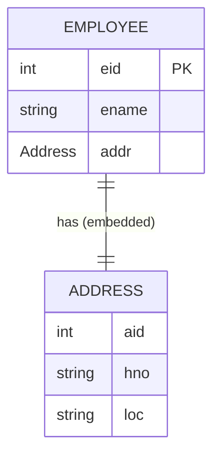
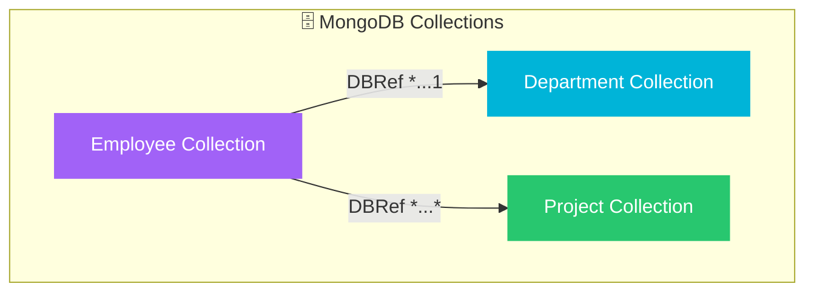

# Spring Boot MongoDB Complex Types Example

**Spring Boot MongoDB Complex Types Example** | We will see how to work with primitive data types, collection data, and classType (Embedded and DBRef) in MongoDB through Spring Boot examples. In MongoDB, there is no concept of association mappings like One-To-One, One-To-Many, and e.t.c. Here we use Embedded and DBRef concepts. We will discuss them with examples.

- [Spring Boot MongoDB Example with Primitive Data](#1-spring-boot-mongodb-example-with-primitive-data)
- [Spring Boot MongoDB Example with Collection Data](#2-spring-boot-mongodb-example-with-collection-data)
- [Spring Boot MongoDB Example with Embedded](#3-spring-boot-mongodb-example-with-embedded)
- [Another Example with Embedded List ClassType for MongoDB](#4-another-example-with-embedded-list-classtype-for-mongodb)
- [Spring Boot MongoDB Example with DBRef](#5-spring-boot-mongodb-example-with-dbref)

---

## 1. Spring Boot MongoDB Example with Primitive Data

For primitive data, we use the variable in class which works as the key that holds a single value in the Document.

1️⃣ **Create a Spring Starter project** and add the following dependencies: Lombok, Spring Data MongoDB.

🔧 **Configuration** (`application.properties`):

```properties
spring.data.mongodb.host=localhost
spring.data.mongodb.port=27017
spring.data.mongodb.database=sample
```

**Model class:**

```java
@Data
@AllArgsConstructor
@NoArgsConstructor
@Document
public class Employee {
    @Id
    private Integer empId;
    private String empName;
    private Double empSal;
}
```

**Repository:**

```java
public interface EmployeeRepository extends MongoRepository<Employee, Integer> { }
```

**Runner class:**

```java
@Component
@Order(1)
public class DataInsertRunner implements CommandLineRunner {

    @Autowired
    private EmployeeRepository employeeRepository;

    @Override
    public void run(String... args) throws Exception {
        employeeRepository.deleteAll();
        employeeRepository.save(new Employee(10, "Rocco", 200.0));

    }
}
```

📤 **Output** (MongoDB Shell):

```bash
> mongosh
> use sample
> db.employee.find()
[
  {
    _id: 10,
    empName: 'Rocco',
    empSal: 200,
    _class: 'com.knowprogram.demo.model.Employee'
  }
]
```

---

## 2. Spring Boot MongoDB Example with Collection Data

For collection data (like `List`/`Set`/`Array`/`Map`) we use variables which works as key that can hold multiple values.

🗂️ **For `List`/`Set`/`Array`:**

```json
key : [ val, val, val, .... ]
```

🗃️ **For `Map`:**

```json
key : {
   mapKey : mapVal,
   mapKey : mapVal
}
```

**Model class:**

```java
@Data
@AllArgsConstructor
@NoArgsConstructor
@Document
public class Employee {
    @Id
    private Integer empId;
    private String empName;
    private Double empSal;
    private Set<String> empProjects;
    private List<String> empPrjVer;
    private String[] empGrades;
    private Map<String, String> empClients;
}
```

**Runner class:**

```java
@Component
@Order(1)
public class DataInsertRunner implements CommandLineRunner {

    @Autowired
    private EmployeeRepository employeeRepository;

    @Override
    public void run(String... args) throws Exception {
        employeeRepository.deleteAll();
        employeeRepository.save(
            new Employee(10, "Rocco", 200.0,
                Set.of("HTC", "KP", "ORCL"),
                List.of("3.2GA", "6.5 RELEASE", "0.1 ALPHA"),
                new String[] { "A+", "GR-T", "UI-NEW" },
                Map.of("C1", "TEC-IN", "C2", "US-ARMY", "C3", "JANSON & JANSON")
            )
        );

    }

}
```

📤 **Output** (MongoDB Shell):

```json
> db.employee.find()
[
  {
    _id: 10,
    empName: 'Rocco',
    empSal: 200,
    empProjects: [
      'ORCL',
      'KP',
      'HTC'
    ],
    empPrjVer: [
      '3.2GA',
      '6.5 RELEASE',
      '0.1 ALPHA'
    ],
    empGrades: [
      'A+',
      'GR-T',
      'UI-NEW'
    ],
    empClients: {
      C1: 'TEC-IN',
      C2: 'US-ARMY',
      C3: 'JANSON & JANSON'
    },
    _class: 'com.knowprogram.demo.model.Employee'
  }
]
```

---

## 3. Spring Boot MongoDB Example with Embedded

**Embedded** — Placing one JSON Document inside another JSON Document for Association Mapping is called Embedded. It creates only one collection for all Associated Models.



🧠 **In Simple Words:**

```json
// Only one collection : employee
{
  "eid": 10,
  "ename": "A",
  "addr": {
    "aid": 501,
    "hno": "5-67",
    "loc": "HYD"
  }
}
```

Here we use ClassType. In this case, an inner JSON document is created. The `hasAVariable` behaves like a key and child object behaves as like Inner JSON:

```json
hasAVariable : {
   variable : value
}
```

INNER JSON is also called an Embedded Document. Finally, one JSON Document that contains all child JSONS is created. They are not reusable, repeated data.

**Model class** (`Employee`):

```java
@Data
@AllArgsConstructor
@NoArgsConstructor
@Document
public class Employee {
    @Id
    private Integer empId;
    private String empName;
    private Double empSal;
    private Set<String> empProjects;
    private List<String> empPrjVer;
    private String[] empGrades;
    private Map<String, String> empClients;

    private Address addr;
}
```

**Model class** (`Address`):

```java
@Data
@AllArgsConstructor
@NoArgsConstructor
public class Address {
    private String houseNo;
    private String location;
    private Long pincode;
}
```

**Runner class:**

```java
@Component
@Order(1)
public class DataInsertRunner implements CommandLineRunner {

    @Autowired
    private EmployeeRepository employeeRepository;

    @Override
    public void run(String... args) throws Exception {
        employeeRepository.deleteAll();
        employeeRepository.save(
            new Employee(10, "Rocco", 200.0,
                Set.of("HTC", "KP", "ORCL"),
                List.of("3.2GA", "6.5 RELEASE", "0.1 ALPHA"),
                new String[] { "A+", "GR-T", "UI-NEW" },
                Map.of("C1", "TEC-IN", "C2", "US-ARMY", "C3", "JANSON & JANSON"),
                new Address("8-9/A", "DC", 50032L)
            )
        );
    }
}
```

📤 **Output** (MongoDB Shell):

```json
> db.employee.find()
[
  {
    _id: 10,
    empName: 'Rocco',
    empSal: 200,
    empProjects: [
      'HTC',
      'ORCL',
      'KP'
    ],
    empPrjVer: [
      '3.2GA',
      '6.5 RELEASE',
      '0.1 ALPHA'
    ],
    empGrades: [
      'A+',
      'GR-T',
      'UI-NEW'
    ],
    empClients: {
      C1: 'TEC-IN',
      C2: 'US-ARMY',
      C3: 'JANSON & JANSON'
    },
    addr: {
      houseNo: '8-9/A',
      location: 'DC',
      pincode: Long('50032')
    },
    _class: 'com.knowprogram.demo.model.Employee'
  }
]
```

> 💡 **Tip:** If we compare `Map` and classType i.e. `empClients` and `addr`, then they look the same and for the first time, it is not very easy to understand which one is from map and which is one from classType. However, we use the map when all key values will be of the same data type whereas we use classType when different key values have distinct data types.

---

## 4. Another Example with Embedded List ClassType for MongoDB

**Model class** (`Employee` with `List<Department>`):

```java
@Data
@AllArgsConstructor
@NoArgsConstructor
@Document
public class Employee {
    @Id
    private Integer empId;
    private String empName;
    private Double empSal;
    private Set<String> empProjects;
    private List<String> empPrjVer;
    private String[] empGrades;
    private Map<String, String> empClients;

    private Address addr;

    private List<Department> dobs;
}
```

**Model class** (`Department`):

```java
@Data
@AllArgsConstructor
@NoArgsConstructor
public class Department {
    private String deptCode;
    private String deptName;
}
```

**Runner class:**

```java
@Component
@Order(1)
public class DataInsertRunner implements CommandLineRunner {

    @Autowired
    private EmployeeRepository employeeRepository;

    @Override
    public void run(String... args) throws Exception {
        employeeRepository.deleteAll();
        employeeRepository.save(
            new Employee(10, "Rocco", 200.0,
                Set.of("HTC", "KP", "ORCL"),
                List.of("3.2GA", "6.5 RELEASE", "0.1 ALPHA"),
                new String[] { "A+", "GR-T", "UI-NEW" },
                Map.of("C1", "TEC-IN", "C2", "US-ARMY", "C3", "JANSON & JANSON"),
                new Address("8-9/A", "DC", 50032L),
                List.of(
                        new Department("D1", "DEV-AB"),
                        new Department("D2", "QA-RB"),
                        new Department("D3", "SUPRT-MN")
                )
            )
        );
    }
}
```

📤 **Output** (MongoDB Shell):

```json
> db.employee.find()
[
  {
    _id: 10,
    empName: 'Rocco',
    empSal: 200,
    empProjects: [ 'HTC', 'ORCL', 'KP' ],
    empPrjVer: [ '3.2GA', '6.5 RELEASE', '0.1 ALPHA' ],
    empGrades: [ 'A+', 'GR-T', 'UI-NEW' ],
    empClients: { C1: 'TEC-IN', C2: 'US-ARMY', C3: 'JANSON & JANSON' },
    addr: { houseNo: '8-9/A', location: 'DC', pincode: Long('50032') },
    dobs: [
      { deptCode: 'D1', deptName: 'DEV-AB' },
      { deptCode: 'D2', deptName: 'QA-RB' },
      { deptCode: 'D3', deptName: 'SUPRT-MN' }
    ],
    _class: 'com.knowprogram.demo.model.Employee'
  }
]
```

> ⚠️ **Caution:** The issue with this example is that we can't reuse this department again. Embedded documents are not reusable.

---

## 5. Spring Boot MongoDB Example with DBRef

**DBRef** — Creating Independent collections for association mapping using ID as a Link variable with parent collection.

- 🔗 One collection ID is another Collection DBRef.
- ⚖️ Compared with Data JPA, we can say One Table's primary key is another Table's foreign key.



🧠 **In Simple Words:**

```json
// dept-collection
{
    "did" : 10,
    "dname" : "DEV"
}

// employee-collection
{
    "eid" : 101,
    "ename" : "ABC",
    "dob" : ("dept-collection", 10)  // Reference/foreign key
}
```

### When to Use Embedded vs DBRef

In which case we do use Embedded and DBRef? If we want to re-use data (JSON Doc) then we should use DBRef, else we can use Embedded.

Comparing with Data JPA, generally in the case of One-To-One and One-To-Many we use Embedded and in the case of Many-To-One, and Many-To-Many we use DBRef.

| Approach 🏷️ | Multiplicity 🔗 | Reusable? 🔄 |
|-------------|-----------------|--------------|
| **Embedded** | `1...1` (One-To-One) | ❌️ No |
| **Embedded** | `1...*` (One-To-Many) | ❌️ No |
| **DBRef** | `*...1` (Many-To-One) | ✅ Yes |
| **DBRef** | `*...*` (Many-To-Many) | ✅ Yes |

🛠️ **Examples:**

- 🧑 **Person --- SSN (Social Security Number):** One-To-One (one person can have only one SSN), therefore use **Embedded**.
- 📦 **Product --- Client:** Many-To-Many (one product can have many clients, and one client can use many products), therefore use **DBRef**.
- 🎓 **Student --- Address:** One-To-Many (one student can have multiple addresses), therefore use **Embedded**.
- 👔 **Employee --- Department:** Many-To-One (many employees belong to one department but generally one employee belongs to only one department), use **DBRef**.

> 🔑 **Key Point:** Every Association Mapping (HAS-A) without any annotation in Spring Boot MongoDB is **default Embedded**. For DBRef, use annotation `@DBRef` over the HAS-A variable.

For the child document, follow these steps:

1. Define child as a `@Document`.
2. Provide `@Id` for the child Document too.
3. Create a Repository Interface even.
4. Save them before calling the save method to the parent. Cascading is not present for MongoDB.

### DBRef Implementation

Previous example code are not used. Create a new project and add the following dependencies: Lombok, Spring Data MongoDB.

🔧 **Configuration** (`application.properties`):

```properties
spring.data.mongodb.host=localhost
spring.data.mongodb.port=27017
spring.data.mongodb.database=sample1
```

**Model class** (`Employee`):

```java
@Data
@AllArgsConstructor
@NoArgsConstructor
@Document
public class Employee {
    @Id
    private Integer empId;
    private String empName;
    private Double empSal;

    // * ... 1
    @DBRef
    private Department dob;

    // * ... *
    @DBRef
    private List<Project> pobs;
}
```

**Model class** (`Project`):

```java
@Data
@AllArgsConstructor
@NoArgsConstructor
@Document
public class Project {
    @Id
    private Integer projId;
    private String projName;
    private String clientName;
}
```

**Model class** (`Department`):

```java
@Data
@AllArgsConstructor
@NoArgsConstructor
@Document
public class Department {
    @Id
    private Integer deptId;
    private String deptName;
    private String deptAdmin;
}
```

**Repositories:**

```java
public interface EmployeeRepository extends MongoRepository<Employee, Integer> {}
```

```java
public interface DepartmentRepository extends MongoRepository<Department, Integer> {}
```

```java
public interface ProjectRepository extends MongoRepository<Project, Integer> {}
```

**Runner class:**

```java
@Component
public class DataInsertRunner implements CommandLineRunner {

    @Autowired
    private EmployeeRepository employeeRepository;

    @Autowired
    private ProjectRepository projectRepository;

    @Autowired
    private DepartmentRepository departmentRepository;

    @Override
    public void run(String... args) throws Exception {
        employeeRepository.deleteAll();
        projectRepository.deleteAll();
        departmentRepository.deleteAll();

        Project p1 = new Project(101, "P1-AA", "ABC");
        Project p2 = new Project(102, "P2-BB", "XYZ");
        Project p3 = new Project(103, "P2-CC", "MNO");
        projectRepository.saveAll(List.of(p1, p2, p3));

        Department d1 = new Department(50601, "DEV", "WILLIAM");
        Department d2 = new Department(50602, "QA", "JERRY");
        departmentRepository.saveAll(List.of(d1, d2));

        Employee e1 = new Employee(320, "Rocco", 600.0, d1, List.of(p1, p2));
        Employee e2 = new Employee(321, "Anna", 600.0, d2, List.of(p2, p3));
        employeeRepository.saveAll(List.of(e1, e2));

    }

}
```

📤 **Output** (MongoDB Shell):

```bash
> use sample1
> show collections
department
employee
project
```

💾 **Project collection:**

```json
> db.project.find()
[
  {
    _id: 101,
    projName: 'P1-AA',
    clientName: 'ABC',
    _class: 'com.knowprogram.demo.model.Project'
  },
  {
    _id: 102,
    projName: 'P2-BB',
    clientName: 'XYZ',
    _class: 'com.knowprogram.demo.model.Project'
  },
  {
    _id: 103,
    projName: 'P2-CC',
    clientName: 'MNO',
    _class: 'com.knowprogram.demo.model.Project'
  }
]
```

🏢 **Department collection:**

```json
> db.department.find()
[
  {
    _id: 50601,
    deptName: 'DEV',
    deptAdmin: 'WILLIAM',
    _class: 'com.knowprogram.demo.model.Department'
  },
  {
    _id: 50602,
    deptName: 'QA',
    deptAdmin: 'JERRY',
    _class: 'com.knowprogram.demo.model.Department'
  }
]
```

👥 **Employee collection:**

```json
> db.employee.find()
[
  {
    _id: 320,
    empName: 'Rocco',
    empSal: 600,
    dob: DBRef('department', 50601),
    pobs: [ DBRef('project', 101), DBRef('project', 102) ],
    _class: 'com.knowprogram.demo.model.Employee'
  },
  {
    _id: 321,
    empName: 'Anna',
    empSal: 600,
    dob: DBRef('department', 50602),
    pobs: [ DBRef('project', 102), DBRef('project', 103) ],
    _class: 'com.knowprogram.demo.model.Employee'
  }
]
```

We can see that `dob` and `pobs` fields are referring the `id` of the department and project collections.

> 📝 **Note:** The `MongoRepository` does not support all features like fetching records from DBRef collections. Instead we can use [MongoTemplate](./06_MongoTemplate_Spring_Boot_Example.md), there we will use this example application to see how to fetch records while using DBRef.
