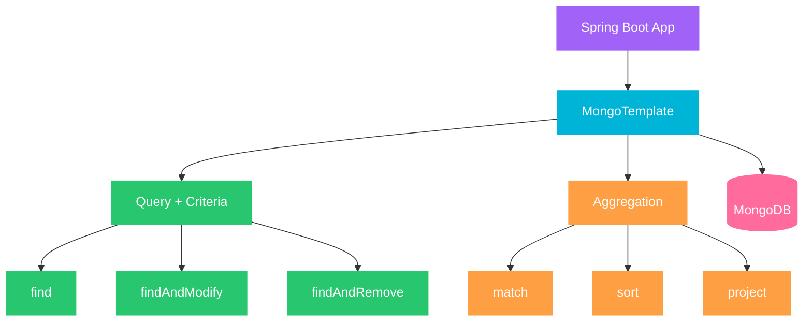

# MongoTemplate Spring Boot Example

**MongoTemplate Spring Boot Example** | `MongoTemplate` is an auto-configured class given by Spring Data MongoDB, used to perform all operations over MongoDB collections.

- [Overview](#1-overview)
- [Query-based Operations](#2-query-based-operations)
- [Project Setup](#3-project-setup)
- [Model Class](#4-model-class)
- [Runner Class with CRUD Operations](#5-runner-class-with-crud-operations)
- [AND Operation](#6-and-operation)
- [OR Operation](#7-or-operation)
- [IN Operator](#8-in-operator)
- [Not IN Operator](#9-not-in-operator)
- [Existence, Null, and Empty Checks](#10-existence-null-and-empty-checks)
- [Regex Matching](#11-regex-matching)
- [MongoDB Aggregation](#12-mongodb-aggregation)
- [Spring Boot MongoDB With Lookup process using DBRef](#13-spring-boot-mongodb-with-lookup-process-using-dbref)

---

## 1. Overview

When we use `MongoTemplate`(C), **no need to use the `MongoRepository` interface**. We can directly use `MongoTemplate`(C) via `@Autowired` inside our application.



---

## 2. Query-based Operations

We can define a `Query` with `Criteria` which is also called a WHERE condition to execute FETCH/UPDATE/DELETE operations.

`Criteria` provides methods for all operations: `lt`, `ge`, `and`, `or`, `not`, `is`, etc.

| Method 🛠️ | Purpose 📋 | Usage 🔍 |
|-----------|-----------|----------|
| **`find(q, class)`** | Fetch matching data | 🔎 Select with conditions |
| **`findAndModify(q, update, class)`** | Modify matching data | ✏️ Update with conditions |
| **`findAndRemove(q, class)`** | Delete matching data | 🗑️ Remove with conditions |

🛠️ **Example — building a query with criteria:**

```java
q.addCriteria(
    Criteria.where("stdName").is("C")
        .and("stdFee").gt(50.0)
        .and("stdName").ne(null)
);
```

---

## 3. Project Setup

1️⃣ **Create a Spring Starter project** and add the following dependencies:

- 📦 Lombok
- 💾 Spring Data MongoDB

🔧 **Configuration** (`application.properties`):

```properties
spring.data.mongodb.host=localhost
spring.data.mongodb.port=27017
spring.data.mongodb.database=resttemplate
```

---

## 4. Model Class

**Student model:**

```java
@Data
@NoArgsConstructor
@AllArgsConstructor
@Document
public class Student {

    @Id
    private Integer stdId;
    private String stdName;
    private Double stdFee;
}
```

---

## 5. Runner Class with CRUD Operations

**Runner class** (`TestTemplateRunner.java`):

```java
package com.knowprogram.demo.runner;

import java.util.List;

import org.springframework.beans.factory.annotation.Autowired;
import org.springframework.boot.CommandLineRunner;
import org.springframework.data.mongodb.core.MongoTemplate;
import org.springframework.data.mongodb.core.query.Criteria;
import org.springframework.data.mongodb.core.query.Query;
import org.springframework.data.mongodb.core.query.Update;
import org.springframework.stereotype.Component;

import com.knowprogram.demo.model.Student;

@Component
public class TestTemplateRunner implements CommandLineRunner {

    @Autowired
    private MongoTemplate mt;

    @Override
    public void run(String... args) throws Exception {

        // 1. save (insert/update)
        mt.save(new Student(10, "A", 3.3));
        mt.save(new Student(11, "B", 2.3));
        mt.save(new Student(12, "C", 4.3));

        // fetch data
        List<Student> list = mt.findAll(Student.class);
        list.forEach(System.out::println);

        // 3. condition based (Query) update/fetch/delete
        Query query = new Query();
        // where stdName = 'C' and stdFee != 5.5
        query.addCriteria(Criteria.where("stdName").is("C").and("stdFee").ne(5.5));

        // 3.a) fetch data
        mt.find(query, Student.class).forEach(System.out::println);

        // 3.b) update data
        Update update = new Update();
        update.set("stdName", "CAM");
        update.set("stdFee", 9.9);
        mt.findAndModify(query, update, Student.class);

        // 3.c) remove data
        mt.findAndRemove(query, Student.class);
    }
}
```

---

## 6. AND Operation

By default, adding multiple criteria to a `Query` combines them with AND logic.

**AND query example:**

```java
Query query = new Query();

// Add criteria to the query
query.addCriteria(Criteria.where("stdName").is("A"));
// By default it is AND
query.addCriteria(Criteria.where("stdFee").gte(3.3));

// Execute the query and retrieve the results
List<Student> list = mt.find(query, Student.class);

// Print the results
System.out.println(list);
```

---

## 7. OR Operation

Use `orOperator()` on `Criteria` to combine conditions with OR logic.

**OR query example:**

```java
Query query = new Query();
Criteria criteria = new Criteria();
query.addCriteria(criteria.orOperator(
    Criteria.where("stdName").is("A"),
    Criteria.where("stdFee").lte(2.3)
));
List<Student> list = mt.find(query, Student.class);
System.out.println(list);
```

💡 **Tip:** The same can be written as:

```java
Query query = new Query();
query.addCriteria(Criteria.where("stdName").is("A")
    .orOperator(Criteria.where("stdFee").lte(2.3)));
List<Student> list = mt.find(query, Student.class);
System.out.println(list);
```

---

## 8. IN Operator

Use `.in()` to match against a list of values.

**IN query example:**

```java
Query query = new Query();
query.addCriteria(Criteria.where("stdName").in(List.of("A", "B")));
List<Student> list = mt.find(query, Student.class);
System.out.println(list);
```

---

## 9. Not IN Operator

Use `.nin()` to exclude a list of values.

**Not IN query example:**

```java
query.addCriteria(Criteria.where("stdName").nin(List.of("A", "B")));
```

---

## 10. Existence, Null, and Empty Checks

Check for existence, not null, and not empty:

**Existence check example:**

```java
query.addCriteria(Criteria.where("stdName")
    .exists(true)  // Ensures the field exists
    .ne(null)   // Ensures the field is not null
    .ne("")     // Ensures the field is not an empty string
);
```

---

## 11. Regex Matching

`Criteria` also supports regex-based matching.

**Regex example:**

```java
query.addCriteria(Criteria.where("stdName").regex("^.{3,50}$"));
```

---

## 12. MongoDB Aggregation

- 🔄 **MongoDB Aggregation:** Executing a large set of operations over collections of data.
- 🧮 **Aggregation Operations:** condition, sort, group, project, etc.

`Aggregation`(C) supports:

- ⚙️ Creating a new Aggregation object
- 🔍 Providing conditional tests
- 📊 Supporting data sort
- 📑 Executing field projections
- 🔄 Converting source format to result class type

**Student model:**

```java
@Data
@NoArgsConstructor
@AllArgsConstructor
@Document
public class Student {
    @Id
    private Integer stdId;
    private String stdName;
    private Double stdFee;
}
```

**Result model** (`MyResult.java`):

```java
@Data
@NoArgsConstructor
@AllArgsConstructor
public class MyResult {
    private String stdName;
    private Double stdFee;
}
```

**Runner class** (`Test2Runner.java`):

```java
package com.knowprogram.demo.runner;

import org.springframework.beans.factory.annotation.Autowired;
import org.springframework.boot.CommandLineRunner;
import org.springframework.data.domain.Sort.Direction;
import org.springframework.data.mongodb.core.MongoTemplate;
import org.springframework.data.mongodb.core.aggregation.Aggregation;
import org.springframework.data.mongodb.core.query.Criteria;
import org.springframework.stereotype.Component;

import com.knowprogram.demo.model.MyResult;
import com.knowprogram.demo.model.Student;

@Component
public class Test2Runner implements CommandLineRunner {

    @Autowired
    private MongoTemplate mt;

    @Override
    public void run(String... args) throws Exception {
        mt.save(new Student(12, "C", 4.3));
        mt.save(new Student(13, "D", 5.3));
        mt.save(new Student(14, "E", 6.3));

        // mongoDB aggregation
        Aggregation ag = Aggregation.newAggregation(
                Aggregation.match(Criteria.where("stdFee").gt(1.1)),
                Aggregation.sort(Direction.DESC, "stdName"),
                Aggregation.project("stdName", "stdFee")
            );

        // execute
        // Method syntax:- aggregate(aggregationObject, source, expectedResult.class)
        mt.aggregate(ag, Student.class, Student.class)
          .forEach(System.out::println);
        // gives:- Student(stdId=14, stdName=E, stdFee=6.3)
        // stdId will come by default

        // if we want only stdName, and stdFee in result.
        mt.aggregate(ag, Student.class, MyResult.class)
          .forEach(System.out::println);
        // gives:- MyResult(stdName=E, stdFee=6.3)
    }

}
```

📝 **Note:** When using `Student.class` as the result type, `stdId` is included by default. To exclude it, use a custom result class like `MyResult` that only contains the projected fields.


---

## 13. Spring Boot MongoDB With Lookup process using DBRef

Previously we have developed an [application using DBRef](./05_Spring_Boot_MongoDB_Complex_Types_Example.md) with `Employee`, `Department`, and `Project` model classes — we will use that here.

🗄️ **Sample MongoDB data** (`db.employee.find()`):

```json
[
  {
    _id: 320,
    empName: 'Rocco',
    empSal: 600,
    dob: DBRef('department', 50601),
    pobs: [ DBRef('project', 101), DBRef('project', 102) ],
    _class: 'com.knowprogram.demo.model.Employee'
  },
  {
    _id: 321,
    empName: 'Anna',
    empSal: 600,
    dob: DBRef('department', 50602),
    pobs: [ DBRef('project', 102), DBRef('project', 103) ],
    _class: 'com.knowprogram.demo.model.Employee'
  }
]
```

Let us see how to perform the Aggregation concept on `DBRef`.

**DataFetchRunner class:**

```java
@Component
@Order(2)
public class DataFetchRunner implements CommandLineRunner {

    @Autowired
    private MongoTemplate mt;

    @Override
    public void run(String... args) throws Exception {
        Aggregation aggr = Aggregation.newAggregation(
                Aggregation.match(Criteria.where("_id").is(320)),
                Aggregation.sort(Direction.DESC, "empName"),
                Aggregation.project("empName", "addr","dob", "pobs")
            );

        List<Employee> list = mt.aggregate(aggr, "employee", Employee.class)
                .getMappedResults();
        list.forEach(System.out::println);

    }

}
```

📤 **Output:**

```
Employee(empId=320, empName=Rocco, empSal=null, dob=Department(deptId=50601, deptName=DEV, deptAdmin=WILLIAM), pobs=[Project(projId=101, projName=P1-AA, clientName=ABC), Project(projId=102, projName=P2-BB, clientName=XYZ)])
```

🔗 See more about aggregation in MongoDB: [Aggregation](https://docs.mongodb.com/manual/aggregation/)
