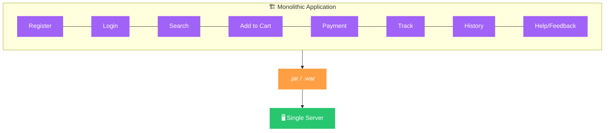
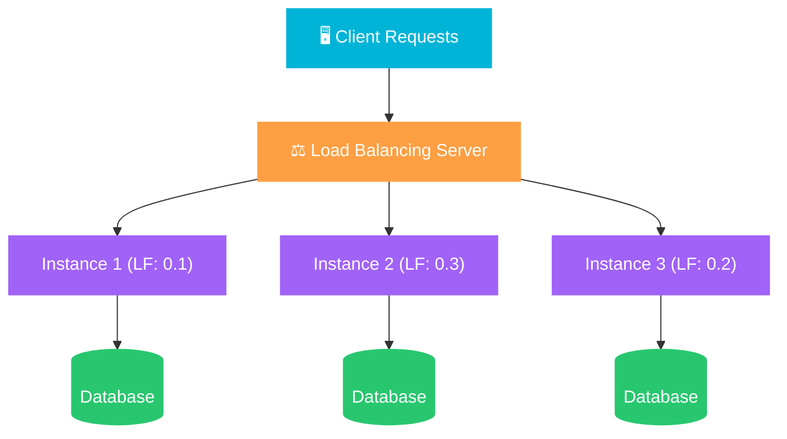
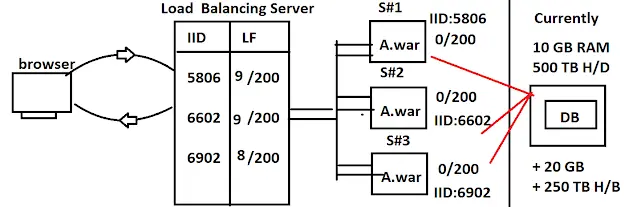
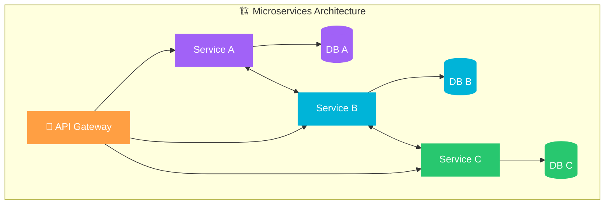
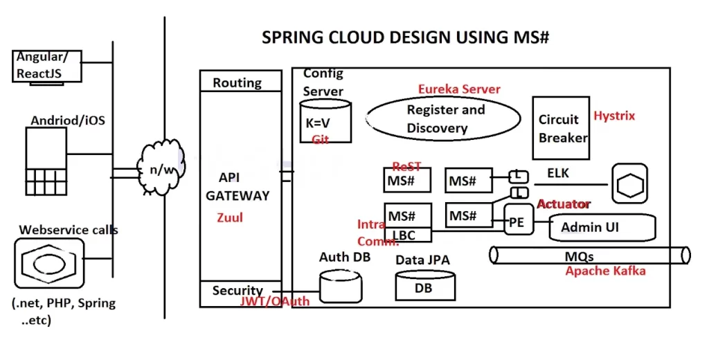
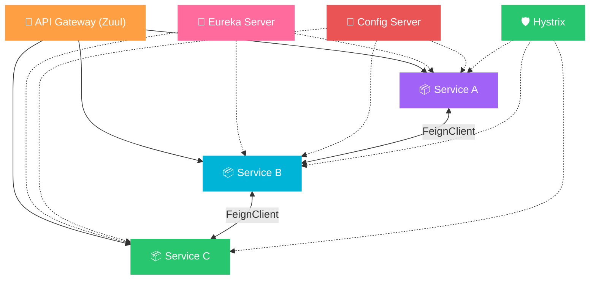
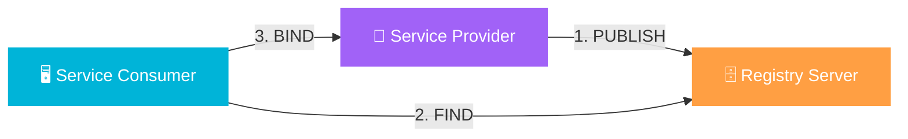
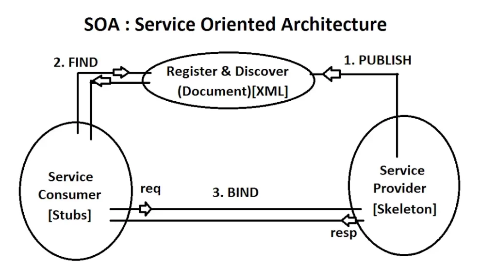

# Microservices Introduction

**Microservices Introduction** | We will examine some of the terms commonly used in microservices. And see what is Monolithic Application, its advantages and disadvantages, Microservices Design Overview, and Spring Cloud Netflix Components.

- [Cloud Computing and Microservices Overview](#1-cloud-computing-and-microservices-overview)
- [Monolithic Applications](#2-monolithic-applications)
- [Load and Scaling](#3-load-and-scaling)
- [Load Balancing Server](#4-load-balancing-server)
- [Advantages of Monolithic Application](#5-advantages-of-monolithic-application)
- [Limitations of Monolithic Application](#6-limitations-of-monolithic-application)
- [Microservices Design Overview](#7-microservices-design-overview)
- [Spring Cloud Netflix Components](#8-spring-cloud-netflix-components)
- [SOA (Service Oriented Architecture)](#9-soa-service-oriented-architecture)

---

## 1. Cloud Computing and Microservices Overview

🏗️ **Microservices** — It is a design used to develop applications by decomposing modules into applications and integrating them using web services. Microservices is not coding, it is theory/design. For this coding is Spring Cloud.

☁️ **What is Cloud computing?** Using services over the network for rental is called Cloud computing. For example you have started a new software company today then you will need servers but server setup is very costly. So, instead of server setup, you go for renting the servers and pay the server provider based on usages/services.

We will need mainly three types of services: Hardware, OS, and Applications.

| Service Type 🏷️ | Full Name 📋 | Examples 🛠️ |
|-----------------|-------------|-------------|
| **IaaS** | Infrastructure as a Service | Hard Disk, Network, Processor, etc. |
| **PaaS** | Platform as a Service | Windows Server, Unix Server |
| **SaaS** | Software as a Service | Tomcat Server, Oracle tools, Databases, etc. |

🌐 **What are different cloud computing providers?** AWS (Amazon Web Services), Google Cloud, and Microsoft Azure are popular cloud computing providers. By using them we can run our application.

⚙️ **What is Spring Cloud? Where it is used?** To develop applications using Microservices design, Spring Cloud is used.

⚖️ **Cloud computing vs Spring Cloud?** Cloud computing is used to run the application whereas Spring Cloud is used to develop the Microservices design.

📖 To know what is microservices (not coding) we have to see the below concepts:

1. Monolithic Application
2. Monolithic Advantages
3. Monolithic Limitations
4. Scaling
5. SOA (Service Oriented Architecture)
6. Microservices design
7. Spring Cloud Netflix OSS components

---

## 2. Monolithic Applications

One application that contains multiple services together and is deployed as a single unit is called a Monolithic Application. In short, we can say monolithic application = complete project as a single unit (`.jar`/`.war` file).

- 📦 **Application** = Collection of Services
- 🗂️ **Project** = Collection of Modules

🧠 **In Simple Words:**
Let us see an example of an Application/Project. Consider any e-commerce website. It provides the following services: Register, Login, Search items, Add to Cart, Payment, Track, History, Help, Feedback, Review, Logout. In a monolithic application, all these services will be developed as a single application.



To develop a monolithic Java application, first, we will write the source code (`.java`) containing all services together, compile it (`.class`) then build the project which will create a `.jar`/`.war` file, and finally, deploy it to the server.

🔨 **What is build?** Creating the final format of a project code that can be deployed to the server is called build. Example: creating `.jar`/`.war` file. To build the project we can use Maven Goals `Maven Clean` and `Maven Install` or we can automate the process using Jenkins with Maven/Gradle or AWS pipeline.

`Maven clean` will delete the old files from the target folder. `Maven install` will download all the dependencies and create the `.jar`/`.war` file in the target folder. To run the `.jar`/`.war` file we can use `java -jar <project.jar/.war>`. In real time Jenkins with Maven/Gradle or AWS Pipeline is most commonly used which automates the build process.

🚀 **What is Deploy?** Placing the build file (`.jar`/`.war` file) inside the server and starting the server is called deploy.

🖥️ **What is a server instance / Service Instance?** An Application running inside one server is called a service instance. Each service instance will have a unique instance ID.

📝 **What is the default max capacity of a server (or) the default max number of requests a server can process at a time?** 200 (default). But we can modify that as follows:

**Tomcat configuration:**

```properties
server.tomcat.threads.max=400
```

**Jetty configuration:**

```properties
server.jetty.threads.max=400
```

---

## 3. Load and Scaling

⚡ **What is Load and Load Factor?** One server creates one request thread when a request comes. One request thread is called one Load.

- 📊 **Load** = Current number of requests under processing
- 📈 **Load Factor** = Current Load / Max Load. Assume the current load is 20 then load factor = 20/200 = 0.1
- 🔑 **Load Factor** always varies in the range of **0 (min) to 1 (max)**

🔧 **What is scaling and how many types do we have?** Scaling is the process of increasing resource processing capacity. That provides fast/more service. It is 2 types:

| Scaling Type ⚖️ | Description 📋 | Example 🛠️ |
|-----------------|---------------|------------|
| **Horizontal Scaling** | Creating multiple instances of the same service/project. Each instance will have a unique ID called **IID** (Instance ID). Most of the time these multiple instances are created at different servers so that if one server is down then other servers will be available. | MongoDB supports both vertical and horizontal scaling |
| **Vertical Scaling** | Increase current system capacity/hardware configuration like RAM, Processor, Hard disk, network, etc. | MySQL and Oracle primarily support vertical scaling |

> 📝 **Note:** MySQL and Oracle primarily support vertical scaling, while MongoDB supports both vertical and horizontal scaling.

---

## 4. Load Balancing Server

⚖️ **What is LBS (Load Balancing Server)? Why is it used for?** LBS (Load Balancing Server) is a mediator server, it will distribute requests equally to multiple instances to execute. It will allocate an instance that has less Load Factor. If all/multiple instances have the same load factor, then any one random instance will be allocated.





---

## 5. Advantages of Monolithic Application

- 🛠️ Simple to develop the application using basic Layers design (Presentation Layer, Service Layer, and Data Access Layer).
- 🧪 Easy to test as it is a single application. By using a single script like the Selenium tool and execute end to end test.
- 🚀 Easy to deploy the application. Create the build then place it in the server and start.
- 📈 Scaling is also a simple process. We can create multiple instances (Horizontal Scaling).

💡 **Example:** Spring Thymeleaf CRUD Application

---

## 6. Limitations of Monolithic Application

- 🔄 We must rebuild and re-deploy the entire application even for small modifications/updates in code.
- ⚠️ These are not reliable applications (may not work properly every time).
- 💥 If one small problem exists in one module, it may affect other modules' execution/stop completing project work. It leads to memory issues, bugs in code, wrong output, etc. because of high cohesion/tight connected design.
- 🐢 Adding new concepts/Adopting new technologies may affect project design, take time, affect cost, and code may become complex.
- 📦 When new modules are added then application size, code, and memory may increase which affects deployment time, debugging, CI/CD pipeline management, log tracing, etc.
- 🗄️ On Scale, all instances may not use memory properly for all modules. Resource utilization issues may come.

> 📝 **Note:** We have various forms of Monolithic with names like **Single-Process Monolith, Modular Monolith, Distributed Monolith**.

---

## 7. Microservices Design Overview

What are Microservices? Microservices can be defined as:

- 🚀 An independent deployable component.
- 🔀 A Decoupled Architecture.
- 📦 Module as a project / Service as an Application.
- 🌐 Independent services make resource utilization and communication using web services.

| Aspect ⚖️ | Monolithic 🅰️ | Microservices 🅱️ |
|-----------|--------------|-----------------|
| **Structure** | All modules together as a single project | One module as one project |
| **Deployment** | Single `.jar`/`.war` file | Independent deployment per service |
| **Communication** | Internal method calls | Web services (REST/HTTP) |
| **Cohesion** | ❌️ High (tightly connected) | ✅ Low (loosely coupled) |
| **Resource Utilization** | ❌️ May waste resources | ✅ Effective per service |
| **Scaling** | Entire application scaled | Individual services scaled |



✅ **Microservices Advantages:**

- ⚡ Effective Resource Utilization
- 🔄 Parallel implementation
- 🚀 CI/CD (Continuous Integration/Continuous deployment) is easy.
- 🔗 Less Cohesion (connectivity between two modules). So, one module's problem may not affect other modules. No need to re-build and deploy all projects even on one service change.
- ➕ Adding a new concept/module/service needs another instance and integration is also easy (web services).

❌️ **Limitations in Microservices:**

- 🖥️ Maintenance (There will be multiple server/instance/log files/deployments)
- 🔍 Debug process (Finding Bugs and execution flow)
- 🧪 Testing Process.



---

## 8. Spring Cloud Netflix Components

| Component 🏷️ | Tool / Technology 🛠️ |
|--------------|---------------------|
| **Register and Discovery Server** | Eureka Server |
| **Intra Communication Clients** | `DiscoveryClient`, `LoadBalancerClient`, `FeignClient` |
| **Fault Tolerance / Circuit Breaker** | Hystrix with Dashboard |
| **Log Trace and Visualize** | ELK (Elastic Search, Logstash, Kibana), Zipkin and Sleuth |
| **Message Queues** | ActiveMQ, RabbitMQ, Apache Kafka |
| **Production Support Endpoints** | Actuator with Admin UI |
| **Config Server (Common Properties)** | Git Accounts (GitHub / GitLab) |
| **API Gateway** | Zuul |
| **Security** | JWT, OAuth (FB, Google, etc.) |



---

## 9. SOA (Service Oriented Architecture)

SOA (Service Oriented Architecture) design is used to link two applications that are running in different places/servers.

🏗️ **Components of SOA:**

- 📡 **Service Provider** — Provider application contains logic to give actual service. Ex: Payment Service, Email Service, Message Service, etc.
- 🖥️ **Service Consumer** — It contains logic to make HTTP calls to the service provider that gets services executed and output.
- 🗄️ **Service Register and Discovery** — It contains service provider information like where it exists (IP and PORT), Load Details, and Logical information (service Name, instance ID, common Path). It will hold service information and provide it on request to consumers.





🔑 **Operations of SOA:**

1. 📤 **PUBLISH** — The service provider code is called Skeleton. This code is converted into a document (globally understandable format like XML) and placed inside the Registry server.
2. 🔍 **FIND** — Consumer able to detect the service.
3. 🔗 **BIND** — Consumer code (called Stubs) makes the request and gets a response.
