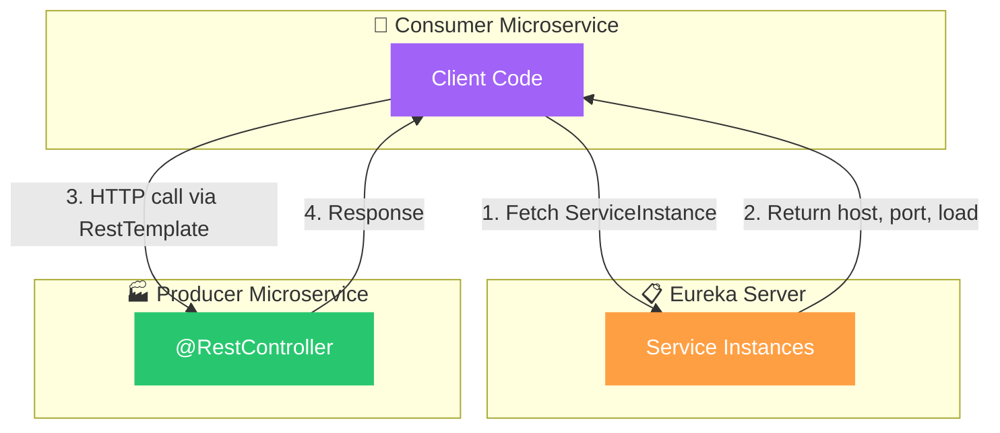
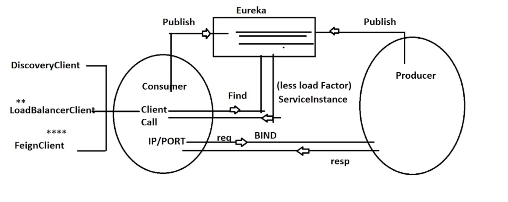
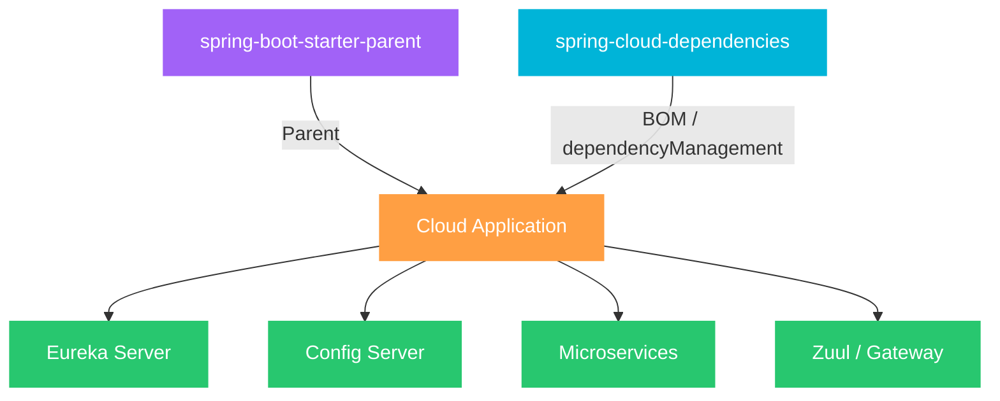
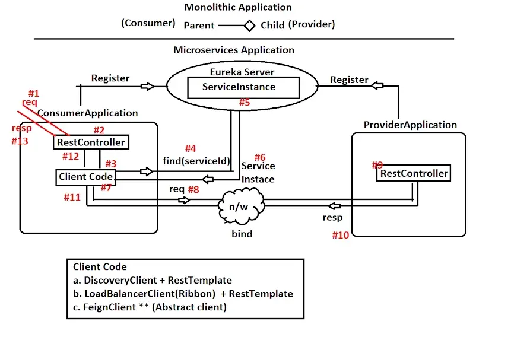

# Spring Cloud Netflix Eureka Server

**Spring Cloud Netflix Eureka Server** | We will see how the Spring Cloud Netflix Eureka server works in Microservices with examples.

- [Microservices and Eureka Overview](#1-microservices-and-eureka-overview)
- [Service Instance](#2-service-instance)
- [Intra-Communication Between Microservices](#3-intra-communication-between-microservices)
- [How to Register MicroServices with the Eureka Registry Server](#4-how-to-register-microservices-with-the-eureka-registry-server)
- [Eureka Server Configuration](#5-eureka-server-configuration)
- [Spring Cloud](#6-spring-cloud)
- [Client Types for Intra-Communication](#7-client-types-for-intra-communication)
- [Service Instance Configuration](#8-service-instance-configuration)

---

## 1. Microservices and Eureka Overview

Microservice applications are implemented using multiple components. The Microservice app is coded using Spring ReST (`@RestController`) with operations like GET, POST, PUT, DELETE, etc.

Once the Microservice code is completed it must be published with the R&D (Registry & Discovery) Server. For this we use `Spring Cloud Netflix Eureka`.

🔑 **Key Points about Spring Cloud Netflix Eureka:**

- 🚫 Eureka will not make HTTP calls to any Microservice.
- 🗄️ Eureka will store Microservice's data and share one Microservice data with another Microservice.
- 📋 Data stored inside Eureka is called **Service Instances**.

---

## 2. Service Instance

A Service Instance is composed of the following fields:

**Service Instance = Service ID + Instance ID + HOST + PORT + Load Factor**

- 🏷️ **Service ID** = Project name given in `spring.application.name`
- 🔢 **Instance ID** = A random number given to instance
- 🖥️ **HOST** = System IP/name
- 🌐 **PORT** = Service PORT number
- ⚖️ **Load Factor** = Current Load / Max Load

| ServiceId 🏷️ | InstanceId 🔢 | Host 🖥️ | Port 🌐 | Load Factor ⚖️ |
|--------------|--------------|---------|--------|----------------|
| **SEARCH-APP** | SA-5210256 | 192.168.0.10 | 9696 | 0/200 |
| **SEARCH-APP** | SA-0056250 | 192.168.2.32 | 8080 | 0/200 |
| **CART-APP** | CA-8840856 | 202.6.11.109 | 8550 | 0/200 |
| **CART-APP** | CA-8840800 | 208.16.50.12 | 9669 | 0/200 |

📝 **Note:** In the above table, one line is called one Service Instance.

---

## 3. Intra-Communication Between Microservices

One Microservice (Module) wants to communicate with another Microservice (Module). Such a process is called **Internal/Intra Communication** to exchange data.

| Normal Webservices ⚖️ | Microservices ⚖️ |
|----------------------|-----------------|
| **Microservice #1** | **Microservice #2** |
| Consumer | Producer |
| `RestTemplate` | `@RestController` |

To do intra-communication on the Consumer application side we should write code using one of the below client components:

- 🕰️ `DiscoveryClient` + `RestTemplate` (outdated)
- ⚖️ `LoadBalancerClient` + `RestTemplate`
- 🚀 `FeignClient` (interface/abstract client) — It is the most commonly used and fastest client compared to the above clients.



The above clients go to Eureka to get the Service Instance of least Load Factor and make HTTP calls using `RestTemplate`.



---

## 4. How to Register MicroServices with the Eureka Registry Server

We need to publish/register our microservice with the Eureka server. To do this add the key-value `eureka.client.register-with-eureka=true` in the properties file.

### Registering with Eureka

Do we need to publish/register our microservice with Eureka Server?

✅ **Yes.** By adding key: `eureka.client.register-with-eureka=true`. When you set `eureka.client.register-with-eureka=true`, it ensures that your microservice registers itself with the Eureka server. This registration is crucial for service discovery, allowing other microservices to find and communicate with it.

If you don't set this key to `true`, your microservice won't be registered with the Eureka server. As a result, other microservices won't be able to discover and communicate with it through Eureka. The default value of `eureka.client.register-with-eureka` is `true`.

### Fetching Registry from Eureka

Can our microservice fetch data of other microservices from the Eureka Server?

✅ **Yes.** By adding key: `eureka.client.fetch-registry=true`. Setting `eureka.client.fetch-registry=true` allows your microservice to fetch the registry information from the Eureka server. This means your microservice will be able to retrieve the list of all registered microservices and their instances, enabling it to discover and communicate with them.

If you don't set this key to `true`, your microservice won't fetch the registry, and it won't be able to discover other services registered with Eureka. The default value of `eureka.client.fetch-registry` is `true`.

> ⚠️ **Warning:** If we don't register microservices with Eureka then when other microservices try searching for them they won't be able to find them. So for intra-communication, we must register microservices with Eureka.

> 💡 **Tip:** Since the default value for `eureka.client.register-with-eureka` and `eureka.client.fetch-registry` is `true`, we don't have to add this key explicitly in every microservice's properties file. But if we want to disable them then we have to add this key by setting the value `false`.

---

## 5. Eureka Server Configuration

1️⃣ **Create a new Spring Starter project** `SpringCloudEurekaServer` with dependency: **Eureka Server** (`spring-cloud-starter-netflix-eureka-server`).

2️⃣ **In the starter class add the annotation:** `@EnableEurekaServer`

3️⃣ **Configure `application.properties` file:**

Can the Eureka server register with the Eureka server itself and fetch data from Eureka itself?

❌️ **No.** Eureka server (project: `SpringCloudEurekaServer`) is also a microservice, but it doesn't have to register with itself. The default value for `eureka.client.register-with-eureka` and `eureka.client.fetch-registry` are `true`. Eureka Server should not register and fetch from itself. So we must modify these keys with the value `false`.

🔧 **Configuration** (`application.properties`):

```properties
# Eureka server recommended port number is 8761
server.port=8761
# Eureka server itself should not register and fetch data
eureka.client.register-with-eureka=false
eureka.client.fetch-registry=false
```

4️⃣ **Run the main class** and enter the URL: **http://localhost:8761/**

5️⃣ **Stop the Application.**

🔗 Also see: Intra-communication Between Microservices in Spring using Eureka Server

---

## 6. Spring Cloud

Can one Java class have multiple superclasses? No, Java doesn't support multiple inheritance through classes. But a Java class contains a HAS-A relationship with multiple classes.

**Java inheritance example:**

```java
class A { }
class B { }

class C extends A, B { } // not possible

// valid
class C extends A {
    B obj; // HAS-A
}
```

Similarly, can one Maven project have multiple parents? No. One Maven project can have at max one Parent Project. However, another Maven project can be added as BOM (Bill Of Materials) (or `<dependencyManagement>`).

For normal Spring Boot projects, `spring-boot-starter-parent` is the parent project that contains pre-defined code for JDBC, JPA, Schedule, and declaration for Web MVC, Rest, etc.

**Parent project:**

Maven (`pom.xml`):

```xml
<parent>
    <groupId>org.springframework.boot</groupId>
    <artifactId>spring-boot-starter-parent</artifactId>
    <version>3.2.9-SNAPSHOT</version>
    <relativePath/>
</parent>
```

Gradle (`build.gradle`):

```groovy
plugins {
    id 'org.springframework.boot' version '3.2.9-SNAPSHOT'
    id 'io.spring.dependency-management' version '1.1.4'
}
```

Similar to `spring-boot-starter-parent`, `spring-cloud-dependencies` is there. The `spring-cloud-dependencies` contains the declaration of Eureka, Config Server, Ribbon, Zuul, etc.

To work with Spring Cloud we need both `spring-boot-starter-parent` and `spring-cloud-dependencies`. Since one Maven project can't have multiple parents, the Pivotal team (Spring dev team) made `spring-boot-starter-parent` as a parent project and `spring-cloud-dependencies` as `<dependencyManagement>`.

**Parent + Dependency Management:**

Maven (`pom.xml`):

```xml
<parent>
    <groupId>org.springframework.boot</groupId>
    <artifactId>spring-boot-starter-parent</artifactId>
    <version>3.2.9-SNAPSHOT</version>
    <relativePath/>
</parent>

<dependencyManagement>
    <dependencies>
        <dependency>
            <groupId>org.springframework.cloud</groupId>
            <artifactId>spring-cloud-dependencies</artifactId>
            <version>${spring-cloud.version}</version>
            <type>pom</type>
            <scope>import</scope>
        </dependency>
    </dependencies>
</dependencyManagement>
```

Gradle (`build.gradle`):

```groovy
plugins {
    id 'org.springframework.boot' version '3.2.9-SNAPSHOT'
    id 'io.spring.dependency-management' version '1.1.4'
}

dependencyManagement {
    imports {
        mavenBom "org.springframework.cloud:spring-cloud-dependencies:${springCloudVersion}"
    }
}
```



📝 **Note:** Every Cloud Application — Eureka, Config Server, Microservices, Zuul, etc. — contains one common parent project used as BOM: `spring-cloud-dependencies`. It provides common keys, code, config, jars, objects, etc. to all Cloud Microservices/Eureka/etc. applications.

---

## 7. Client Types for Intra-Communication

Intra-communication of Microservices can be implemented using client code. There are 3 types:

| Client Type 🏷️ | Description 📋 | Status ⚡ |
|----------------|---------------|-----------|
| **`DiscoveryClient` + `RestTemplate`** | Basic discovery and HTTP calls | 🕰️ Outdated |
| **`LoadBalancerClient` + `RestTemplate`** | Load-balanced discovery and HTTP calls | ✅ Supported |
| **`OpenFeign` / `FeignClient`** | Interface-based abstract client | 🚀 Recommended |

🔑 **Client code workflow:**

1. First, go to Eureka with Provider Application ServiceID.
2. Fetch the `ServiceInstance` object from Eureka.
3. Then create a URL using host, port, and path.
4. Make an HTTP call to the provider application.
5. Get the response back and give it to `@RestController`.



---

## 8. Service Instance Configuration

How can we provide `serviceId` and `instanceId` to Microservices?

🏷️ **ServiceId** — By using the project name:

```properties
# ServiceId
spring.application.name=<project-name>
```

🔢 **InstanceId** — By providing a unique identifier:

```properties
eureka.instance.instance-id=<any-number>
```

🧠 **In Simple Words:** A `ServiceInstance` object contains **ServiceId + InstanceId + Host + Port + Load Factor**.
