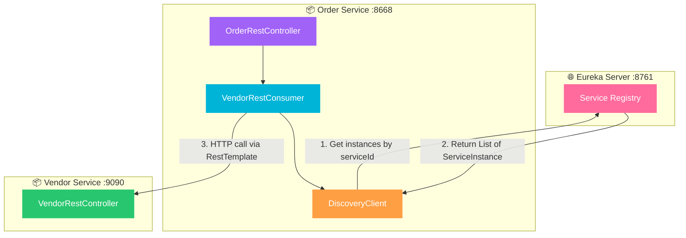
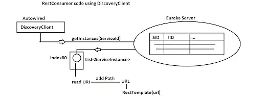
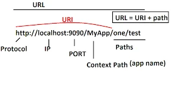
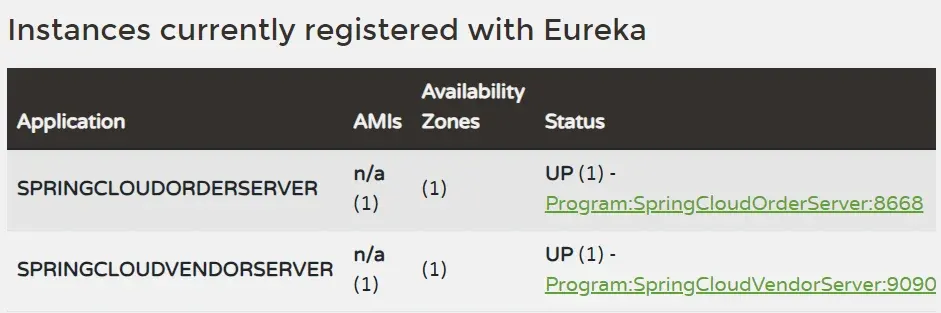
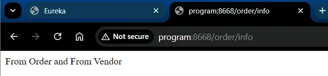
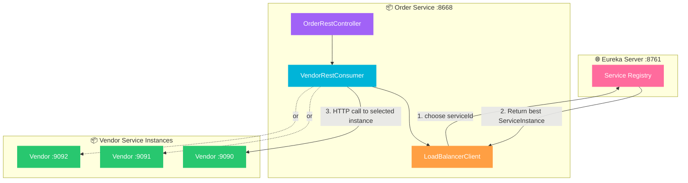
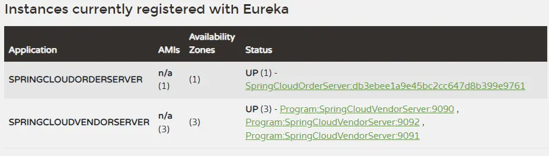
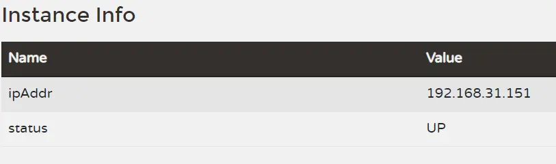
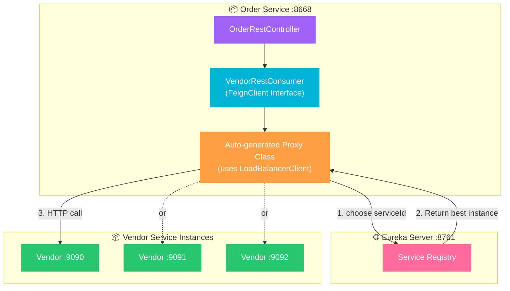

# Intra-communication Between Microservices in Spring

**Intra-communication Between Microservices in Spring** | Intra-communication of Microservices can be implemented using Client codes. There are 3 types:

- [DiscoveryClient](#1-discoveryclient)
- [LoadBalancerClient](#2-loadbalancerclient)
- [FeignClient](#3-feignclient)

| Client Type 🏷️ | Status 📋 | Description 🛠️ |
|----------------|-----------|----------------|
| **DiscoveryClient + RestTemplate** | 🕰️ Legacy / Outdated | Fetches all instances; manual selection required |
| **LoadBalancerClient + RestTemplate** | ⚠️ Rarely used | Supports client-side load balancing |
| **Open Feign (Feign Client)** | ✅ Most widely used | Abstract client built on top of LoadBalancerClient |

Among these three clients, **Open Feign** is mostly used. `DiscoveryClient` is outdated and `LoadBalancerClient` is very little used. Open Feign is built on the top of `LoadBalancerClient`. But to understand the workings of Open Feign we will see all these clients.

📝 **Prerequisite:** Spring Cloud Netflix Eureka Server

---

## 1. DiscoveryClient

`DiscoveryClient` is used to fetch `ServiceInstance` details from Eureka based on ServiceId.

- 🔍 In the case of intra-communication, if one microservice wants to communicate with another microservice then `DiscoveryClient` supports fetching Producer microservice data from Eureka.
- 🕰️ It is called a Legacy (Old) client.
- 📋 It will get all instances (`List`), not one with a lower load factor. We should choose one manually.
- ⚠️ Nowadays, it is not used in real-time. We are seeing this to understand the workflow. It is the easiest process to understand intra-communication.

Consider one Monolithic Application having an Order and Vendor Module. The order has Vendor information. We want to convert the same into a Microservices design using `DiscoveryClient`.



🧠 **In Simple Words:**
`DiscoveryClient` goes to Eureka, fetches all running instances for a given serviceId, and the developer manually picks one instance to send the REST call via `RestTemplate`.

**RestConsumer Code Using DiscoveryClient:**



### URI vs URL

URI contains a protocol, IP, Port, and context port. URL contains URI and path. If we move one application from one system to another system then the URI changes but the Path remains the same.



We have to develop 3 projects:

1. Discovery Client (Eureka Server)
2. Producer Application (Vendor Service)
3. Consumer Application (Order Service)

### Discovery Client

1️⃣ **Create a new Spring Starter project** `SpringCloudEurekaServer` with dependencies: **Eureka Server** (`spring-cloud-starter-netflix-eureka-server`).

2️⃣ **In the starter class add the annotation:** `@EnableEurekaServer`

3️⃣ **Configuration** (`application.properties`):

```properties
server.port=8761
eureka.client.register-with-eureka=false
eureka.client.fetch-registry=false
```

▶️ Run the application and check: http://localhost:8761/

### Producer Application

1️⃣ **Create a new Spring Starter project** `SpringCloudVendorServer` with dependencies: Spring Web, **Eureka Discovery Client** (`spring-cloud-starter-netflix-eureka-client`).

2️⃣ **In the starter class add the annotation:** `@EnableDiscoveryClient`

> 📝 **Note:**  
> The use of `@EnableDiscoveryClient` is **optional** in Spring Boot applications. As of recent updates, simply having a DiscoveryClient implementation (like Eureka, Consul, or Zookeeper) on the classpath is enough to enable service registration and discovery. The application will automatically register with the service discovery server without explicitly using the `@EnableDiscoveryClient` annotation.

3️⃣ **Configuration** (`application.properties`):

```properties
server.port=9090

#serviceId
spring.application.name=SpringCloudVendorServer

# Eureka location
eureka.client.service-url.defaultZone=http://localhost:8761/eureka

# Register with Eureka (their default value is true,
#  so no need to write it explicitly)
#eureka.client.register-with-eureka=true
#eureka.client.fetch-registry=true
```

4️⃣ **RestController** (`VendorRestController.java`):

```java
package com.knowprogram.demo.controller;

import org.springframework.http.ResponseEntity;
import org.springframework.web.bind.annotation.GetMapping;
import org.springframework.web.bind.annotation.RequestMapping;
import org.springframework.web.bind.annotation.RestController;

@RestController
@RequestMapping("/vendor")
public class VendorRestController {

    @GetMapping("/msg")
    public ResponseEntity<String> showVendorMsg(){
        return ResponseEntity.ok("From Vendor");
    }
}
```

▶️ Run the application and check: http://localhost:8080/vendor/msg

### Consumer Application

1️⃣ **Create a new Spring Starter project** `SpringCloudOrderServer` with dependencies: Spring Web, Eureka Discovery Client same as Producer application.

2️⃣ **Configuration** (`application.properties`):

```properties
server.port=8668

#serviceId
spring.application.name=SpringCloudOrderServer

# Eureka server location
eureka.client.service-url.defaultZone=http://localhost:8761/eureka
```

3️⃣ **RestConsumer** (`VendorRestConsumer.java`):

`DiscoveryClient` is an interface from `org.springframework.cloud.client.discovery`. Implementation class: `EurekaDiscoveryClient` — the object is created by the container.

```java
package com.knowprogram.demo.consumer;

import java.util.List;

import org.springframework.beans.factory.annotation.Autowired;
import org.springframework.cloud.client.ServiceInstance;
import org.springframework.cloud.client.discovery.DiscoveryClient;
import org.springframework.http.ResponseEntity;
import org.springframework.stereotype.Component;
import org.springframework.web.client.RestTemplate;

@Component
public class VendorRestConsumer {

    // Autowire the discovery client
    @Autowired
    DiscoveryClient discoveryClient;

    // define one operation for find/bind process
    public String getVendorData() {

        // go to eureka with serviceId and get list of ServiceInstances
        List<ServiceInstance> instances =
           discoveryClient.getInstances("SpringCloudVendorServer");

        // read for ServiceInstance at index#0 (as we have only one instance now)
        ServiceInstance serviceInstance = instances.get(0);

        // read URI and add path
        String url = serviceInstance.getUri() + "/vendor/msg";

        // use RestTemplate
        RestTemplate rt = new RestTemplate();

        // Make call and get response
        ResponseEntity<String> response = rt.getForEntity(url, String.class);

        // return response body
        return response.getBody();
    }

}
```

🔗 Also see: RestTemplate in Spring Boot

4️⃣ **RestController** (`OrderRestController.java`):

```java
package com.knowprogram.demo.controller;

import org.springframework.beans.factory.annotation.Autowired;
import org.springframework.http.ResponseEntity;
import org.springframework.web.bind.annotation.GetMapping;
import org.springframework.web.bind.annotation.RequestMapping;
import org.springframework.web.bind.annotation.RestController;

import com.knowprogram.demo.consumer.VendorRestConsumer;

@RestController
@RequestMapping("/order")
public class OrderRestController {

    @Autowired
    VendorRestConsumer consumer;

    @GetMapping("/info")
    public ResponseEntity<String> getOrderInfo() {
        return ResponseEntity.ok("From Order and " + consumer.getVendorData());
    }
}
```

### Execution Order

1. Run the `SpringCloudEurekaServer` starter class.
2. Run the `SpringCloudVendorServer` starter class.
3. Run the `SpringCloudOrderServer` starter class.
4. Go to the Eureka server dashboard: **http://localhost:8761/**. We can find the Instances currently registered with Eureka.



5. Click on "Program: SpringCloudOrderServer:8668", and it will take you to http://program:8668/actuator/info [Here "program" is the computer name, and 8668 is the port number of consumer application], modify it as http://program:8668/`order/info`. It will give the response of API `/order/info` from the consumer application.



### Limitations of DiscoveryClient

- ❌️ It fetches all `ServiceInstance` objects from Eureka as a `List`. We need only one instance that has less load factor.
- ❌️ The programmer has to choose one instance manually using `List#Index`.

---

## 2. LoadBalancerClient

`LoadBalancerClient` is advanced compared to `DiscoveryClient`. It supports load balancing at the consumer application side (Client side). It means the Consumer App (Client App) will choose one instance from Eureka which has less load factor.

Here, `LoadBalancerClient` is an interface, and the Implementation class is given by the **Spring Cloud LoadBalancer** dependency. This class object is auto-configured by Spring Cloud.



Let us use the previous example. From the previous example, the Discovery Client (`SpringCloudEurekaServer`), and Producer Application (`SpringCloudVendorServer`) will remain the same as it is. Only the Consumer Application (`SpringCloudOrderServer`) will be updated.

### Changes in Consumer Application

1️⃣ **Configuration** — In `application.properties` add instance Id:

```properties
eureka.instance.instance-id=${spring.application.name}:${random.value}
```

2️⃣ **Add dependency** — Spring Cloud LoadBalancer (`spring-cloud-starter-loadbalancer`).

3️⃣ **Update VendorRestConsumer** (`VendorRestConsumer.java`):

```java
package com.knowprogram.demo.consumer;

import org.springframework.beans.factory.annotation.Autowired;
import org.springframework.cloud.client.ServiceInstance;
import org.springframework.cloud.client.loadbalancer.LoadBalancerClient;
import org.springframework.http.ResponseEntity;
import org.springframework.stereotype.Component;
import org.springframework.web.client.RestTemplate;

@Component
public class VendorRestConsumer {

    // Autowire the LoadBalancerClient
    @Autowired
    LoadBalancerClient client;

    // define one operation for find/bind process
    public String getVendorData() {
        // go to eureka with serviceId and get one ServiceInstance
        ServiceInstance serviceInstance = client.choose("SpringCloudVendorServer");

        // read URI and add path
        String url = serviceInstance.getUri() + "/vendor/msg";

        // use RestTemplate
        RestTemplate rt = new RestTemplate();

        // Make call and get response
        ResponseEntity<String> response = rt.getForEntity(url, String.class);

        // return response body
        return response.getBody();
    }
}
```

🔑 **Key Difference:** The `LoadBalancerClient` will ask for the InstanceId from the Eureka Server. The Eureka server will return the instanceId having less load. But if multiple instances have the same load then it will return any random instanceId.

### Optional Changes in Producer Application

To know which application is running at which port, let us modify `VendorRestController` and log the port number.

**VendorRestController** (updated):

```java
package com.knowprogram.demo.controller;

import org.springframework.beans.factory.annotation.Value;
import org.springframework.http.ResponseEntity;
import org.springframework.web.bind.annotation.GetMapping;
import org.springframework.web.bind.annotation.RequestMapping;
import org.springframework.web.bind.annotation.RestController;

@RestController
@RequestMapping("/vendor")
public class VendorRestController {

    @Value("${server.port}")
    private String port;

    @GetMapping("/msg")
    public ResponseEntity<String> showVendorMsg() {
        return ResponseEntity.ok("From Vendor. Port: " + port);
    }
}
```

> 💡 **Tip:** How to create multiple instances of an application on the same machine? Change the port number and run the same application again for a new instance on the local machine.

### Execution Order

1. Run Eureka (`SpringCloudEurekaServer`) Starter class [1 time].
2. Run Vendor (`SpringCloudVendorServer`) Starter class [**run 3 times, by changing port number**].
3. Run Order (`SpringCloudOrderServer`) Starter class [run 1 time].
4. Go to the Eureka server (http://localhost:8761/). It will list all instances.



5. In the Eureka server dashboard (http://localhost:8761/) and from the "instance info" section gather the "ipAddr" value. In our case, it is **192.168.31.151**. And **8668** is the port number of the consumer application. We will use this IP and Port to access the consumer APIs.



6. Go to http://192.168.31.151:8668/actuator/info and modify it as http://192.168.31.151:8668/order/info. Refresh the page multiple times. We can see the different port numbers.

```bash
curl http://192.168.31.151:8668/order/info
```

📤 **Output:**

```
From Order and From Vendor. Port: 9091
From Order and From Vendor. Port: 9090
From Order and From Vendor. Port: 9092
```

---

## 3. FeignClient

- 🏗️ It is also called an **Open Feign** or **Abstract Client**.
- ✅ No need to define any manual code — code is auto-generated.
- ⚙️ Code is generated using `LoadBalancerClient` internally. We need to define one interface only that follows the Producer RestController. When we write FeignClient code then internally `LoadBalancerClient` code is generated.
- ⚖️ This client code makes a call to Eureka and fetches `ServiceInstance` using LoadBalancer, i.e., the instance which has a Less Load Factor.
- 🌐 It will make an HTTP call to the Producer Application and get the response back to the consumer.



Let us use the previous example. From the previous example, the Discovery Client (`SpringCloudEurekaServer`), and Producer Application (`SpringCloudVendorServer`) will remain the same as it is. Only the Consumer Application (`SpringCloudOrderServer`) will be updated.

### Changes in Consumer Application

1️⃣ **Add dependency:** OpenFeign (`spring-cloud-starter-openfeign`). The existing Spring Cloud LoadBalancer (`spring-cloud-starter-loadbalancer`) dependency is not required, so we can remove that.

2️⃣ **At Starter class add:** `@EnableFeignClients`

3️⃣ **Configuration** (`application.properties`):

```properties
server.port=8668
spring.application.name=SpringCloudOrderServer
eureka.client.service-url.defaultZone=http://localhost:8761/eureka
```

4️⃣ **Consumer code** (`VendorRestConsumer.java`):

```java
package com.knowprogram.demo.consumer;

import org.springframework.cloud.openfeign.FeignClient;
import org.springframework.http.ResponseEntity;
import org.springframework.web.bind.annotation.GetMapping;

@Component
@FeignClient("SpringCloudVendorServer") // serviceId
public interface VendorRestConsumer {

    @GetMapping("/vendor/msg")
    public ResponseEntity<String> showData();

}
```

> 🔑 **Key Point:**  
> This interface must follow the Producer RestController. The interface name and method name can be different but the method's request mapping, return type, and parameter must be the same. It means except method name and interface name, others should match.

> 📝 **Note:**  
> If the Producer has 2 RestControllers and we want intra-communication from both RestControllers then we have to create 2 interfaces in consumer by following those RestControllers.

5️⃣ **Modify RestController** (`OrderRestController.java`):

```java
package com.knowprogram.demo.controller;

import org.springframework.beans.factory.annotation.Autowired;
import org.springframework.http.ResponseEntity;
import org.springframework.web.bind.annotation.GetMapping;
import org.springframework.web.bind.annotation.RequestMapping;
import org.springframework.web.bind.annotation.RestController;

import com.knowprogram.demo.consumer.VendorRestConsumer;

@RestController
@RequestMapping("/order")
public class OrderRestController {

    @Autowired
    VendorRestConsumer consumer;

    @GetMapping("/info")
    public String getOrderInfo() {
        System.out.println(consumer.getClass().getName());
        ResponseEntity<String> responseEntity = consumer.showData();
        return "From Order and " + responseEntity.getBody();
    }
}
```

### Execution Order

1. Run Eureka Server.
2. Run Vendor Service (3 times — by changing port number).
3. Run Order Service.
4. Go to Eureka: http://localhost:8761/
5. Send request to http://192.168.31.151:8668/order/info

```bash
curl http://192.168.31.151:8668/order/info
```

### How FeignClient Works Internally

Assume the consumer interface is given as:

```java
@FeignClient("STD-APP")
interface StudentConsumer {
    @GetMapping("/std/data")
    ResponseEntity<String> getData();
}
```

Then the generated **Proxy class** looks like this internally:

```java
@Component
class $1908 implements StudentConsumer {

    @Autowired
    LoadBalancerClient client;

    public ResponseEntity<String> getData() {
        ServiceInstance si = client.choose("STD-APP");
        String url = si.getUri() + "/std/data";
        RestTemplate rt = new RestTemplate();
        ResponseEntity<String> resp = rt.getForEntity(url, String.class);
        return resp;
    }
}
```

🖥️ **Console Output:**

```
StudentConsumer sob = new $1908();
sysout(sob.getClass().getName()); // prints the proxy class name
```

🧠 **In Simple Words:**
When you define a `@FeignClient` interface, Spring Cloud auto-generates a proxy class that internally uses `LoadBalancerClient` to discover and call the producer service. You only write the interface — the framework handles all the plumbing.

| Feature ⚖️ | DiscoveryClient 🕰️ | LoadBalancerClient ⚖️ | FeignClient ✅ |
|------------|---------------------|----------------------|---------------|
| **Manual code** | ❌️ Full manual implementation | ❌️ Partial manual code | ✅ No manual code needed |
| **Load balancing** | ❌️ No (returns all instances) | ✅ Yes (client-side) | ✅ Yes (built on LoadBalancerClient) |
| **Instance selection** | Manual (`List#get(index)`) | Automatic (least load) | Automatic (least load) |
| **Code style** | Class with `RestTemplate` | Class with `RestTemplate` | Interface only |
| **Usage** | 🕰️ Legacy / Learning | ⚠️ Rarely used | ✅ Production standard |
