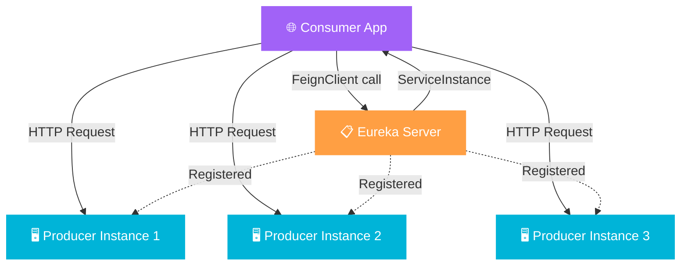
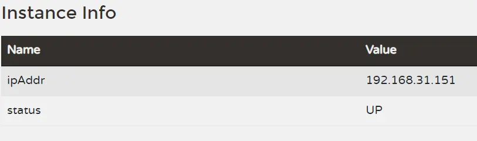

# FeignClient Example in Spring Cloud

**FeignClient Example in Spring Cloud** | Open Feign is built on top of `LoadBalancerClient` and it is the most used client for the intra-communication of microservices.

- [Overview](#1-overview)
- [Eureka Server](#2-eureka-server)
- [Producer Application](#3-producer-application)
- [Consumer Application](#4-consumer-application)
- [API Calls](#5-api-calls)
- [Best Practices](#6-best-practices)

---

## 1. Overview

- 🔗 It is also called an open Feign or abstract client.
- 🚀 No need to define any manual code for consumers.
- ⚙️ Code is generated using `LoadBalancerClient`. We need to define one interface only that follows the Producer `RestController`. When we write FeignClient code then internally `LoadBalancerClient` code is generated.
- 📡 This client code makes a call to Eureka and fetches `ServiceInstance` using LoadBalancer, i.e. the instance which has a less load factor.
- 🔄 It will make an HTTP call to the Producer Application and get the response back to the consumer.



We have to develop 3 projects:

- 📋 Discovery Client (Eureka Server)
- 📦 Producer Application
- 🌐 Consumer Application

---

## 2. Eureka Server

1️⃣ **Create a new Spring Starter project** `SpringCloudEurekaServer` with dependencies: **Eureka Server** (`spring-cloud-starter-netflix-eureka-server`).

2️⃣ **Add the annotation** in the starter class: `@EnableEurekaServer`

3️⃣ **Configuration** (`application.properties`):

```properties
server.port=8761
eureka.client.register-with-eureka=false
eureka.client.fetch-registry=false
```

---

## 3. Producer Application

1️⃣ **Create a new Spring Starter project** `SpringCloudFCBookServices` with dependencies: **Lombok, Spring Web, Eureka Discovery Client** (`spring-cloud-starter-netflix-eureka-client`).

2️⃣ **Add the annotation** in the starter class: `@EnableDiscoveryClient`

> 📝 **Note:**  
> The use of `@EnableDiscoveryClient` is **optional** in Spring Boot applications. As of recent updates, simply having a DiscoveryClient implementation (like Eureka, Consul, or Zookeeper) on the classpath is enough to enable service registration and discovery. The application will automatically register with the service discovery server without explicitly using the `@EnableDiscoveryClient` annotation.

3️⃣ **Configuration** (`application.properties`):

```properties
server.port=9900
spring.application.name=BOOK-SERVICE
eureka.client.service-url.defaultZone=http://localhost:8761/eureka
eureka.instance.instance-id=${spring.application.name}:${random.value}
```

> 💡 **Tip:**  
> It is not compulsory to provide `eureka.instance.instance-id=${spring.application.name}:${random.value}` in your Producer microservices when working with a FeignClient and Eureka server. However, it is a common practice to ensure that each instance of your microservice has a unique identifier. This helps Eureka distinguish between different instances of the same service. By default, Eureka uses the combination of the application name and a random value to generate a unique instance ID. This configuration ensures that each instance registers with a unique ID, which is particularly useful in a microservices architecture where multiple instances of the same service might be running.
>
> If you don't specify the `instance-id`, Eureka will still generate a unique ID for each instance, but explicitly setting it can help with debugging and monitoring.

4️⃣ **Model class:**

```java
package com.knowprogram.demo.model;

import lombok.AllArgsConstructor;
import lombok.Data;
import lombok.NoArgsConstructor;

@Data
@NoArgsConstructor
@AllArgsConstructor
public class Book {

    private Integer bookId;
    private String bookName;
    private String bookAuthor;
}
```

5️⃣ **RestController:**

```java
package com.knowprogram.demo.controller;

import java.util.Arrays;
import java.util.List;

import org.springframework.http.ResponseEntity;
import org.springframework.web.bind.annotation.DeleteMapping;
import org.springframework.web.bind.annotation.GetMapping;
import org.springframework.web.bind.annotation.PathVariable;
import org.springframework.web.bind.annotation.PostMapping;
import org.springframework.web.bind.annotation.RequestBody;
import org.springframework.web.bind.annotation.RequestMapping;
import org.springframework.web.bind.annotation.RestController;

import com.knowprogram.demo.model.Book;

@RestController
@RequestMapping("/books")
public class BookRestController {

    @GetMapping("/all")
    public ResponseEntity<List<Book>> getAllBooks() {
        return ResponseEntity.ok(
                Arrays.asList(
                        new Book(10, "Core Java", "SAM"),
                        new Book(11, "Adv Java", "RAM"),
                        new Book(12, "Spring Boot", "SAM"),
                        new Book(13, "Microservices", "SYED")
                        )
                );
    }

    @GetMapping("/find/{id}")
    public ResponseEntity<Book> getOneBook(@PathVariable Integer id) {
        return ResponseEntity.ok(new Book(id, "Dummy Book", "Dummy Author"));
    }

    @PostMapping("/create")
    public ResponseEntity<String> createNewBook(@RequestBody Book book) {
        return ResponseEntity.ok(book.toString());
    }

    @DeleteMapping("/remove/{id}")
    public ResponseEntity<String> deleteBook(@PathVariable Integer id) {
        return ResponseEntity.ok("Book deleted! " + id);
    }
}
```

---

## 4. Consumer Application

1️⃣ **Create a new Spring Starter project** `SpringCloudFCPublisherService` with dependencies: **Lombok, Spring Web, Eureka Discovery Client** (`spring-cloud-starter-netflix-eureka-client`), and **OpenFeign** (`spring-cloud-starter-openfeign`).

2️⃣ **Add the annotations** in the starter class: `@EnableDiscoveryClient` and `@EnableFeignClients`.

3️⃣ **Configuration** (`application.properties`):

```properties
server.port=9880
spring.application.name=PUBLISHER-SERVICE
eureka.client.service-url.defaultZone=http://localhost:8761/eureka
```

4️⃣ **Model class** (copy the Model class from Producer to Consumer):

```java
package com.knowprogram.demo.model;

import lombok.AllArgsConstructor;
import lombok.Data;
import lombok.NoArgsConstructor;

@Data
@NoArgsConstructor
@AllArgsConstructor
public class Book {

    private Integer bookId;
    private String bookName;
    private String bookAuthor;
}
```

5️⃣ **FeignClient Consumer interface:**

This interface must follow the Producer `RestController`. The interface name and method name can be different but the method's request mapping, return type, and parameter must be the same. It means except method name and interface name, others should match.

```java
package com.knowprogram.demo.consumer;

import java.util.List;

import org.springframework.cloud.openfeign.FeignClient;
import org.springframework.http.ResponseEntity;
import org.springframework.web.bind.annotation.DeleteMapping;
import org.springframework.web.bind.annotation.GetMapping;
import org.springframework.web.bind.annotation.PathVariable;
import org.springframework.web.bind.annotation.PostMapping;
import org.springframework.web.bind.annotation.RequestBody;

import com.knowprogram.demo.model.Book;

@Component
@FeignClient("BOOK-SERVICE")
public interface BookRestConsumer {

    @GetMapping("/books/all")
    public ResponseEntity<List<Book>> getAllBooks();

    @GetMapping("/books/find/{id}")
    public ResponseEntity<Book> getOneBook(@PathVariable Integer id);

    @PostMapping("/books/create")
    public ResponseEntity<String> createNewBook(@RequestBody Book book);

    @DeleteMapping("/books/remove/{id}")
    public ResponseEntity<String> deleteBook(@PathVariable Integer id);
}
```

6️⃣ **RestController:**

```java
package com.knowprogram.demo.controller;

import java.util.List;

import org.springframework.beans.factory.annotation.Autowired;
import org.springframework.http.ResponseEntity;
import org.springframework.web.bind.annotation.DeleteMapping;
import org.springframework.web.bind.annotation.GetMapping;
import org.springframework.web.bind.annotation.PathVariable;
import org.springframework.web.bind.annotation.PostMapping;
import org.springframework.web.bind.annotation.RequestBody;
import org.springframework.web.bind.annotation.RequestMapping;
import org.springframework.web.bind.annotation.RestController;

import com.knowprogram.demo.consumer.BookRestConsumer;
import com.knowprogram.demo.model.Book;

@RestController
@RequestMapping("/publisher")
public class PublisherRestController {

    @Autowired
    private BookRestConsumer consumer;

    @GetMapping("/view")
    public String viewPublisherBooks() {
        ResponseEntity<List<Book>> resp = consumer.getAllBooks();
        return "FROM PUBLISHER =>" + resp.getBody();
    }

    @GetMapping("/getOne")
    public String viewOnePublisherBook() {
        ResponseEntity<Book> resp = consumer.getOneBook(550);
        return "FROM PUBLISHER ONE BOOK=>" + resp.getBody();
    }

    @PostMapping("/save")
    public String createOnePublisherBook(@RequestBody Book book) {
        ResponseEntity<String> resp = consumer.createNewBook(book);
        return "FROM PUBLISHER SAVE BOOK=>" + resp.getBody();
    }

    @DeleteMapping("/del/{id}")
    public String removeOnePublisherBook(@PathVariable Integer id) {
        ResponseEntity<String> resp = consumer.deleteBook(id);
        return "FROM PUBLISHER DELETE BOOK=>" + resp.getBody();
    }

}
```

### Running Multiple Instances

How to create multiple instances of an application on the same machine? Change the port number and run the same application again for a new instance on the local machine.

**Execution Order:**

1. Run Eureka (`SpringCloudEurekaServer`) Starter class [1 time]
2. Run Producer (`SpringCloudFCBookServices`) Starter class [**run 3 times, by changing port number**]
3. Run Consumer (`SpringCloudFCPublisherService`) Starter class [run 1 time]
4. Go to the Eureka server (`http://localhost:8761/`). It will list all instances.

In the Eureka server dashboard (`http://localhost:8761/`) and from the "instance info" section gather the `ipAddr` value. In our case, it is **192.168.31.151**. And **9880** is the **port number of** the **consumer** application. We will use this IP and Port to access the consumer APIs.



---

## 5. API Calls

### GET All Books

**Request:**

```bash
curl http://192.168.31.151:9880/publisher/view
```

📤 **Output:**

```
FROM PUBLISHER =>[Book(bookId=10, bookName=Core Java, bookAuthor=SAM), Book(bookId=11, bookName=Adv Java, bookAuthor=RAM), Book(bookId=12, bookName=Spring Boot, bookAuthor=SAM), Book(bookId=13, bookName=Microservices, bookAuthor=SYED)]
```

### GET One Book

**Request:**

```bash
curl http://192.168.31.151:9880/publisher/getOne
```

📤 **Output:**

```
FROM PUBLISHER ONE BOOK=>Book(bookId=550, bookName=Dummy Book, bookAuthor=Dummy Author)
```

### POST Create Book

POST `http://192.168.31.151:9880/publisher/save`
Body => raw => JSON

📥 **Request Body (JSON):**

```json
{
  "bookId": 99,
  "bookName": "Test",
  "bookAuthor": "SAMPLE"
}
```

**Request:**

```bash
curl -X POST http://192.168.31.151:9880/publisher/save -H "Content-Type: application/json" -d "{ \"bookId\": 99,\"bookName\": \"Test\",\"bookAuthor\": \"SAMPLE\"}"
```

📤 **Output:**

```
FROM PUBLISHER SAVE BOOK=>Book(bookId=99, bookName=Test, bookAuthor=SAMPLE)
```

### DELETE Book

**Request:**

```bash
curl -X DELETE http://192.168.31.151:9880/publisher/del/1234
```

📤 **Output:**

```
FROM PUBLISHER DELETE BOOK=>Book deleted! 1234
```

---

## 6. Best Practices

| Guideline 📋 | Recommendation 💡 |
|--------------|-------------------|
| **Microservice scope** | One microservice is recommended for 1 module and it should contain only 1 `RestController` |
| **RestConsumers** | One microservice can have multiple modules integration so it can have N `RestConsumers` |
| **RestControllers** | There can be multiple `RestConsumers` but there will be only 1 `RestController` for 1 project |
