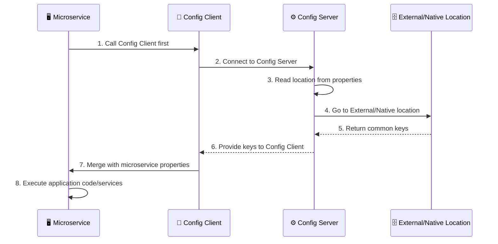
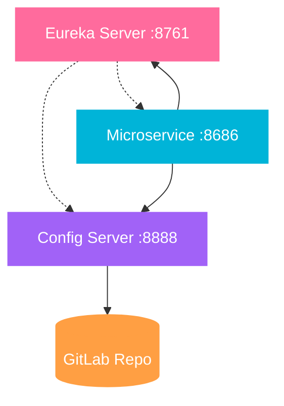
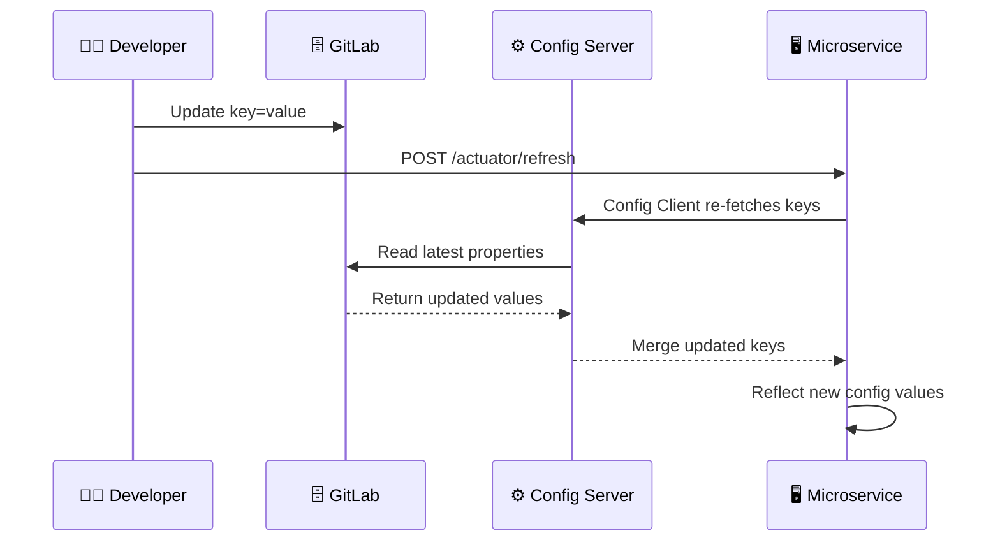
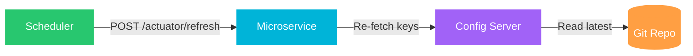

# Spring Cloud Config Server

**Spring Cloud Config Server** | Externalize all common properties (key=value) from every microservice into a centralized configuration server.

- [Why Config Server](#1-why-config-server)
- [Config Server Types](#2-config-server-types)
- [Config Server Setup Overview](#3-config-server-setup-overview)
- [Config Client Startup Workflow](#4-config-client-startup-workflow)
- [Frequently Asked Questions](#5-frequently-asked-questions)
- [Spring Cloud Config Server Example](#6-spring-cloud-config-server-example)
- [Config Client Workflow with Different Locations](#7-config-client-workflow-with-different-locations)
- [Refresh Scope](#8-refresh-scope)
- [Native Config Server](#9-native-config-server)
- [How RefreshScope Works](#10-how-refreshscope-works)
- [Automating Refresh](#11-automating-refresh)

---

## 1. Why Config Server

In our application, there can be multiple Microservices such as Search, Payment, Cart, Feedback, etc. In every Microservice we provide key=value pairs using properties files. Among those key=value pairs, many are common across services.

🧠 **In Simple Words:**
Instead of repeating the same configuration in every microservice, we provide them once using a Config Server for easy centralized management.

- 💾 **Database connection** keys shared across services
- 📧 **Email keys** used by multiple services
- 🔗 **Eureka location** needed by all registered services
- 📊 **Logging configuration** common to the entire system
- 🔧 **Connection pool details** standardized across services
- 🔒 **Security roles and tokens** managed centrally
- 📬 **Topic names for MQs** shared between producers and consumers
- 🖥️ **Admin server keys** for monitoring

---

## 2. Config Server Types

| Type 🏷️ | Source 📂 | Usage 📋 |
|---------|----------|---------|
| **External Config Server** | Git Account (GitHub/GitLab) | Default; mostly used in production |
| **Native Config Server** | Local Drive (e.g., `D:/drive`) | Mainly used for testing/dev purposes |

---

## 3. Config Server Setup Overview

1️⃣ **Create a Mediator Server project** called Config Server using `spring-cloud-config-server` dependency.

2️⃣ **Set the port number** — the recommended port for Config Server is **8888** (can be changed).

3️⃣ **Configure the external/native config location** in the Config Server properties file.

🔧 **Configuration** (`application.properties`):

```properties
spring.cloud.config.server.git.uri=https://gitlab.com/knowprogram/my-config-test.git
# If it is private account
spring.cloud.config.server.git.username=knowprogram
spring.cloud.config.server.git.password=enter_password
```

4️⃣ **Add Config Client dependency** at every microservice — `spring-cloud-starter-config`. No coding is required, only the dependency.

5️⃣ **Start the microservice** — the first component executed is Config Client, which fetches common key=value pairs from Config Server.

---

## 4. Config Client Startup Workflow

When we start our microservice, the following sequence occurs:



---

## 5. Frequently Asked Questions

**Q) How many config servers can be created for one Application?**
One Config Server.

**Q) Which dependency should we add at microservice to link with the Config server?**
Config Client (`spring-cloud-starter-config`).

**Q) How many types of Config Servers exist?**

- 🌐 **External Config (Git)** — Default type, reads from a remote Git repository
- 💾 **Native Config (Local)** — Reads from local file system

**Q) What types of keys are placed in Config Server?**

- 💾 Database connection
- 📧 Email Keys
- 🔗 Eureka Keys
- 📊 Actuators
- 🔒 Security Roles
- 🔑 Token userId
- 📬 topicNames for MQs
- 🔧 Connection Pool Details
- 🖥️ Admin server keys

---

## 6. Spring Cloud Config Server Example

Let us develop these applications:

1. Eureka Server
2. Config Server
3. Microservice



### 1. Eureka Server

1️⃣ **Create a new Spring Starter project** `SpringCloudEurekaServer` with dependency: **Eureka Server** (`spring-cloud-starter-netflix-eureka-server`).

2️⃣ **Add annotation** to the starter class: `@EnableEurekaServer`

3️⃣ **Configuration** (`application.properties`):

```properties
server.port=8761
eureka.client.register-with-eureka=false
eureka.client.fetch-registry=false
```

### 2. Config Server Setup with GitLab

1️⃣ Go to GitLab and click on the **New Project** button.

2️⃣ Choose **Blank Project**.

3️⃣ Enter a project name: `my-config-test`.

4️⃣ Use **Private** (if you don't want to share it with others) else use **Public**.

5️⃣ Click on the **Create** button.

6️⃣ Click on **Add File**.

7️⃣ Enter file name: `application.properties`. You can also use a YML file.

8️⃣ Enter key=value:

```properties
my.app.title=knowprogram
```

9️⃣ **Commit** > Enter Commit Message > Click on **Commit**.

🔟 Navigate to **Project > Your Projects**, click on your project name, then click **Clone** and copy the HTTPS option.

📋 **Example URL:** `https://gitlab.com/knowprogram/my-config-test.git`

### 3. Config Server

1️⃣ **Create a new Spring Starter project** `SpringCloudCSConfigServer` with dependency: **Config Server** (`spring-cloud-config-server`).

2️⃣ **Add annotation** to the starter class: `@EnableConfigServer`

3️⃣ **Configuration** (`application.properties`):

```properties
server.port=8888
spring.cloud.config.server.git.uri=https://gitlab.com/knowprogram/my-config-test.git

# If it is private account
spring.cloud.config.server.git.username=username
spring.cloud.config.server.git.password=enter_password
```

4️⃣ **Verify** — Run the application and check whether it can read the properties file:

**URL:** `http://localhost:8888/SpringCloudCSConfigServer/default` [GET]

📤 **Output:**

```json
{
  "name": "SpringCloudCSConfigServer",
  "profiles": [
    "default"
  ],
  "label": null,
  "version": "99ff711492a299e866156e5607de58407f4c5306",
  "state": null,
  "propertySources": [
    {
      "name": "https://gitlab.com/knowprogram/my-config-test.git/application.properties",
      "source": {
        "my.app.title": "xyz"
      }
    }
  ]
}
```

### 4. Microservice

1️⃣ **Create a new Spring Starter project** `SpringCloudCSEmployeeService` with dependencies: **Spring Web, Eureka Discovery Client, Config Client** (`spring-cloud-starter-config`).

2️⃣ **Add annotation** to the starter class: `@EnableDiscoveryClient`

3️⃣ **Configuration** (`application.properties`):

```properties
server.port=8686
spring.application.name=EMPLOYEE-SERVICE
eureka.client.service-url.defaultZone=http://localhost:8761/eureka
spring.config.import=optional:configserver:http://localhost:8888
```

> ⚠️ **Warning:** Don't forget to add the `spring.config.import=configserver:` property to your configuration. If configuration is not required add `spring.config.import=optional:configserver:` instead. To disable this check, set `spring.cloud.config.enabled=false` or `spring.cloud.config.import-check.enabled=false`.

4️⃣ **RestController:**

```java
package com.knowprogram.demo.controller;

import org.springframework.beans.factory.annotation.Value;
import org.springframework.web.bind.annotation.RequestMapping;
import org.springframework.web.bind.annotation.RestController;

@RestController
@RequestMapping("/emp")
public class EmployeeRestController {

    @Value("${my.app.title}")
    private String title;

    @GetMapping("/data")
    public String showData() {
        return "Hello FROM Microservice: " + title;
    }

}
```

### Execution Order

1. Run Eureka Server
2. Run Config Server
3. Run the Microservice app. Open `http://192.168.31.151:8686/emp/data`

Let us now explore:

- 🔄 Config Client workflow + different location
- 🔃 Refresh Scope
- 💾 Native Config

---

## 7. Config Client Workflow with Different Locations

- 📦 When we create any microservice we need to add Config Client dependency: `spring-cloud-starter-config`.
- 🏗️ We don't write any code for Config Client in our microservice, because Config Client code already exists in the parent project.
- 🔗 Config Server URL exists in Config Client Code in the parent project as `url = http://localhost:8888` (it is not in our project).

**Q) Where is the code for Config Client?**
It is in the parent project (Spring Cloud) that we just add as a dependency/jar.

**Q) Where is the location (URL) of the Config Server** (not Git)?
At the parent (Spring Cloud) properties file it has the location of Config Server Application as: `spring.cloud.config.uri=http://localhost:8888`. It means the **default IP** of Config Server is `localhost` and the default port recommended is **8888**.

**Q) Is our `application.properties` loaded first or Parent Project Config Client code executed first?**
First Parent project Config Client code is executed. At last, our `application.properties` is loaded.

**Q) How can we override the above Config Server default URL?**
We can override the above config server default value using the `spring.config.import` property. Let us demonstrate it through an example. Instead of using the default port 8888, let us use 8008.

🔧 **Config Server** (`SpringCloudCSConfigServer`) — change port number:

```properties
server.port=8008
```

🔧 **Microservice** (`SpringCloudCSEmployeeService`) — modify `spring.config.import` value:

```properties
spring.config.import=optional:configserver:http://localhost:8008
```

---

## 8. Refresh Scope

**Problem statement:** Microservices with Eureka and Config Server are started. Even though Microservices can read/print keys from the Config Server, if we modify key=value in the External Config Server (in Git), the value is not reflected in our microservices.

**Solutions:**

1. Restart all Microservices and Config Server apps.
2. Use `@RefreshScope` to avoid the restart concept.

We can either restart all the microservices and config server applications or we can use `@RefreshScope`. Let us see `@RefreshScope` in detail.

1️⃣ **Add dependency** — In the microservice app (`SpringCloudCSEmployeeService`) `pom.xml`, add **Spring Boot Actuator** (`spring-boot-starter-actuator`).

2️⃣ **Add property** to `application.properties`:

```properties
management.endpoints.web.exposure.include=*
```

3️⃣ **Add annotation** — At RestController add: `@RefreshScope`

4️⃣ **Start all apps.**

5️⃣ **Update config in GitLab**, then verify in Config Server: `http://localhost:8008/SpringCloudCSConfigServer/default`

> 📝 **Note:** The changes won't be reflected in the microservices itself. This is where the actuator comes to help.

6️⃣ **Trigger refresh** — Make a POST request using the microservice IP/PORT:

```bash
curl -X POST http://localhost:8686/actuator/refresh
```

The request does not require a body. Now the updated config will be available to the microservices.

**Q) What is `@RefreshScope` doing here?**
It calls Config Client code again which gets the latest keys from Config Server and merges back to our application that affects our microservices.



---

## 9. Native Config Server

- 💻 Here, Native indicates the local machine.
- 🧪 In the case of Dev Environment, it is recommended to use the native config server.
- ⏳ Until the Application goes to Production/UAT, we may not get the actual Git link.
- 🔧 In that case, we can use the Native Config Server.
- 🚫 **It is never used in Production/UAT Environments.**

1️⃣ **Configuration** — In `SpringCloudCSConfigServer` => `application.properties`:

```properties
server.port=8888
# This is for external config server
#spring.cloud.config.server.git.uri=

# This is for native config server
# spring.cloud.config.server.native.search-locations=file:D:/abcd
spring.cloud.config.server.native.search-locations=classpath:mydata
spring.profiles.active=native
```

2️⃣ **Create folder** — Create a `mydata` folder under `src/main/resources`.

3️⃣ **Create properties file** — Create an `application.properties` file under the `mydata` folder.

📂 **Project structure:**

```
[project-name]
    |--src/main/resources
        |- mydata
            |- application.properties [native config file]
```

4️⃣ **Add common keys** — In this `application.properties`, add your microservice's common keys:

```properties
my.app.title=FROM-LOCAL-CONFIG
```

💡 **Tip:** Restart the Config Server (`SpringCloudCSConfigServer`) and Employee microservice (`SpringCloudCSEmployeeService`) to pick up the native config.

---

## 10. How RefreshScope Works

`@RefreshScope` is used to avoid restarting microservices and Config Server. Every key in a Spring Application (including Spring Boot and microservices) is stored inside `Environment` (Interface) — `org.springframework.core.env`. The implementation class is `ApplicationEnvironment` which stores data as key=value from `.properties`, `.yml`, OS properties, JVM Properties, etc. using the method `getProperty(key): value`.

🛠️ **Test Example:**

```java
package com.knowprogram.demo;

import org.springframework.beans.factory.annotation.Autowired;
import org.springframework.boot.CommandLineRunner;
import org.springframework.core.env.Environment;
import org.springframework.stereotype.Component;

@Component
public class TestData implements CommandLineRunner {

    @Autowired
    private Environment environment;

    @Override
    public void run(String... args) throws Exception {
        System.out.println(environment.getClass());
        System.out.println(environment.getProperty("my.app.title"));
    }
}
```

🔧 **Configuration** (`application.properties`):

```properties
my.app.title=SAMPLE
```

---

## 11. Automating Refresh

🏗️ **Workflow:** If we make an HTTP POST call to `/actuator/refresh`, then `RefreshScope` is triggered for the `ApplicationContext` refresh event `ContextRefreshedEvent`. It gets the latest `Environment` from the parent call and merges it with our Environment memory.

🔑 **Key Point:** `@RefreshScope` gets modified keys from the Config Server to the microservice only if an HTTP POST request is made from the microservice.

We previously used the Postman tool to call the API and get the modified keys. Now let us automate HTTP calls by writing code using `RestTemplate#post` combined with scheduling.

⏰ **Scheduling** — Execute the POST call in a loop, for example getting the latest data every night at midnight: `cron = 0 0 0 * * *`

This scheduling can be done either in a microservice or in a separate project.

**Starter class annotation:** `@EnableScheduling`

**Scheduler component:**

```java
package com.knowprogram.demo;

import org.springframework.http.HttpEntity;
import org.springframework.http.HttpHeaders;
import org.springframework.http.HttpMethod;
import org.springframework.http.MediaType;
import org.springframework.scheduling.annotation.Scheduled;
import org.springframework.stereotype.Component;
import org.springframework.web.client.RestTemplate;

@Component
public class RefreshMemoryProps {

    @Scheduled(cron = "0 24 10 * * *")
    public void run() throws Exception {
        RestTemplate rt = new RestTemplate();
        HttpHeaders header = new HttpHeaders();
        header.setContentType(MediaType.APPLICATION_JSON);
        HttpEntity<String> entity = new HttpEntity<String>("{}", header);
        rt.exchange("http://192.168.0.7:8686/actuator/refresh",
                             HttpMethod.POST, entity, String.class);
        System.out.println("DONE");
    }
}
```


