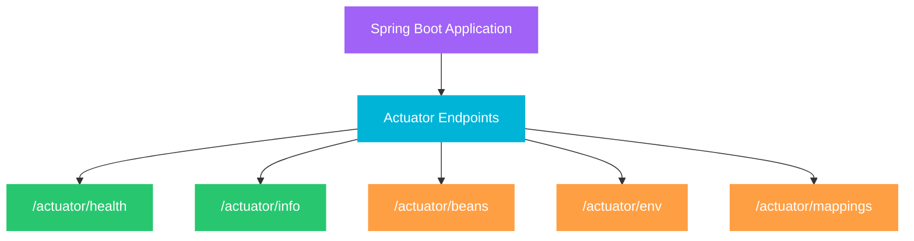
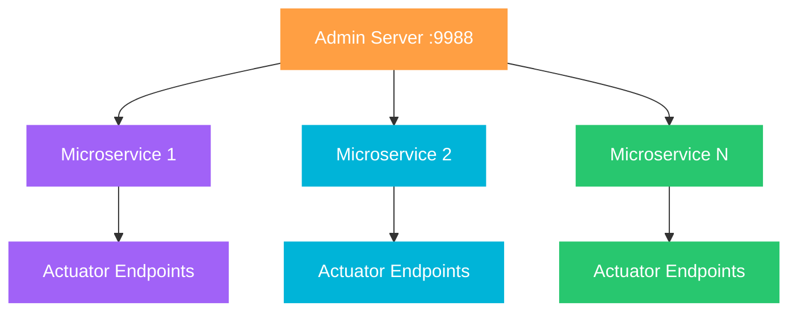
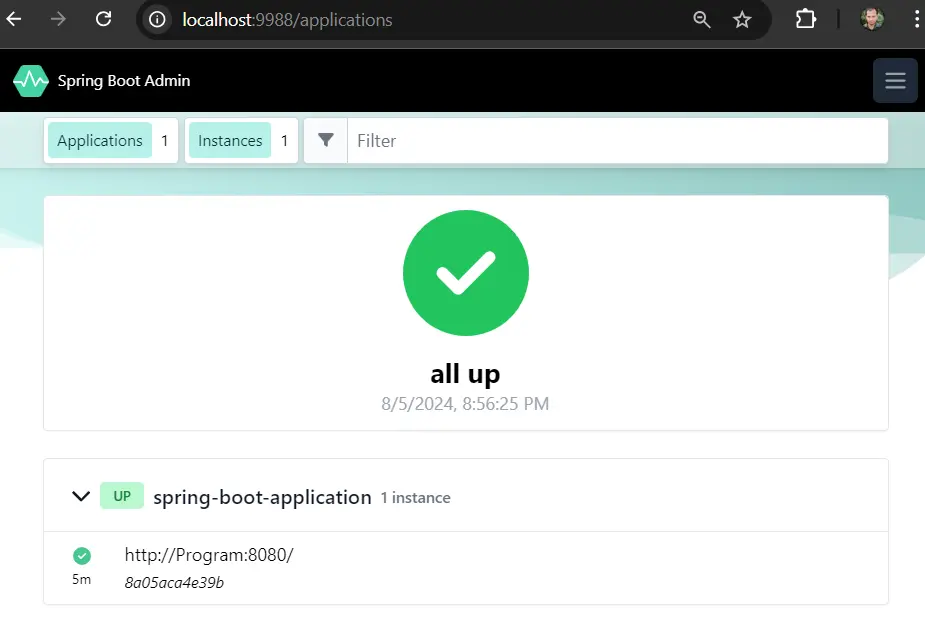
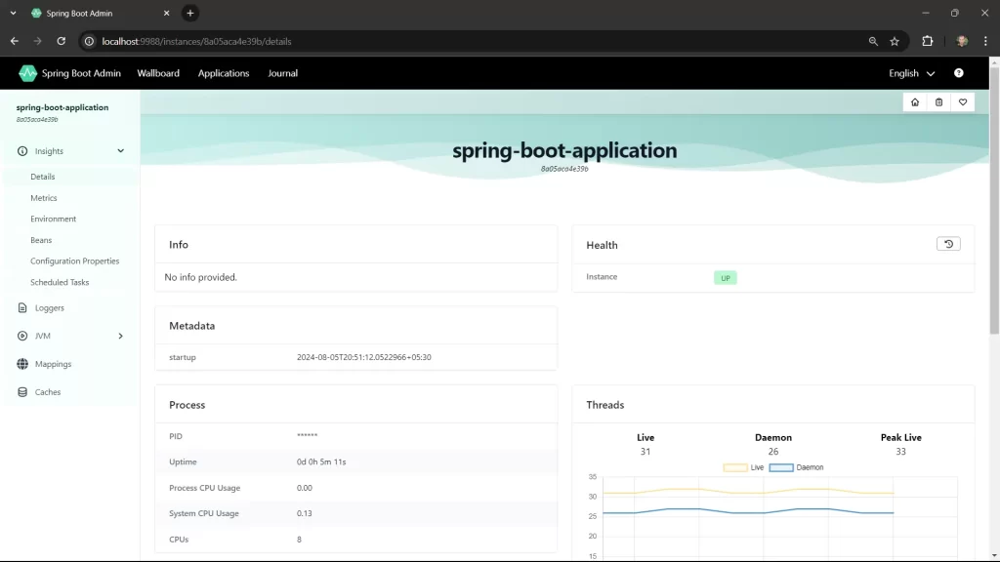

# Spring Boot Actuator with Admin Server

**Spring Boot Actuator with Admin Server** | Actuator: Production Ready Endpoints (Readymade services).

- [Why Actuator](#1-why-actuator)
- [Actuator Health](#2-actuator-health)
- [Actuator Info](#3-actuator-info)
- [Actuator Endpoints](#4-actuator-endpoints)
- [Admin Server](#5-admin-server)
- [Admin Server Project](#admin-server-project)
- [Microservice Project](#microservice-project)
- [Running the Applications](#6-running-the-applications)

---

## 1. Why Actuator

If one application is developed and placed in production then we need a few additional services.

🧠 **In Simple Words:**
Actuator gives you ready-made monitoring endpoints without writing any extra code.

🛠️ **Example additional services:**

- 🟢 Is the Application started?
- ⚙️ What are objects created?
- 📋 What are properties loaded?
- ℹ️ What is the information on the Application?
- 🕒 Schedulers details?
- 🧊 Caches Enabled?
- 📊 Logger Details?
- 🧵 Threads, Heap details.

These additional services can be added to our project without writing explicit code. For this, we can use an Actuator. It is a pre-defined code, we can enable/disable these services.

- 🌐 Generally, for every REST/microservices Application, we should enable Actuator.
- 🧪 We can check them in the dev/test environment also, but it is mainly designed for the production environment.



While creating the project we should add one dependency: `spring-boot-starter-actuator`

**Dependency:**

Maven (`pom.xml`):

```xml
<dependency>
    <groupId>org.springframework.boot</groupId>
    <artifactId>spring-boot-starter-actuator</artifactId>
</dependency>
```

Gradle (`build.gradle`):

```groovy
implementation 'org.springframework.boot:spring-boot-starter-actuator'
```

When we add the above dependency then 2 services (Endpoints) are activated by default with the base path `/actuator`. URL: **http://localhost:8080/actuator**. Here default endpoints are **health** and **info**.

💡 **Tip:** To demonstrate, create a spring starter project using the following dependencies: Spring Web, Spring Boot DevTools, and Spring Boot Actuator. Start the application.

---

## 2. Actuator Health

The **health** endpoint shows the status of the application: UP/DOWN. Enter URL: **http://localhost:8080/actuator/health**

To see disk space (RAM details, total, free, allocated data):

🔧 **Configuration (`application.properties`):**

```properties
management.endpoint.health.show-details=always
```

Default is `never` (don't show). We can show the same details only after login:

```properties
management.endpoint.health.show-details=when-authorized
```

To disable health:

```properties
management.endpoint.health.enabled=false
```

| Property 🏷️ | Value 📋 | Effect ⚡ |
|-------------|---------|----------|
| **`show-details`** | `always` | Shows full disk/RAM details |
| **`show-details`** | `when-authorized` | Shows details only after login |
| **`show-details`** | `never` | Default — hides details |
| **`enabled`** | `false` | Disables health endpoint entirely |

---

## 3. Actuator Info

The **info** endpoint shows the meta-data of the application like Project Name, version, client, location, copyrights info, etc.

📝 **Note:** Syntax to add info is `info.key=value`.

**Example (`application.properties`):**

```properties
info.app.title=ABCD-APP
info.app.version=3.2 GA
info.client.name=KnowProgram
info.client.license=KnowProgram-NEW
```

URL: **http://localhost:8080/actuator/info**

---

## 4. Actuator Endpoints

**Q) How can we modify the default base path?**

Add below key:

```properties
management.endpoints.web.base-path=/mytest
```

⚠️ **Caution:** We can use even `/` as a base path, but you may not see all endpoints. You can still access them with the full path as: `http://localhost:8080/info` — it is not recommended.

**Q) How can we activate all endpoints? (or) Specific endpoints?**

To activate all endpoints:

```properties
management.endpoints.web.exposure.include=*
```

To activate specific:

```properties
management.endpoints.web.exposure.include=health,beans,env
```

**Q) How can we exclude specific endpoints?**

```properties
# to activate all
management.endpoints.web.exposure.include=*

# to exclude provided
management.endpoints.web.exposure.exclude=health,info,beans,env
```

### Common Endpoints Reference

| Endpoint 🏷️ | Purpose 📋 | URL 🔗 |
|-------------|-----------|--------|
| **`beans`** | Check what objects are created in the application | `http://localhost:8080/actuator/beans` |
| **`env`** | Environment — Properties (key=val) loaded into the Application | `http://localhost:8080/actuator/env` |
| **`configprops`** | Find keys loaded via `@ConfigurationProperties` | `http://localhost:8080/actuator/configprops` |
| **`scheduledtasks`** | Find your scheduled tasks | `http://localhost:8080/actuator/scheduledtasks` |
| **`mappings`** | For a given Request URL — which class/method are executed, output, etc. | `http://localhost:8080/actuator/mappings` |

To enable the `beans` endpoint:

```properties
management.endpoints.web.exposure.include=*
# (or)
management.endpoints.web.exposure.include=beans
```

---

## 5. Admin Server

If we have multiple microservices then we have to check every microservice manually for Actuators. We can avoid that by using the Admin Server.

🧠 **In Simple Words:**
**Admin Server** provides one common UI for all microservices Actuator outputs. Now we don't need to check every microservice URL manually.



---

### Admin Server Project

1️⃣ **Create a Spring starter project** `SpringBoot2AdminServer`, and add the dependency: **Codecentric's Spring Boot Admin Server (`spring-boot-admin-starter-server`)**

**Dependency:**

Maven (`pom.xml`):

```xml
<dependency>
    <groupId>de.codecentric</groupId>
    <artifactId>spring-boot-admin-starter-server</artifactId>
</dependency>
```

Gradle (`build.gradle`):

```groovy
implementation 'de.codecentric:spring-boot-admin-starter-server'
```

2️⃣ **Configure `application.properties`:**

```properties
# any port number
server.port=9988
```

3️⃣ **At starter class:** Add `@EnableAdminServer`

4️⃣ **Run the application.**

---

### Microservice Project

1️⃣ **Create a Spring starter project** `SpringBoot2EmployeProject`, and add dependencies: **Spring Web, Spring Boot Actuator, Codecentric's Spring Boot Admin Client (`spring-boot-admin-starter-client`)**.

**Dependency:**

Maven (`pom.xml`):

```xml
<dependency>
    <groupId>de.codecentric</groupId>
    <artifactId>spring-boot-admin-starter-client</artifactId>
</dependency>
```

Gradle (`build.gradle`):

```groovy
implementation 'de.codecentric:spring-boot-admin-starter-client'
```

2️⃣ **Configure `application.properties`:**

```properties
# Provider AdminClient --Admin server URL
spring.boot.admin.client.url=http://localhost:9988

#management.endpoints.web.base-path=/
#management.endpoints.web.base-path=/mytest
#management.endpoints.web.exposure.exclude=health,info,beans,env
#management.endpoint.health.show-details=always
#management.endpoint.health.show-details=when-authorized
#management.endpoint.health.enabled=false
#management.endpoint.info.enabled=false
info.app.title=ABCD-APP
info.app.version=3.2 GA
info.client.name=KnowProgram
info.client.license=KnowProgram-NEW
management.endpoints.web.exposure.include=*
```

3️⃣ **RestController:**

```java
package com.knowprogram.demo.controller;

import org.springframework.beans.factory.annotation.Autowired;
import org.springframework.http.ResponseEntity;
import org.springframework.web.bind.annotation.GetMapping;
import org.springframework.web.bind.annotation.RequestMapping;
import org.springframework.web.bind.annotation.RestController;
import org.springframework.web.client.RestTemplate;

@RestController
@RequestMapping("/employee")
public class EmployeeRestController {

    @Autowired
    private RestTemplate rt;

    @GetMapping("/show")
    public ResponseEntity<String> showMsg() {
        return ResponseEntity.ok("Hello");
    }
}
```

4️⃣ **AppConfig:**

```java
package com.knowprogram.demo.config;

import org.springframework.context.annotation.Bean;
import org.springframework.context.annotation.Configuration;
import org.springframework.web.client.RestTemplate;

@Configuration
public class AppConfig {
    @Bean
    RestTemplate rtemplate() {
        return new RestTemplate();
    }
}
```

---

## 6. Running the Applications

1️⃣ Start the **Admin Server**
2️⃣ Start the **Microservice app**
3️⃣ Enter URL: **http://localhost:9988/applications**
4️⃣ Click on the **Application name**



5️⃣ Click on the **ID shown**
6️⃣ **Check all services**


