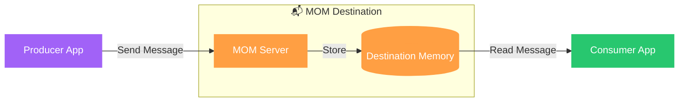
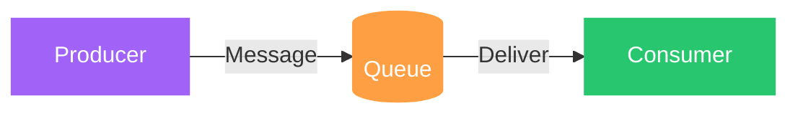
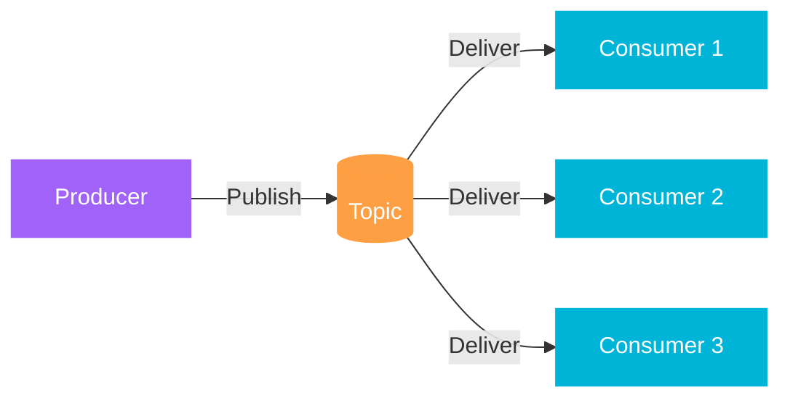
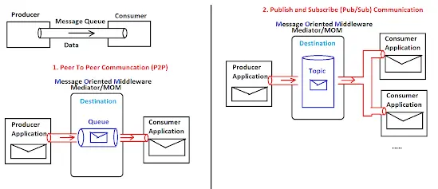

# Message Queues Using Spring Boot

**Message Queues Using Spring Boot** | Create a communication link between two applications for continuous data flow using Message Oriented Middleware (MOM).

- [Overview](#1-overview)
- [Types of Communications](#2-types-of-communications)
- [P2P vs Pub/Sub Examples](#3-p2p-vs-pubsub-examples)
- [Destinations](#4-destinations)
- [Message Queue Technologies](#5-message-queue-technologies)

---

## 1. Overview

Message Queues create a communication link between two applications for continuous data flow. For example, in any food delivery application, we can see the delivery person's current location through continuous data flow.

- 📨 Send data from the Producer application to the Consumer application (for a period of time, continuous data flow).
- 🔔 Consumers need not make any request, just one time connect/subscribe.

This is not a webservices concept — the consumer will never make any requests, and will not even send any data to the producer. Here, both Producer and Consumer applications communicate with each other using **Mediator software called MOM (Message Oriented Middleware)**.

- 🗄️ This MOM software contains memory called a 'Destination' which holds all messages.
- 📬 The producer gives the message to MOM#Destination, the consumer reads the message from MOM#Destination.

---

## 2. Types of Communications

### Peer-to-Peer Communication (P2P)

If one message is given to one consumer then it is called P2P. The destination type is called **Queue**.

🧠 **In Simple Words:**
You ordered food via some App. That particular delivery person status will be visible only to you but not to every single user of that App.

### Publish and Subscribe Communication (Pub/Sub)

If the same/one message is given to multiple consumers then it is called Pub/Sub. The destination type is called **Topic**.

🧠 **In Simple Words:**
You are watching a football match. The updates about the match will be visible to multiple clients.

---

## 3. P2P vs Pub/Sub Examples

| Example 📋 | Type 🔗 | Destination 📮 |
|------------|---------|----------------|
| **Food Delivery App Tracing Status** | P2P | Queue |
| **Uber cabs (taxi) live status** | P2P | Queue |
| **Train/Flight live status** | Pub/Sub | Topic |
| **Football Matches Score** | Pub/Sub | Topic |
| **Stock Market Details** | Pub/Sub | Topic |
| **Whatsapp Group** | Pub/Sub | Topic |
| **TV Channel** | Pub/Sub | Topic |

📝 **Note:** There can be multiple queues/topics created in the MOM server. Every topic/queue is identified using one name.

🛠️ **Example names:**
- 🚕 `uber-william-john-2012003-queue`
- 🏏 `crickdata-ind-aus-55682693-topic`

---

## 4. Destinations

Destinations are of two types:

| Destination 📮 | Communication Type 🔗 | Description 📋 |
|----------------|----------------------|----------------|
| **Queue** | P2P | One message delivered to one consumer |
| **Topic** | Pub/Sub | One message delivered to multiple consumers |

---

## 5. Message Queue Technologies

Message Queues coding can be done by using:

1. 📦 **JMS** (Apache ActiveMQ) / **RabbitMQ** — These are basic/traditional approaches
2. 🚀 **Apache Kafka** — In real-time, it is very commonly used
