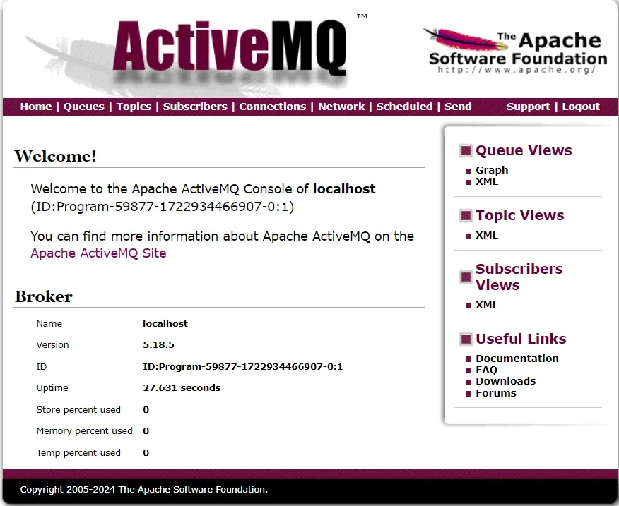
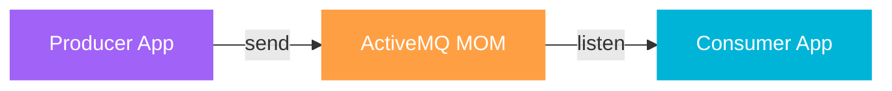
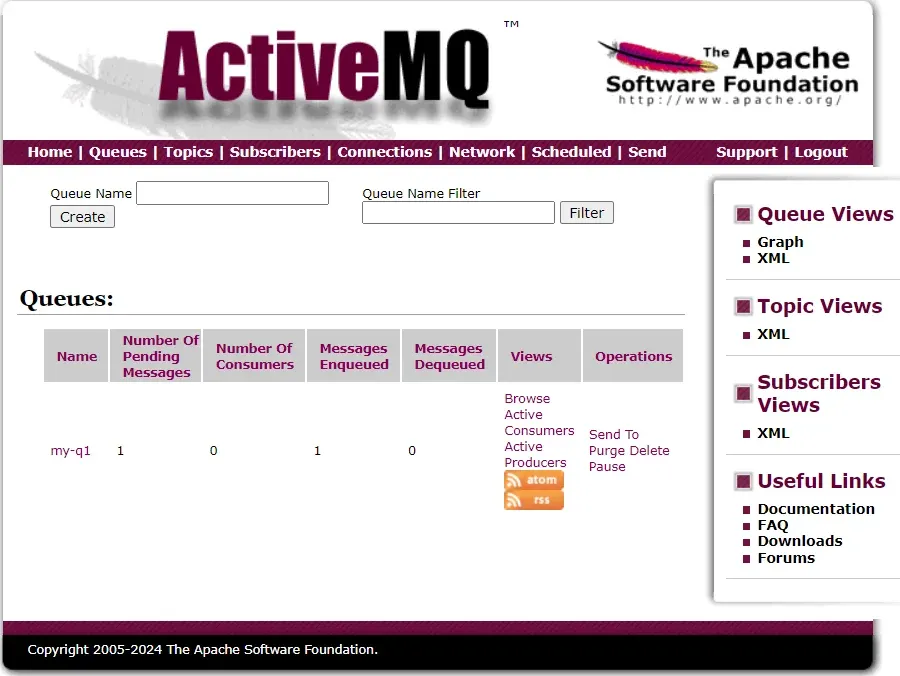
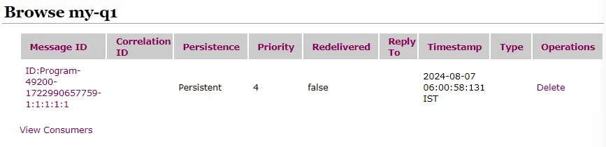
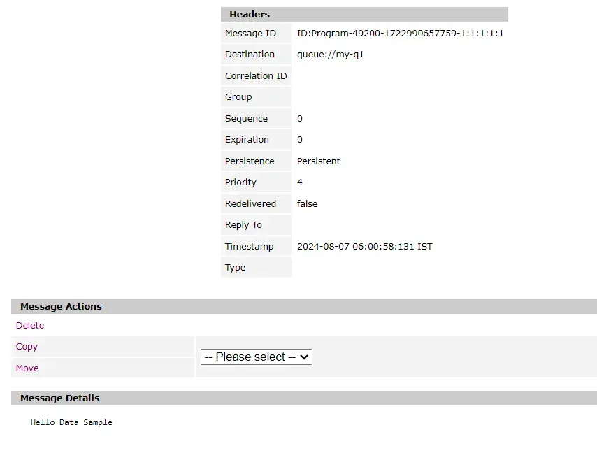
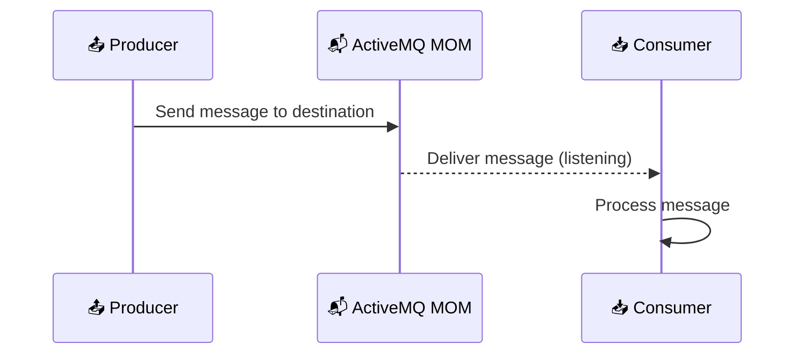
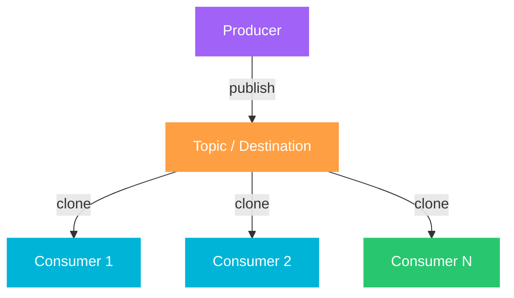

# Apache ActiveMQ Spring Boot Example

**Apache ActiveMQ Spring Boot Example** | We have seen what is message queue and the types of communication (P2P & Pub/Sub). See more: Message Queues Using Spring Boot. Let us see the Spring Boot Message queues example using Apache ActiveMQ.

- [ActiveMQ Setup](#1-activemq-setup)
- [JMS (Java Message Service)](#2-jms-java-message-service)
- [Spring Boot Example using Apache ActiveMQ](#3-spring-boot-example-using-apache-activemq)
- [ActiveMQ](#3-spring-boot-example-using-apache-activemq)
- [Sending Object through ActiveMQ](#5-sending-object-through-activemq)
- [Pub/Sub Communication using JMS](#6-pubsub-communication-using-jms)
- [Advantages of ActiveMQ](#7-advantages-of-activemq)
- [Limitations of ActiveMQ](#8-limitations-of-activemq)

---

## 1. ActiveMQ Setup

1. Download [Apache ActiveMQ](https://activemq.apache.org/components/classic/download/)
2. Click on OS based link: Windows `apache-activemq-5.18.5-bin.zip`
3. Extract to a folder ex: `apache-activemq-5.18.5`
4. Open folder location `\apache-activemq-5.18.5\bin\win64`
5. Click on `activemq.bat` file
6. Enter URL: **http://127.0.0.1:8161/admin**

🔑 **Credentials:**

- **Username:** admin
- **Password:** admin



📝 **Note:** For username & password, check `\apache-activemq-5.18.5\conf\users.properties` file. There we can update the username and password.

**`users.properties` format:**

```properties
username=password
```

💡 **Tip:** Press `CTRL + C` to terminate the batch.

---

## 2. JMS (Java Message Service)

To work with Apache ActiveMQ we will use JMS API.

- 📖 JMS stands for Java Message Service.
- 🏢 This API is given by Sun/Oracle.
- 📦 It is part of J2EE.
- 🌐 By using this API we can transfer data between two machines (apps) by using the Protocol `TCP` = Transmission Control Protocol.

| Technology 🏷️ | Protocol 📡 | Purpose 📋 |
|---------------|------------|-----------|
| **TCP MQs** | TCP | Message Queues |
| **Apache Kafka** | TCP | Message Queues |
| **FTP** | FTP | File Transfer |
| **Apache Camel** | FTP | File Transfer Protocol |
| **HTTP Web Apps** | HTTP | Web Application |
| **Web API + Server** | HTTP | Web API + Server |

- 📨 JMS is used for continuous data flow between two systems using a mediator.
- 🔗 There should be at least two Applications:

1. **Producer Application** — `JmsTemplate#send(destinationName, messageCreator)`
2. **Consumer Application** — Uses `@JmsListener(destination="")` to read messages



These two applications communicate with each other using TCP protocol for data exchange.

🧠 **In Simple Words:** The producer sends data to a mediator (ActiveMQ), and the consumer listens for messages from that mediator. They never talk directly.

JMS API contains the following interfaces:

- `Session`
- `Message`
  - `TextMessage`

ActiveMQ contains the following implementations:

| JMS Interface 🏷️ | ActiveMQ Implementation ⚙️ |
|-------------------|---------------------------|
| **`Session`** | `ActiveMQSession` |
| **`TextMessage`** | `ActiveMQTextMessage` |

---

## 3. Spring Boot Example using Apache ActiveMQ

📋 **Steps:**

1. **ActiveMQ Setup** — We have already set up ActiveMQ by downloading Apache ActiveMQ. Start ActiveMQ by clicking on the `activemq.bat` file of `\apache-activemq-5.18.5\bin\win64` folder. Enter URL: *http://127.0.0.1:8161/admin*; Use username: admin, password: admin. Go to the "Queues" section.
2. **Producer Application**
3. **Consumer Application**

### Producer Application

1️⃣ **Create a Spring starter project** `ActiveMQProducerEx`, and add dependency: **Spring for Apache ActiveMQ 5 (`spring-boot-starter-activemq`)**.

2️⃣ **Configure connectivity** in the `application.properties` file:

```properties
spring.activemq.broker-url=tcp://localhost:61616
spring.activemq.user=admin
spring.activemq.password=admin

# for P2P communication
spring.jms.pub-sub-domain=false

# for PUB/SUB communication
# spring.jms.pub-sub-domain=true
```

> 🔑 **Key Point:** If we use `spring.jms.pub-sub-domain=false` then code behaves like P2P communication, if it is set to `true` then it is PUB/SUB Communication.

3️⃣ **ProducerService:**

```java
package com.knowprogram.demo.service;

import org.springframework.beans.factory.annotation.Autowired;
import org.springframework.jms.core.JmsTemplate;
import org.springframework.stereotype.Component;

@Component
public class ProducerService {

    @Autowired
    JmsTemplate jmsTemplate;

    public void send(String destination, String message) {
        jmsTemplate.send(destination, (session) -> session.createTextMessage(message));
    }

}
```

4️⃣ **Runner class** to call the `ProducerService`:

```java
package com.knowprogram.demo.runner;

import org.springframework.beans.factory.annotation.Autowired;
import org.springframework.boot.CommandLineRunner;
import org.springframework.stereotype.Component;

import com.knowprogram.demo.service.ProducerService;

@Component
public class TestProducerRunner implements CommandLineRunner {

    @Autowired
    ProducerService producerService;

    @Override
    public void run(String... args) throws Exception {
        producerService.send("my-q1", "Hello Data Sample");
        System.out.println("Data Sent");
    }
}
```

5️⃣ **Start the application** and check the ActiveMQ dashboard "Queues" section (*http://127.0.0.1:8161/admin/queues.jsp*). There we can find the `my-q1` queue with the Number of pending message=1 and the Number of Consumer=0.



Click on `my-q1`:



Click on the given message ID:



### Consumer Application

1️⃣ **Choose a different workspace** for consumer applications.

2️⃣ **Create a Spring starter project** `JMSConsumerApp`, and add the dependency: **Spring for Apache ActiveMQ 5 (`spring-boot-starter-activemq`)**.

3️⃣ **In starter class** add: `@EnableJms`

4️⃣ **Configure connectivity** in the `application.properties` file:

```properties
spring.activemq.broker-url=tcp://localhost:61616
spring.activemq.user=admin
spring.activemq.password=admin
# for P2P communication
spring.jms.pub-sub-domain=false
```

5️⃣ **MessageConsumer:**

```java
package com.example.demo.consumer;

import org.springframework.jms.annotation.JmsListener;
import org.springframework.stereotype.Component;

@Component
public class MessageConsumer {

    @JmsListener(destination = "my-q1")

    public void readMessage(String message) {
        System.out.println("At consumer: " + message);
    }
}
```

6️⃣ **Run the application.**

🖥️ **Console Output:**

```
At consumer: Hello Data Sample
```

📝 **Note:** The Consumer never directly communicates with the producer. ActiveMQ MOM will work as a mediator between the producer and consumer. The producer application will send data to the MOM, and the MOM will send data to the consumer application.



---

## 4. ActiveMQ

- 🖥️ It is a mediator server.
- 📡 It will transfer data using Protocol TCP (Port: 61616). We can find the port details in `apache-activemq-5.18.5\conf` folder, open `activemq.xml` file and search for: `<transportConnector name="openwire" uri="tcp://0.0.0.0:61616? .../>`.
- 🌐 It provides a GUI (HTTP 8161) that provides information on sent messages, Consumers, Queue/Topic Names, etc.
- 🔗 Both Producer and Consumer communicate with MOM (Message Oriented Middleware) software only.
- 💾 Data is stored in a Destination (Queue/Topic).
- ⚠️ The producer destination name and consumer destination must be the same. If destination names are not matching then NO ERROR / NO EXCEPTION / NO OUTPUT.
- 📨 On receiving a message to the destination, MOM software will send a message to the Consumer.
- 👂 Consumer App need not make any request (it is always listening).

---

## 5. Sending Object through ActiveMQ

**How can we send/transfer Object/Collection data?**

We can not send Java objects as-is. They must be converted into one global format String (JSON/XML).

1️⃣ **Add Lombok & Jackson dependencies** in the producer application:

Maven (`pom.xml`):

```xml
<dependency>
    <groupId>com.fasterxml.jackson.core</groupId>
    <artifactId>jackson-core</artifactId>
</dependency>
<dependency>
    <groupId>com.fasterxml.jackson.core</groupId>
    <artifactId>jackson-databind</artifactId>
</dependency>
<dependency>
    <groupId>org.projectlombok</groupId>
    <artifactId>lombok</artifactId>
    <optional>true</optional>
</dependency>
```

Gradle (`build.gradle`):

```groovy
implementation 'com.fasterxml.jackson.core:jackson-core'
implementation 'com.fasterxml.jackson.core:jackson-databind'
compileOnly 'org.projectlombok:lombok'
annotationProcessor 'org.projectlombok:lombok'
```

2️⃣ **Create a model class:**

```java
package com.knowprogram.demo.model;

import lombok.AllArgsConstructor;
import lombok.Data;
import lombok.NoArgsConstructor;

@Data
@NoArgsConstructor
@AllArgsConstructor
public class GameInfo {
    private String matchId;
    private String op1;
    private String op2;
    private Integer op1Score;
    private Integer op2Score;
    private String winner;
}
```

3️⃣ **Create a MessageConverter class:**

```java
package com.knowprogram.demo.converter;

import com.fasterxml.jackson.core.JsonProcessingException;
import com.fasterxml.jackson.databind.ObjectMapper;

public class MessageConverter {
    public static String convertObjectToString(Object object) {
        try {
            return new ObjectMapper().writeValueAsString(object);
        } catch (JsonProcessingException e) {
            e.printStackTrace();
        }
        return null;
    }

}
```

4️⃣ **Modify TestProducerRunner** to send Object data:

```java
package com.knowprogram.demo.runner;

import org.springframework.beans.factory.annotation.Autowired;
import org.springframework.boot.CommandLineRunner;
import org.springframework.stereotype.Component;

import com.knowprogram.demo.converter.MessageConverter;
import com.knowprogram.demo.model.GameInfo;
import com.knowprogram.demo.service.ProducerService;

@Component
public class TestProducerRunner implements CommandLineRunner {

    @Autowired
    ProducerService producerService;

    @Override
    public void run(String... args) throws Exception {
        producerService.send("my-q1",
                MessageConverter.convertObjectToString(
                        new GameInfo("ABC15246", "ABC", "IND", 251, 252, "IND-WINNER")
                        )
                );
        System.out.println("Data Sent");
    }
}
```

5️⃣ **Re-run the producer application.** No need to do anything with the consumer application. The consumer is already in listening mode.

6️⃣ **Check output in consumer application.**

🖥️ **Console Output:**

```json
At consumer: {"matchId":"ABC15246","op1":"ABC","op2":"IND","op1Score":251,"op2Score":252,"winner":"IND-WINNER"}
```

---

## 6. Pub/Sub Communication using JMS

- 📡 By default every Producer and Consumer app is P2P Communication as internally key: `spring.jms.pub-sub-domain` is set to `false`.
- 🔄 To convert the P2P Application into Pub/Sub, modify the key: `spring.jms.pub-sub-domain` with value `true` in both producer and consumer.
- 🔧 Producer/Consumer code is the same for both P2P and Pub/Sub. Just define another consumer Application.
- 📬 The topic is created if `spring.jms.pub-sub-domain=true`.
- 📋 Based on the number of consumers, actual message cloning is done (Clone = Create a copy of actual message).
- 📈 Considering the number of consumers is 10 then one message is delivered to 10 consumers from MOM.



📋 **Steps to set up Pub/Sub:**

1. Create one more consumer by copying the existing consumer application.
2. In all Producer and consumer applications, modify the below property in the `application.properties` file:

```properties
spring.jms.pub-sub-domain=true
```

3. Run the producer and consumers.
4. Change data in the producer and rerun the producer. We can see the modified data in all consumers.

---

## 7. Advantages of ActiveMQ

- 💾 MOM software will store data to avoid message loss until the consumer receives it.
- 🌐 MOM software can support sending data in Global Format (JSON/XML).
- ✅ It is good to use for simple and less data transfer between multiple systems.

---

## 8. Limitations of ActiveMQ

- 🐢 In case of data is too large (like GBs) then MOM becomes slow, even data loss may occur.
- 📈 In case of number of consumers increases it may become very slow.
- ⚠️ Here, MOM contains a single broker instance. If it is down or not responding then data loss may occur. It does not support the Load Balancer concept.
- 🔗 It is fully protocol-dependent (TCP).

> 💡 **Tip:** To overcome these limitations we can work with **Apache Kafka**.
