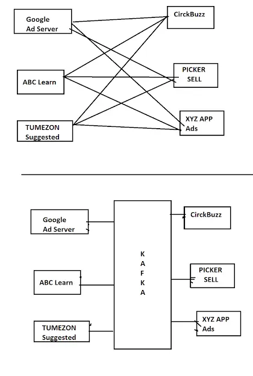
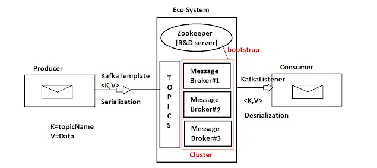
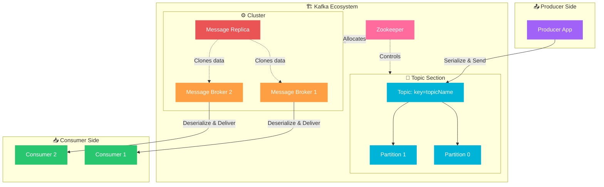
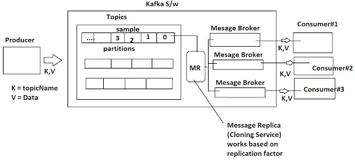
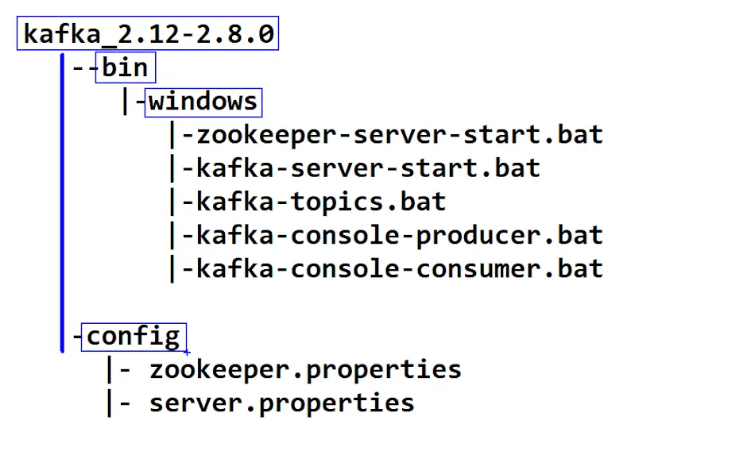

# Apache Kafka Introduction

**Apache Kafka Introduction** | Apache Kafka is used to send continuous data between the producer and consumer using a mediator.

- [Kafka Overview](#1-kafka-overview)
- [Kafka Software Overview](#2-kafka-software-overview)
- [Kafka Architecture](#3-kafka-architecture)
- [Key Concepts and FAQ](#4-key-concepts-and-faq)
- [Serialization and Deserialization](#5-serialization-and-deserialization)
- [Data Storage in Topics](#6-data-storage-in-topics)
- [Apache Kafka Setup](#7-apache-kafka-setup)
- [Apache Kafka Commands](#8-apache-kafka-commands)
- [Topic Creation Inputs](#9-topic-creation-inputs)

---

## 1. Kafka Overview

- 📨 It is also called an Advanced Message Queue Protocol supporting tool (AMQP).
- 📦 It is from Apache with Scala 2.13.
- 🔗 It supports sending/receiving data between various systems.
- 🌐 It is language-independent and even protocol-independent.
- 📬 It contains only topic concepts. It does not support Queue. We can use the topic concept to send a message to one or more consumers. So, the queue concept is removed.



If multiple systems want to communicate with each other then there will be multiple permutations and combinations. Kafka helps here as a mediator.

---

## 2. Kafka Software Overview

1. The full software is called EcoSystem which contains Cluster, bootstrap Server, and Topic Section.
2. One Message Broker is used to read data from the topic section, clone it, and send data to consumers based on the topic name. There will be multiple message brokers, if one goes down then another will be used.
3. All message brokers and topic sections are fully controlled by an R&D Server Zookeeper i.e. creating topics, storing data, allocating Message brokers to consumers.. etc.
4. The collection of message broker instances is called a Cluster. When we start Kafka Software it is created with one Instance. On-demand (number of consumers) Message Brokers are controlled by Zookeeper.
5. The topic is memories which store data in partitions. Inputs: topicName, partition factor. Based on the replication factor number of consumers even identified. default is taken as 1 for both partition and replication.



---

## 3. Kafka Architecture

Assume we have a producer application having some data. We transfer data to the Eco System (Kafka). The ecosystem stores data in topics in a key-value format where the key contains topicName and the value contains data. Data is transferred in the form of serialization and stored in partitions. If we don't give any partition then one default partition is created with index zero. Once it is done, Zookeeper allocates one message broker to transfer data to the consumer. Every consumer will have one unique message broker (N consumer = N message broker). The data will be deserialized while transferring to the consumer. Message Broker asks for a copy of the message from the MR (message replica; cloning service) and that message will be transferred to the consumer.





---

## 4. Key Concepts and FAQ

**Q) Kafka Full software is called as?**
Eco System = Zookeeper + Topics + Cluster.

**Q) What is a cluster? What is the default size on startup?**
A cluster is a collection of Message brokers. A message broker is a mediator software that sends data to consumers. The default size on startup is one.

**Q) What is the Topic Section? How will it store data?**
It is a memory that holds data. It stores in the key-value format as topicName=Data using the Partitions concept. The index starts from zero. The default size is one.

**Q) What is MR? When will it be executed?**
The MR represents Message Replica, which creates cloning objects for actual data. It gets executed before sending data to the consumer.

| Term 🏷️ | Description 📋 |
|----------|---------------|
| **Ecosystem** | Zookeeper + Topics + Cluster |
| **Cluster** | Collection of Message Brokers (default size: 1) |
| **Topic Section** | Memory holding data in key-value format using Partitions |
| **Message Replica (MR)** | Cloning service that copies data before sending to consumer |
| **Message Broker** | Mediator software that sends data to consumers |
| **Zookeeper** | R&D Server that controls brokers, topics, and allocation |

---

## 5. Serialization and Deserialization

- 🔄 **Serialization:** It is a process of converting Java Object to network understandable format. Object ---> Network Format, File System.
- 🔄 **Deserialization:** Converting Response data (n/w data) into Java Object Format. N/w Format ---> Object.

The producer can be a Java application, but the consumer may be a non-Java application. In that case, we should be able to send/read data in Global Formats. Like `String` (plain text), `JSON`, `XML` .. etc.

---

## 6. Data Storage in Topics

- 🔑 Data is sent or received in K=V Format. Here K=TopicName, V=Data.
- 📂 Data is stored inside the Topic Section, every topic is identified using one name (topicName=Key).
- 📦 Topic data is stored as partitions (default 1). Every partition contains one index number called an `offset`.
- ⚙️ Partitions are created by Kafka software only. However, the number of Partitions must be provided by the programmer only while creating the topic.

---

## 7. Apache Kafka Setup

1. [Download Apache Kafka](https://kafka.apache.org/downloads) by choosing binary Scala 2.13. [If getting the error "The input line is too long." then try Kafka version 3.2.0.]
2. Extract the downloaded file.
3. Open the command prompt/terminal from that location.



---

## 8. Apache Kafka Commands

Run the below commands in the command prompt. **Run each command in separate tabs/windows**. These commands are specific to Windows OS. For Unix use the appropriate `.sh` file located outside of the `windows` folder.

1️⃣ **Start Zookeeper:**

```bash
.\bin\windows\zookeeper-server-start.bat .\config\zookeeper.properties
```

2️⃣ **Start Kafka Server:**

```bash
.\bin\windows\kafka-server-start.bat .\config\server.properties
```

3️⃣ **Create Topics** (name, partitions, replication factor, to zookeeper):

```bash
.\bin\windows\kafka-topics.bat --create --bootstrap-server localhost:9092 --replication-factor 1 --partitions 1 --topic knowprogramone
```

**List all topics:**

```bash
.\bin\windows\kafka-topics.bat --list --bootstrap-server localhost:9092
```

4️⃣ **Start Producer** (Console-based):

```bash
.\bin\windows\kafka-console-producer.bat --bootstrap-server localhost:9092 --topic knowprogramone
```

**Enter some messages:**

```bash
>hi
>hello
>{eid:10, ename:john, esal:2.2
```

5️⃣ **Start Consumer** (Console-based):

```bash
.\bin\windows\kafka-console-consumer.bat --bootstrap-server localhost:9092 --topic knowprogramone
```

**Read messages from the beginning:**

```bash
.\bin\windows\kafka-console-consumer.bat --bootstrap-server localhost:9092 --topic knowprogramone --from-beginning
```

📝 **Note:** We have used console-based producers and consumers just for demo purposes. We have to define one application for producer and consumer services.

---

## 9. Topic Creation Inputs

| Input 🏷️ | Description 📋 |
|-----------|---------------|
| **topicName** | A name given to the Topic (Key) |
| **replication factor** | Number of copies to be created for given one message |
| **partitions** | Number of parts that need to be created for a given message |
| **Zookeeper details** | The Zookeeper creates a topic with given details |

> 🔑 **Key Points:**  
> - Zookeeper runs on port number `2181`, check inside `config/zookeeper.properties`.  
> - Kafka Server with Zookeeper (Full setup) runs on port number `9092`.
