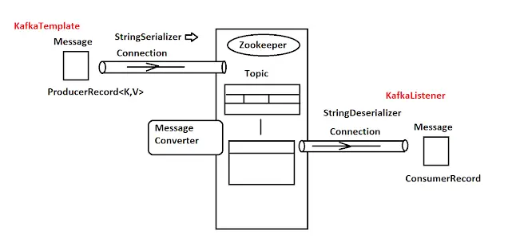
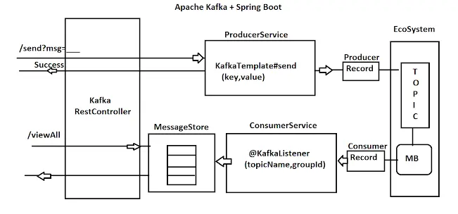
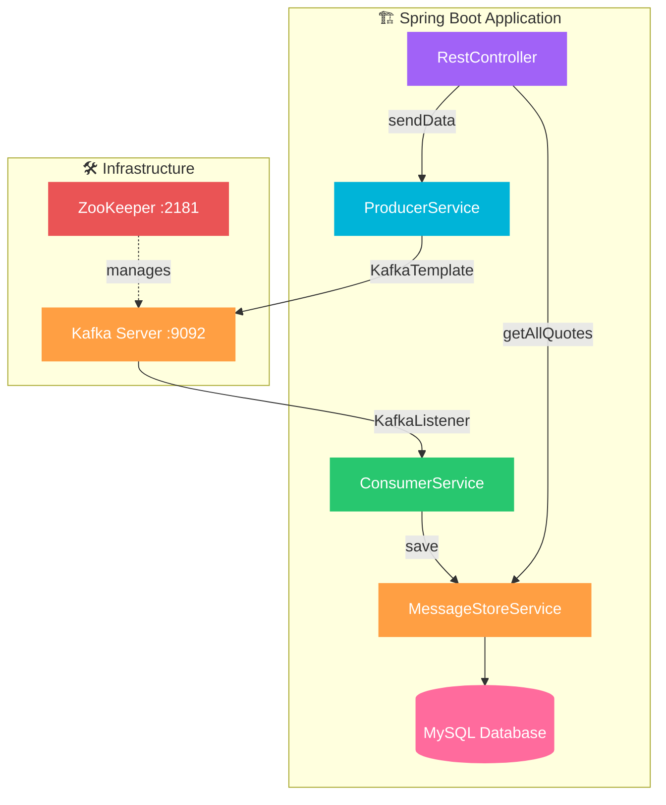

# Spring Boot Integration with Apache Kafka

**Spring Boot Integration with Apache Kafka** | An application example for Spring Boot integration with Apache Kafka for messaging.

- [Apache Kafka API Details](#1-apache-kafka-api-details)
- [Spring Boot Integration with Apache Kafka Application Example](#2-spring-boot-integration-with-apache-kafka-application-example)
- [Execution Steps](#6-execution-steps)
- [Understanding the Project](#7-understanding-the-project)

---

## 1. Apache Kafka API Details

Apache has provided one API to work with the Kafka EcoSystem known as **Apache Kafka API** — `org.apache.kafka`.

```mermaid
graph LR
    P[Producer] -->|Serialize| PR[ProducerRecord K,V]
    PR -->|Send| T[Kafka Topic]
    T -->|Read| CR[ConsumerRecord K,V]
    CR -->|Deserialize| C[Consumer]

    classDef purple fill:#A162F7,stroke:#A162F7,color:#fff
    classDef cyan fill:#00b4d8,stroke:#00b4d8,color:#fff
    classDef green fill:#28C76F,stroke:#28C76F,color:#fff
    classDef orange fill:#FF9F43,stroke:#FF9F43,color:#fff
    classDef pink fill:#FF6B9D,stroke:#FF6B9D,color:#fff

    class P purple
    class PR cyan
    class T orange
    class CR cyan
    class C green
```





| Component 🏷️ | Purpose 📋 |
|--------------|-----------|
| **`ProducerRecord<K, V>`** | Combination object storing TopicName and data after Serialization |
| **`ConsumerRecord<K, V>`** | Message Broker reads data from topicName, clones and sends data (Deserialized) |
| **`StringSerializer`** | Converts message to `ProducerRecord` format (Serialization) |
| **`StringDeserializer`** | Converts Serialized data back to Object format (Deserialization) |

🔧 **Connection Properties:**

| Property ⚙️ | Value 🔗 |
|-------------|---------|
| **Bootstrap server** | `localhost:9092` |
| **Zookeeper server** | `localhost:2181` |
| **Serializer (Producer)** | `org.apache.kafka.common.serialization.StringSerializer` |
| **Deserializer (Consumer)** | `org.apache.kafka.common.serialization.StringDeserializer` |



### Spring Kafka Components

- 📨 **`KafkaTemplate<K,V>`** — Used to send data in key=val format which internally creates `ProducerRecord<K,V>` and sends to Kafka software. K=TopicName, V=Data which is Serialized and transferred.
- 📬 **`@KafkaListener(topicName)`** — Reads data from Kafka software which comes in `ConsumerRecord<K, V>`. Data is given in Deserialized format.

📝 **Note:** The `groupId` is used for multiple consumers to replicate data. We can provide a replication factor while creating topicName, or else use `groupId`.

---

## 2. Spring Boot Integration with Apache Kafka Application Example

1️⃣ **Create a Spring Starter project** `SpringBootKafkaEx` with the following dependencies:

- 🔧 Spring Boot DevTools
- 📦 Lombok
- 💾 MySQL Driver
- 🗄️ Spring Data JPA
- 🌐 Spring Web
- 📨 Spring for Apache Kafka

2️⃣ **Model class:**

```java
package com.knowprogram.demo.model;

@Entity
@Table(name = "stock_quota_tab")
@Data
public class StockQuote {

   @Id
   @GeneratedValue(strategy = GenerationType.IDENTITY)
   private Integer id;

   @Column(name = "stk_code_col")
   private String stockCode;

   @Column(name = "stk_cost_col")
   private Double shareValue;

   @Column(name = "stk_dte_col")
   @Temporal(TemporalType.TIMESTAMP)
   private Date serviceDate;
}
```

3️⃣ **Repository:**

```java
package com.knowprogram.demo.repository;

public interface StockQuoteRepository extends JpaRepository<StockQuote, Integer> { }
```

4️⃣ **MessageStoreService:**

```java
package com.knowprogram.demo.service;

@Service
public class MessageStoreService {

   @Autowired
   private StockQuoteRepository repository;

   public void addStockData(StockQuote quote) {
      repository.save(quote);
   }

   public List<StockQuote> getAllStockQuotes() {
      return repository.findAll();
   }
}
```

5️⃣ **JsonUtil (Object to JSON and String to Object converter):**

```java
package com.knowprogram.demo.util;

@Component
public class JsonUtil {

   public String toJson(StockQuote stockQuote) {
      try {
         return new ObjectMapper().writeValueAsString(stockQuote);
      } catch (JsonProcessingException e) {
         e.printStackTrace();
      }
      return null;
   }

   public StockQuote fromJson(String json) {
      try {
         return new ObjectMapper().readValue(json, StockQuote.class);
      } catch (JsonProcessingException e) {
         e.printStackTrace();
      }
      return null;
   }

}
```

6️⃣ **Producer service:**

```java
package com.knowprogram.demo.producer;

@Component
public class ProducerService {

   private static final Logger LOG = LoggerFactory.getLogger(ProducerService.class);

   @Value("${my.app.topicName}")
   private String topic;

   @Autowired
   private KafkaTemplate<String, String> template;

   @Autowired
   private JsonUtil util;

   public void sendData(StockQuote quote) {
      String message = util.toJson(quote);
      LOG.info("At producer received {}", message);
      template.send(topic, message);
   }

}
```

7️⃣ **Consumer service:**

```java
package com.knowprogram.demo.consumer;

@Component
public class ConsumerService {

   private static final Logger LOG = LoggerFactory.getLogger(ConsumerService.class);

   @Autowired
   private MessageStoreService service;

   @Autowired
   private JsonUtil util;

   @KafkaListener(topics = "${my.app.topicName}", groupId = "groupId")
   public void readData(String message) {
      LOG.info("Data at consumer: {}", message);
      StockQuote quote = util.fromJson(message);
      quote.setServiceDate(new Date());
      service.addStockData(quote);
   }

}
```

8️⃣ **RestController:**

```java
package com.knowprogram.demo.rest;

@RestController
@RequestMapping("/api/quote")
public class KafkaRestController {

   @Autowired
   private ProducerService producerService;

   @Autowired
   private MessageStoreService storeService;

   // 1. send StockQuote
   @PostMapping("/create")
   public ResponseEntity<String> createStockQuote(@RequestBody StockQuote quote) {
      producerService.sendData(quote);
      return ResponseEntity.ok("Quote Data is sent!");
   }

   // 2. View all received
   @GetMapping("/all")
   public ResponseEntity<List<StockQuote>> getAllQuotes() {
      List<StockQuote> list = storeService.getAllStockQuotes();
      return ResponseEntity.ok(list);
   }

}
```

9️⃣ **Configuration** (`application.properties`):

```properties
spring.application.name=SpringBootKafkaEx

# server details
server.port=8761

# database details
spring.datasource.url=jdbc:mysql://localhost:3306/test
spring.datasource.username=root
spring.datasource.password=root

# JPA details
spring.jpa.show-sql=true
spring.jpa.hibernate.ddl-auto=update
spring.jpa.properties.format-sql=true

# Kafka details
## 3. producer
spring.kafka.producer.bootstrap-servers=localhost:9092
spring.kafka.producer.key-serializer=org.apache.kafka.common.serialization.StringSerializer
spring.kafka.producer.value-serializer=org.apache.kafka.common.serialization.StringSerializer

## 4. consumer
spring.kafka.consumer.bootstrap-servers=localhost:9092
spring.kafka.consumer.key-deserializer=org.apache.kafka.common.serialization.StringDeserializer
spring.kafka.consumer.value-deserializer=org.apache.kafka.common.serialization.StringDeserializer

## 5. topic name
my.app.topicName = sample-topic-knowprogram
```

> ⚠️ **Caution:** Kafka topic names must adhere to specific rules:  
> - Length must be between 1 and 249 characters.  
> - Only letters, digits, hyphens (`-`), underscores (`_`), and periods (`.`) are allowed.  
> - No spaces allowed.  
> - Certain names may be restricted or reserved by Kafka.

> 🚨 **Common Error:** In the properties, `topicName` must not contain space/leading or trailing spaces, else you will get: `org.apache.kafka.common.errors.InvalidTopicException: Invalid topics:`

💡 **Tip:** Always trim any leading or trailing spaces from the topic name and ensure it meets the valid criteria.

---

## 6. Execution Steps

Go to the Kafka home folder and use the below commands to start the Zookeeper and Kafka server.

1️⃣ **Start Zookeeper:**

```bash
.\bin\windows\zookeeper-server-start.bat .\config\zookeeper.properties
```

2️⃣ **Start Kafka server:**

```bash
.\bin\windows\kafka-server-start.bat .\config\server.properties
```

3️⃣ **Run** the `SpringBootKafkaEx` application.

4️⃣ **Send data using Postman:**

```
POST http://localhost:8761/api/quote/create
```

📥 **Request Body (JSON):**

```json
{"stockCode": "KP-TECH LTD", "shareValue": 100}
```

5️⃣ **Check database table:**

```sql
use test;
select * from stock_quota_tab;
```

6️⃣ **Check console:**

📤 **Output:**

```
c.k.demo.producer.ProducerService       : At producer received {"id":null,"stockCode":"KP-TECH LTD","shareValue":100.0,"serviceDate":null}
c.k.demo.consumer.ConsumerService       : Data at consumer: {"id":null,"stockCode":"KP-TECH LTD","shareValue":100.0,"serviceDate":null}
```

📝 **Note:** In real-time, in place of Postman, some other application will be sending continuous data.

---

## 7. Understanding the Project



- 🐘 **ZooKeeper** is a must for Kafka. It manages the Kafka cluster state.
- 🖥️ By default, the Kafka server starts on port `9092`. ZooKeeper starts on port `2181`.
- 👥 **Group ID** — Consumer groups give Kafka the flexibility to have the advantages of both message queuing and publish-subscribe models.
- 🔄 Kafka consumers belonging to the same consumer group share a group ID. The consumers in a group divide the topic partitions fairly, establishing that each partition is only consumed by a single consumer from the group.
- ⚖️ If all consumers are from the same group, the Kafka model functions as a traditional **message queue**. All the records and processing are load balanced. Each message would be consumed by one consumer of the group only. Each partition is connected to at most one consumer from a group.
- 📨 `KafkaTemplate` helps send messages to their respective topic. Call the `sendMessage()` method with the message and the topic name as parameters.
- 📡 When multiple consumer groups exist, the flow aligns with the traditional **publish-subscribe model**. The messages are broadcast to all consumer groups.
- 🔧 In order to prepare the message for transmission from the producer to the broker, we use **serializers**. The `key.serializer` and `value.serializer` instruct how to turn the key and value objects the user provides with their `ProducerRecord` into bytes. You can use the included `ByteArraySerializer` or `StringSerializer` for simple string or byte types.

> 💡 **Tip:** In the consumer, instead of `String` as the method parameter, you can use `ConsumerRecord<String, String>` as follows:

```java
@KafkaListener(topics = "${kafka.topic.name}",
               groupId= "${spring.kafka.consumer.group-id}"
)
public void listen(ConsumerRecord<String, String> record) {
    System.out.println("Received Message: " + record.value());
}
```
