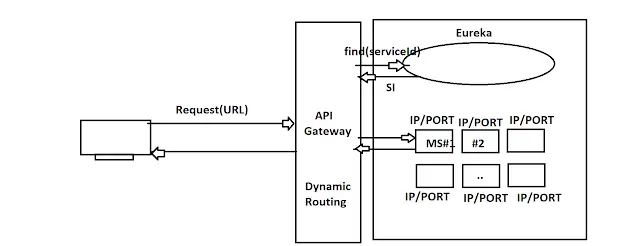
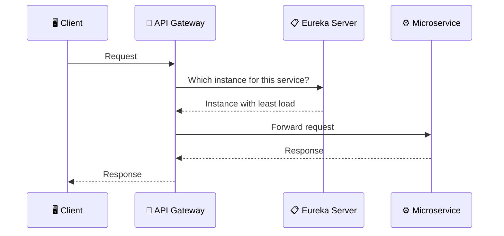
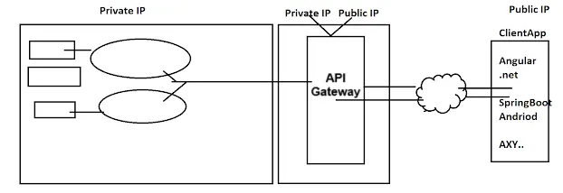
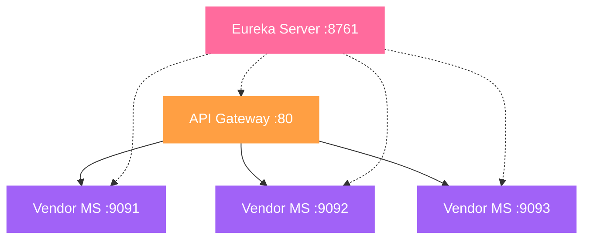
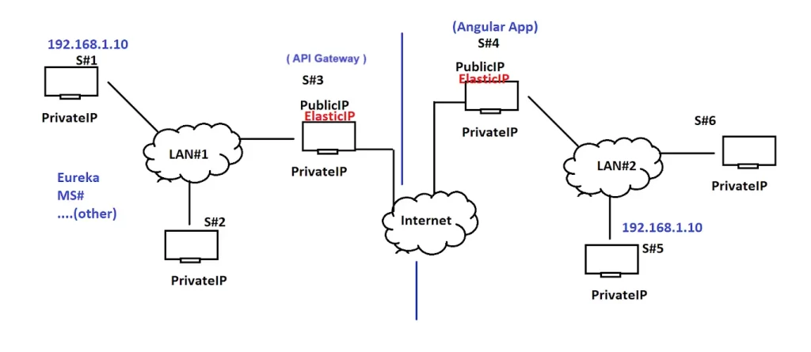
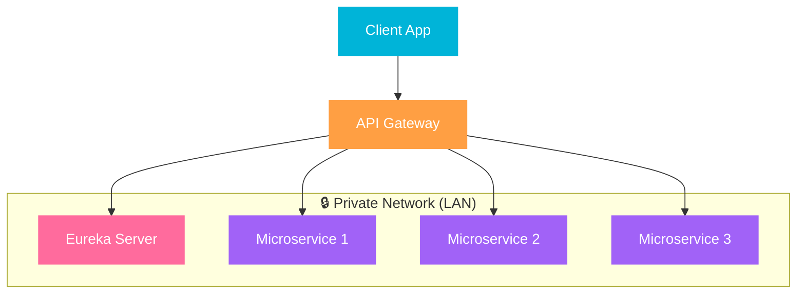
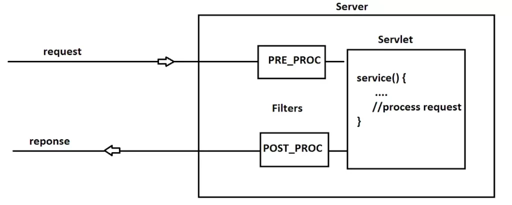
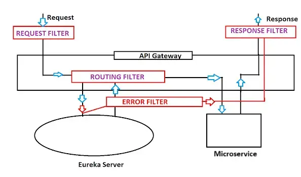
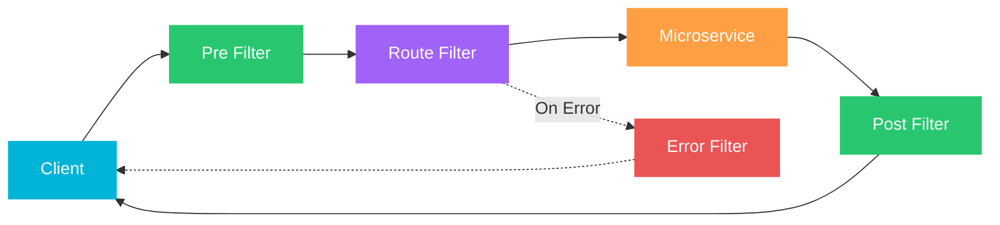
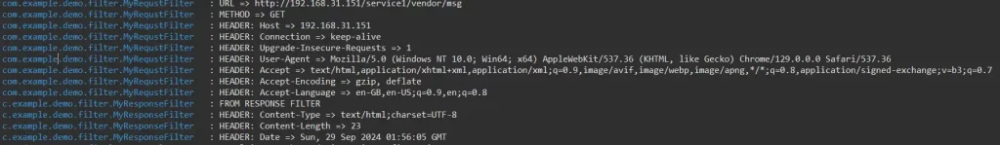

# Spring Cloud Gateway with Eureka Service Registry in Spring Boot

**Spring Cloud Gateway with Eureka Service Registry Example in Spring Boot** | Generally we develop multiple microservices. Those microservices will be running at multiple locations, multiple instances are created and that will have multiple IP addresses and port numbers. We can't give those all IP addresses and port numbers to the frontend application or clients. Clients must have one single entrance to use all those microservices.

- [Why API Gateway is Required](#1-why-api-gateway-is-required)
- [What is API Gateway](#2-what-is-api-gateway)
- [Feign Client vs API Gateway](#3-feign-client-vs-api-gateway)
- [Spring Cloud Gateway Example with Spring Boot](#4-spring-cloud-gateway-example-with-spring-boot)
- [How Spring Cloud Gateway Works](#5-how-spring-cloud-gateway-works)
- [Public IP vs Elastic IP](#6-public-ip-vs-elastic-ip)
- [Filters](#7-filters)
- [Spring Cloud Gateway Filters](#8-spring-cloud-gateway-filters)
- [GlobalFilter](#globalfilter)
- [GatewayFilter](#gatewayfilter)
- [Pre Filter Example](#pre-filter-example)
- [Route Filter](#route-filter)
- [Error Filter](#error-filter)
- [Post Filter](#post-filter)
- [Exception Handling](#exception-handling)

---

There should be only one entrance and exit point known as API Gateway. The API Gateway is going to call all microservices by using Load Balancing without writing any specific load balancer code.



The client requests the API Gateway. API Gateway goes to the Eureka server and asks for a particular service instance based on the request URL. Eureka gives a service instance having less load factor. That service instance will have some response to the API Gateway. Finally, API Gateway returns the response to the client. That process of going to the Eureka server and getting an instance is called Dynamic Routing. Routing is a process of executing a particular microservice based on a URL.



---

## 1. Why API Gateway is Required

- 🏗️ In our application, there can be multiple microservices and multiple instances.
- 🌐 Every instance may run in different systems. So, IP/PORT combinations are even multiples.
- 🔗 We must give a single (one) IP/PORT (or HOST) to the Frontend App (or Clients).
- 🚪 For that, we should create one entry and exit point that even executes our microservice based on the Request URL.
- ⚖️ Even it has to choose an instance having less load factor (Load Balancing).
- ✅ So, we use API Gateway.

---

## 2. What is API Gateway

It is used for one common entry/exit point. It has the following benefits:

- 🔀 Supports Dynamic routing by generating client code (`LoadBalancerClient`) using Proxy.
- 🔒 Security at the entrance (SSO-Single Sign On -- JWT/OAuth2.x). We should not write security codes in each single microservice. Instead, security is implemented at the API Gateway level only.
- 🧪 Execute Filters at multiple levels. (Error Filter, Routing Filter, etc.)

### Some Terminologies

| Term 🏷️ | Definition 📖 |
|----------|--------------|
| **Routing** | Executing one microservice instance based on a given URL by the Client |
| **Dynamic Routing** | Choosing microservice IP/PORT (URL) from Eureka at runtime based on Load Factor |

🔑 **Important points about API Gateway:**

- ⚙️ API Gateway is also one microservice that is even registered with Eureka.
- 🔀 API Gateway calls our one microservice based on URL using internal `LoadBalancerClient` code which is generated (Proxy).
- 🏗️ API Gateway internally uses the Proxy concept to make Client calls.

---

## 3. Feign Client vs API Gateway

If one microservice wants to communicate with another microservice then we use the Feign Client interface in microservice1/microservice2 (here we create the interface manually). For all microservices, we need one common IP/PORT for making calls from outside of our app. So, for that purpose, we use API Gateway (Generates code).

In the cloud (AWS/Google Cloud/..) environment there will be private IPs and a public IP. Microservices will have private IPs. API Gateway will have both one private IP and one public IP. The private IP of API Gateway is used for routing whereas clients will use public IP. The client application runs on their public IP and can request only public IPs.



**Statements:**

| Statement 📋 | True/False ✅❌️ |
|--------------|----------------|
| **API Gateway is also one microservice** | ✅ TRUE |
| **API Gateway supports dynamic routing/LoadBalancing** | ✅ TRUE |
| **API Gateway internally uses Eureka Server** | ✅ TRUE |
| **API Gateway defines code manually for microservice Communication** | ❌️ FALSE (Proxy Generated using `LoadBalancerClient`) |
| **API Gateway provides Single IP/PORT to Frontend Apps** | ✅ TRUE |
| **Only API Gateway calls our microservice** | ✅ TRUE |
| **There can be multiple API Gateway in one Project** | ❌️ FALSE |

---

## 4. Spring Cloud Gateway Example with Spring Boot

There will be 3 microservices:

1. Eureka Registry server
2. One microservice (running on multiple instances)
3. Spring Cloud Gateway Application



### Eureka Server

1️⃣ **Create a new Spring Starter project** `SpringCloudEurekaServer` with dependencies: Eureka Server (`spring-cloud-starter-netflix-eureka-server`).

2️⃣ **In the starter class** add the annotation: `@EnableEurekaServer`

3️⃣ **Configuration** (`application.properties`):

```properties
server.port=8761
eureka.client.register-with-eureka=false
eureka.client.fetch-registry=false
```

### Microservice

1️⃣ **Create a new Spring Starter project** `SpringCloudVendorServer` with dependencies: Spring Web, Eureka Discovery Client (`spring-cloud-starter-netflix-eureka-client`).

2️⃣ **In the starter class** add the annotation: `@EnableDiscoveryClient` (This is Optional)

3️⃣ **Configuration** (`application.properties`):

```properties
server.port=9091

#serviceId
spring.application.name=SpringCloudVendorServer

# Eureka location
eureka.client.service-url.defaultZone=http://localhost:8761/eureka
```

4️⃣ **RestController:**

```java
package com.knowprogram.demo.controller;

import org.springframework.beans.factory.annotation.Value;
import org.springframework.http.ResponseEntity;
import org.springframework.web.bind.annotation.GetMapping;
import org.springframework.web.bind.annotation.RequestMapping;
import org.springframework.web.bind.annotation.RestController;

@RestController
@RequestMapping("/vendor")
public class VendorRestController {

    @Value("${server.port}")
    private String port;

    @GetMapping("/msg")
    public ResponseEntity<String> showVendorMsg() {
        return ResponseEntity.ok("From Vendor. Port: " + port);
    }
}
```

### Spring Cloud Gateway Application

1️⃣ **Create a new Spring Starter project** `SpringCloudApiGateway` with dependencies:

- 🌐 Spring Cloud Gateway (i.e. Reactive Gateway) (`spring-cloud-starter-gateway`)
- 📡 Eureka Discovery Client (`spring-cloud-starter-netflix-eureka-client`)

2️⃣ **In the starter class** add the annotation: `@EnableDiscoveryClient` (This is Optional)

3️⃣ **Configuration** (`application.yml`):

```yaml
server:
  port: 80

eureka:
  client:
    service-url:
      defaultZone: http://localhost:8761/eureka

spring:
  application:
    name: SpringCloudApiGateway

  cloud:
    gateway:
      routes:
        - id: service1-route
          uri: lb://SpringCloudVendorServer   # Load-balanced URI for service1
          predicates:
            - Path=/service1/**               # Matching path for service1
          filters:
            - StripPrefix=1                   # Strips the first prefix from the path

        # Uncomment this block for service2
        # - id: service2-route
        #   uri: lb://SpringCloudVendorServerMicroService2  # Load-balanced URI for service2
        #   predicates:
        #     - Path=/service2/**              # Matching path for service2
        #   filters:
        #     - StripPrefix=1                  # Strips the first prefix from the path
```

🔑 **Key Components:**

| Component 🏷️ | Purpose 📋 |
|--------------|-----------|
| **`id`** | Unique identifier for the route |
| **`uri`** | The target URI (load-balanced via `lb://` for service discovery) |
| **`predicates`** | Defines when this route should be applied based on conditions like path matching (`/service1/**`) |
| **`filters`** | Defines modifications to the request or response. `StripPrefix=1` removes the first part of the path (`/service1`) before forwarding the request to the target service |

### Execution

1. Run the Eureka server application.
2. Run Microservice 3 times by changing the `server.port` property in the `application.properties` file. It will create 3 instances of the microservice.
3. Run API Gateway.
4. Go to the Eureka dashboard: `http://localhost:8761/`
5. Open API Gateway Link and path: `service1/vendor/msg`. If `ipAddr` of Eureka (which can be found in the "Instance Info" section of the Eureka dashboard) is `192.168.31.151`, you can directly give a request to `http://192.168.31.151/service1/vendor/msg`.

📝 **Note:** We have **used port 80 for API gateway** and it is the **default port of any system** therefore we **don't need to mention the port number in the URL**.

💡 **Tip:** In Spring Cloud Gateway, we use the `lb://` prefix to indicate that we are referring to a load-balanced service. Eureka helps Spring Cloud Gateway discover the available instances of your `SpringCloudVendorServer`. When we use `lb://SpringCloudVendorServer`, Spring Cloud Gateway consults Eureka to find the right instance(s) to forward requests to.

🧠 **In Simple Words:** The `StripPrefix=1` part in your configuration removes the first segment of the path. For example, if a request comes in with `/service1/foo/bar`, the `StripPrefix=1` ensures that only `/foo/bar` is sent to your `SpringCloudVendorServer`.

The request starts with `/service1/` will route to Microservice `SpringCloudVendorServer`, whereas the request starts with `/service2/` will route to the Microservice `SpringCloudVendorServerMicroService2`.

---

## 5. How Spring Cloud Gateway Works

- 🚪 It is the common entry/exit point to all our Microservices.
- ⚙️ It is also one type of Microservice.
- 📡 It will be registered with Eureka and able to fetch data (`ServiceInstance`) from Eureka.
- 🏗️ It generates Client Code using `LoadBalancerClient` (i.e. proxy class) based on serviceId given as input.

For communication between two microservices, Discovery Client/LoadBalancerClient/Feign Client is required. Gateway is also a microservice that needs to communicate with other microservices therefore it also requires these clients for intra-communication. For that Gateway auto-generates client code using `LoadBalancerClient` (i.e. proxy class).

### How Dynamic Routing is Done

For client machine requests:

1. Select the appropriate service from Routes Register (Cloud API Gateway).
2. Go to Eureka to get `ServiceInstance` which has less load factor.
3. Execute Microservice based on the path entered by the Client.
4. Give the response back to the client machine.

| Path 🔗 | Service Name 🏷️ |
|---------|-----------------|
| **`/service1/**`** | `SpringCloudVendorServer` |
| **`/employee-api/**`** | `EMPLOYEE-SERVICE` |
| **`/products-api/**`** | `PRODUCT-SERVICE` |

---

## 6. Public IP vs Elastic IP

| Feature 🏷️ | Description 📖 |
|------------|---------------|
| **Public IP** | The system is connected to the internet and may get changed if we restart the system/server |
| **Elastic IP** | A static public IP (purchased for a long time) |

Whenever our system connects to the internet it gets a public IP and it might get changed if we restart the system/server. Microservices will have private IPs and they can't directly communicate with client applications. Only API Gateway and Client application will have the public IP addresses.





📝 **Note:**

- 🔒 All microservices and Eureka Servers run in a private network (LAN#1) which supports intra-communication using clients i.e. all microservice setup runs with private IPs.
- 🌐 Spring Cloud Gateway is also connected to the same network and even exposed to the internet using Public/Elastic IP. It will have both public/elastic and private IPs. The client will use the public/elastic IP for communication whereas the private IP will be used for intra-communication between microservices.
- 📡 The client application can communicate with our Spring Cloud Gateway, which will fetch SI (`ServiceInstance`) from Eureka and make the call to Microservice, giving a response back to the client.

🛠️ **URL Format:**

`http://GatewayIP:PORT/GatewayPath/ControllerPath/MethodPath`

**Example:** `http://192.168.31.151:80/service1/vendor/msg`

---

## 7. Filters

The filter is a pluggable component (if we add/remove code, the logic remains the same). It executes PRE-PROCESSING logic over the 'request' object and POST-PROCESSING logic over the 'response' object.



🛠️ **Examples where Filters are used:**

- 🔒 Authentication Filters
- 📊 Logging and Auditing Filters
- 🖼️ Image conversion Filters
- 📦 Data compression Filters
- 🔐 Encryption Filters
- 🏷️ Tokenizing Filters
- 📋 Filters that trigger resource access events
- 🔄 XSL/T filters
- 🌐 Mime-type chain Filter (On response)

---

## 8. Spring Cloud Gateway Filters

Spring Cloud Gateway filters are used for various purposes including logging, auditing, and content type/MIME-type checking. Filters allow us to manipulate requests and responses as they pass through the gateway. Here, we have 4 types of filters:

| Filter Type 🏷️ | Description 📋 | When Executed ⏱️ |
|----------------|---------------|-----------------|
| **Pre-Filters** | Applied before the request is routed to the downstream service. Used for tasks like logging, authentication, or modifying request headers | Before routing |
| **Post-Filters** | Applied after the request is routed but before the response is sent back to the client. Used for tasks like adding headers to the response or logging response details | After routing |
| **Error Filters** | Handle errors that occur during routing or processing | Only on routing errors (e.g., microservice instance not found, Eureka not responding) |
| **Global Filters** | Operate on all routes, not limited to specific routes, allowing for universal request and response manipulation | Every request |





> ⚠️ **Warning:** Error Filter is executed only in case of Routing Error, i.e. unable to find microservice instance, Eureka not responding, etc. The remaining filters are executed for every request.

> 📝 **Note:** **Spring Cloud Gateway filters are not `javax.servlet.Filter` implementations.** They are specific to Spring Cloud Gateway and are used for handling routing and manipulation of requests and responses at the gateway level. They provide a way to intercept and modify HTTP requests and responses in a way that is specific to the gateway and its routing mechanism, distinct from traditional servlet filters.

To implement one Spring Cloud Gateway filter we can create and configure `GatewayFilter` or `GlobalFilter`.

In Spring Cloud Gateway:

- 🌐 **`GlobalFilter`:** This can be used for pre, post, and error filtering. It operates on all routes and can handle tasks such as logging, modifying requests and responses, or handling errors across the board.
- 🚪 **`GatewayFilter`:** Used for route-specific filtering. It applies to individual routes and allows you to perform custom logic for those specific routes.

🔗 **GitHub Link:** [Spring Cloud API Gateway Example with Filters](https://github.com/Know-Program/Spring-Boot-Examples/tree/main/Spring%20Cloud%20API%20Gateway)

---

### GlobalFilter

1. Define a Class: Create a new class for your filter.
2. Implement the `GlobalFilter`: Implement the `GlobalFilter` interface.
3. Override the `filter` Method: Provide your custom filter logic in the `filter` method.
4. Add the Component: Annotate your class with `@Component` to make it a Spring bean.

**GlobalFilter implementation:**

```java
import org.springframework.cloud.gateway.filter.GlobalFilter;
import org.springframework.core.Ordered;
import org.springframework.stereotype.Component;
import org.springframework.web.server.ServerWebExchange;
import reactor.core.publisher.Mono;

@Component
public class CustomGlobalFilter implements GlobalFilter, Ordered {

    @Override
    public Mono<Void> filter(ServerWebExchange exchange, GatewayFilterChain chain) {
        // Pre-filter logic
        return chain.filter(exchange).then(Mono.fromRunnable(() -> {
            // Post-filter logic
        }));
    }

    @Override
    public int getOrder() {
        return Ordered.LOWEST_PRECEDENCE;
    }
}
```

💡 **Tip:** To get Request, Response, and error details for the current request we can use the `ServerWebExchange` object created by Spring Cloud Gateway.

---

### GatewayFilter

1. Define a Class: Create a new class for your filter.
2. Implement the `GatewayFilter`: Implement the `GatewayFilter` interface or extend `AbstractGatewayFilterFactory`.
3. Override the Apply Method: Provide your custom filter logic in the `apply` method.
4. Add the Component: Annotate your class with `@Component` to make it a Spring bean.

**GatewayFilter implementation:**

```java
import org.springframework.cloud.gateway.filter.GatewayFilter;
import org.springframework.cloud.gateway.filter.factory.AbstractGatewayFilterFactory;
import org.springframework.stereotype.Component;
import org.springframework.web.server.ServerWebExchange;
import reactor.core.publisher.Mono;

@Component
public class CustomGatewayFilter extends AbstractGatewayFilterFactory<CustomGatewayFilter.Config> {

    public CustomGatewayFilter() {
        super(Config.class);
    }

    @Override
    public GatewayFilter apply(Config config) {
        return (exchange, chain) -> {
            // Custom filter logic
            return chain.filter(exchange).then(Mono.fromRunnable(() -> {
                // Post-filter logic
            }));
        };
    }

    public static class Config {
        // Configuration properties
    }
}
```

---

### Pre Filter Example

**Pre-filter (Request logging):**

```java
package com.example.demo.filter;

import org.slf4j.Logger;
import org.slf4j.LoggerFactory;
import org.springframework.cloud.gateway.filter.GatewayFilterChain;
import org.springframework.cloud.gateway.filter.GlobalFilter;
import org.springframework.core.Ordered;
import org.springframework.stereotype.Component;
import org.springframework.web.server.ServerWebExchange;

import reactor.core.publisher.Mono;

@Component
public class MyRequstFilter implements GlobalFilter, Ordered {

    private static final Logger LOG = LoggerFactory.getLogger(MyRequstFilter.class);

    @Override
    public int getOrder() {
        return 0;
    }

    @Override
    public Mono<Void> filter(ServerWebExchange exchange, GatewayFilterChain chain) {
        // pre-processing logic
        LOG.info("URL => " + exchange.getRequest().getURI());
        LOG.info("METHOD => " + exchange.getRequest().getMethod());
        exchange.getRequest().getHeaders().forEach((name, values)->{
            values.forEach(value -> LOG.info("HEADER: {} => {}", name, value));
        });
        return chain.filter(exchange).then(Mono.fromRunnable(()->{
            // post-processing logic
            // access response details if needed
        }));
    }

}
```

---

### Route Filter

In Spring Cloud Gateway, route-specific filters are typically implemented as `GatewayFilter`.

**Route-specific filter:**

```java
package com.example.demo.filter;

import org.slf4j.Logger;
import org.slf4j.LoggerFactory;
import org.springframework.cloud.gateway.filter.GatewayFilter;
import org.springframework.cloud.gateway.filter.factory.AbstractGatewayFilterFactory;
import org.springframework.stereotype.Component;

@Component
public class MyRoutingFilter extends AbstractGatewayFilterFactory<MyRoutingFilter.Config> {

    private static final Logger LOG = LoggerFactory.getLogger(MyRoutingFilter.class);

    public MyRoutingFilter() {
        super(Config.class);
    }

    @Override
    public GatewayFilter apply(Config config) {
        return (exchange, chain) -> {
            LOG.info("FROM ROUTING....");
            return chain.filter(exchange);
        };
    }

    public static class Config {
        // Configuration properties
    }

}
```

---

### Error Filter

Error handling in Spring Cloud Gateway can be managed by implementing a `GlobalFilter` to catch and handle exceptions.

**Error filter:**

```java
package com.example.demo.filter;

import org.slf4j.Logger;
import org.slf4j.LoggerFactory;
import org.springframework.cloud.gateway.filter.GatewayFilterChain;
import org.springframework.cloud.gateway.filter.GlobalFilter;
import org.springframework.core.Ordered;
import org.springframework.http.HttpStatus;
import org.springframework.http.MediaType;
import org.springframework.stereotype.Component;
import org.springframework.web.server.ServerWebExchange;

import reactor.core.publisher.Mono;

@Component
public class MyErrorFilter implements GlobalFilter, Ordered {

    private static final Logger LOG = LoggerFactory.getLogger(MyErrorFilter.class);

    @Override
    public Mono<Void> filter(ServerWebExchange exchange, GatewayFilterChain chain) {
        return chain.filter(exchange).doOnError(e -> {
            LOG.error("Spring Cloud Gateway failure detected: " + e.getMessage(), e);
            exchange.getResponse().setStatusCode(HttpStatus.INTERNAL_SERVER_ERROR);
            exchange.getResponse().getHeaders().setContentType(MediaType.APPLICATION_JSON);
            String body = "{ \"code\": 500, \"problem\": \"not working\" }";
            exchange.getResponse().writeWith(Mono.just(exchange.getResponse().bufferFactory().wrap(body.getBytes())));
        });
    }

    @Override
    public int getOrder() {
        return -1;
    }

}
```

---

### Post Filter

Post filters can be implemented using the `GlobalFilter` interface for logic that should run after routing.

**Post-filter (Response logging):**

```java
package com.example.demo.filter;

import org.slf4j.Logger;
import org.slf4j.LoggerFactory;
import org.springframework.cloud.gateway.filter.GatewayFilterChain;
import org.springframework.cloud.gateway.filter.GlobalFilter;
import org.springframework.core.Ordered;
import org.springframework.stereotype.Component;
import org.springframework.web.server.ServerWebExchange;

import reactor.core.publisher.Mono;

@Component
public class MyResponseFilter implements GlobalFilter, Ordered {

    private static final Logger LOG = LoggerFactory.getLogger(MyResponseFilter.class);

    @Override
    public Mono<Void> filter(ServerWebExchange exchange, GatewayFilterChain chain) {
        return chain.filter(exchange).then(Mono.fromRunnable(() -> {
            LOG.info("FROM RESPONSE FILTER");
            exchange.getResponse().getHeaders().forEach((name, values) -> {
                values.forEach(value -> LOG.info("HEADER: {} => {}", name, value));
            });
        }));
    }

    @Override
    public int getOrder() {
        return 0;
    }

}
```

After adding these 4 classes in `SpringCloudApiGateway` project, run the Eureka server, `SpringCloudVendorServer` Microservice, and Spring Cloud Gateway projects. Now give a request to the URL: `http://192.168.31.151/service1/vendor/msg`.

📤 **Output (Console of SpringCloudApiGateway):**



To demonstrate the Error filter, stop all the instances of `SpringCloudVendorServer` Microservice, and then try to give a request to the same URL: `http://192.168.31.151/service1/vendor/msg`.

🚨 **Error Output:**

```
com.example.demo.filter.MyErrorFilter: Spring Cloud Gateway failure detected: Connection refused: no further information: program.lan/192.168.31.151:8082
a.w.r.e.AbstractErrorWebExceptionHandler : [2e1407ce-3] 500 Server Error for HTTP GET "/service1/vendor/msg"
```

---

### Exception Handling

In Spring Cloud Gateway, the main exception used for global exception handling is `ResponseStatusException`. This exception allows you to set an HTTP status code and an error message for the response. Here's how you can use it in a global exception handler:

1. Create a Global Exception Handler: You can create a class annotated with `@ControllerAdvice` to handle exceptions globally.
2. Define Exception Handling Methods: Use the `@ExceptionHandler` annotation to define methods that handle specific exceptions, including `ResponseStatusException`.

**Global exception handler:**

```java
package com.example.demo;

import org.springframework.http.HttpStatus;
import org.springframework.web.bind.annotation.ControllerAdvice;
import org.springframework.web.bind.annotation.ExceptionHandler;
import org.springframework.web.server.ResponseStatusException;
import org.springframework.web.server.ServerWebExchange;

import reactor.core.publisher.Mono;

@ControllerAdvice
public class GlobalExceptionHandler {

    @ExceptionHandler(ResponseStatusException.class)
    public Mono<Void> handleResponseStatusException(ResponseStatusException ex, ServerWebExchange exchange) {
        exchange.getResponse().setStatusCode(ex.getStatusCode());
        return exchange.getResponse().setComplete();
    }

    @ExceptionHandler(Exception.class)
    public Mono<Void> handleException(Exception ex, ServerWebExchange exchange) {
        exchange.getResponse().setStatusCode(HttpStatus.INTERNAL_SERVER_ERROR);
        return exchange.getResponse().setComplete();
    }

}
```

Restart the `SpringCloudApiGateway` and give a request to the same URL: `http://192.168.31.151/service1/vendor/msg`.

🚨 **Error Output:**

```
com.example.demo.filter.MyErrorFilter : Spring Cloud Gateway failure detected: 503 SERVICE_UNAVAILABLE "Unable to find instance for SpringCloudVendorServer"
org.springframework.cloud.gateway.support.NotFoundException: 503 SERVICE_UNAVAILABLE "Unable to find instance for SpringCloudVendorServer"
at org.springframework.cloud.gateway.support.NotFoundException.create(NotFoundException.java:45) ~[spring-cloud-gateway-server-4.1.5.jar:4.1.5]
```
