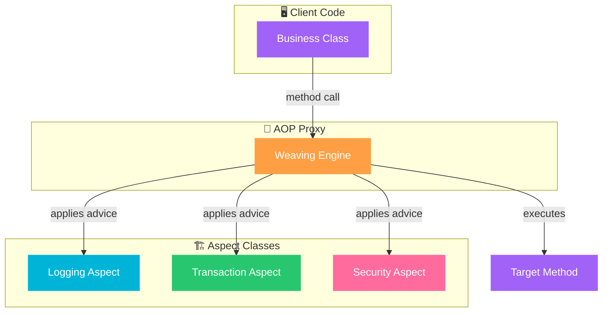
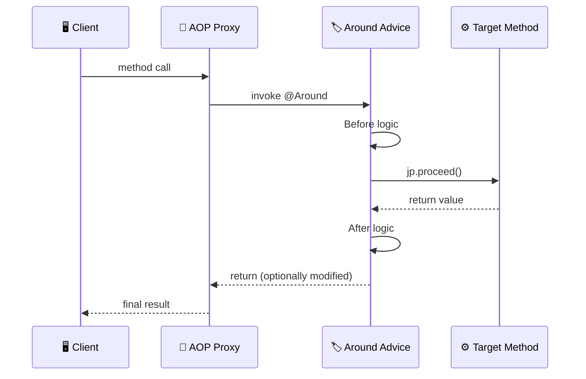

# Spring AOP using AspectJ

**Spring AOP using AspectJ** | AOP stands for Aspect Oriented Programming. Why do we use Spring AOP? For cross-cutting concerns. Let us see it in detail.

- [AOP Terminologies](#1-aop-terminologies)
- [Pointcut](#2-pointcut)
- [Spring AOP Example](#3-spring-aop-example)
- [More Examples of Spring AOP](#4-more-examples-of-spring-aop)
- [Spring Boot AOP – Around Advice Example](#5-spring-boot-aop-around-advice-example)
- [Conditional Execution of Advice](#6-conditional-execution-of-advice)
- [Spring Boot AOP Interview Questions](#7-spring-boot-aop-interview-questions)

---

## 1. AOP Terminologies

🧠 **Cross-cutting concern:** Move additional services of a project into other classes (services class/Aspect classes) and bind them when and where they are required.



| Term 🏷️ | Annotation ⚙️ | Description 📋 |
|----------|--------------|----------------|
| **Aspect** | `@Aspect` | A class that provides additional services like transaction management, logging, security, encoding, decoding, etc. |
| **Advice** | — | A method inside the Aspect class. It is the actual implementation of Aspect. There are 5 types of advice. |
| **Pointcut** | `@Pointcut` | An expression that selects the business method that needs advice. It can never specify what advice. It looks like a method header. |
| **JoinPoint** | — | The combination of advices and pointcut. It connects business class methods with required advice. |
| **Target** | — | Business class object where advice will be applied. |
| **Weaving** | — | Using JDK dynamic proxy, a new class is generated containing both business method and connected advice. It is a process of mixing business class methods and their connected advice. |
| **Proxy** | — | The final output (class/object) that contains both logic connected. |

### Types of Advice

| Advice Type 🏷️ | Annotation ⚙️ | When It Executes 🔄 |
|----------------|--------------|---------------------|
| **Before** | `@Before` | Executing advice before calling the business method. |
| **After** | `@After` | Executing advice after the business method is finished. |
| **Around** | `@Around` | Advice code split into 2 parts — 1st part executes before, then business method, then 2nd part. |
| **After Returning** | `@AfterReturning` | After executing the business method, only on success execute advice. |
| **After Throwing** | `@AfterThrowing` | After executing the business method, if the business method throws any exception then execute advice. |

🛠️ **Example Aspect class:**

```java
@Aspect
public class TxnService {

    @Pointcut("execution(public * com.app.ProductDao.*(...))")
    public void p1() {}

    @Before("p1()") // JoinPoint
    public void beginTx() {
        // ...
    }
}
```

### Difference Between @After, @AfterReturning, @AfterThrowing

- 🔄 **`@After`** — Executed next to the business method without caring whether it was executed successfully or failed.
- ✅ **`@AfterReturning`** — Executed only on successful execution of the business method.
- 🚨 **`@AfterThrowing`** — Executed only on failure (Exception) execution of the business method.

### How to Implement the AOP Concept

It can be implemented in 2 ways:

- 📜 Spring AOP using XML Based Configuration (legacy style)
- 🏷️ **Spring AOP using AspectJ (Annotations based)**

---

## 2. Pointcut

- 📖 A pointcut is an expression that selects the business class method that needs advice.
- ⚠️ Pointcut can never specify which advice is going to be connected.

🔧 **Pointcut Syntax:**

`Specifier ReturnType Package.ClassName.MethodName(ParameterTypes)`

📝 **Note:** Allowed symbols in pointcut expression: `*` (star), `.` (dot)

### Pointcut Expression Examples

| # | Expression 🛠️ | Meaning 📋 |
|---|---------------|-----------|
| 1 | `public int com.kp.dao.EmployeeDao.saveEmployee(Employee)` | The `saveEmployee()` method having parameter `Employee` with return type `int` of type public, defined in class `EmployeeDao` from `com.kp.dao` package is selected to connect with advice. |
| 2 | `public * com.kp.dao.EmployeeDao.*()` | Zero parameters only (no parameter). Any method name inside the `EmployeeDao` class. Any return type. |
| 3 | `public * com.kp.dao.EmployeeDao.*(..)` | Two dots mean zero or more params (of any type), therefore any parameter is fine. |
| 4 | `public * com.kp.dao.*.*(..)` | All classes inside the `com.kp.dao` package and their methods. |
| 5 | `* com.kp.dao.*.*(..)` | Any return type and any accessibility modifier. |

Let us understand it in detail through an example.

**Business Methods:**

- M#1 `public int saveEmployee(Employee e) { ... }`
- M#2 `public void deleteEmployee(Integer id) { ... }`
- M#3 `public void updateEmployee(Employee e) { ... }`
- M#4 `public Employee getEmployee(Integer id) { ... }`

### Matching Examples

| # | Expression 🛠️ | Explanation 📋 | Methods Matched 🔍 |
|---|---------------|---------------|-------------------|
| a | `public * *()` | Zero params, any method name, any return type | ❌️ None (zero) |
| b | `public void *(..)` | Two dots inside method param indicates any number/type of parameters | ✅ 2 → M#2 & M#3 |
| c | `public * saveEmployee(..)` | Matches `saveEmployee` with any params | ✅ 1 → M#1 |
| d | `public * *(Integer)` | Any method with single `Integer` parameter | ✅ 2 → M#2 & M#4 |

---

## 3. Spring AOP Example

Create a Spring Starter project `SpringBootAOPEx`. Add the following dependency:

**Dependencies** (`pom.xml`):

```xml
<dependency>
    <groupId>org.springframework.boot</groupId>
    <artifactId>spring-boot-starter-aop</artifactId>
</dependency>
```

Let us see a very basic example.

1️⃣ **Business class (`EmployeeDao`):**

```java
package com.example.demo;

import org.springframework.stereotype.Component;

// business class
@Component
public class EmployeeDao {
    public void saveEmployee() {
        System.out.println("EmployeeDao.saveEmployee()");
    }
}
```

2️⃣ **Runner class (`TestRunner`):**

```java
package com.example.demo;

import org.springframework.beans.factory.annotation.Autowired;
import org.springframework.boot.CommandLineRunner;
import org.springframework.stereotype.Component;

@Component
public class TestRunner implements CommandLineRunner {

    @Autowired
    EmployeeDao dao;

    @Override
    public void run(String... args) throws Exception {
        dao.saveEmployee();
    }

}
```

📤 **Output** (when we run the application):

```
EmployeeDao.saveEmployee()
```

Now, without modifying `EmployeeDao` and `TestRunner` classes we want to execute some tasks before the `saveEmployee()` method call. To do that:

1. In the starter class, add `@EnableAspectJAutoProxy`
2. Create an Aspect as follows and do not forget to add `@Component` to the class

3️⃣ **Aspect class (`TxnService`):**

```java
package com.example.demo;

import org.aspectj.lang.annotation.Aspect;
import org.aspectj.lang.annotation.Before;
import org.aspectj.lang.annotation.Pointcut;
import org.springframework.stereotype.Component;

@Aspect
@Component
public class TxnService {

    @Pointcut("execution(public void com.example.demo.EmployeeDao.saveEmployee())")
    public void p1() {
    }

    @Before("p1()") // JoinPoint
    public void beginTxn() {
        System.out.println("Txn Begin");
    }
}
```

📤 **Output** (after adding the aspect):

```
Txn Begin
EmployeeDao.saveEmployee()
```

💡 **Tip:** The same can be done using an inline pointcut expression without a separate `@Pointcut` method:

```java
@Aspect
@Component
public class TxnService {

    @Before("execution(public String com.example.demo.EmployeeDao.*())")
    public void beforeTxn() {
        System.out.println("Txn Begin");
    }

}
```

---

## 4. More Examples of Spring AOP

1️⃣ **Business class with random exception (`EmployeeDao`):**

```java
package com.example.demo;

import java.util.Random;

import org.springframework.stereotype.Component;

// business class
@Component
public class EmployeeDao {
    public void saveEmployee() {
        System.out.println("EmployeeDao.saveEmployee()");

        if (new Random().nextInt(15) <= 5) {
            throw new RuntimeException("Dummy Exception");
        }
    }
}
```

2️⃣ **Aspect class with all advice types (`TxnService`):**

```java
package com.example.demo;

import org.aspectj.lang.annotation.After;
import org.aspectj.lang.annotation.AfterReturning;
import org.aspectj.lang.annotation.AfterThrowing;
import org.aspectj.lang.annotation.Aspect;
import org.aspectj.lang.annotation.Before;
import org.aspectj.lang.annotation.Pointcut;
import org.springframework.stereotype.Component;

@Aspect
@Component
public class TxnService {

    @Pointcut("execution(public void com.example.demo.EmployeeDao.saveEmployee())")
    public void p1() {
    }

    @Before("p1()")
    public void beginTxn() {
        System.out.println("Txn Begin");
    }

    @AfterReturning("p1()")
    public void commitTxn() {
        System.out.println("Txn is committed");
    }

    @AfterThrowing("p1()")
    public void rollbackTxn() {
        System.out.println("Txn is rollback");
    }

    @After("p1()")
    public void sendReport() {
        System.out.println("Report sent");
    }
}
```

📤 **Output (in case of failure):**

```
Txn Begin
EmployeeDao.saveEmployee()
Txn is rollback
Report sent
```

📤 **Output (in case of success):**

```
Txn Begin
EmployeeDao.saveEmployee()
Txn is committed
Report sent
```

🔑 **Key Point:** The `@After` will always execute whether the business method is executed successfully or failed.

### Accessing Exception Info in Advice

We can display the exception info in advice:

```java
@AfterThrowing(value = "p1()", throwing = "th")
public void rollbackTxn(Throwable th) {
    System.out.println("Txn is rollback: " + th.getMessage());
}
```

### Accessing Return Value in Advice

Similarly, if the business method returns something, we can get that in advice.

**Modified business class:**

```java
@Component
public class EmployeeDao {
    public String saveEmployee() {
        // existing code
        return "Hello";
    }
}
```

The `saveEmployee()` method is returning a string therefore the pointcut should also have `String` return type execution.

**Modified aspect class:**

```java
@Aspect
@Component
public class TxnService {

    @Pointcut("execution(public String com.example.demo.EmployeeDao.saveEmployee())")
    public void p1() {
    }

    @AfterReturning(value = "p1()", returning = "ob")
    public void commitTxn(Object ob) {
        System.out.println("Txn is committed: " + ob);
    }
}
```

📤 **Output:**

```
EmployeeDao.saveEmployee()
Txn is committed: Hello
```

---

## 5. Spring Boot AOP – Around Advice Example



1️⃣ **Business class (`EmployeeDao`):**

```java
@Component
public class EmployeeDao {
    public String saveEmployee() {
        System.out.println("EmployeeDao.saveEmployee()");
        return "Hello";
    }
}
```

2️⃣ **Aspect class with `@Around` advice (`TxnService`):**

```java
package com.example.demo;

import org.aspectj.lang.ProceedingJoinPoint;
import org.aspectj.lang.annotation.Around;
import org.aspectj.lang.annotation.Aspect;
import org.aspectj.lang.annotation.Pointcut;
import org.springframework.stereotype.Component;

@Aspect
@Component
public class TxnService {

    @Pointcut("execution(* com.example.demo.EmployeeDao.*())")
    public void p1() {
    }

    @Around("p1()")
    public void aroundTest(ProceedingJoinPoint jp) {
        System.out.println("Before business method");

        // call business method
        try {
            Object obj = jp.proceed();
            System.out.println("Return data: " + obj);
            // on success
        } catch (Throwable e) {
            // on failures
            e.printStackTrace();
        }

        System.out.println("After business method");
    }

}
```

📤 **Output:**

```
Before business method
EmployeeDao.saveEmployee()
Return data: Hello
After business method
```

📝 **Note:** From advice, we need to call the business method by using joinpoint details, i.e., `ProceedingJoinPoint`. It has a method `proceed()` that makes a call to the business method. It even returns the value given by the business method.

### Returning Value to the Controller

We can even return the value to the controller. If the method is called from the controller, then `@Around` can suppress the return value from the service. But we can return that from the advice as follows:

```java
@Around("p1()")
public String aroundTest(ProceedingJoinPoint jp) {
    System.out.println("Before business method");
    // Call business method
    try {
        String obj = (String) jp.proceed();
        System.out.println("Return data: " + obj);
        // On success
        return obj;
    } catch (Throwable e) {
        // On failures
        e.printStackTrace();
    }
    System.out.println("After business method");
    return null;
}
```

### Modifying the Return Value

Since the return value is going through `@Around`, the return value can be modified:

```java
try {
    String obj = (String) jp.proceed();
    obj = obj + " - Modified data";
    System.out.println("Return data: " + obj);
    // on success
} catch (Throwable e) {
    // on failures
    e.printStackTrace();
}
```

### Passing Parameters to Proceed

We can even pass some parameters to the proceeding method, but that method should accept the parameter:

```java
try {
    Employee[] empArr = new Employee[1];
    Employee dummyEmp = new Employee();
    dummyEmp.setName("Dumy");
    empArr[0] = dummyEmp;
    String s = (String) jp.proceed(empArr);
}
```

### Calling Business Method Multiple Times

We can even call the method multiple times:

```java
// call business method
try {
    String obj = (String) jp.proceed();
    jp.proceed();
    jp.proceed();
    System.out.println("Return data: " + obj);
    // on success
} catch (Throwable e) {
    // on failures
    e.printStackTrace();
}
```

---

## 6. Conditional Execution of Advice

💡 **Requirement:** If the business method contains `@MyTx` annotation then only call the advice. **This is the most regularly used concept.**

1️⃣ **Create a custom annotation:**

```java
package com.example.demo.anno;

import java.lang.annotation.ElementType;
import java.lang.annotation.Retention;
import java.lang.annotation.RetentionPolicy;
import java.lang.annotation.Target;

@Retention(RetentionPolicy.RUNTIME)
@Target(ElementType.METHOD)
public @interface MyTx {
}
```

2️⃣ **Business class with `@MyTx` annotation:**

```java
package com.example.demo;

import org.springframework.stereotype.Component;

import com.example.demo.anno.MyTx;

// business class
@Component
public class EmployeeDao {

    @MyTx
    public String saveEmployee() {
        System.out.println("EmployeeDao.saveEmployee()");
        return "Hello";
    }
}
```

3️⃣ **Aspect using `@annotation` pointcut:**

In advice, while declaring pointcut use `@annotation`:

```java
package com.example.demo;

import org.aspectj.lang.annotation.Aspect;
import org.aspectj.lang.annotation.Before;
import org.aspectj.lang.annotation.Pointcut;
import org.springframework.stereotype.Component;

@Aspect
@Component
public class TxnService {

    @Pointcut("@annotation(com.example.demo.anno.MyTx)")
    public void p1() {
    }

    @Before("p1()")
    public void beforeTxn() {
        System.out.println("Before Txn");
    }

}
```

📤 **Output:**

```
Before Txn
EmployeeDao.saveEmployee()
```

---

## 7. Spring Boot AOP Interview Questions

### 1. What is AOP?

- 📖 Aspect Oriented Programming (AOP) is a programming paradigm aiming to segregate cross-cutting functionalities, such as logging/caching, from business logic in an application.
- 🏗️ Spring Boot application is mainly divided into three layers:
  - 🌐 Web Layer for exposing the services using RESTful web services (Controller).
  - ⚙️ Business layer to handle business logic.
  - 💾 Data Layer for data persistence logic.
- 🔀 Each layer has a different responsibility and some common aspects apply to all layers. e.g. Logging, Security, Validation, etc. Common aspects are also called cross-cutting concerns.
- 🛡️ Spring AOP has interceptors that can intercept applications and their methods.

### 2. What are AOP Terminologies?

- 🏷️ **Aspect** — A class in which we define Pointcuts and Advices.
- ⚙️ **Advice** — The behavior that addresses system-wide concerns (logging, security checks, etc.). This behavior is represented by a method to be executed at a JoinPoint. This behavior can be executed Before, After, or Around the JoinPoint according to the Advice type.
- 🎯 **Pointcut** — An expression that defines at what JoinPoints a given Advice should be applied.
- 🔗 **JoinPoint** — A point in the execution flow of a method where an Aspect (new behavior) can be plugged in.

### 3. What are the Types of Advice in AspectJ AOP?

| Advice Type 🏷️ | Description 📋 |
|----------------|----------------|
| **`@Before`** | Advice that executes before a join point, but which cannot prevent execution flow from proceeding to the join point (unless it throws an exception). |
| **`@AfterReturning`** | Advice to be executed after a join point completes normally. |
| **`@AfterThrowing`** | Advice to be executed if a method exits by throwing an exception. |
| **`@After`** | Advice to be executed regardless of how a join point exits (normal or exceptional return). |
| **`@Around`** | Advice that surrounds a join point such as a method invocation. |

🔑 **Key Points about `@Around` Advice:**

- 🏷️ The first parameter of the advice method must be of type `ProceedingJoinPoint`.
- ▶️ Within the body of the advice, calling `proceed()` on the `ProceedingJoinPoint` causes the underlying method to execute.
- 📦 The proceed method may also be called passing in an `Object[]` — the values in the array will be used as the arguments to the method execution when it proceeds.
- 🔄 **The value returned by the around advice will be the return value seen by the caller of the method.**
- 🧊 A simple caching aspect for example could return a value from a cache if it has one and invoke `proceed()` if it does not.
- ⚠️ Note that `proceed` may be invoked once, many times, or not at all within the body of the around advice — all of these are quite legal.

### 4. Provide an Example of When You Have Used Spring AOP in Your Project

In my project, I leveraged Spring AOP concepts while implementing global exception handling using `@ControllerAdvice`.

The `@ControllerAdvice` annotation provides a centralized mechanism to handle exceptions and add global data across all controllers in a Spring application. This approach aligns with the principles of Aspect-Oriented Programming (AOP), where cross-cutting concerns such as exception handling are separated into reusable components (aspects).

By using `@ControllerAdvice`, I created an aspect that handles exceptions, thus avoiding the need to write repetitive exception-handling code in each controller. Below is a sample implementation:

**Global Exception Handler:**

```java
import org.springframework.web.bind.annotation.ControllerAdvice;
import org.springframework.web.bind.annotation.ExceptionHandler;
import org.springframework.http.ResponseEntity;
import org.springframework.web.context.request.WebRequest;

@ControllerAdvice
public class GlobalExceptionHandler {

    @ExceptionHandler(Exception.class)
    public ResponseEntity<String> handleAllExceptions(Exception ex, WebRequest request) {
        return ResponseEntity.status(500).body("An error occurred: " + ex.getMessage());
    }
}
```

✅ **Benefits:**

- 🎯 **Centralized Exception Handling** — All exception-handling logic is centralized in one class, making it easier to manage and update.
- 🔄 **Reuse and Maintainability** — This approach enhances code reuse and maintainability by avoiding repetitive code across multiple controllers.
- 🏗️ **Alignment with AOP** — By separating the exception-handling concern into an aspect (`@ControllerAdvice`), it aligns well with AOP principles, promoting modularity and separation of concerns.

> 🧠 **In Summary:** `@ControllerAdvice` effectively creates an aspect for handling exceptions, demonstrating a practical use of AOP concepts in Spring.
