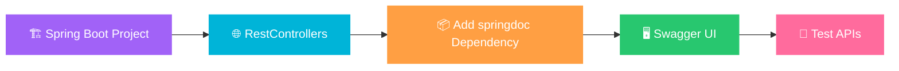
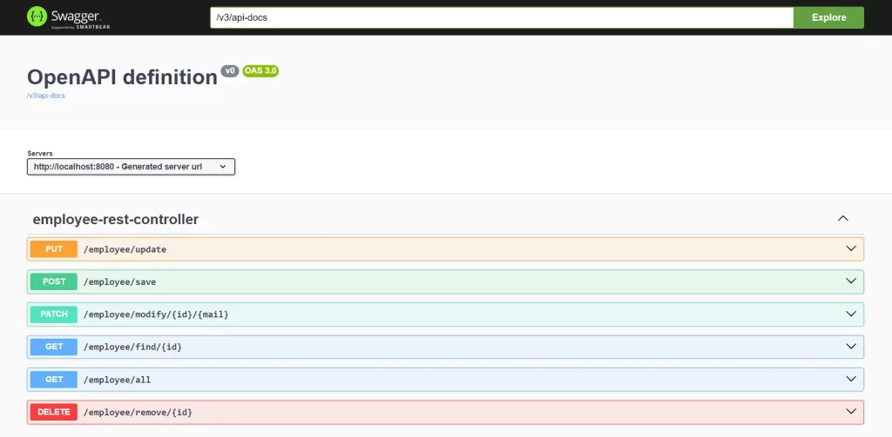
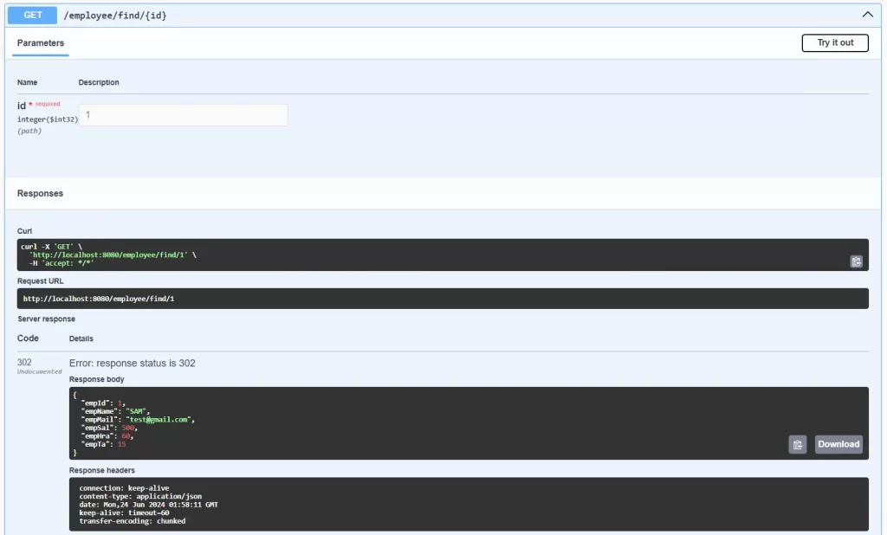
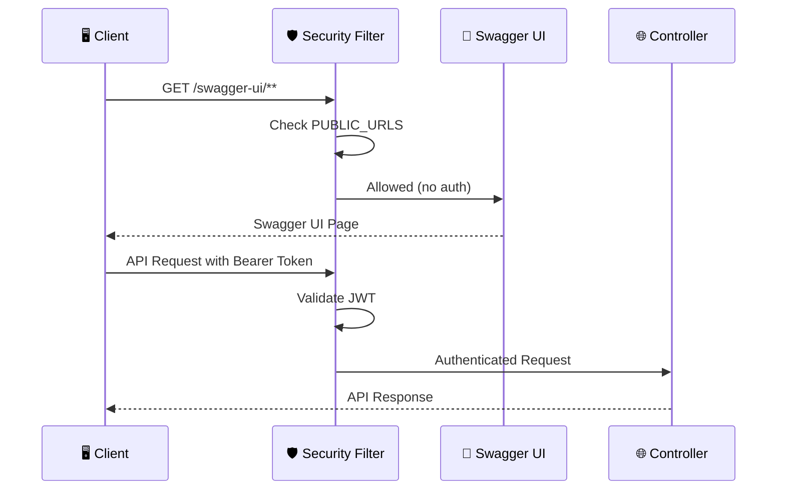

# Swagger with Spring Boot REST

**Swagger with Spring Boot REST** | An advanced API testing and documentation tool integrated with Spring Boot REST controllers using OpenAPI 3.0.

- [Introduction](#1-introduction)
- [Swagger vs POSTMAN](#2-swagger-vs-postman)
- [Swagger Configuration in Spring Boot REST](#3-swagger-configuration-in-spring-boot-rest)
- [Controller with Swagger Annotations](#4-controller-with-swagger-annotations)
- [Spring Security](#5-spring-security)

---

## 1. Introduction

**POSTMAN** is a fully manual tool for testing REST controllers — you must enter all details yourself: URL, method type, parameters, JSON input, header details, etc.

For a small application this is manageable, but for a large application (say 40 controllers, each with `save`, `update`, `delete`, `get` methods), manually tracking all URLs, types, and inputs becomes complex and time-consuming.

**Swagger** is an advanced test tool compared to POSTMAN. It provides an easy UI for testing all RestControllers in the project.

🧠 **In Simple Words:**
With Swagger, you do not need to enter the URL or choose the method type manually. You only need to enter input data — Swagger auto-discovers everything from your controllers.

---

## 2. Swagger vs POSTMAN

| Feature | POSTMAN 🅰️ | Swagger 🅱️ |
|---------|-----------|-----------|
| **URL Entry** | ❌️ Manual — type full URL | ✅ Auto-discovered from controllers |
| **Method Type** | ❌️ Manual selection | ✅ Auto-detected from annotations |
| **Input Data** | ❌️ Manual JSON/params entry | ✅ Only input data needed |
| **Controller Discovery** | ❌️ Must list all endpoints | ✅ Scans all `@RestController` classes |
| **Documentation** | ❌️ Separate effort | ✅ Built-in API documentation |
| **Large Applications** | ⚠️ Complex and time-consuming | ✅ Scales effortlessly |
| **Adds Functionality** | ❌️ No | ❌️ No — testing and docs only |

---

## 3. Swagger Configuration in Spring Boot REST



1️⃣ **Define a Spring Boot project** with RestControllers.

2️⃣ **Add the `springdoc-openapi-starter-webmvc-ui` dependency:**

Maven (`pom.xml`):

```xml
<dependency>
    <groupId>org.springdoc</groupId>
    <artifactId>springdoc-openapi-starter-webmvc-ui</artifactId>
    <version>2.3.0</version>
</dependency>
```

Gradle (`build.gradle`):

```groovy
implementation 'org.springdoc:springdoc-openapi-starter-webmvc-ui:2.3.0'
```

> 📝 **Note:** See why not to use `springfox-swagger2` and `springfox-swagger-ui` dependencies: [StackOverflow — springfox javax.servlet issue](https://stackoverflow.com/questions/71549614/springfox-type-javax-servlet-http-httpservletrequest-not-present)

💡 **Tip:** No additional configuration is needed — no `Docket` bean, no controller package path. It works out of the box.

3️⃣ **Access the Swagger UI** at: **http://localhost:8080/swagger-ui/index.html**



⚠️ **Caution:** Swagger does not add any functionality to your application. It works only to make testing easy.



---

## 4. Controller with Swagger Annotations

The following controller demonstrates Swagger annotations like `@Tag`, `@Operation`, `@ApiResponses`, and `@Schema` applied to a standard CRUD REST controller.

| Annotation 🏷️ | Purpose 📋 |
|---------------|-----------|
| `@Tag` | Groups endpoints under a named section in Swagger UI |
| `@Operation` | Describes a single API operation (summary + description) |
| `@ApiResponses` | Defines possible HTTP response codes and their meanings |
| `@ApiResponse` | Single response code definition with content schema |
| `@Schema` | Specifies the model class used in request/response body |
| `@Content` | Defines the media type and schema of a response |

**EmployeeController:**

```java
@Tag(name = "Employee", description = "Employee Management APIs")
@RestController
@RequestMapping("/emp")
public class EmployeeController {

    @Autowired
    EmployeeService employeeService;

    /**
     * POST - /emp
     *
     * Save Employee
     *
     * @param employee
     * @return
     */
    @Operation(summary = "Save Employee", description = "Create a new employee")
    @ApiResponses(value = {
        @ApiResponse(responseCode = "201", description = "Employee created",
                content = @Content(mediaType = "application/json",
                schema = @Schema(implementation = Employee.class))),
        @ApiResponse(responseCode = "400", description = "Invalid input")
    })
    @PostMapping
    public ResponseEntity<Employee> save(@RequestBody Employee employee) {
        return new ResponseEntity<>(employeeService.save(employee), HttpStatus.CREATED);
    }

    /**
     * PUT - /emp/{id}
     *
     * Update Employee
     *
     * @param employee
     * @return
     */
    @Operation(summary = "Update Employee", description = "Update an existing employee")
    @ApiResponses(value = {
        @ApiResponse(responseCode = "200", description = "Employee updated",
                content = @Content(mediaType = "application/json",
                schema = @Schema(implementation = Employee.class))),
        @ApiResponse(responseCode = "404", description = "Employee not found")
    })
    @PutMapping("{id}")
    public ResponseEntity<Employee> update(@RequestBody Employee employee, @PathVariable Long id) {
        return new ResponseEntity<>(employeeService.update(employee, id), HttpStatus.OK);
    }

    /**
     * GET - /emp
     *
     * Get All Employees
     *
     * @return
     */
    @Operation(summary = "Get All Employees", description = "Retrieve all employees")
    @ApiResponses(value = {
        @ApiResponse(responseCode = "200", description = "Employees retrieved",
                content = @Content(mediaType = "application/json",
                schema = @Schema(implementation = Employee.class)))
    })
    @GetMapping
    public ResponseEntity<List<Employee>> getAllEmployees() {
        return ResponseEntity.ok(employeeService.getAll());
    }

    /**
     * GET - /emp/{id}
     *
     * Get Employee by ID
     *
     * @param id
     * @return
     */
    @Operation(summary = "Get Employee by ID",
            description = "Retrieve an employee by their ID")
    @ApiResponses(value = {
        @ApiResponse(responseCode = "200", description = "Employee retrieved",
                content = @Content(mediaType = "application/json",
                schema = @Schema(implementation = Employee.class))),
        @ApiResponse(responseCode = "404", description = "Employee not found")
    })
    @GetMapping("/{id}")
    public ResponseEntity<Employee> getEmployeeById(@PathVariable Long id) {
        return ResponseEntity.ok(employeeService.findById(id));
    }

    /**
     * DELETE - /emp/{id}
     *
     * Delete Employee by ID
     *
     * @param id
     * @return
     */
    @Operation(summary = "Delete Employee by ID",
            description = "Delete an employee by their ID")
    @ApiResponses(value = {
        @ApiResponse(responseCode = "202", description = "Employee deleted"),
            @ApiResponse(responseCode = "404", description = "Employee not found") })
    @DeleteMapping("/{id}")
    public ResponseEntity<Void> deleteEmployeeById(@PathVariable Long id) {
        employeeService.deleteById(id);
        return new ResponseEntity<>(HttpStatus.ACCEPTED);
    }
}
```

🔗 **GitHub Link:** [Spring Rest Swagger Example](https://github.com/Know-Program/Spring-Boot-Examples/tree/main/CRUDSwaggerUI)

---

## 5. Spring Security

When using Swagger with Spring Security, you need two things: a Swagger configuration class with security metadata, and security filter chain updates to allow Swagger URLs.



1️⃣ **Swagger Configuration class** with `@OpenAPIDefinition` and `@SecurityScheme`:

```java
package com.example.demo.config;

import io.swagger.v3.oas.annotations.OpenAPIDefinition;
import io.swagger.v3.oas.annotations.enums.SecuritySchemeIn;
import io.swagger.v3.oas.annotations.enums.SecuritySchemeType;
import io.swagger.v3.oas.annotations.info.Contact;
import io.swagger.v3.oas.annotations.info.Info;
import io.swagger.v3.oas.annotations.info.License;
import io.swagger.v3.oas.annotations.security.SecurityRequirement;
import io.swagger.v3.oas.annotations.security.SecurityScheme;

@OpenAPIDefinition(
   info = @Info(
        title = "Know Program",
        description = "This API is for User Info",
        summary = "API Contains Summary Info",
        termsOfService = "https://www.knowprogram.com/terms-and-conditions/",
        contact = @Contact(
                name="Rocco Jerry",
                email="info@knowprogram.com",
                url="https://www.knowprogram.com"
        ),
        license = @License(name="KnowProgram License"),
        version = "API/V1"
   ),
   security = @SecurityRequirement(name="KnowProgramSecurity")
)
@SecurityScheme(
        name="KnowProgramSecurity",
        in = SecuritySchemeIn.HEADER,
        type = SecuritySchemeType.HTTP,
        bearerFormat = "Berear ",
        description = "This is My Basic Security"
)
public class SwaggerConfig {
}
```

2️⃣ **Security Config** — allow `"/v3/api-docs/**"` and `"/swagger-ui/**"` URLs:

```java
public static final String[] PUBLIC_URLS = {
     "/user/save", "/user/login",

     // swagger related URLs
     "/v3/api-docs/**", "/swagger-ui/**",
};

@Bean
SecurityFilterChain securityFilterChain(HttpSecurity http) throws Exception {
     return http
        .csrf(csrf -> csrf.disable())
        .authorizeHttpRequests(auth -> {
            auth.requestMatchers(PUBLIC_URLS).permitAll()
            .anyRequest().authenticated();
        })
        // other
        .build();
}
```

🔗 **GitHub Code:** [SpringSecurityJWTMySQLSwagger](https://github.com/Know-Program/Spring-Boot-Examples/tree/main/SpringSecurityJWTMySQLSwagger)

> ⚠️ **Caution:** Swagger 2 doesn't seem to support authentication properly — see [httpAuth HTTP authentication: unsupported scheme 'token'](https://github.com/softwaremill/realworld-tapir-zio/issues/110). It suggests using Swagger solely for documentation purposes and sending requests via Postman for authenticated endpoints.
