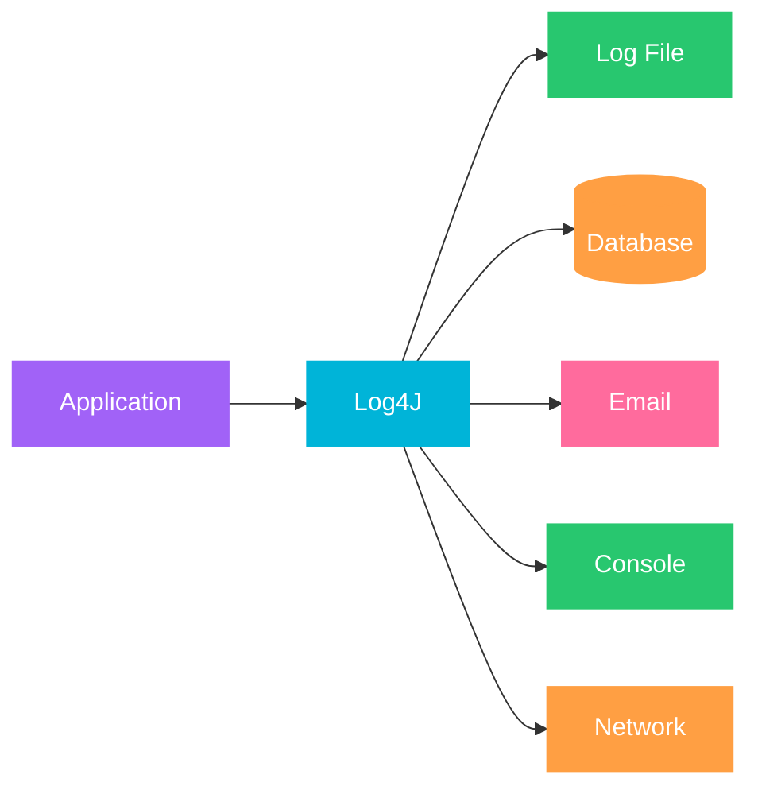
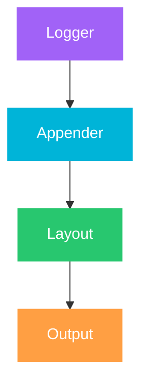
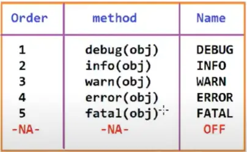
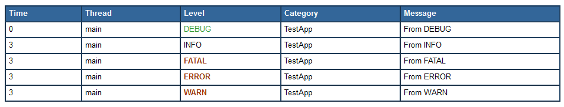

# Logging using Log4J in Java

**Logging using Log4J in Java** | Understanding logging concepts, Log4J components, configuration, and integration with files, databases, and email.

- [Introduction to Logging](#1-introduction-to-logging)
- [Log4J](#2-log4j)
- [Log4J Components](#3-log4j-components)
- [Priority Methods](#4-priority-methods)
- [Log4J Example](#5-log4j-example)
- [PatternLayout](#6-patternlayout)
- [log4j.properties File](#7-log4jproperties-file)
- [Log4J with Database](#8-log4j-with-database)
- [Log4J with Email](#9-log4j-with-email)

---

## 1. Introduction to Logging

Based on all the setups where the application is running is called an environment. There are different types of environments:

- 🖥️ **DEV** — Development
- 🧪 **QA** — Testing
- 👤 **UAT** — User Acceptance Test
- 🚀 **Production** — Live environment

When we run the application then it gives various types of messages in the console in the IDE (STS/Eclipse) like success, error/exception, and warning messages. If suddenly any problem arises then we go to the console and try to understand the potential issue by observing those messages.

But the console can display only the last 100/200 messages only. It is temporary and not available in all environments. To overcome this limitation we can use Logging tools.

🧠 **In Simple Words:**
Logging is a process of getting/fetching success, warning, errors/exceptions messages from the server while it is running.

---

## 2. Log4J

Log4J is a tracing or logging tool used especially in the production environment for Java applications. By using Log4J, we can get log messages and store them in the file (log file)/database/network or send them to the mail. Using a log file is the most common practice. The extension of the log file is `.log`. By using log files, the dev/support teams identify the mistake and fix the code.

Not every class will give exceptions or any messages therefore they do not need Log4J. For example, the Model/Entity class contains only variable, and setter/getter methods, and they won't provide any message.

Log4J provides error details like exception type, class, and method with line number it occurred, date, time, and other information. It also supports writing errors to the console. Using `System.out.println` prints messages only on the console, but not to the file or any other memory.



---

## 3. Log4J Components

Log4J has 3 components:

- 📋 **Logger** — For which class do you want to enable logging?
- 📂 **Appender** — Where to print the message.
- 🎨 **Layout** — How to print the message.



### Logger

This object must be created inside the class as an instance variable for which Log4J is required. Example: Controllers, Services, etc. need Log4J. If we get any exceptions/errors inside these classes then we can trace them into the log file.

> ⚠️ **Caution:** Do not create a logger object if we don't want to log for a class. Not every class will give exceptions or any messages therefore they do not need Log4J. For example, the Model/Entity class contains only variable, and setter/getter methods, and they won't provide any message.

**Logger declaration:**

```java
public static Logger log = Logger.getLogger(TestApp.class);
```

Logger is used to enable Log4J service to the current class. If this object is not created in the class then the Log4J concept will not be applicable (will not work) for that class. It has 5 priority methods: `debug()`, `info()`, `warn()`, `error()`, `fatal()`.



### Appender

The Appender is an interface. Appender is used to specify where to store log messages. It has various implementation classes.

| Destination 📂 | Appender Class 🏷️ |
|----------------|-------------------|
| **File** | `FileAppender` |
| **Database** | `JdbcAppender` |
| **Email** | `SmtpAppender` |
| **Console** | `ConsoleAppender` |
| **Network** | `Ftp/TelnetAppender` |

📝 **Note:** Among these `FileAppender` is most commonly used. In one application we can use more than one appender also.

### Layout

It provides a message format that should be printed. Different layouts:

- 📄 **SimpleLayout** — Print the message as it is given by the application.
- 🌐 **HTMLLayout** — Print the message in HTML format.
- 📑 **XMLLayout** — Print message as XML output.
- 🎨 **PatternLayout** — Print message as given pattern by the programmer.

💡 **Tip:** Among these `PatternLayout` is most commonly used.

---

## 4. Priority Methods

It specifies which kinds of messages we are printing, and they are executed in priority order. These are pre-defined methods given inside the Logger object. By using these methods, we have to print messages at Appender.

| Priority 🔢 | Name 🏷️ | Method 🛠️ |
|-------------|---------|-----------|
| **1** | DEBUG | `debug(msg)` |
| **2** | INFO | `info(msg)` |
| **3** | WARN | `warn(msg)` |
| **4** | ERROR | `error(msg)` |
| **5** | FATAL | `fatal(msg)` |
| **N/A** | OFF | N/A |

- ✅ **`debug()`** — This method is used to print a final success message. Example: Employee created with ID-EMP-3652 successfully.
- ℹ️ **`info()`** — This method is used to print the current status in execution. Example: Request came to controller layer, object sent to the service layer, service returned to the controller, try block execution completed, process state-1 done, if block end, email sent, etc.
- ⚠️ **`warn()`** — This method is used to print warning messages. Example: File object is created but never closed, variable is created but not used, Collection is not with Generic, etc.
- 🚨 **`error()`** — This method is used to print exception messages. Example: `NullPointerException`, `ArrayIndexOutOfBoundsException`. Example message: Application ID is null and can not be processed.
- 💥 **`fatal()`** — This method is used to print very high-level problems/exceptions that stop application usage. Example: Database connection is not working, network server/middleware server/API gateway is down, Connection timeout, Network broke, etc.

`OFF` is used to disable the Log4J concept in the application. Log4J code need not be deleted.

---

## 5. Log4J Example

Create a simple Maven project "LogApp". Add Log4J dependencies in the `pom.xml` file.

**Dependencies:**

Maven (`pom.xml`):

```xml
<dependencies>
    <dependency>
        <groupId>log4j</groupId>
        <artifactId>log4j</artifactId>
        <version>1.2.17</version>
    </dependency>
</dependencies>
```

Gradle (`build.gradle`):

```groovy
implementation 'log4j:log4j:1.2.17'
```

**Main class (`TestApp.java`):**

```java
import org.apache.log4j.Appender;
import org.apache.log4j.ConsoleAppender;
import org.apache.log4j.Layout;
import org.apache.log4j.Logger;
import org.apache.log4j.SimpleLayout;

public class TestApp {
    public static Logger log = Logger.getLogger(TestApp.class);

    public static void main(String[] args) {
        // create layout
        Layout layout = new SimpleLayout();
        // Layout layout = new HTMLLayout();
        // Layout layout = new XMLLayout();

        // create appender + link layout
        Appender appender = new ConsoleAppender(layout);
        // link appender with logger
        log.addAppender(appender);

        // print message
        log.debug("From DEBUG");
        log.info("From INFO");
        log.fatal("From FATAL");
        log.error("From ERROR");
        log.warn("From WARN");
    }

}
```

📤 **Output:**

```
DEBUG – From DEBUG
INFO – From INFO
FATAL – From FATAL
ERROR – From ERROR
WARN – From WARN
```

Below is the output if we use `HTMLLayout()` for layout.



One of the most common layouts is `PatternLayout`. Example:

**PatternLayout usage:**

```java
Layout layout = new PatternLayout("%p %d %C %M %m %n");
```

📤 **Output:**

```
DEBUG 2024-07-19 16:28:06,975 TestApp main From DEBUG
INFO 2024-07-19 16:28:06,981 TestApp main From INFO
FATAL 2024-07-19 16:28:06,981 TestApp main From FATAL
ERROR 2024-07-19 16:28:06,981 TestApp main From ERROR
WARN 2024-07-19 16:28:06,981 TestApp main From WARN
```

To store data in a log file we can use `FileAppender` as follows:

**FileAppender usage:**

```java
Appender appender = new FileAppender(layout, "mylogs/data.log");
```

> ⚠️ **Warning:** If no appender is provided to the logger object then Log4J throws a warning as `WARN no appenders could be found for the logger`.

---

## 6. PatternLayout

This class provides an output pattern for a message that contains the date, time, class, method, line number, thread name, message, etc. Observe some example patterns given below:

| Symbol 🏷️ | Description 📋 |
|-----------|---------------|
| `%C` | Class Name |
| `%M` | Method Name |
| `%m` | Message |
| `%p` | Priority method name (DEBUG, INFO, etc.) |
| `%L` | Line number |
| `%l` | Line number with the link |
| `%n` | New Line (next line) |
| `%r` | Time taken to execute current method/block in milliseconds |
| `%%` | To print one `%` symbol |
| `%d` | Date and Time Pattern |

**Date pattern examples:**

```properties
%d
%d{dd-MMM-yy hh:mm:ss SSS}
%d{dd-MM-yy hh:mm:ss SSS}
%d{HH:mm:ss}
```

Here the meaning of every word used in the date pattern:

| Symbol 🔤 | Meaning 📖 |
|-----------|-----------|
| `dd` | Date |
| `MMM` | Month name |
| `MM` | Month number |
| `yy` | Year last two digits |
| `YYYY` | Year in 4 digits |
| `hh` | Hours in 12-hour format |
| `HH` | Hours in 24-hour format |
| `mm` | Minutes |
| `ss` | Seconds |
| `SSS` | Milliseconds |

We can also use symbols like `[]`, `/`. If we use any symbol except `%` then that symbol will be printed as it is.

🛠️ **Example patterns:**

- `"%d-%C[%M] : {%p}=%m<%L>%n"`
- `"%p %d{dd-MM-yy hh:mm} - %C[%M] %L %m %n"`

---

## 7. log4j.properties File

In real time we don't create Layout and Appender objects in every required class. Instead, we place them in the properties file in the `src/main/resources` folder. The file name is called `log4j.properties`.

This file is used to specify all the configuration details of Log4J especially Appender details and Layout details with Patterns and root logger details. This file contains details in key=value format. Data will be shown in the below order:

1. rootLogger
2. Appenders
3. Layouts

🔧 **Configuration (`log4j.properties`):**

```properties
# root logger details
log4j.rootLogger=DEBUG,stdout

# redirect log message to console
log4j.appender.stdout=org.apache.log4j.ConsoleAppender
log4j.appender.stdout.Target=System.out
log4j.appender.stdout.layout=org.apache.log4j.PatternLayout
log4j.appender.stdout.layout.ConversionPattern=%p %d{dd-MM-yy hh:mm} - %C[%M] %L %m %n
```

🔑 **Key Points:**

- 📋 The `log4j.properties` file is detected by the Log4J tool. No manual coding is required.
- 📂 We can specify multiple appenders in the `log4j.properties` file like 2 FileAppender, 1 JdbcAppender, 1 SmtpAppender, etc.
- 🔗 Every Appender must be connected with the layout.
- 🏷️ The appender name must be defined before use at the rootLogger level.
- ✏️ The appender's name can be anything. Example: abc, hello, sysout, file, db, email, etc.
- 📁 `log4j.properties` file must be created under the `src` folder (normal project) or `src/main/resources` folder (Maven project).
- 🚫 We can make `rootLogger=OFF` to disable Log4J completely without deleting code in any class or properties file.
- ⚙️ Every key starts with `log4j`.

In the properties file, we have used rootLogger as `DEBUG` whose priority is 1, therefore, all priority method messages will be displayed. If we use rootLogger as `INFO` in which the priority order is 2 then it will display all priority method messages except for DEBUG because the priority of DEBUG is low compared to INFO. If we use rootLogger as `FATAL` whose priority is 5 then it will display only the `fatal()` method message because it has the highest priority.

💡 **Tip:** `INFO` is the most common rootLogger. In the Spring Boot framework also, `INFO` is the default rootLogger.

**Multiple appenders configuration (`log4j.properties`):**

```properties
# root logger
log4j.rootLogger=INFO,myout,myfile

# Appender + Layout details
log4j.appender.myout=org.apache.log4j.ConsoleAppender
# Target is only applicable for ConsoleAppender
log4j.appender.myout.Target=System.out
log4j.appender.myout.layout=org.apache.log4j.PatternLayout
log4j.appender.myout.layout.ConversionPattern=%p %d{dd-MM-yy hh:mm} - %C[%M] %L %m %n

log4j.appender.myfile=org.apache.log4j.FileAppender
log4j.appender.myfile.File=mylogs/file1.log
log4j.appender.myfile.layout=org.apache.log4j.PatternLayout
log4j.appender.myfile.layout.ConversionPattern=%p %d{dd-MM-yy hh:mm} - %C[%M] %L %m %n
```

📝 **Note:** Through the above Log4J configuration log messages will be displayed in the console and also the `mylogs/file1.log` file. When we run the application multiple times then content in the log file will be appended but not overridden.

---

## 8. Log4J with Database

Create a database `logdb` in MySQL database and create a LOGS table as follows.

**SQL setup:**

```sql
create database logdb;
use logdb;
CREATE TABLE LOGS(
    METHOD VARCHAR(20) NOT NULL,
    DATED DATETIME NOT NULL,
    LOGGER VARCHAR(50) NOT NULL,
    LEVEL VARCHAR(10) NOT NULL,
    MESSAGE VARCHAR(1000) NOT NULL
);
```

**MySQL dependency:**

Maven (`pom.xml`):

```xml
<dependency>
    <groupId>com.mysql</groupId>
    <artifactId>mysql-connector-j</artifactId>
    <version>8.3.0</version>
</dependency>
```

Gradle (`build.gradle`):

```groovy
implementation 'com.mysql:mysql-connector-j:8.3.0'
```

🔧 **Configuration (`log4j.properties`):**

```properties
log4j.rootLogger=DEBUG,db
log4j.appender.db=org.apache.log4j.jdbc.JDBCAppender
log4j.appender.db.driver=com.mysql.cj.jdbc.Driver
log4j.appender.db.URL=jdbc:mysql://localhost:3306/logdb
log4j.appender.db.user=root
log4j.appender.db.password=root
log4j.appender.db.layout=org.apache.log4j.PatternLayout
log4j.appender.db.sql=INSERT INTO LOGS VALUES('%M', now(), '%C', '%p', '%m')
```

📤 **Output (after running the application):**

```sql
mysql> select * from logs;
+--------+---------------------+---------+-------+------------+
| METHOD | DATED               | LOGGER  | LEVEL | MESSAGE    |
+--------+---------------------+---------+-------+------------+
| main   | 2024-07-21 07:08:56 | TestApp | DEBUG | From DEBUG |
| main   | 2024-07-21 07:08:56 | TestApp | INFO  | From INFO  |
| main   | 2024-07-21 07:08:56 | TestApp | WARN  | From WARN  |
| main   | 2024-07-21 07:08:56 | TestApp | ERROR | From ERROR |
| main   | 2024-07-21 07:08:56 | TestApp | FATAL | From FATAL |
+--------+---------------------+---------+-------+------------+
5 rows in set (0.00 sec)
```

---

## 9. Log4J with Email

**Sample email configuration (`log4j.properties`):**

```properties
log4j.rootLogger=DEBUG,email
log4j.appender.email=org.apache.log4j.net.SMTPAppender
log4j.appender.email.SMTPHost=smtp.gmail.com
log4j.appender.email.SMTPUsername=test@gmail.com
log4j.appender.email.SMTPPassword=password
log4j.appender.email.From=example@gmail.com
log4j.appender.email.To=to@gmail.com
log4j.appender.email.Subject=Log Messages
log4j.appender.email.Threshold=DEBUG
log4j.appender.email.layout=org.apache.log4j.PatternLayout
log4j.appender.email.layout.ConversionPattern=%p %d{dd-MM-yy hh:mm} - %C[%M] %L %m %n
```

Add dependencies for `Java Mail`. Right-click on the project => Run as => Run configuration. Enter the below key=value in VM arguments:

`-Dmail.smtp.starttls.enable=true`
