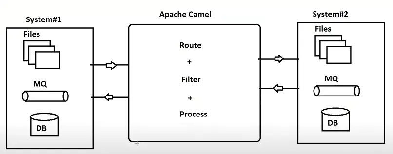
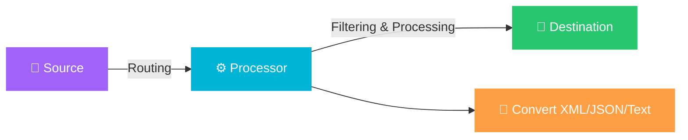
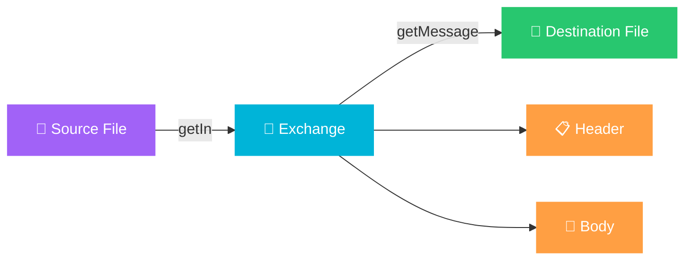
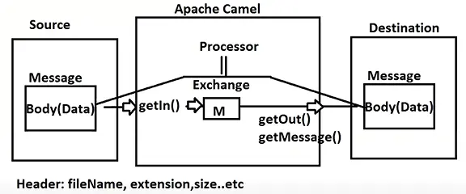

# Apache Camel with Spring Boot

**Apache Camel with Spring Boot** | Apache Camel is an open-source integration framework that transfers data between systems.

- [Apache Camel Overview](#1-apache-camel-overview)
- [Apache Camel with Spring Boot Example](#2-apache-camel-with-spring-boot-example)
- [Dynamic Configuration from Properties](#3-dynamic-configuration-from-properties)
- [Processing Data Using Apache Camel](#4-processing-data-using-apache-camel)
- [Processor with Lambda Expression](#5-processor-with-lambda-expression)

---

## 1. Apache Camel Overview

Apache Camel is an open-source integration framework that transfers data between systems.

- 🌐 It supports multiple protocols like HTTP, FTP, FILE, JMS, etc.
- 💻 It supports different languages Hadoop, PHP, Python, etc.
- 📄 We can transfer data in different formats XML, JSON, Text, etc.



Apache Camel supports 3 types of operations:

| Operation 🏷️ | Purpose 📋 |
|--------------|-----------|
| **Routing** | Transfer data from source to destination |
| **Filtering** | Check condition before transfer |
| **Processing** | Modify/convert (like XML to JSON), calculations, etc. |



Apache Camel coding is done using EIP (Enterprise Integration Pattern). Apache Camel can be used as replacement of the Spring Batch or it can be used as integration to the Spring Batch. For example, if we have log files in the production server and we want to copy them to the dev server then we can take the help of Apache Camel, and there is no Spring Batch processing required. ActiveMQ and Kafka support message queues only, but Apache Camel also supports cross-connectivity.

---

## 2. Apache Camel with Spring Boot Example

1️⃣ **Create a Spring Starter project** and add the following dependency: `Apache Camel`.

**Dependencies:**

Maven (`pom.xml`):

```xml
<dependency>
    <groupId>org.apache.camel.springboot</groupId>
    <artifactId>camel-spring-boot-starter</artifactId>
    <version>4.6.0</version>
</dependency>
```

Gradle (`build.gradle`):

```groovy
implementation 'org.apache.camel.springboot:camel-spring-boot-starter:4.6.0'
```

Spring Boot supports auto-configuration with Apache Camel using `camel-spring-boot-starter` starter.

2️⃣ **Create the RouteBuilder class:**

`org.apache.camel.builder.RouteBuilder` is an abstract class and contains an abstract method `configure()` method. We have to create a class extending `org.apache.camel.builder.RouteBuilder` and override `configure()` method.

🧠 **In Simple Words:**
Assume we have a `data.txt` file in a source folder (`V:\source`), and we want to transfer it to another destination folder (`V:\destination`). To do this we have to use File protocol and EIP (Enterprise Integration Pattern) pattern.

**Input file** (`data.txt`):

```text
Know Program
```

**Router class:**

```java
package com.knowprogram.demo.router;

import org.apache.camel.builder.RouteBuilder;
import org.springframework.stereotype.Component;

@Component
public class MyDataRoute extends RouteBuilder {

    @Override
    public void configure() throws Exception {
        from("file:V:\\source").to("file:V:\\destination");
    }
}
```

🔧 **Configuration** (`application.properties`):

```properties
camel.springboot.main-run-controller=true
```

📝 **Note:** The `camel.springboot.main-run-controller=true` property specifies when the main method started then Apache Camel should also start. When the main method is stopped then Apache Camel should also stop.

📤 **Output:**

On execution the following things happen:

- 📂 Create a folder "source" in V drive.
- 📂 Create a folder "destination" in F drive.
- 📋 Copy files from the source folder to the destination folder.
- 🗄️ Place the original `data.txt` file inside a hidden folder `.camel` in the source folder as a backup.

The application won't stop itself. While running the application, if we place any file in the source folder then immediately it will be copied to the destination folder and the file inside the source folder will be placed inside the `.camel` folder as a backup. The process will continue till we stop the application.

💡 **Tip:** Generally, it is used to transfer log files from production to dev server. If there is a change in the source folder log file then Apache Camel will copy it to the destination folder by overriding the existing log file. It won't create another file, rather it will override.

🔑 **Key Points:**

- ⚙️ In the `configure()` method: `from("file:V:\\source").to("file:V:\\destination")` indicates sending files from `V:/source` to `V:/destination` folder.
- 🗂️ All files are taken as backups in the source as the `.camel` folder.
- 🔄 We can send the same file again with new data, that overrides at the destination.

### Using NOOP Option

```java
from("file:V:\\source?noop=true").to("file:V:\\destination")
```

- 🛡️ Here NOOP represents No Operation to Override.
- 📂 No backup into `.camel` in the source folder.
- ❌️ It avoids sending duplicates.

---

## 3. Dynamic Configuration from Properties

If we want to change source/destination or NOOP dynamically then instead of hardcoding the values in the class we can read them from the `application.properties` file as follows:

🔧 **Configuration** (`application.properties`):

```properties
camel.springboot.main-run-controller=true
my.app.source=file:V:/source?noop=true
my.app.destination=file:V:/destination
```

We can either use `@Value` to read the data from the properties file or we can use them directly through `{{}}`.

**Router class:**

```java
package com.knowprogram.demo.router;

import org.apache.camel.builder.RouteBuilder;
import org.springframework.stereotype.Component;

@Component
public class MyDataRoute extends RouteBuilder {

    @Override
    public void configure() throws Exception {
        from("{{my.app.source}}").to("{{my.app.destination}}");
    }
}
```

📝 **Note:** Here `{{my.app.source}}` indicates the dynamic location is taken from the properties file.

---

## 4. Processing Data Using Apache Camel

If we just want to transfer the files then the router is sufficient but if we want any data conversion or calculations then processing is also required along with the router.

🏗️ **Processor provides:**

- 🔄 Data Conversions (like Text to JSON, XML to JSON, LOG to HTML, etc.)
- 🧮 Data Calculations

The `org.apache.camel.Processor` interface provides an abstract method: `void process(Exchange exchange) throws Exception`. This interface indicates data modification/operations are going to be applied to source data.

**Code style reference:**

```java
// Anonymous inner class
new InterfaceName() {
   // override abstract method
}

// lambda expression
Interface ob = (methodParam) -> { methodBody };
```

### Exchange and Message Interfaces

The `org.apache.camel.Exchange` is also an interface having methods: `getIn()`, `getOut()`, `getMessage()` etc. It supports reading source Messages using the `getIn()` method and supports writing destination messages using the method `getOut()`/`getMessage()`.

The `org.apache.camel.Message` is an interface having methods: `getHeader()`, `getBody()`, `setBody()` etc. It indicates the data source/destination (file). The message contains mainly two parts:

- 📋 **Header:** File information (filename, file Extension, etc.)
- 📄 **Body:** Actual data inside the file.





### Data Conversion Example

📥 **Input** (`source.txt`):

```text
10,A,3.3
```

📤 **Expected Output** (`emp.json`):

```json
{eid:10, ename:A, esal:3.3}
```

🔧 **Configuration** (`application.properties`):

```properties
camel.springboot.main-run-controller=true
my.app.source=file:V:/source?noop=true
my.app.destination=file:V:/destination?fileName=emp.json
```

**Router class (Anonymous Inner Class):**

```java
package com.knowprogram.demo.router;

import java.util.StringTokenizer;

import org.apache.camel.Exchange;
import org.apache.camel.Message;
import org.apache.camel.Processor;
import org.apache.camel.builder.RouteBuilder;
import org.springframework.stereotype.Component;

@Component
public class MyDataRoute extends RouteBuilder {

    @Override
    public void configure() throws Exception {
        from("{{my.app.source}}").process(new Processor() {
            @Override
            public void process(Exchange exchange) throws Exception {
                // read input message given by source
                Message input = exchange.getIn();

                // read body as String from input message
                String data = input.getBody(String.class);

                // operation
                StringTokenizer str = new StringTokenizer(data, ",");
                String eid = str.nextToken();
                String ename = str.nextToken();
                String esal = str.nextToken();

                // output data
                String modifiedData = "{eid: " + eid + ", ename: "
                            + ename + ", esal: " + esal + "}";

                // read output message Reference
                // Message output = exchange.getOut(); // deprecated
                Message output = exchange.getMessage();

                // set data to Message
                output.setBody(modifiedData);
            }
        }).to("{{my.app.destination}}");
    }
}
```

---

## 5. Processor with Lambda Expression

Instead of using an anonymous inner class, we can use lambda expression as follows:

**Router class (Lambda Expression):**

```java
package com.knowprogram.demo.router;

import java.util.StringTokenizer;

import org.apache.camel.Message;
import org.apache.camel.builder.RouteBuilder;
import org.springframework.stereotype.Component;

@Component
public class MyDataRoute extends RouteBuilder {

    @Override
    public void configure() throws Exception {
        from("{{my.app.source}}").process((exchange) -> {
            // read input message given by source
            Message input = exchange.getIn();

            // read body as String from input message
            String data = input.getBody(String.class);

            // operation
            StringTokenizer str = new StringTokenizer(data, ",");
            String eid = str.nextToken();
            String ename = str.nextToken();
            String esal = str.nextToken();

            // output data
            String modifiedData = "{eid: " + eid + ", ename: " +
                            ename + ", esal: " + esal + "}";

            // read output message Reference
            // Message output = exchange.getOut(); // deprecated
            Message output = exchange.getMessage();

            // set data to Message
            output.setBody(modifiedData);
        }).to("{{my.app.destination}}");
    }
}
```

> 💡 **Tip:** Lambda expressions are preferred over anonymous inner classes as they are more concise and readable. Use them when the `Processor` interface has a single abstract method.

---
