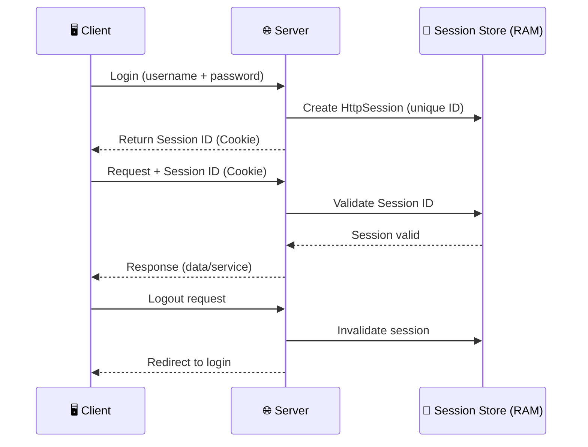
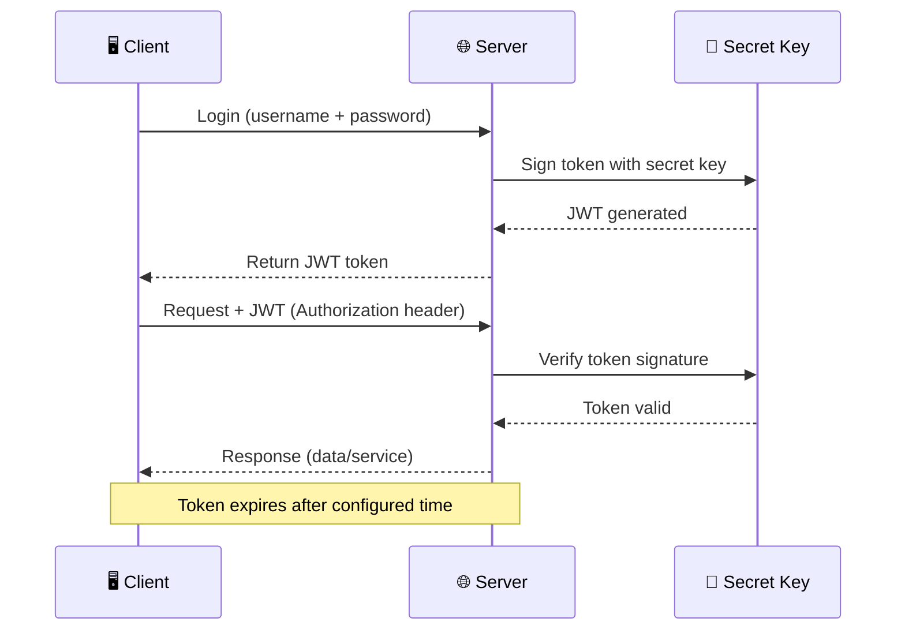
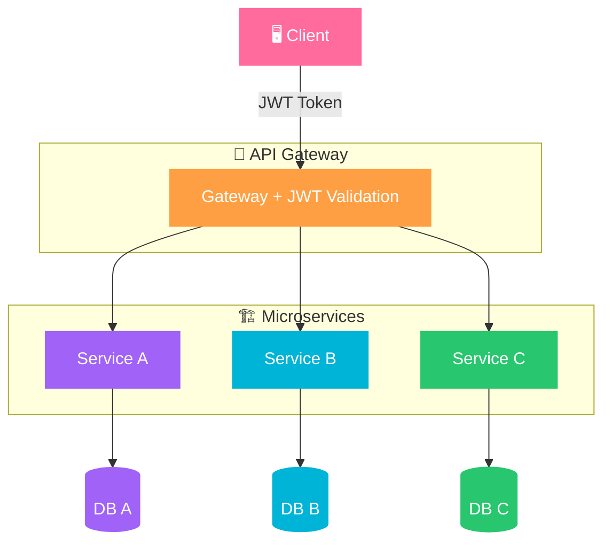

# Stateful and Stateless Authentication

**Stateful and Stateless Authentication** | Client-Server Authentication can be done in 2 ways.

- [Stateful Authentication](#1-stateful-authentication)
- [Stateless Authentication](#2-stateless-authentication)
- [Uses of Stateful vs Stateless Authentication](#3-uses-of-stateful-vs-stateless-authentication)
- [Summary](#4-summary)

---

## 1. Stateful Authentication

Client-Server Authentication can be done in 2 ways:

- 🗄️ **Stateful Authentication** — It works on `HttpSession`. It will create one HTTP Session on the server side when the client is authenticated. One `sessionId` is provided and the same is sent to the client using the response as one Cookie client machine, for the next request onwards, submits Cookie to the server, then the server verifies and provides service, until logout. On click of logout, the session will be invalidated.
- 🔑 **Stateless Authentication (JWT Token)** — It will never create any memory on the server side. For client authentication, one unique number is generated called TOKEN. Token can be created using `secretKey` and even generated token can be read using `secretKey`. This generated token is sent to the client machine using Response. The client has to send a token using the request for 2nd request onwards. The token is valid only for some time.

Stateful authentication is a method where the server maintains session information about the user. This is typically done using `HttpSession` in web applications.

**Stateful Authentication Process:**

1️⃣ **Client Login Request** — The client sends a login request with the username and password to the server.

2️⃣ **Server Validation** — The server validates the credentials. If valid, it creates an `HttpSession` with a unique ID and stores session data in memory (RAM).

3️⃣ **Session Returned to Client** — The server returns the session ID to the client, typically stored in a cookie.

4️⃣ **Client Sends Session with Requests** — For subsequent requests, the client includes the session ID in the request header from the cookie.

5️⃣ **Server Validates Session** — The server checks if the session ID matches the stored session. If it matches, the request is processed.

6️⃣ **Logout and Session Invalidation** — When the client logs out, the server invalidates/destroys the session (using `invalidate()`), and the client is typically redirected to the login page.

---

## 2. Stateless Authentication

Stateless authentication, often referred to as token-based authentication, is a method where the server does not maintain any session information about the user. Instead, all the necessary information to authenticate a user is stored in a token, which is sent with each request. Here's how it works:

**Stateless Authentication Process:**

1️⃣ **Client Login Request** — The client sends a login request with the username and password to the server.

2️⃣ **Server Validation** — The server validates the credentials. If valid, it generates a token (e.g., JWT -- JSON Web Token) that contains all the necessary information about the user, such as user ID, roles, and expiration time. The token will be in encoded format.

3️⃣ **Token Returned to Client** — The server sends this token back to the client.

4️⃣ **Client Stores Token** — The client stores the token, typically in local storage or a cookie.

5️⃣ **Client Sends Token with Requests** — For subsequent requests, the client includes the token in the HTTP headers (usually in the `Authorization` header).

6️⃣ **Server Validates Token** — The server validates the token by checking its signature and expiration. If valid, the server processes the request.

7️⃣ **Token Expiry** — Every token will expire about a period of time.

✅ **Advantages of Stateless Authentication:**

- 📈 **Scalability** — Since the server does not need to store session information, it can easily scale horizontally.
- ⚡ **Performance** — Reduces the load on the server as it does not need to manage the session state.
- 🔗 **Interoperability** — Tokens can be used across different domains and services, making them suitable for microservices architectures.

### Role of Secret Key in Token Generation

The **secret key** is a crucial part of the token generation and validation process, especially when using JWT (JSON Web Tokens). Here's how it works:

- 🔏 **Token Generation** — When the server generates a token, it uses the secret key to sign the token. This ensures that the token cannot be tampered with. The secret key is known only to the server and is never shared with the client.
- 🔍 **Token Validation** — When the server receives a token from the client, it uses the same secret key to verify the token's signature. If the token has been altered in any way, the signature will not match, and the token will be considered invalid.

---

## 3. Uses of Stateful vs Stateless Authentication

Both stateful and stateless authentication are used in real-time applications, each suited to different scenarios based on the requirements and architecture of the application. The stateless authentication is mainly used at:

- 🌐 Webservices Authentication (server to server)
- 📈 Horizontal scaling (microservices)
- 🔓 Resource Grant (Open Authorization/OAuth)

Here's a detailed description of when and why each type is used:

| Feature | Stateful 🅰️ | Stateless 🅱️ |
|---------|-------------|--------------|
| **Session Storage** | Server-side (RAM) | No server storage (Token) |
| **Scalability** | ❌️ Hard to scale horizontally | ✅ Easy horizontal scaling |
| **Performance** | ⚠️ Session lookup per request | ✅ Token verified locally |
| **Use Case** | Traditional web apps | REST APIs, Microservices, OAuth |
| **Memory Usage** | ❌️ Consumes server memory | ✅ No server memory needed |
| **Control** | ✅ Centralized session control | ⚠️ Token cannot be revoked easily |
| **Implementation** | ✅ Simpler to implement | ⚠️ Requires token management |

### Stateful Authentication Scenarios

**Scenario** — General Web Applications

- 📖 **Description** — Stateful authentication is commonly used in traditional web applications where the server maintains session information about the user. This is typically done using `HttpSession`.
- 🛠️ **Use Case** — Suitable for applications where maintaining session state on the server is feasible and desirable, such as e-commerce websites, content management systems, and internal enterprise applications.

✅ **Advantages:**

- 💡 **Simplicity** — Easier to implement and understand.
- 🛡️ **Centralized Control** — The server has full control over the session data, making it easier to manage user sessions and enforce security policies.

❌️ **Disadvantages:**

- 📈 **Scalability** — Maintaining a session state on the server can be resource-intensive and challenging to scale horizontally.
- 🗄️ **Resource Consumption** — Each session consumes server memory, which can become a bottleneck in high-traffic applications.

### Stateless Authentication Scenarios

**Scenario 1** — Web Services Authentication (Server to Server)

- 📖 **Description** — Stateless authentication is ideal for web services where servers communicate with each other. Each request from the client must contain all the information needed to process the request, typically in the form of a token (e.g., JWT).
- 🛠️ **Use Case** — Suitable for RESTful APIs, where each request is independent, and the server does not need to maintain a session state.
- ⚡ **Scalability** — Easier to scale horizontally as the server does not need to maintain a session state.
- 🚀 **Performance** — Reduces the load on the server as it does not need to manage the session state.

**Scenario 2** — Horizontal Scaling (Microservices)

- 📖 **Description** — In a microservices architecture, stateless authentication is preferred because it allows each microservice to be stateless and independently scalable.
- 🛠️ **Use Case** — Suitable for applications built using microservices, where each service can independently validate tokens without relying on a central session store.
- 📈 **Scalability** — Each microservice can scale independently.
- 🔗 **Decoupling** — Services are decoupled from each other, making the system more resilient and easier to maintain.

**Scenario 3** — Resource Grant (Open Authorization/OAuth)

- 📖 **Description** — OAuth is a stateless authentication protocol used for resource grant scenarios, where a user grants a third-party application access to their resources without sharing their credentials.
- 🛠️ **Use Case** — Suitable for scenarios where users need to authorize third-party applications to access their data, such as social media integrations, single sign-on (SSO), and API access.
- 🔒 **Security** — Users do not need to share their credentials with third-party applications.
- 🔀 **Flexibility** — Tokens can be used across different domains and services.

---

## 4. Summary

- 🗄️ **Stateful Authentication** — Best for traditional web applications where maintaining the session state on the server is feasible.
- 🔑 **Stateless Authentication** — Best for web services, microservices, and scenarios requiring resource grants (OAuth).

✅ **Benefits of Stateless Authentication:**

- 💾 The stateless concept never allocates any memory to the server.
- 🏗️ It is good for Distributed Applications.

❌️ **Limitations of Stateless Authentication:**

- ⚠️ The token must be validated on every request.
- 🚨 If the token is shared with others then they can also access the client data/services.
