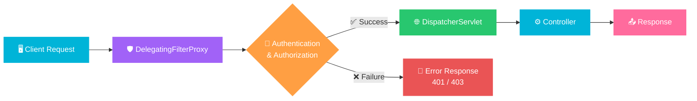
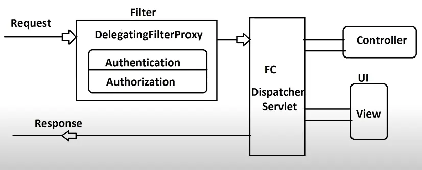
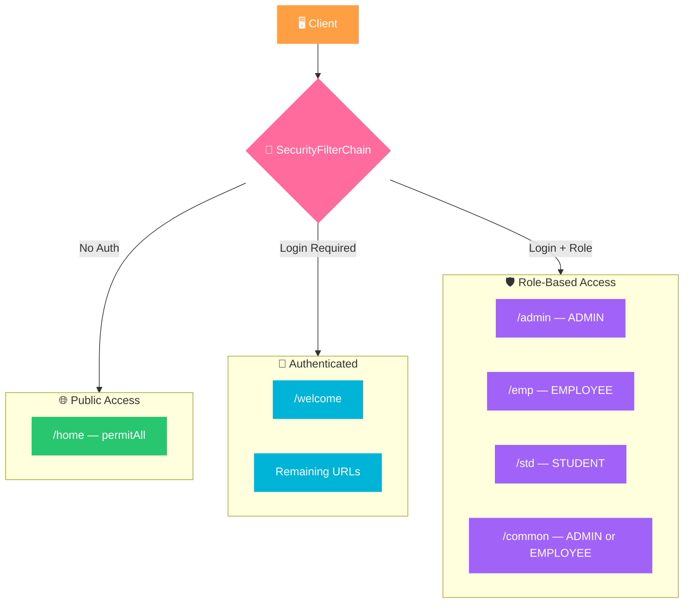

# Spring Boot Security

**Spring Boot Security** | Security is applied through the JAAS concept (Java Authentication and Authorization Service) using Spring Security's filter-based architecture.

- [Authentication vs Authorization](#1-authentication-vs-authorization)
- [How Security Works in Spring](#2-how-security-works-in-spring)
- [Authorization Type](#3-authorization-type)
- [HttpStatus Codes](#4-httpstatus-codes)
- [API Details](#5-api-details)
- [PasswordEncoder](#6-passwordencoder)
- [requestMatchers()](#7-requestmatchers)
- [anyRequest()](#8-anyrequest)
- [Types of Authentication](#9-types-of-authentication)
- [InMemoryUserDetailsManager Example](#10-inmemoryuserdetailsmanager-example)

---

## 1. Authentication vs Authorization

Authentication and authorization are two fundamental concepts in security, often used together but serving different purposes.

🔐 **Authentication:**

- 🎯 **Purpose:** Verifies the identity of a user or system.
- ⚙️ **Process:** Involves checking credentials like usernames, passwords, biometrics, or security tokens.
- 🛠️ **Example:** When you log into a website using your username and password, the system checks if your credentials match its records to confirm your identity.

🛡️ **Authorization:**

- 🎯 **Purpose:** Determines what resources or actions the authenticated user is allowed to access.
- ⚙️ **Process:** Involves setting permissions and access levels for different resources.
- 🛠️ **Example:** After logging in, you might have access to your account settings but not to the admin panel, which is restricted to users with higher privileges.

🧠 **In Simple Words:**

- 🔐 Authentication is about **verifying identity** — "Who are you?"
- 🛡️ Authorization is about **granting permissions** — "What can you do?"
- 1️⃣ Authentication always comes **before** authorization. You must first prove your identity before the system can decide what you are allowed to do.

**Example — Bank Application:**

All people have to login through username/password to use the application — this process is called **Authentication**. The application has different types of roles like Manager, Clerk, and User. Based on the role they can perform different actions:

- 👤 **User:** View Balance, Open FD/RD, Transfer Money, etc.
- 👔 **Manager:** Approve loans, View Employees, View Branch Information, etc.
- 🏦 **Clerk:** Deposits/Withdraws, print statements, etc.

Accessing different resources or actions based on the role is the process of **Authorization**. In Spring, Authentication and Authorization is applied using **Spring Security**.

| Feature | Authentication 🔐 | Authorization 🛡️ |
|---------|-------------------|-------------------|
| **Question** | Who are you? | What can you do? |
| **Verifies** | Identity (credentials) | Permissions (roles) |
| **Mechanism** | Username/Password, tokens, biometrics | Roles, access levels, policies |
| **Order** | ✅ First | ✅ Second (after authentication) |
| **HTTP Error** | 401 Unauthorized | 403 Forbidden |

---

## 2. How Security Works in Spring

Spring web application internally uses Servlet.

- 🔗 `Filter(I) [javax.servlet]` — It is used to execute **PRE-PROCESSING** logic over the request object (before going to servlet) and **POST-PROCESSING** logic over the response object (after coming from Servlet). Only PRE-PROCESSING or POST-PROCESSING is also possible.
- 🛡️ `DelegatingFilterProxy(C) [org.springframework.web.filter]` — This is a predefined filter given by Spring Security. It implements `Filter(I) [javax.servlet]`. It will process the request for JAAS.



All security is implemented using a concept filter through `DelegatingFilterProxy` which will do authentication and authorization services. Then control goes to `DispatcherServlet` to process the request. `DispatcherServlet` gives a response — either success or failure.



---

## 3. Authorization Type

When we develop any application then not all pages need security. For example: Login page, Create new account page, Contact page, About Us page. These pages should be accessible to everyone without Authorization. Few pages can be accessed after login but every logged-in user can access that, and role validation is not required. Example: profile-edit page, settings page.

| Authorization Type 🛡️ | Description 📋 | Example URLs 🌐 |
|------------------------|---------------|-----------------|
| **`permitAll`** | No security is required to access the page/path | `/login`, `/home`, `/contactUs` |
| **`authenticated`** | Login is required, but no role is required | `/inbox`, `/settings`, `/edit-profile` |
| **`hasRole`** | Login required + matching role required | `/approveLoan` + Manager, `/blockUser` + Admin |
| **`hasAnyRole`** | Login required + any matching role is required | `/showBankStatement` + Manager/Clerk |

---

## 4. HttpStatus Codes

| Scenario 🔍 | HTTP Status Code 📡 | Meaning |
|-------------|---------------------|---------|
| **URL is `authenticated` type, invalid username/password** | `401` Unauthorized | 🔐 Identity verification failed |
| **URL is `hasRole` type, login success but role not matching** | `403` Forbidden | 🛡️ Insufficient permissions |

---

## 5. API Details

In recent versions of Spring Security, specifically starting from version **5.7.0-M2**, the `WebSecurityConfigurerAdapter` class has been **deprecated**. This change encourages a more component-based approach to configuring security.

Instead of extending `WebSecurityConfigurerAdapter`, you now define security configurations using beans:

- 👤 Define a **`UserDetailsService`** Bean — This bean sets up user details for authentication.
- 🔗 Define a **`SecurityFilterChain`** Bean — This bean configures the HTTP security (authorization).

📝 **Note:** Create a Spring Boot starter project with Spring Security dependencies.

**SecurityConfig class:**

```java
@Configuration
@EnableWebSecurity
public class SecurityConfig {

    @Bean
    PasswordEncoder passwordEncoder() {
        return new BCryptPasswordEncoder();
    }

    @Bean
    SecurityFilterChain securityFilterChain(HttpSecurity http) throws Exception {
        http.authorizeHttpRequests(authorizeRequests -> authorizeRequests
                .anyRequest()
                .authenticated()
             )
             .formLogin(form -> form
                .loginPage("/login")
                .permitAll()
             );
        return http.build();
    }

    @Bean
    UserDetailsService userDetailsService(PasswordEncoder passwordEncoder) {
        UserDetails user = User.builder()
                .username("user")
                .password(passwordEncoder.encode("password"))
                .roles("USER", "ADMIN")
                .build();
        return new InMemoryUserDetailsManager(user);
    }
}
```

🔧 **SecurityFilterChain configuration options:**

```java
@Bean
SecurityFilterChain securityFilterChain(HttpSecurity http) throws Exception {
    // URL AccessTypes
    // Login Form Details
    // Logout Details
    // Exception Details
}
```

---

## 6. PasswordEncoder

- 🔒 **Encode:** Convert readable data into unreadable format. Example: `Hello` => `hign%53jhv4`
- 🔓 **Decode:** Encoded data converted back into readable format. Example: `hign%53jhv4` => `Hello`

The password in the database will be saved after encoding through `PasswordEncoder(I)`. `PasswordEncoder` is an interface given by Spring Security. `PasswordEncoder` has many implementation classes, and `BCryptPasswordEncoder` is one of them which uses the **BCrypt strong hashing function**.

🔑 **Key Point:** In Spring Security programming `PasswordEncoder` must be provided. `PasswordEncoder` is used to store end-user passwords in the database in an unreadable format.

| Implementation Class 🏷️ | Purpose 📋 | Status |
|--------------------------|-----------|--------|
| **`BCryptPasswordEncoder`** | Converts passwords using BCrypt hashing | ✅ Recommended |
| **`NoOpPasswordEncoder`** | Stores password in plain text (no encoding) | ⚠️ Deprecated |

> ⚠️ **Warning:** To avoid password encoding (store password in plain text format) use `NoOpPasswordEncoder` — but this is **deprecated** and should not be used in production. Always use `BCryptPasswordEncoder` for secure password storage.

---

## 7. requestMatchers()

`requestMatchers(path)` — This method is used to match (compare) request URL (path) with Controller method URL (path). If they are matched then its connected authority type [`permitAll()` / `authenticated()` / `hasRole()`] is selected.

🛠️ **Examples:**

| # | URL Pattern 🌐 | Access Rule 🛡️ | Code 💻 |
|---|----------------|----------------|---------|
| 1 | `/register` | Everyone | `.requestMatchers("/register").permitAll()` |
| 2 | `/inbox` | Any logged-in user (any role) | `.requestMatchers("/inbox").authenticated()` |
| 3 | `/exportData` | Login + ADMIN role | `.requestMatchers("/exportData").hasRole("ADMIN")` |
| 4 | `/import` | Login + any role (ADMIN/EMPLOYEE/STUDENT) | `.requestMatchers("/import").hasAnyRole("ADMIN","EMPLOYEE","STUDENT")` |
| 5 | `/login` (GET) | Everyone | `.requestMatchers(HttpMethod.GET, "/login").permitAll()` |
| 6 | `/save` (POST) | Any logged-in user | `.requestMatchers(HttpMethod.POST, "/save").authenticated()` |

---

## 8. anyRequest()

`anyRequest()` — It indicates non-configured URLs that are in the Application (Controller paths) i.e. `requestMatchers` not provided URLs.

🛠️ **Example:** Project has 5 URLs at the Controller method level: `/show`, `/save`, `/export`, `/delete`, `/import`.

- 🌐 Anyone can access `/show` and `/export` without login
- 🔒 `/save` can be accessed only by ADMIN
- 🔐 Remaining URLs can be accessed only after login (any role)

**Configuration:**

```java
.requestMatchers("/show").permitAll()
.requestMatchers("/export").permitAll()
.requestMatchers("/save").hasRole("ADMIN")
.anyRequest().authenticated()
```

> 💡 **Tip:** It is good programming practice to write `.anyRequest().authenticated()` at the end. So, in the future, if you add another endpoint to the application, it will be secured by default.

---

## 9. Types of Authentication

It specifies where to store user data. It is going to fetch data from the source given and compare it with login data (validate user login). There are 3 types of Authentication Manager:

| Type 🏷️ | Storage 💾 | Mechanism ⚙️ | Use Case 🎯 |
|---------|-----------|-------------|------------|
| **`InMemoryUserDetailsManager`** | RAM | Hardcoded users | 🧪 Testing / Dev purposes |
| **`jdbcAuthentication`** | Database | SQL queries (by programmer) | 🗄️ Direct SQL-based auth |
| **`UserDetailsService`** | Database | ORM (Spring Data JPA) | ✅ Most commonly used |

**Sample user data:**

| Username 👤 | Password 🔑 | Authorities 🛡️ |
|-------------|-------------|-----------------|
| **sam** | sam | ADMIN |
| **syed** | syed | EMPLOYEE |
| **william** | william | STUDENT |

🛠️ **InMemoryUserDetailsManager Bean:**

Replace the `UserDetailsService` Bean configured in the `SecurityConfig` class as follows:

```java
@Bean
UserDetailsService userDetailsService(PasswordEncoder passwordEncoder) {
    UserDetails admin = User.builder()
            .username("sam")
            .password(passwordEncoder.encode("sam"))
            .roles("ADMIN")
            .build();
    UserDetails employee = User.builder()
            .username("syed")
            .password(passwordEncoder.encode("syed"))
            .roles("EMPLOYEE")
            .build();
    UserDetails student = User.builder()
            .username("william")
            .password(passwordEncoder.encode("william"))
            .roles("STUDENT")
            .build();
    return new InMemoryUserDetailsManager(admin, employee, student);
}
```

---

## 10. InMemoryUserDetailsManager Example

Create a project **SecurityDemoSecurityInMemoryAuthDemo** using the Spring Starter Project with dependencies:

- 🌐 Spring Web
- 🔒 **Spring Security** (`spring-boot-starter-security`)
- 🎨 Thymeleaf
- 🔧 Spring Boot Devtools (optional)

We will use Thymeleaf to build some simple UI.

**URL, UI, and Security Configuration details:**

| URL 🌐 | UI Page 🎨 | Access Details 🛡️ |
|---------|-----------|-------------------|
| **`/home`** | `HomePage.html` | `permitAll` — everyone can access |
| **`/welcome`** | `WelcomePage.html` | `authenticated` — only login users (no role required) |
| **`/admin`** | `AdminPage.html` | `hasAuthority(ADMIN)` — login + role ADMIN |
| **`/emp`** | `EmployeePage.html` | `hasAuthority(EMPLOYEE)` — login + role EMPLOYEE |
| **`/std`** | `StudentPage.html` | `hasAuthority(STUDENT)` — login + role STUDENT |
| **`/common`** | `CommonPage.html` | `hasAnyAuthority(ADMIN, EMPLOYEE)` — login + role ADMIN/EMPLOYEE |
| **Remaining URLs** | N/A | `authenticated` — only login users (no role required) |



🔗 **Project GitHub Link:** [SecurityDemoSecurityInMemoryAuthDemo](https://github.com/Know-Program/Spring-Boot-Examples/tree/main/SecurityDemoSecurityInMemoryAuthDemo)

Inside **src/main/resources/templates** folder:

1️⃣ **HomePage.html:**

```html
<!DOCTYPE html>
<html xmlns:th="https://www.thymeleaf.org">

<head>
    <meta charset="ISO-8859-1">
    <title>Home Page</title>
</head>

<body>
    <h1>Welcome to Home Page (No Security)</h1>
</body>

</html>
```

Similarly, create the following HTML pages (just change the title and `<h1>` so we can identify the page easily):

- 📄 `WelcomePage.html`
- 📄 `AdminPage.html`
- 📄 `EmployeePage.html`
- 📄 `StudentPage.html`
- 📄 `CommonPage.html`

2️⃣ **DeniedPage.html:**

```html
<!DOCTYPE html>
<html xmlns:th="https://www.thymeleaf.org/">

<head>
    <meta charset="ISO-8859-1">
    <title>Denied Page</title>
</head>

<body>
    <h1>No Access Provided to You. Please Go to Welcome Page</h1>
    <br/>
    <a th:href="@{/welcome}">Home</a>
    <a th:href="@{/logout}">Logout</a>
</body>

</html>
```

📝 **Note:** If the user doesn't have access to a particular URL (due to Role) then instead of showing `403` HttpStatus code, we will route them to the `DeniedPage.html`.

3️⃣ **Controller class:**

```java
package com.example.demo.controller;

import org.springframework.stereotype.Controller;
import org.springframework.web.bind.annotation.GetMapping;

@Controller
public class HomeController {

    @GetMapping("/home")
    public String showHome() {
        return "HomePage";
    }

    @GetMapping("/welcome")
    public String showWelcome() {
        return "WelcomePage";
    }

    @GetMapping("/admin")
    public String showAdmin() {
        return "AdminPage";
    }

    @GetMapping("/emp")
    public String showEmp() {
        return "EmployeePage";
    }

    @GetMapping("/std")
    public String showStudent() {
        return "StudentPage";
    }

    @GetMapping("/common")
    public String showCommon() {
        return "CommonPage";
    }

    @GetMapping("/access-denied")
    public String showDenied() {
        return "DeniedPage";
    }

}
```

4️⃣ **Security Configuration class:**

```java
package com.example.demo.config;

import org.springframework.context.annotation.Bean;
import org.springframework.context.annotation.Configuration;
import org.springframework.security.config.annotation.web.builders.HttpSecurity;
import org.springframework.security.config.annotation.web.configuration.EnableWebSecurity;
import org.springframework.security.core.userdetails.User;
import org.springframework.security.core.userdetails.UserDetails;
import org.springframework.security.core.userdetails.UserDetailsService;
import org.springframework.security.crypto.bcrypt.BCryptPasswordEncoder;
import org.springframework.security.crypto.password.PasswordEncoder;
import org.springframework.security.provisioning.InMemoryUserDetailsManager;
import org.springframework.security.web.SecurityFilterChain;

@Configuration
@EnableWebSecurity
public class SecurityConfiguration {

    @Bean
    PasswordEncoder passwordEncoder() {
        return new BCryptPasswordEncoder();
    }

    @Bean
    UserDetailsService userDetailsService(PasswordEncoder passwordEncoder) {
        UserDetails admin = User.builder()
                .username("sam")
                .password(passwordEncoder.encode("sam"))
                .roles("ADMIN")
                .build();
        UserDetails employee = User.builder()
                .username("syed")
                .password(passwordEncoder.encode("syed"))
                .roles("EMPLOYEE")
                .build();
        UserDetails student = User.builder()
                .username("william")
                .password(passwordEncoder.encode("william"))
                .roles("STUDENT")
                .build();
        return new InMemoryUserDetailsManager(admin, employee, student);
    }

    @Bean
    SecurityFilterChain securityFilterChain(HttpSecurity http) throws Exception {
        http.authorizeHttpRequests(authorizeRequests -> authorizeRequests
                .requestMatchers("/home").permitAll()
                .requestMatchers("/welcome").authenticated()
                .requestMatchers("/admin").hasRole("ADMIN")
                .requestMatchers("/emp").hasRole("EMPLOYEE")
                .requestMatchers("/std").hasRole("STUDENT")
                .requestMatchers("/common").hasAnyRole("ADMIN", "EMPLOYEE")
                .anyRequest().authenticated()
             )
             // Login Form details
            .formLogin(form -> form // default login form
                    .defaultSuccessUrl("/welcome", true)
                    .permitAll()
            )
            // Logout details
            .logout(logout -> logout
                    .logoutUrl("/logout")
                    .logoutSuccessUrl("/login?logout")
                    .permitAll()
            )
            // Exception Details
            .exceptionHandling(exception -> exception
                    // custom page to show access denied message
                    .accessDeniedPage("/access-denied")
            );
        return http.build();
    }

}
```

Now try to access all URLs with different usernames/passwords. In Spring REST Security with JWT, we have used Spring Data JPA to store users in the database and JWT for token generation.
