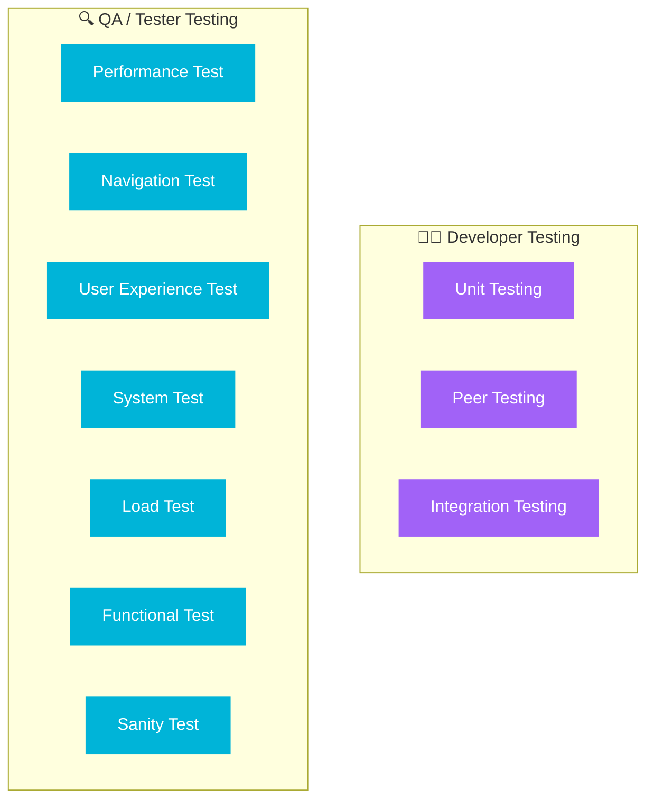
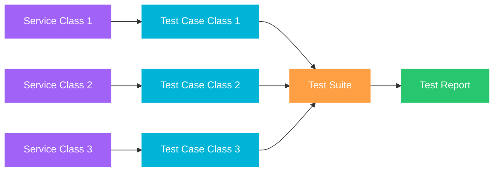
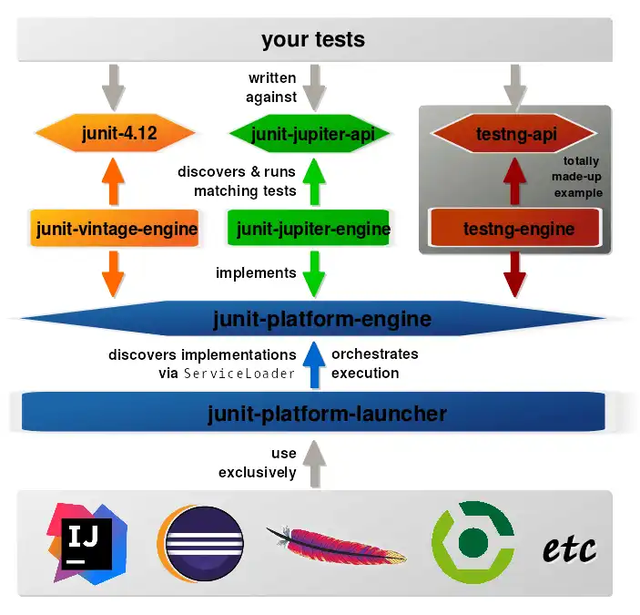
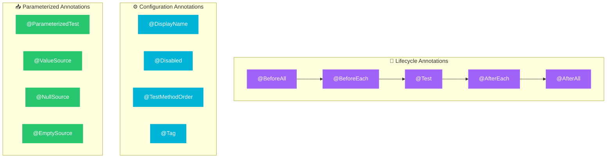
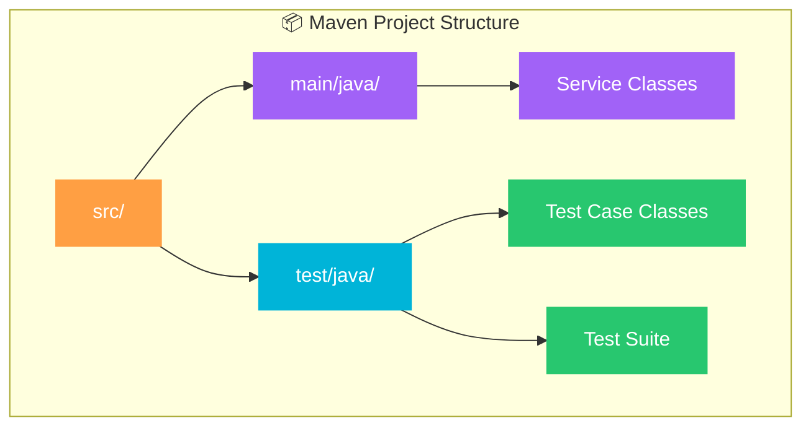

# Unit Testing in Java

**Unit Testing in Java** | We will discuss what is unit testing, how to perform unit testing using JUnit, what are different tools available for testing in Java, etc.

- [Introduction to Testing](#1-introduction-to-testing)
- [Types of Testing](#2-types-of-testing)
- [Manual vs Automated Unit Testing](#3-manual-vs-automated-unit-testing)
- [Test Results](#4-test-results)
- [JUnit Components](#5-junit-components)
- [JUnit 5 Architecture](#6-junit-5-architecture)
- [JUnit Annotations](#7-junit-annotations)
- [Assertion Methods](#8-assertion-methods)
- [Naming Conventions](#9-naming-conventions)
- [Test Plans and Strategies](#10-test-plans-and-strategies)
- [Project Setup](#11-project-setup)

---

## 1. Introduction to Testing

Testing means matching expected results with actual results. If matched then the test result is positive (test succeeded), if not matched then the test result is negative (test failed). Development and unit/peer testing should be done continuously by the programmer until test results are positive.

🧠 **In Simple Words:**
Testing is about verifying that your code does what it is supposed to do by comparing expected vs. actual outcomes.

- 🧪 **Unit Testing** — The test done by the programmer on their own piece of code is called unit testing.
- 👥 **Peer Testing** — The unit testing done on one programmer's code/task by a colleague programmer is called peer testing.

📝 **Note:** Business analyst gives design documents/user stories, the developer develops the code, performs the unit/peer testing, and commits the code to the code repository (like GIT/SVN) when test results are positive. In unit/peer testing, entire projects will not be tested — instead only one task will be tested. Testers/QA teams take care of the testing of the entire project.

🔗 **Also See:**

- [JUnit Annotations with Examples](./02_JUnit_Annotations_with_Examples.md)
- [JUnit Assert Methods Example](./03_JUnit_Assert_Methods_Example.md)
- [Mockito With Examples](./04_Mockito_With_Examples.md)
- [Spring Boot Unit Testing (JUnit with Mockito)](./05_Spring_Boot_Rest_API_Unit_Testing_(JUnit_with_Mockito).md)

---

## 2. Types of Testing

### Testing Done by Developers

- 🧪 Unit testing
- 👥 Peer testing
- 🔗 Integration testing (talks about modules/apps integration)

### Testing Done by Testers

- ⚡ Performance test
- 🧭 Navigation test
- 🎨 User experience test
- 🖥️ System test
- 📈 Load test
- ⚙️ Functional test
- 🔍 Sanity test, and etc.



---

## 3. Manual vs Automated Unit Testing

Unit testing can be done in two ways:

| Approach 🔧 | Description 📋 |
|-------------|----------------|
| **Manual Unit Testing** | Programmer manually writes and runs tests, records results |
| **Automated Unit Testing** | Uses tools like JUnit, Mockito, TestNG to automate the process |

### Limitations of Manual Unit Testing

- 🐢 **No productivity** — It takes time.
- 📊 **Complex reporting** — Writing test reports manually is a complex process (Excel sheet report).
- 📋 **Complex presentation** — Presenting test plans/test cases to TL/superior is a complex process.
- 🔄 **Test regression** — Repeating the test is very complex.

> 💡 **Tip:** To overcome these problems, use automated unit testing tools like JUnit, HttpUnit (for web applications), Mockito, TestNG, and others in Java. For HttpUnit, Mockito, and TestNG tools, JUnit is the base tool. All these are Java-based unit testing tools.

---

## 4. Test Results

In the test results we can see:

| Result 📊 | Meaning 📋 | Condition ⚙️ |
|-----------|-----------|-------------|
| **Success** ✅ | Test passed | Expected results matched with actual results |
| **Failure** ❌️ | Test failed | Expected results did not match actual results |
| **Error** 🚨 | Unexpected exception | Unanticipated exceptions occurred while testing the code |

🔑 **Key Point:** What is the difference between failure and error in testing? Failure means the actual code has given some result but the result does not match the expected result. Whereas error means the actual code has not given any result — rather it has thrown some exception.

---

## 5. JUnit Components

While working with JUnit we can see 3 main components:

| Component 🏷️ | Purpose 📋 |
|-------------|-----------|
| **Service class / Main class** | Class to be tested |
| **Test Case Class** | The class that contains test methods |
| **Test Suite** | Allows combining multiple test case classes to generate the test report (optional) |



📝 **Note:** In a project, there can be 1 or more service classes/main classes and test case classes, but Test Suite can be 0 or 1. We can run each test case class manually to generate the test report. But if we want to get test reports of all the classes together then take the support of the Test Suite class.

---

## 6. JUnit 5 Architecture

JUnit 5 contains 3 runtime libraries:

- 🆕 **JUnit Jupiter** — JUnit 5 libraries.
- 🕰️ **JUnit Vintage** — JUnit 3/4 libraries (for backward compatibility).
- 🔗 **JUnit Integrations** — To allow JUnit integration with TestNG, Mockito, and etc.



- ⚙️ The `junit-platform-engine` is responsible for loading test case classes, creating objects for them, and calling the test method.
- 🚀 The `junit-platform-launcher` helps different IDEs, tools like Maven, etc. to search and get `junit-platform-engine`.

JUnit 5 Jupiter API provides the following which we use in the development of TestCase classes and test methods:

- 🏷️ **Annotations** — Metadata markers for test configuration and lifecycle.
- 🧪 **Assertion API** — Provides `Assertions.assertXyz()` static methods to match actual results with expected results and generate test reports.

---

## 7. JUnit Annotations

| Annotation 🏷️ | Purpose 📋 |
|---------------|-----------|
| `@Test` | Marks a method as a test method |
| `@DisplayName` | Sets a custom display name for the test |
| `@BeforeEach` | Runs before each test method |
| `@AfterEach` | Runs after each test method |
| `@BeforeAll` | Runs once before all test methods |
| `@AfterAll` | Runs once after all test methods |
| `@Disabled` | Disables a test method or class |
| `@TestMethodOrder` | Configures test method execution order |
| `@RepeatedTest` | Repeats a test a specified number of times |
| `@Tag` | Tags a test for filtering |
| `@ParameterizedTest` | Marks a parameterized test |
| `@ValueSource` | Provides values for parameterized tests |
| `@NullSource` | Provides a null argument |
| `@EmptySource` | Provides an empty argument |
| `@NullAndEmptySource` | Provides both null and empty arguments |



---

## 8. Assertion Methods

The following are the most used Assertion methods. They have multiple overloaded forms and all are static methods:

| Method 🧪 | Description 📋 |
|-----------|----------------|
| `fail` | Forces a test failure |
| `assertTrue` | Asserts that a condition is `true` |
| `assertFalse` | Asserts that a condition is `false` |
| `assertSame` | Asserts two references point to the same object |
| `assertNotSame` | Asserts two references do not point to the same object |
| `assertNull` | Asserts that an object is `null` |
| `assertNotNull` | Asserts that an object is not `null` |
| `assertEquals` | Asserts two values are equal |
| `assertNotEquals` | Asserts two values are not equal |
| `assertArrayEquals` | Asserts two arrays are equal |
| `assertAll` | Groups multiple assertions together |

---

## 9. Naming Conventions

Generally, the test case class name starts or ends with the "Test" word and all methods generally begin with the "test" word.

| Main Class / Method 🏷️ | Test Class / Method 🧪 |
|------------------------|----------------------|
| `BankService` | `TestBankService` |
| `float calcSimpleInterest()` | `void testCalcSimpleInterest()` |
| `float getBalance()` | `void testGetBalance()` |

📝 **Note:** We write multiple forms of these test methods to test the main method or service method from multiple angles. In test case classes, for each business/service method we need to write a variety of test methods — but not just to increase the number of test methods.

---

## 10. Test Plans and Strategies

### Login App Test Plans

- ✅ Test with valid credentials
- ❌️ Test with invalid credentials
- ⚠️ Test with no credentials

### Sum of Two Numbers Test Plans

- ➕ Test with positive values
- ➖ Test with negative values
- 🔀 Test with mixed values
- 0️⃣ Test with zeros
- 🔢 Test with floating points
- 🔤 Test with chars/strings

> 🔑 **Key Point:** Always think about edge cases and boundary conditions when designing your test plans. Cover both happy paths and failure scenarios.

---

## 11. Project Setup

1️⃣ **Create a Maven Project:**

Create a new Maven project in Eclipse IDE => Select archetype: `maven-archetype-quickstart` of `org.apache.maven.archetypes` => Group Id: `com.knowprogram`, Artifact Id: `JUnitDemo`.

2️⃣ **Update Compiler Settings:**

Open `pom.xml` and change the `maven.compiler.source` and `maven.compiler.target` to your workspace available Java version. Then right-click => Maven => Update Project.

**`pom.xml` properties:**

```xml
<properties>
    <project.build.sourceEncoding>UTF-8</project.build.sourceEncoding>
    <maven.compiler.source>11</maven.compiler.source>
    <maven.compiler.target>11</maven.compiler.target>
</properties>
```

3️⃣ **Add JUnit 5 Dependency:**

Remove the existing JUnit dependency and add JUnit Jupiter Engine in `pom.xml` dependencies:

**`pom.xml` dependency:**

```xml
<dependency>
    <groupId>org.junit.jupiter</groupId>
    <artifactId>junit-jupiter-engine</artifactId>
    <version>5.10.2</version>
    <scope>test</scope>
</dependency>
```

4️⃣ **Update and Verify:**

After adding the dependencies, right-click on the project => Maven => Update Project.

> 📝 **Note:** The main/service classes are placed inside the `src/main/java` folder whereas test case classes/Test Suite classes are placed inside the `src/test/java` folder.


