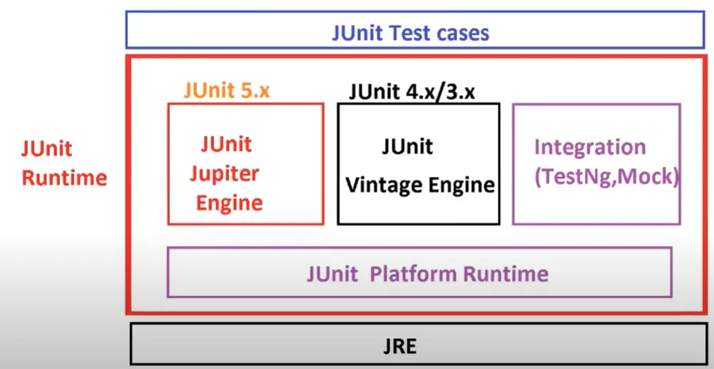
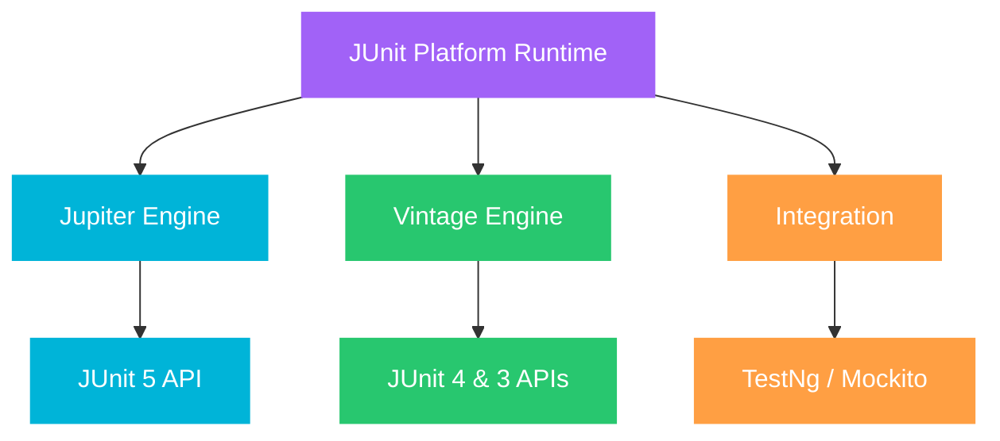
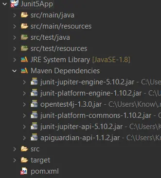
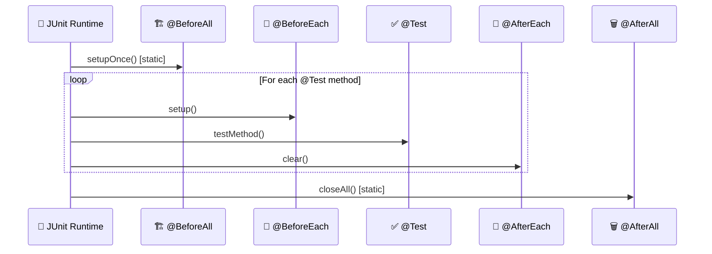
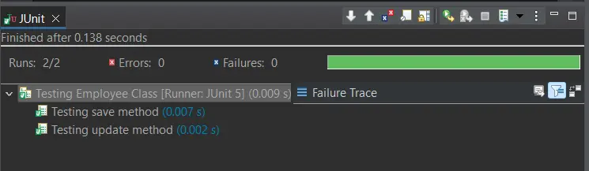
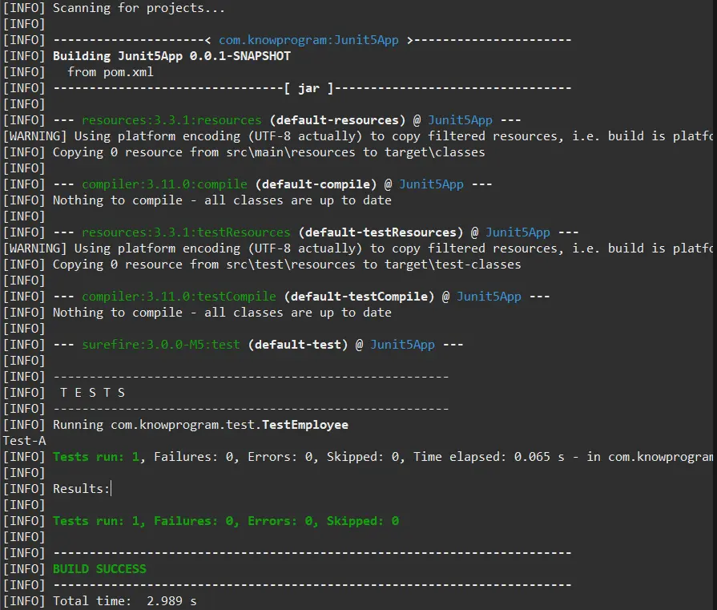

# JUnit Annotations with Examples

**JUnit Annotations with Examples** | We had introduced [unit testing in Java](./01_Unit_Testing_in_Java.md), now we will see JUnit and later introduce Mockito.

- [JUnit](#1-junit)
- [JUnit Runtime](#2-junit-runtime)
- [Setting Up JUnit](#3-setting-up-junit)
- [Test Annotation](#4-test-annotation)
- [TestMethodOrder and Order](#5-testmethodorder-and-order)
- [BeforeEach, AfterEach, BeforeAll, AfterAll](#6-beforeeach-aftereach-beforeall-afterall)
- [DisplayName](#7-displayname)
- [Disabled](#8-disabled)
- [RepeatedTest and TestInfo](#9-repeatedtest-and-testinfo)
- [Tag](#10-tag)
- [ParameterizedTest and ValueSource](#11-parameterizedtest-and-valuesource)
- [NullSource, EmptySource, NullAndEmptySource](#12-nullsource-emptysource-nullandemptysource)

**Related Links:**

- [Unit Testing in Java](./01_Unit_Testing_in_Java.md)
- [JUnit Assert Methods Example](./03_JUnit_Assert_Methods_Example.md)
- [Mockito With Examples](./04_Mockito_With_Examples.md)
- [Spring Boot Unit Testing (JUnit with Mockito)](./05_Spring_Boot_Rest_API_Unit_Testing_(JUnit_with_Mockito).md)

---

## 1. JUnit

Unit testing: Here unit indicates a part of a project which can be a task/story. Once the code is completed by the developer, then that part must be tested.

🧠 **In Simple Words:**
Unit testing = testing one part of the project developed by a programmer. Example: Develop the Employee register task, and test the employee register task.

Maven (`pom.xml`):

```xml
<dependency>
    <groupId>org.junit.jupiter</groupId>
    <artifactId>junit-jupiter-engine</artifactId>
    <version>5.10.2</version>
    <scope>test</scope>
</dependency>
```

Gradle (`build.gradle`):

```groovy
testImplementation 'org.junit.jupiter:junit-jupiter-engine:5.10.2'
```

To define one test case we should use:

- 🏷️ JUnit 5 Annotations
- 🧪 JUnit 5 Assert API

**JUnit 5 Annotations:**

| Annotation 🏷️ | Purpose 📋 |
|---------------|-----------|
| `@Test` | Marks a method as a test method |
| `@DisplayName` | Provides readable text for test names |
| `@BeforeEach` | Runs before each test method |
| `@AfterEach` | Runs after each test method |
| `@BeforeAll` | Runs once before all test methods |
| `@AfterAll` | Runs once after all test methods |
| `@Disabled` | Skips a test method |
| `@TestMethodOrder` | Controls test execution order |
| `@RepeatedTest` | Repeats a test multiple times |
| `@Tag` | Filters tests for specific environments |
| `@ParameterizedTest` | Runs a test with different parameters |
| `@ValueSource` | Supplies input values for parameterized tests |
| `@NullSource` | Supplies `null` as input |
| `@EmptySource` | Supplies empty string as input |
| `@NullAndEmptySource` | Supplies both `null` and empty string |

---

## 2. JUnit Runtime



JUnit Runtime is provided with 3 components and one platform runtime:

- ⚙️ **JUnit Jupiter Engine** — JUnit 5 API
- 🕰️ **JUnit Vintage Engine** — JUnit 4 and 3 APIs
- 🔗 **Integration** — TestNg, Mock, etc.



For our test cases (Class + Method) object creation and test-method calling is done by JUnit Platform runtime.

---

## 3. Setting Up JUnit

Create a Maven project, add the `junit-jupiter-engine` dependency. Test cases are written inside the `src/test/java` folder.

**Maven dependency:**

Maven (`pom.xml`):

```xml
<dependency>
    <groupId>org.junit.jupiter</groupId>
    <artifactId>junit-jupiter-engine</artifactId>
    <version>5.10.2</version>
    <scope>test</scope>
</dependency>
```

Gradle (`build.gradle`):

```groovy
testImplementation 'org.junit.jupiter:junit-jupiter-engine:5.10.2'
```



While creating the test class, generally we use the "Test" prefix along with the class name and method name.

- 📁 Admin Module: `TestAdmin`
- 📁 Product Module: `TestProduct`
- 🔧 `save()` => `testSave()`
- 🔧 `delete()` => `testDelete()`

---

## 4. Test Annotation

`@Test` is used to make the method of a test case class a test method.

**Test class (`TestEmployee.java`):**

```java
package com.knowprogram.test;

import org.junit.jupiter.api.Test;

// Test case: A class that will test our code
public class TestEmployee {

    // test methods
    @Test
    public void testSave() {
        System.out.println("Hello-SAVE");
    }

    @Test
    public void testUpdate() {
        System.out.println("Hello-UPDATE");
    }

    @Test
    public void testDelete() {
        System.out.println("Hello-DELETE");
    }
}
```

Select the class and run as "JUnit Test".

📤 **Output:**

```
Hello-SAVE
Hello-DELETE
Hello-UPDATE
```

---

## 5. TestMethodOrder and Order

We can define multiple test methods inside a test case. Those are executed in random order by default. We can specify our own order using `@TestMethodOrder` and `@Order`. Here we need to provide `@Order(number)`.

**Ordered test class:**

```java
package com.knowprogram.test;

import org.junit.jupiter.api.MethodOrderer.OrderAnnotation;
import org.junit.jupiter.api.Order;
import org.junit.jupiter.api.Test;
import org.junit.jupiter.api.TestMethodOrder;

@TestMethodOrder(OrderAnnotation.class)
public class TestEmployee {

    // test methods
    @Test
    @Order(5)
    public void testSave() {
        System.out.println("Hello-SAVE");
    }

    @Test
    @Order(1)
    public void testUpdate() {
        System.out.println("Hello-UPDATE");
    }

    @Test
    @Order(25)
    public void testDelete() {
        System.out.println("Hello-DELETE");
    }
}
```

📤 **Output:**

```
Hello-UPDATE
Hello-SAVE
Hello-DELETE
```

📝 **Note:** We can also pass a negative number to `@Order` like `@Order(-5)` and in that case method execution order has: Negative => Zero => Positive numbers.

If we want to execute in the order of the method name then we can use:

```java
@TestMethodOrder(MethodName.class)
```

The `OrderAnnotation` and `MethodName` are implementation classes of the `MethodOrderer` interface. Other implementation classes are:

| Implementation 🏷️ | Description 📋 | Usage 🛠️ |
|-------------------|--------------|---------|
| **`DisplayName`** | Orders by display name | `@TestMethodOrder(OrderAnnotation.DisplayName.class)` (note: `@DisplayName` annotation also exists) |
| **`Random`** | Random order | Default behavior |
| **`Alphanumeric`** | Alphabetical order | ⚠️ Deprecated |

---

## 6. BeforeEach, AfterEach, BeforeAll, AfterAll

- 🔄 `@BeforeEach` — Execute any logic once per test method *before* starting the test method. We usually place common logic that should be executed before each test method execution.
- 🧹 `@AfterEach` — Execute any logic once per test method *after* finishing the test method. We usually place common logic that should execute after each test method execution.
- 🏗️ `@BeforeAll` — Execute any logic once per test case/class *before* starting. It is used to write common logic one time for all test methods.
- 🗑️ `@AfterAll` — Execute any logic once per test case/class *before* finishing. It is used to place cleanup logic for all test methods.

> ⚠️ **Warning:** Methods with annotations `@BeforeAll` and `@AfterAll` must be **static methods**, else JUnit gives an error.



**Lifecycle example (`TestEmployee.java`):**

```java
package com.knowprogram.test;

import org.junit.jupiter.api.AfterAll;
import org.junit.jupiter.api.AfterEach;
import org.junit.jupiter.api.BeforeAll;
import org.junit.jupiter.api.BeforeEach;
import org.junit.jupiter.api.Test;

public class TestEmployee {

    @BeforeAll
    public static void setupOnce() {
        System.out.println("From Onetime setup");
    }

    @BeforeEach
    public void setup() {
        // setup, init data
        System.out.println("From Setup");
    }

    @Test
    public void testSave() {
        System.out.println("Hello-SAVE");
    }

    @Test
    public void testUpdate() {
        System.out.println("Hello-UPDATE");
    }

    @AfterEach
    public void clear() {
        System.out.println("Clear data");
    }

    @AfterAll
    public static void closeAll() {
        System.out.println("Once at end");
    }
}
```

📤 **Output:**

```
From Onetime setup
From Setup
Hello-SAVE
Clear data
From Setup
Hello-UPDATE
Clear data
Once at end
```

---

## 7. DisplayName

`@DisplayName` annotation is used to provide "readable text" in place of actual method and class names at the JUnit console.

**DisplayName example:**

```java
package com.knowprogram.test;

import org.junit.jupiter.api.DisplayName;
import org.junit.jupiter.api.Test;

@DisplayName("Testing Employee Class")
public class TestEmployee {

    @Test
    @DisplayName("Testing save method")
    public void testSave() {
        System.out.println("Hello-SAVE");
    }

    @Test
    @DisplayName("Testing update method")
    public void testUpdate() {
        System.out.println("Hello-UPDATE");
    }
}
```



---

## 8. Disabled

`@Disabled` annotation is used to specify ignore one test method while executing test-case (do not execute test method).

**Disabled example:**

```java
public class TestEmployee {

    @Test
    public void testSave() {
        System.out.println("Hello-SAVE");
    }

    @Test
    @Disabled
    public void testUpdate() {
        System.out.println("Hello-UPDATE");
    }
}
```

💡 **Tip:** Use `@Disabled` when a test is temporarily broken or not relevant. Add a reason string like `@Disabled("Bug #123 pending fix")` for clarity.

---

## 9. RepeatedTest and TestInfo

`@RepeatedTest` is used to execute any test method multiple times (like batch processing). Example: Export 1-10 records, Export 11-20 records, Export 21-30 records. It is very useful in batch processing or update-related tests.

`TestInfo` is an interface used to know our test case details like class name, method name, display name, tag name, etc.

**RepeatedTest with TestInfo example:**

```java
package com.knowprogram.test;

import org.junit.jupiter.api.DisplayName;
import org.junit.jupiter.api.RepeatedTest;
import org.junit.jupiter.api.Test;
import org.junit.jupiter.api.TestInfo;

public class TestEmployee {

    @Test
    @RepeatedTest(value = 3, name = "{displayName} - {currentRepetition}/{totalRepetitions}")
    @DisplayName("Multiple Test")
    public void testMultiple(TestInfo info) {
        System.out.println(info.getTestClass().get().getName());
        System.out.println(info.getTestMethod().get().getName());
        System.out.println(info.getDisplayName());
        System.out.println("=======================================");
    }
}
```

📤 **Output:**

```
com.knowprogram.test.TestEmployee
testMultiple
Multiple Test
=======================================
com.knowprogram.test.TestEmployee
testMultiple
Multiple Test - 1/3
=======================================
com.knowprogram.test.TestEmployee
testMultiple
Multiple Test - 2/3
=======================================
com.knowprogram.test.TestEmployee
testMultiple
Multiple Test - 3/3
=======================================
```

---

## 10. Tag

`@Tag` is used to filter test methods for execution in different environments. For example: we want to test the export example in the production environment and at the same time, we want to test the delete operation only in the development environment. In that case use the `@Tag` concept and `maven-surefire-plugin`.

**Tag example:**

```java
public class TestEmployee {

    @Test
    @Tag("dev")
    public void testA() {
        System.out.println("Test-A");
    }

    @Test
    @Tag("prod")
    public void testB() {
        System.out.println("Test-B");
    }
}
```

We can specify the include and exclude tags in the `pom.xml` file through `maven-surefire-plugin`.

**Maven Surefire Plugin configuration (`pom.xml`):**

```xml
<project>
    <build>
        <plugins>
            <plugin>
                <groupId>org.apache.maven.plugins</groupId>
                <artifactId>maven-surefire-plugin</artifactId>
                <version>3.0.0-M5</version>
                <configuration>
                    <!-- include tags -->
                    <groups>dev</groups>
                    <!-- exclude tags -->
                    <excludedGroups>prod</excludedGroups>
                </configuration>
            </plugin>
        </plugins>
    </build>
</project>
```

Right-click on the project, and **run the application as Maven Test** (not as JUnit Test).



🔑 **Key Points about @Tag:**

- `@Tag("dev")` — valid (single String value)
- `@Tag("dev", "prod")` — invalid (cannot pass multiple values)
- `@Tag` is a repeatable annotation, so we can add multiple `@Tag` to one test method

**Multiple tags on a single method:**

```java
@Test
@Tag("dev")
@Tag("prod")
public void testB() {
    System.out.println("Test-B");
}
```

---

## 11. ParameterizedTest and ValueSource

`@ParameterizedTest` and `@ValueSource` are used to execute one test method multiple times with different inputs/params. We use `@ParameterizedTest` to mark the method and `@ValueSource` to supply inputs.

**Service class:**

```java
public class ServiceDemo {
    public boolean isOdd(int n) {
        return n % 2 == 0;
    }

    public String sayHello(String user) {
        return "Hello " + user;
    }
}
```

**Parameterized test class:**

```java
public class TestSerivceDemo {

    @ParameterizedTest
    @ValueSource(ints = { 10, 21, 34, 56, 11, 76 })
    public void testIsOdd(int n) {
        ServiceDemo demo = new ServiceDemo();
        assertTrue(demo.isOdd(n));
    }

    @ParameterizedTest
    @ValueSource(strings = { "Rocco", "William", "Kevin" })
    public void testSayHello(String user) {
        ServiceDemo demo = new ServiceDemo();
        assertEquals("Hello " + user, demo.sayHello(user));
    }
}
```

---

## 12. NullSource, EmptySource, NullAndEmptySource

Other annotations to pass special input values for parameterized tests:

| Annotation 🏷️ | Supplies 📋 | Use Case 🛠️ |
|---------------|-----------|------------|
| `@EmptySource` | Empty string `""` | Testing empty input handling |
| `@NullSource` | `null` | Testing null input handling |
| `@NullAndEmptySource` | Both `null` and `""` | Testing both null and empty inputs |

**Service class:**

```java
public class ServiceDemo {
    public boolean isEmpty(String name) {
        return name.isBlank();
    }
}
```

**Test class with NullAndEmptySource:**

```java
public class TestSerivceDemo {
    @ParameterizedTest
    // @ValueSource(strings = { "", " ", "K" })
    // @EmptySource
    // @NullSource
    @NullAndEmptySource
    public void testIsEmpty(String user) {
        ServiceDemo demo = new ServiceDemo();
        assertTrue(demo.isEmpty(user));
    }
}
```
