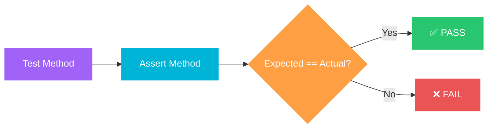
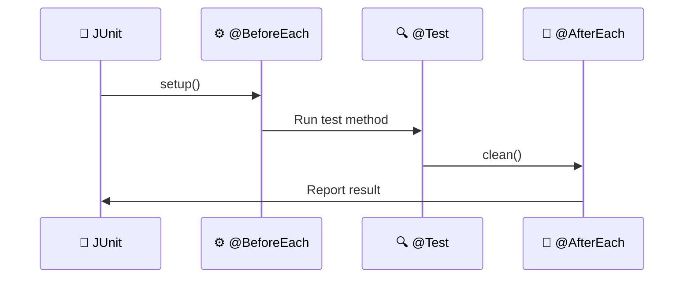

# JUnit Assert Methods Example

**JUnit Assert Methods Example** | It is used to validate the Test, whether the current test is pass or fail. Here, the expected value is compared with the actual result. Also see:

- [Unit Testing in Java](./01_Unit_Testing_in_Java.md)
- [JUnit Annotations with Examples](./02_JUnit_Annotations_with_Examples.md)
- [Mockito With Examples](./04_Mockito_With_Examples.md)
- [Spring Boot Unit Testing (JUnit with Mockito)](./05_Spring_Boot_Rest_API_Unit_Testing_(JUnit_with_Mockito).md)

- [Overview](#1-overview)
- [assertEquals](#2-assertequals)
- [Custom Failure Messages](#3-custom-failure-messages)
- [Testing a Service Method](#4-testing-a-service-method)
- [Using BeforeEach and AfterEach](#5-using-beforeeach-and-aftereach)
- [assertNotNull and assertNull](#6-assertnotnull-and-assertnull)
- [assertDoesNotThrow](#7-assertdoesnotthrow)
- [assertSame vs assertEquals](#8-assertsame-vs-assertequals)
- [fail](#9-fail)
- [assertArrayEquals](#10-assertarrayequals)
- [assertTrue and assertFalse](#11-asserttrue-and-assertfalse)
- [assertThrows](#12-assertthrows)
- [assertAll](#13-assertall)
- [assertTimeout](#14-asserttimeout)
- [Assert Methods Summary](#15-assert-methods-summary)

---

## 1. Overview

JUnit 5 has provided the class [**Assertions**](https://junit.org/junit5/docs/5.0.1/api/org/junit/jupiter/api/Assertions.html) (`org.junit.jupiter.api`) which contains all static assert methods.

🧠 **In Simple Words:**
Assert methods are used to compare expected values with actual results. If matching, the test **passes**; otherwise, the test **fails**.



---

## 2. assertEquals

`assertEquals(expected, actual)` is used to compare an expected value with an actual value. It has multiple overloaded methods, therefore it can accept any data type.

1️⃣ **Create a new Maven project** and add the `junit-jupiter-engine` dependency:

**Dependencies** (`pom.xml`):

```xml
<dependencies>
    <dependency>
        <groupId>org.junit.jupiter</groupId>
        <artifactId>junit-jupiter-engine</artifactId>
        <version>5.10.2</version>
        <scope>test</scope>
    </dependency>
</dependencies>
```

2️⃣ **Create a test class** inside `src/test/java` folder:

**Test class:**

```java
package com.knowprogram.test;

import org.junit.jupiter.api.Assertions;
import org.junit.jupiter.api.Test;

public class TestMessage {

    @Test
    public void testA() {
        String expected = "HELLO";
        String actual = "HELLO";
        Assertions.assertEquals(expected, actual);
    }

}
```

Select the class, and run it as a JUnit test. Inside the JUnit console, it will show whether the test was PASSED or FAILED.

---

## 3. Custom Failure Messages

If we want a custom message in case the test fails then we can write:

```java
assertEquals(expected, actual, "Data May not be matching");
```

💡 **Tip:** Custom failure messages make debugging much easier when a test fails, especially in CI/CD pipelines.

---

## 4. Testing a Service Method

**Service class** (`src/main/java`):

```java
package com.knowprogram.service;

public class Message {

    public String showMsg(String name) {
        return "Welcome to " + name;
    }
}
```

To test the `Message#showMsg()` method, create a class `TestMessage` in the `src/test/java` folder and write a method `testShowMsg()` as follows:

**Test class:**

```java
package com.knowprogram.test;

import static org.junit.jupiter.api.Assertions.assertEquals;

import org.junit.jupiter.api.Test;

import com.knowprogram.service.Message;

public class TestMessage {

    @Test
    public void testShowMsg() {
        Message m = new Message();
        String expected = "Welcome to SAM";
        String actual = m.showMsg("SAM");
        assertEquals(expected, actual);
    }

}
```

---

## 5. Using BeforeEach and AfterEach

Object creation and data initialization must be done before unit testing.



**Test class with lifecycle methods:**

```java
package com.knowprogram.test;

import static org.junit.jupiter.api.Assertions.assertEquals;

import org.junit.jupiter.api.AfterEach;
import org.junit.jupiter.api.BeforeEach;
import org.junit.jupiter.api.Test;

import com.knowprogram.service.Message;

public class TestMessage {

    // declare variables
    private Message m;
    private String expected;
    private String actual;

    // provide initial data
    @BeforeEach
    public void setup() {
        m = new Message();
        expected = "Welcome to SAM";
        actual = "";
    }

    // do unit test
    @Test
    public void testShowMsg() {
        actual = m.showMsg("SAM");
        assertEquals(expected, actual, "Data May not be matching");
    }

    // clear heap data/clear memory
    @AfterEach
    public void clean() {
        m = null;
        expected = actual = null;
    }

}
```

📝 **Note:** `@BeforeEach` runs before every test method and `@AfterEach` runs after every test method. This ensures a clean state for each test.

---

## 6. assertNotNull and assertNull

- 🔍 `assertNotNull(object)` — Specifies that the given object is **not** a null value. If the object holds some data then the test passes, else the test fails.
- 🚫 `assertNull(object)` — Indicates the given object **is** null, else the test fails.

1️⃣ **Add the MySQL dependency:**

**Dependencies** (`pom.xml`):

```xml
<dependency>
    <groupId>mysql</groupId>
    <artifactId>mysql-connector-java</artifactId>
    <version>8.0.26</version>
</dependency>
```

2️⃣ **Create a class** to get the MySQL DB connection:

**DbConnection class:**

```java
package com.knowprogram.util;

import java.sql.Connection;
import java.sql.DriverManager;

public class DbConnection {
    public Connection getConnection() {
        Connection con = null;
        try {
            // con = DriverManager.getConnection("jdbc:mysql://localhost:3306/test", "root",
            // "root");
            DriverManager.getConnection("jdbc:mysql://localhost:3306/test", "root", "root");
        } catch (Exception e) {
            e.printStackTrace();
        }
        return con;
    }
}
```

3️⃣ **Test the class:**

**Test class:**

```java
package com.knowprogram.test;

import static org.junit.jupiter.api.Assertions.assertNotNull;

import java.sql.Connection;

import org.junit.jupiter.api.AfterEach;
import org.junit.jupiter.api.BeforeEach;
import org.junit.jupiter.api.Test;

import com.knowprogram.util.DbConnection;

public class TestDBConnection {

    private DbConnection dbConnection = null;
    private Connection connection = null;

    @BeforeEach
    public void setUp() {
        dbConnection = new DbConnection();
    }

    @Test
    public void testGetConnection() {
        connection = dbConnection.getConnection();
        // expected connection is not null
        assertNotNull(connection, "Connection Is Not Created, Please check!");
    }

    @AfterEach
    public void cleanUp() {
        dbConnection = null;
        connection = null;
    }

}
```

---

## 7. assertDoesNotThrow

`assertDoesNotThrow(Executable)` is used to specify that our method call is **not** throwing any exception; if it throws, the test fails.

📝 **Note:** `Executable` is a functional interface having an abstract method: `void execute() throws Throwable`. So, the lambda expression looks like: `() -> { }`

Before checking the connection, let us check whether any exception is thrown or not.

**Modified DbConnection class:**

```java
public class DbConnection {
    public Connection getConnection() throws Exception {
        Connection con = null;
        try {
            // modify with wrong username or password to get the exception
            con = DriverManager.getConnection("jdbc:mysql://localhost:3306/test", "root1", "root1");
        } catch (Exception e) {
            throw e;
        }
        return con;
    }

}
```

**Unit test code in TestDBConnection class:**

```java
@Test
public void testGetConnection() {
    assertDoesNotThrow(() -> {
        connection = dbConnection.getConnection();
    });
    assertNotNull(connection, "Connection Is Not Created, Please check!");
}
```

⚠️ **Caution:** If you provide wrong credentials, `assertDoesNotThrow` will catch the exception and fail the test, giving a clear indication that something is wrong before even checking `assertNotNull`.

---

## 8. assertSame vs assertEquals

`assertSame(obj1, obj2)` is used to test that the given two references point to **one object**. If yes, the test passes; else the test fails.

| Feature | `assertSame()` ⚖️ | `assertEquals()` ⚖️ |
|---------|-------------------|---------------------|
| **Comparison type** | Object references (`==`) | Data/values (`.equals()`) |
| **Use case** | Singleton verification | Value matching |
| **Passes when** | Both refer to same object | Both hold equal data |

---

## 9. fail

`fail()` is used for testing multiple conditions; if they are not met then you manually fail the test case.

**Singleton utility class:**

```java
package com.knowprogram.util;

import java.sql.Connection;
import java.sql.DriverManager;
import java.sql.SQLException;

public class DbConUtil {

    private static Connection con;

    // singleton
    static {
        try {
            con = DriverManager.getConnection("jdbc:mysql://localhost:3306/test", "root", "root");
        } catch (SQLException e) {
            e.printStackTrace();
        }
    }

    public static Connection getConnection() {
        return con;
    }
}
```

**Test singleton behavior:**

```java
package com.knowprogram.test;

import static org.junit.jupiter.api.Assertions.assertSame;
import static org.junit.jupiter.api.Assertions.fail;

import java.sql.Connection;

import org.junit.jupiter.api.Test;

import com.knowprogram.util.DbConUtil;

public class TestDbConUtil {

    @Test
    public void testGetConnection() {
        Connection con1 = DbConUtil.getConnection();
        Connection con2 = DbConUtil.getConnection();
        if(con1 == null || con2 == null) {
            // test case is failed
            fail("Connections are not created");
        }
        assertSame(con1, con2, "May not be same connection");
    }

}
```

💡 **Tip:** Use `fail()` as a guard clause before running further assertions that would produce misleading errors on `null` values.

---

## 10. assertArrayEquals

`assertArrayEquals()` is used to compare data of two arrays.

**Test class:**

```java
public class TestSample {
    @Test
    public void testNormal() {
        int expected[] = {10, 20, 30};
        int actual[] = {10, 20, 45};
        assertArrayEquals(expected, actual);
    }
}
```

🔑 **Key Point:** The above test will **fail** because the third element differs (`30` vs `45`). The arrays must match element-by-element for the test to pass.

---

## 11. assertTrue and assertFalse

These methods are used to test one Boolean condition/expression/value.

- ✅ `assertTrue()` — Boolean value is expected as `true`, else the test fails.
- ❌️ `assertFalse()` — Boolean value is expected as `false`, else the test fails.

**Test class:**

```java
@Test
public void testNormal() {
    boolean exist = true;
    assertTrue(exist, "Data may not exist");
}
```

---

## 12. assertThrows

`assertThrows()` expects that our logic throws one exception of a specified type.

🛠️ **Syntax:**

```java
assertThrows(ExpectedExceptionType.class, () -> {
    // our logic
});
```

**Test class:**

```java
@Test
public void testNormal() {
    assertThrows(NullPointerException.class, () -> {
        // throw new NullPointerException();
        throw new ArrayIndexOutOfBoundsException();
    });
}
```

⚠️ **Caution:** The above test will **fail** because it expects `NullPointerException` but receives `ArrayIndexOutOfBoundsException`. The thrown exception must match (or be a subclass of) the expected type.

---

## 13. assertAll

`assertAll(Executable... executables)` is used to group multiple assert test methods and execute them all at once. If all pass then the test passes; if at least one fails then the test fails.

**Test class:**

```java
package com.knowprogram.test;

import static org.junit.jupiter.api.Assertions.assertAll;
import static org.junit.jupiter.api.Assertions.assertNotNull;
import static org.junit.jupiter.api.Assertions.assertSame;
import static org.junit.jupiter.api.Assertions.fail;

import java.sql.Connection;

import org.junit.jupiter.api.Test;

import com.knowprogram.util.DbConUtil;

public class TestSample {
    @Test
    public void testNormal() {
        assertAll(() -> {
            assertNotNull(DbConUtil.getConnection());
        }, () -> {
            Connection con1 = DbConUtil.getConnection();
            Connection con2 = DbConUtil.getConnection();
            assertSame(con1, con2);
        }, () -> {
            Connection con1 = DbConUtil.getConnection();
            Connection con2 = DbConUtil.getConnection();
            if(con1 == null || con2==null) {
                fail();
            }
        });
    }
}
```

💡 **Tip:** Unlike running assertions sequentially, `assertAll` executes **all** grouped assertions even if one fails, giving you a complete picture of all failures at once.

---

## 14. assertTimeout

`assertTimeout()` is used to check whether a business method execution is completed within the specified time or not.

**Service class:**

```java
public class ServiceDemo {
    public String showMsg(String name) {
        try {
            // 3 seconds
            Thread.sleep(3000);
        } catch (Exception e) {
            e.printStackTrace();
        }
        return "Welcome to " + name;
    }
}
```

**Test class:**

```java
public class TestSerivceDemo {
    @Test
    public void testShowMsgWithTimer() {
        ServiceDemo demo = new ServiceDemo();
        // 2 seconds
        assertTimeout(Duration.ofMillis(2000), () -> {
            demo.showMsg("KnowProgram");
        });
    }
}
```

⚠️ **Caution:** The above test will **fail** because `showMsg()` takes 3 seconds but the timeout is set to 2 seconds.

---

## 15. Assert Methods Summary

| Method 🧪 | Purpose 📋 | Passes When ✅ |
|-----------|-----------|---------------|
| **`assertEquals()`** | Compare expected vs actual value | Values are equal |
| **`assertNotNull()`** | Check object is not null | Object holds data |
| **`assertNull()`** | Check object is null | Object is `null` |
| **`assertDoesNotThrow()`** | Verify no exception thrown | No exception occurs |
| **`assertSame()`** | Compare object references | Same object in memory |
| **`fail()`** | Manually fail a test | Never passes (guard clause) |
| **`assertArrayEquals()`** | Compare two arrays element-by-element | All elements match |
| **`assertTrue()`** | Check boolean is true | Condition is `true` |
| **`assertFalse()`** | Check boolean is false | Condition is `false` |
| **`assertThrows()`** | Expect a specific exception | Correct exception thrown |
| **`assertAll()`** | Group multiple assertions | All grouped assertions pass |
| **`assertTimeout()`** | Check execution within time limit | Completes before timeout |
