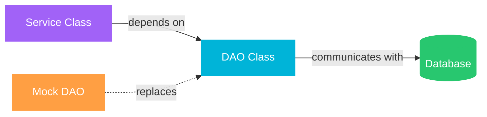
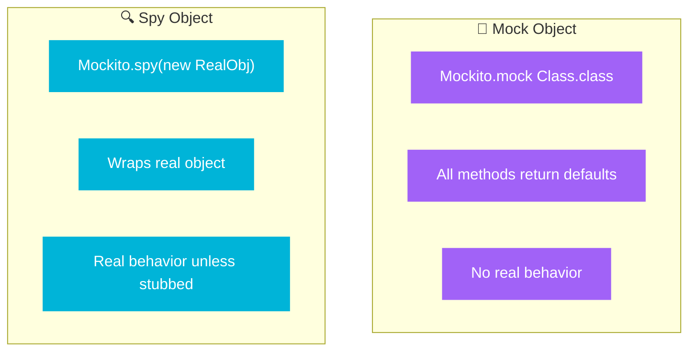

# Mockito With Examples

**Mockito With Examples** | Mockito is built on the top of JUnit. It is given to perform unit testing by mocking the local dependent or external dependent objects.

- [Mockito Example Application](#2-mockito-example-application)
- [Mockito.spy() Vs Mockito.mock() Method](#3-mockitospy-vs-mockitomock-method)
- [Stub on Mock and Spy object](#4-stub-on-mock-and-spy-object)
- [Mockito.verify() Method](#5-mockitoverify-method)
- [Mockito Annotations](#6-mockito-annotations)
- [BDDMockito](#7-bddmockito)

---

## 1. Introduction

🧠 **In Simple Words:**
The service class has a dependency on the DAO class and the DAO class communicates with the database. The service class contains business logic and the DAO class contains persistence logic.

`Service class => DAO class => Database software`

Assume the DAO class is unavailable (or not ready yet), but the Service class is available and we want to do unit testing. In that case, we need to create a mock/fake/dummy object for the DAO class and assign/inject it to the service class to write test cases on service class methods.



💡 **Real-World Example:**
Stock Broker applications and Stock Exchange applications. When a stockbroker application is under development, they may not take a subscription to the Stock exchange component because it is costly. Generally, this subscription will be taken after hosting/releasing the Stockbroker application. Till that time they need to take one mock stock exchange component and assign it to a service class to perform unit testing.

📝 **Note:** Mock objects are for temporary needs, mostly they will be used in the unit testing. These mock objects created in test methods or test case classes do not affect the real code.

We can do this mocking in 3 ways:

| Type 🏷️ | Description 📋 |
|---------|---------------|
| **Mock object/Fake object** | Provides temporary objects |
| **Stub object** | Provides some functionalities for the methods of the mock object like specifying for certain inputs or certain outputs should come |
| **Spy object** | Called partial mock object or half mock object which means if we provide new functionality to the method then it will be used otherwise real object functionality will be used. While working with spy objects, we will be having real objects also |

Instead of creating classes manually to prepare Mock, Stub, and Spy objects, we can use mocking frameworks available in the market that are capable of generating such classes dynamically at runtime as InMemory classes (classes that are generated in the JVM memory of RAM).

📦 **List of mocking frameworks:**

- 🥇 Mockito
- 🥈 JMockito
- 🥉 EasyMock
- 🔧 PowerMock

🔗 **Also see:**

- [Unit Testing in Java](./01_Unit_Testing_in_Java.md)
- [JUnit Annotations with Examples](./02_JUnit_Annotations_with_Examples.md)
- [JUnit Assert Methods Example](./03_JUnit_Assert_Methods_Example.md)
- [Spring Boot Unit Testing (JUnit with Mockito)](./05_Spring_Boot_Rest_API_Unit_Testing_(JUnit_with_Mockito).md)

---

## 2. Mockito Example Application

Testing the `LoginMgmtService` class without keeping the `LoginDAO` class ready.

1️⃣ **Step 1 — Create a Maven project:**

Create a new Maven project => Select archetype: `maven-archetype-quickstart` of `org.apache.maven.archetype` => Group Id: `com.knowprogram`, Artifact Id: `MockitoUnitTesting-LoginApp`. Open `pom.xml` and change the `maven.compiler.source` and `maven.compiler.target` to your workspace available Java version. Then right click => maven => update project.

🔧 **Configuration** (`pom.xml` properties):

```xml
<properties>
    <project.build.sourceEncoding>UTF-8</project.build.sourceEncoding>
    <maven.compiler.source>11</maven.compiler.source>
    <maven.compiler.target>11</maven.compiler.target>
</properties>
```

2️⃣ **Step 2 — Add dependencies:**

Remove the existing JUnit dependency and add the latest JUnit Jupiter Engine in `pom.xml` between `<dependencies>` and `</dependencies>`:

**JUnit Jupiter Engine dependency:**

Maven (`pom.xml`):

```xml
<dependency>
    <groupId>org.junit.jupiter</groupId>
    <artifactId>junit-jupiter-engine</artifactId>
    <version>5.10.2</version>
    <scope>test</scope>
</dependency>
```

Gradle (`build.gradle`):

```groovy
testImplementation 'org.junit.jupiter:junit-jupiter-engine:5.10.2'
```

**Mockito dependency:**

Maven (`pom.xml`):

```xml
<dependency>
    <groupId>org.mockito</groupId>
    <artifactId>mockito-core</artifactId>
    <version>5.12.0</version>
    <scope>test</scope>
</dependency>
```

Gradle (`build.gradle`):

```groovy
testImplementation 'org.mockito:mockito-core:5.12.0'
```

> 📝 **Note:** After adding the dependencies, right-click on the project => maven => update project. The main/service classes are placed inside the `src/main/java` folder whereas test case classes/Test Suite classes are placed inside the `src/test/java` folder.

3️⃣ **Step 3 — Develop service interface, service class, and DAO interface:**

📁 **Project structure:**

- `com.knowprogram.service`
  - `ILoginMgmtService.java` (I)
  - `LoginMgmtServiceImpl.java` (C)
- `com.knowprogram.dao`
  - `ILoginDAO.java` (I)

**DAO Interface** (`ILoginDAO.java`):

```java
package com.knowprogram.dao;

public interface ILoginDAO {

    public int authenticate(String username, String password);
}
```

**Service Interface** (`ILoginMgmtService.java`):

```java
package com.knowprogram.service;

public interface ILoginMgmtService {

    public boolean login(String username, String password);
}
```

**Service Implementation** (`LoginMgmtServiceImpl.java`):

```java
package com.knowprogram.service;

import com.knowprogram.dao.ILoginDAO;

public class LoginMgmtServiceImpl implements ILoginMgmtService {

    private ILoginDAO loginDAO;

    public LoginMgmtServiceImpl(ILoginDAO loginDAO) {
        this.loginDAO = loginDAO;
    }

    @Override
    public boolean login(String username, String password) {
        if (username.isBlank() || password.isBlank()) {
            throw new IllegalArgumentException("Empty Credentials");
        }
        // Use LoginDAO
        int count = loginDAO.authenticate(username, password);
        System.out.println("count: " + count);
        return count != 0 ? true : false;
    }
}
```

**Test Class** (`LoginMgmtServiceTest.java`):

```java
package com.knowprogram.test;

import static org.junit.jupiter.api.Assertions.assertFalse;
import static org.junit.jupiter.api.Assertions.assertThrows;
import static org.junit.jupiter.api.Assertions.assertTrue;

import org.junit.jupiter.api.AfterAll;
import org.junit.jupiter.api.BeforeAll;
import org.junit.jupiter.api.Test;
import org.mockito.Mockito;

import com.knowprogram.dao.ILoginDAO;
import com.knowprogram.service.ILoginMgmtService;
import com.knowprogram.service.LoginMgmtServiceImpl;

public class LoginMgmtServiceTest {

    private static ILoginMgmtService loginService;
    private static ILoginDAO loginDAOMock;

    @BeforeAll
    public static void setupOnce() {

        // Implementation class of ILoginDAO(I) is not available yet.

        // create mock/fake/dummy object
        loginDAOMock = Mockito.mock(ILoginDAO.class);  // ← key line
        // mock() method generates InMemory class implementing ILoginDAO(I)
        // having null method definitions for authenticate(-,-) method

        System.out.println(loginDAOMock.getClass());
        System.out.println(Arrays.toString(loginDAOMock.getClass().getInterfaces()));

        // create service class object
        loginService = new LoginMgmtServiceImpl(loginDAOMock);  // ← inject mock
    }

    @AfterAll
    public static void clearOnce() {
        loginDAOMock = null;
        loginService = null;
    }

    @Test
    public void testLoginWithValidCredentials() {
        // provide Stub (temporary functionalities) for DAO's authenticate method
        Mockito.when(loginDAOMock.authenticate("admin", "admin@123")).thenReturn(1);
        // unit testing
        assertTrue(loginService.login("admin", "admin@123"));
    }

    @Test
    public void testLoginWithInvalidCredentials() {
        // provide Stub (temporary functionalities) for DAO's authenticate method
        Mockito.when(loginDAOMock.authenticate("admin", "admin")).thenReturn(0);
        // unit testing
        assertFalse(loginService.login("admin", "admin"));
    }

    @Test
    public void testLoginWithNoCredentials() {
        assertThrows(IllegalArgumentException.class, () -> loginService.login("", ""));
    }
}
```

🔑 **Key Points:**

- 🧪 `Mockito.mock(ILoginDAO.class)` generates an InMemory class implementing `ILoginDAO`
- ⚙️ The mock object is injected into `LoginMgmtServiceImpl` via the constructor
- 🏷️ `Mockito.when(...).thenReturn(...)` provides stub behavior for mock methods

📤 **Output:**

```
class com.knowprogram.dao.ILoginDAO$MockitoMock$8VGESt2W
[interface com.knowprogram.dao.ILoginDAO, interface org.mockito.internal.creation.bytebuddy.MockAccess]
count: 1
count: 0
```

---

## 3. Mockito.spy() Vs Mockito.mock() Method

The `mock()` can accept the class name only whereas the `spy()` object can accept the real object or class name (in this case, a real object with default values will be passed).



**Test Class** (`MockVsSpyTest.java`):

```java
package com.knowprogram.test;

import java.util.ArrayList;
import java.util.List;

import org.junit.jupiter.api.Test;
import org.mockito.Mockito;

public class MockVsSpyTest {

    @Test
    public void testList() {
        List<String> listMock = Mockito.mock(ArrayList.class);      // ← mock

        List<String> listSpy = Mockito.spy(new ArrayList<>());      // ← spy with real object
        // or
        // List<String> listSpy = Mockito.spy(ArrayList.class);     // ← spy with class name

        listMock.add("table");
        listSpy.add("table");

        System.out.println(listMock.size()); // 0
        System.out.println(listSpy.size()); // 1
    }

}
```

| Behavior 🔬 | `mock()` 🧪 | `spy()` 🔍 |
|-------------|------------|-----------|
| **Input** | Class name only | Real object or class name |
| **Method behavior** | Returns default values (0, null, false) | Uses real method implementation |
| **`listMock.size()` after add** | 0 | 1 |
| **Use case** | Full isolation from real code | Partial mocking with real behavior |

---

## 4. Stub on Mock and Spy object

Stub provides some functionalities for the methods of the mock object like specifying for certain inputs or certain outputs should come.

**Test Class** (`MockVsSpyTest.java` with stubs):

```java
package com.knowprogram.test;

import java.util.ArrayList;
import java.util.List;

import org.junit.jupiter.api.Test;
import org.mockito.Mockito;

public class MockVsSpyTest {

    @Test
    public void testList() {
        List<String> listMock = Mockito.mock(ArrayList.class);

        // passing real object to spy()
        List<String> listSpy = Mockito.spy(ArrayList.class);

        listMock.add("table");
        // stub on mock object
        Mockito.when(listMock.size()).thenReturn(10);

        listSpy.add("table");
        // stub on spy object
        Mockito.when(listSpy.size()).thenReturn(9);

        System.out.println(listMock.size()); // 10
        System.out.println(listSpy.size()); // 9
    }

}
```

💡 **Tip:** Stubbing overrides the default behavior for both mock and spy objects. With `Mockito.when(...).thenReturn(...)`, you define exactly what the method should return regardless of the underlying object type.

---

## 5. Mockito.verify() Method

The spy objects are useful to check how many times methods are called and whether they are called or not because the spy object is always linked with real objects. For this we can use `Mockito.verify()` method.

**Updated DAO Interface** (`ILoginDAO.java`):

```java
package com.knowprogram.dao;

public interface ILoginDAO {

    public int authenticate(String username, String password);

    public int addUser(String user, String role);
}
```

**Updated Service Interface** (`ILoginMgmtService.java`):

```java
package com.knowprogram.service;

public interface ILoginMgmtService {

    public boolean login(String username, String password);

    public String registerUser(String user, String role);
}
```

**Updated Service Implementation** (`LoginMgmtServiceImpl.java`):

```java
package com.knowprogram.service;

import com.knowprogram.dao.ILoginDAO;

public class LoginMgmtServiceImpl implements ILoginMgmtService {

    private ILoginDAO loginDAO;

    public LoginMgmtServiceImpl(ILoginDAO loginDAO) {
        this.loginDAO = loginDAO;
    }

    public String registerUser(String user, String role) {
        if (!role.equalsIgnoreCase("") && !role.equalsIgnoreCase("visitor")) {
            loginDAO.addUser(user, role);
            return "User Added";
        }
        return "User Not Added";
    }

}
```

**Test Class with verify** (`LoginMgmtServiceTest.java`):

```java
package com.knowprogram.test;

import static org.junit.jupiter.api.Assertions.assertFalse;
import static org.junit.jupiter.api.Assertions.assertThrows;
import static org.junit.jupiter.api.Assertions.assertTrue;

import java.util.Arrays;

import org.junit.jupiter.api.AfterAll;
import org.junit.jupiter.api.BeforeAll;
import org.junit.jupiter.api.Test;
import org.mockito.Mockito;

import com.knowprogram.dao.ILoginDAO;
import com.knowprogram.service.ILoginMgmtService;
import com.knowprogram.service.LoginMgmtServiceImpl;

public class LoginMgmtServiceTest {

    private static ILoginMgmtService loginService;
    private static ILoginDAO loginDAOMock;

    @BeforeAll
    public static void setupOnce() {

        // Implementation class of ILoginDAO(I) is not available yet.

        // create mock/fake/dummy object
        loginDAOMock = Mockito.mock(ILoginDAO.class);
        // mock() method generates InMemory class implementing ILoginDAO(I)
        // having null method definitions for authenticate(-,-) method

        System.out.println(loginDAOMock.getClass());
        System.out.println(Arrays.toString(loginDAOMock.getClass().getInterfaces()));

        // create service class object
        loginService = new LoginMgmtServiceImpl(loginDAOMock);
    }

    @AfterAll
    public static void clearOnce() {
        loginDAOMock = null;
        loginService = null;
    }

    @Test
    public void testLoginWithNoCredentials() {
        assertThrows(IllegalArgumentException.class, () -> loginService.login("", ""));
    }

    @Test
    public void testRegisterWithSpy() {
        ILoginDAO loginDAOSpy = Mockito.spy(ILoginDAO.class);
        ILoginMgmtService loginService = new LoginMgmtServiceImpl(loginDAOSpy);
        loginService.registerUser("Rocco", "admin");
        loginService.registerUser("William", "visitor");
        loginService.registerUser("Jerry", "");

        // check in the above register method calls whether addUser(-,-) is called
        // for 1 or more times internally or not for the inputs "Rocco", "admin".
        Mockito.verify(loginDAOSpy, Mockito.times(1)).addUser("Rocco", "admin");
        Mockito.verify(loginDAOSpy, Mockito.times(0)).addUser("William", "visitor");
        Mockito.verify(loginDAOSpy, Mockito.never()).addUser("Jerry", "");
    }
}
```

| Verification Method 🔍 | Description 📋 |
|------------------------|---------------|
| `Mockito.verify(spy, times(1))` | Method was called exactly once |
| `Mockito.verify(spy, times(0))` | Method was never called |
| `Mockito.verify(spy, never())` | Same as `times(0)` — method was never called |
| `Mockito.verify(spy, atLeast(n))` | Method was called at least `n` times |
| `Mockito.verify(spy, atMost(n))` | Method was called at most `n` times |

> 🔑 **Key Concept:** In the example above, `addUser("Rocco", "admin")` is called once because the role is "admin" (not empty and not "visitor"). `addUser("William", "visitor")` is never called because the role "visitor" is filtered out by the business logic. Similarly `addUser("Jerry", "")` is never called because the role is empty.

---

## 6. Mockito Annotations

| Annotation 🏷️ | Purpose 📋 |
|---------------|-----------|
| `@Mock` | Generate a mock object |
| `@Spy` | Generate a spy object |
| `@InjectMocks` | Inject mock or spy objects into the service class |

> ⚠️ **Warning:** We must call `MockitoAnnotations.openMocks(this)` method in `@Before` or constructor of the test case class in order to activate Mockito Annotations.

**Activation call:**

```java
MockitoAnnotations.openMocks(this);
```

**Test Class with annotations** (`LoginMgmtServiceTestAnno.java`):

```java
package com.knowprogram.test;

import static org.junit.jupiter.api.Assertions.assertFalse;
import static org.junit.jupiter.api.Assertions.assertThrows;
import static org.junit.jupiter.api.Assertions.assertTrue;

import org.junit.jupiter.api.Test;
import org.mockito.InjectMocks;
import org.mockito.Mock;
import org.mockito.Mockito;
import org.mockito.MockitoAnnotations;

import com.knowprogram.dao.ILoginDAO;
import com.knowprogram.service.ILoginMgmtService;
import com.knowprogram.service.LoginMgmtServiceImpl;

public class LoginMgmtServiceTestAnno {

    // use service implementation class instead of service interface
    @InjectMocks
    private LoginMgmtServiceImpl loginService;

    @Mock
    private ILoginDAO loginDAOMock;

    // to get spy object
    // @Spy
    // private ILoginDAO loginDAOSpy;

    public LoginMgmtServiceTestAnno() {
        // must call this method to activate annotations
        MockitoAnnotations.openMocks(this);
    }

    @Test
    public void testLoginWithValidCredentials() {
        Mockito.when(loginDAOMock.authenticate("admin", "admin@123")).thenReturn(1);
        assertTrue(loginService.login("admin", "admin@123"));
    }

    @Test
    public void testLoginWithInvalidCredentials() {
        Mockito.when(loginDAOMock.authenticate("admin", "admin")).thenReturn(0);
        assertFalse(loginService.login("admin", "admin"));
    }

    @Test
    public void testLoginWithNoCredentials() {
        assertThrows(IllegalArgumentException.class, () -> loginService.login("", ""));
    }

    @Test
    public void testRegisterWithSpy() {
        ILoginDAO loginDAOSpy = Mockito.spy(ILoginDAO.class);
        ILoginMgmtService loginService = new LoginMgmtServiceImpl(loginDAOSpy);
        loginService.registerUser("Rocco", "admin");
        loginService.registerUser("William", "visitor");
        loginService.registerUser("Jerry", "");

        Mockito.verify(loginDAOSpy, Mockito.times(1)).addUser("Rocco", "admin");
        Mockito.verify(loginDAOSpy, Mockito.times(0)).addUser("William", "visitor");
        Mockito.verify(loginDAOSpy, Mockito.never()).addUser("Jerry", "");
    }

}
```

💡 **Tip:** Using `@InjectMocks` requires the service **implementation class** (`LoginMgmtServiceImpl`) rather than the service interface (`ILoginMgmtService`). Mockito needs the concrete class to inject dependencies.

---

## 7. BDDMockito

To write stub functionality according to agile user stories/JIRA stories (`given.. when.. then..`) `BDDMockito` can be used.

| Style 🔀 | Syntax 💻 |
|----------|----------|
| **Traditional Mockito** | `Mockito.when(...).thenReturn(...)` |
| **BDD Mockito** | `BDDMockito.given(...).willReturn(...)` |

**BDDMockito example:**

```java
@Test
public void testLoginWithValidCredentials() {
    // Mockito.when(loginDAOMock.authenticate("admin", "admin@123")).thenReturn(1);
    BDDMockito.given(loginDAOMock.authenticate("admin", "admin@123"))
                         .willReturn(1);
    assertTrue(loginService.login("admin", "admin@123"));
}
```

> 🧠 **In Simple Words:** BDDMockito aligns your test code with the **Given-When-Then** pattern used in Behavior-Driven Development (BDD), making tests read more like user stories.
