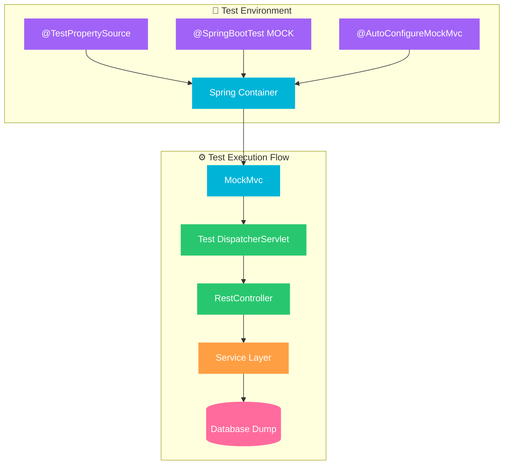
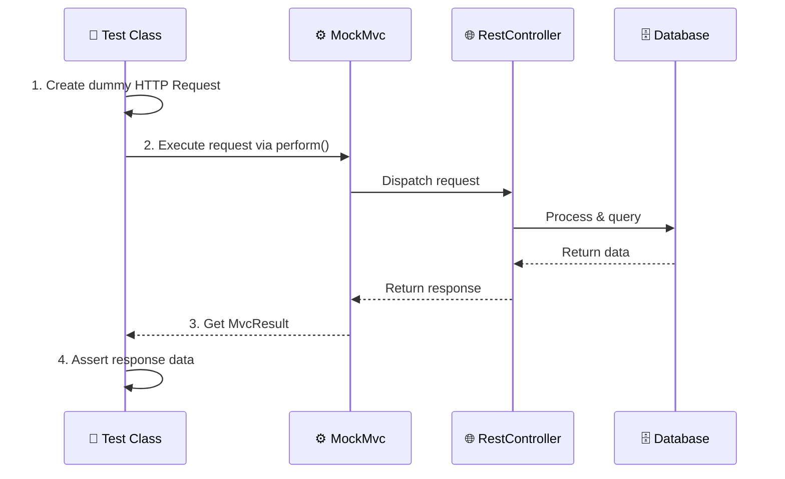

# Spring Boot Rest API Unit Testing (JUnit with Mockito)

**Spring Boot Rest API Unit Testing (JUnit with Mockito)** | The `spring-boot-starter-test` dependency includes `junit-jupiter`, `vintage`, and `mockito` dependencies.

- [Test Dependency](#1-test-dependency)
- [What is Mocking](#2-what-is-mocking)
- [Related Resources](#3-related-resources)
- [Setup Full Environment](#4-setup-full-environment)
- [Unit Test Architecture](#5-unit-test-architecture)
- [Unit Test Coding Steps](#6-unit-test-coding-steps)
- [Complete Test Class Example](#7-complete-test-class-example)
- [Request Construction Examples](#8-request-construction-examples)

---

## 1. Test Dependency

📦 **Maven dependency:**

Maven (`pom.xml`):

```xml
<dependency>
  <groupId>org.springframework.boot</groupId>
  <artifactId>spring-boot-starter-test</artifactId>
</dependency>
```

Gradle (`build.gradle`):

```groovy
testImplementation 'org.springframework.boot:spring-boot-starter-test'
```

---

## 2. What is Mocking

Mocking means creating dummy implementations or objects. If we want to test the Spring Boot application, then the following dummies are required:

- 🔍 Component Scanning
- ⚙️ Auto Configuration for Web Application
- 🏗️ Spring Container (`AnnotationConfigServletWebApplicationContext`)
- 🌐 Request objects
- 📋 Environment details (props)

We need to provide all the above details using Mock support. If we run the starter class, that takes care of all the above things. But this time we are running a Test class.

---

## 3. Related Resources

- 🔗 [Unit Testing in Java](./01_Unit_Testing_in_Java.md)
- 🔗 [JUnit Annotations with Examples](./02_JUnit_Annotations_with_Examples.md)
- 🔗 [JUnit Assert Methods Example](./03_JUnit_Assert_Methods_Example.md)
- 🔗 [Mockito With Examples](./04_Mockito_With_Examples.md)

---

## 4. Setup Full Environment

Setting up the full environment is equal work to the starter class.

| Step 🔢 | Annotation 🏷️ | Purpose 📋 |
|---------|---------------|-----------|
| **1. Load Properties** | `@TestPropertySource("classpath:application-test.properties")` | Loads properties file for test environment. If not provided, `application.properties` is loaded by default. |
| **2. Create Spring Container** | `@SpringBootTest(webEnvironment = WebEnvironment.MOCK)` | Creates container with WebApplication Support (DispatcherServlet). Default: `AnnotationConfigServletWebApplicationContext` |
| **3. Create Required Objects** | `@AutoConfigureMockMvc` | Creates DataSource, HandlerMapping, ORM Config (`EntityManagerFactory`, `EntityManager`), etc. |

For the final runtime environment, the reference is given by `MockMvc`. That supports Test Dispatcher Servlet, Access Spring Container, execution of RestControllers, Database Connection support, etc.

> 📝 **Note:** Database dumps are used for Mock Testing, not the production or UAT environments.

---

## 5. Unit Test Architecture



---

## 6. Unit Test Coding Steps

To do Unit Test coding, follow the below steps:



1️⃣ **Create one dummy/proxy HTTP Request** (not made by the client).

2️⃣ **Execute the dummy request** using `MockMvc` and get the result (`MvcResult`).

3️⃣ **Read the response** from the result object.

4️⃣ **Assert response data** (checking Status, Body/content, header type, etc.).

📥 **Sample Request Body (JSON):**

```json
{"empName":"A","empSal":2500.0,"empMail":"a@gm.com"}
```

---

## 7. Complete Test Class Example

**Test class with annotations and a save operation test:**

```java
@SpringBootTest(webEnvironment = WebEnvironment.MOCK)
@AutoConfigureMockMvc
@TestPropertySource("classpath:application-test.properties")
public class MiniProjectApplicationTests {

    @Autowired
    private MockMvc mockMvc;

    @Test
    public void testSaveOp() throws Exception {
        // 1. prepare http request
        MockHttpServletRequestBuilder request =
          MockMvcRequestBuilders.post("/employee/update")
            .contentType("application/json")
            .content("{\"empName\":\"A\",\"empSal\":2500.0,\"empMail\":\"a@gm.com\"}");

        // 2. execute request and get result
        MvcResult result = mockMvc.perform(request).andReturn();

        // 3. Read Response from result
        MockHttpServletResponse response = result.getResponse();

        // 4. assert/validate result
        assertEquals(HttpStatus.CREATED.value(), response.getStatus());
        assertNotNull(response.getContentAsString());
    }

}
```

💡 **Tip:** Each test method follows the same 4-step pattern: build request, execute, read response, assert.

---

## 8. Request Construction Examples

Examples for different request construction methods:

### POST Request

🌐 **Endpoint:** `/employee/save` (POST)

```java
MockHttpServletRequestBuilder request =
    MockMvcRequestBuilders
      .post("/employee/update")
      .contentType("application/json")
      .content("{\"empName\":\"A\",\"empSal\":2500.0,\"empMail\":\"a@gm.com\"}");
```

### GET All Request

🌐 **Endpoint:** `/employee/all` (GET)

```java
MockHttpServletRequestBuilder request =
    MockMvcRequestBuilders
      .get("/employee/all")
      .accept("application/json");
```

### DELETE Request

🌐 **Endpoint:** `/employee/remove/10` (DELETE)

```java
MockHttpServletRequestBuilder request =
   MockMvcRequestBuilders.delete("/employee/remove/10");
```

### GET By ID Request

🌐 **Endpoint:** `/employee/find/10` (GET)

```java
MockHttpServletRequestBuilder request =
    MockMvcRequestBuilders
      .get("/employee/find/10")
      .accept(MediaType.APPLICATION_XML);
```

### PUT Request

🌐 **Endpoint:** `/employee/update` (PUT)

```java
MockHttpServletRequestBuilder request =
    MockMvcRequestBuilders
      .put("/employee/update")
      .contentType("application/json")
      .content("{\"empName\":\"A\",\"empSal\":2500.0,\"empMail\":\"a@gm.com\"}");
```

| HTTP Method 🌐 | Endpoint 🔗 | Builder Method 🛠️ | Content Type 📋 |
|----------------|------------|-------------------|----------------|
| **POST** | `/employee/save` | `MockMvcRequestBuilders.post()` | `application/json` |
| **GET** | `/employee/all` | `MockMvcRequestBuilders.get()` | Accept: `application/json` |
| **DELETE** | `/employee/remove/{id}` | `MockMvcRequestBuilders.delete()` | None |
| **GET** | `/employee/find/{id}` | `MockMvcRequestBuilders.get()` | Accept: `application/xml` |
| **PUT** | `/employee/update` | `MockMvcRequestBuilders.put()` | `application/json` |
