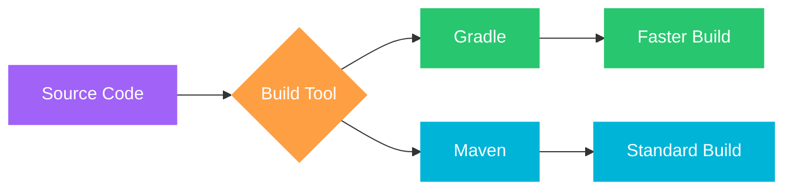

# Need of Build Tools in Java

**Need of Build Tools in Java** | What is the meaning of building the Application/Project? Keeping the application or project ready for execution is called building the application/project.

- [Build Process Operations](#1-build-process-operations)
- [Automating the Build Process](#2-automating-the-build-process)
- [Limitations with Batch Files](#3-limitations-with-batch-files)
- [Advantages and Limitations of Ant](#4-advantages-and-limitations-of-ant)
- [Gradle vs Maven](#5-gradle-vs-maven)

---

## 1. Build Process Operations

Building an application involves the following operations:

- 💻 **Developing source files** — Writing the actual Java source code.
- 🔨 **Compilations** — Compiling `.java` files into `.class` bytecode.
- 📦 **Adding dependencies/libraries (jars) to the classpath** — Including required third-party libraries.
- 📁 **Creating project standard directories** — Setting up the conventional folder structure.
- 📤 **Packaging the app** — Creating JAR or WAR files for distribution.
- 🧪 **Unit testing** — Running automated tests to verify correctness.
- 📖 **Generating API documentation** — Using the `javadoc` tool.
- 🚀 **Deployments** — Deploying the packaged application to a server.
- 📧 **Sending emails/notifications** (optional).

Performing all the above operations is called the build process. We may have to repeat it multiple times until satisfactory results come. Instead of doing these build process activities manually, it is better to automate the complicated, repetitive operations of the build process by using build automation tools.

---

## 2. Automating the Build Process

We can automate it through batch files (`build.bat`) but it has many limitations.

🛠️ **Sample `build.bat`:**

```batch
cd E:\proj1
javac *.java
cd E:\proj1\Dao
javac *.java
mkdir WEB-INF
cd WEB-INF
mkdir classes
cd classes
set classpath=E:\Tomcat9.0\lib\servlet-api.jar;<other jars>;
...
...
```

---

## 3. Limitations with Batch Files

❌️ **Limitations with Batch (`.bat`) file:**

- 📜 It is procedural — we need to tell everything.
- 🧠 It is not self-intelligent.
- 🔗 We can't create dependencies among the tasks.
- ⚠️ We can't place conditional tasks.
- 🌐 It can't download jars dynamically from the internet, etc.

To overcome the problems of manual processes and `.bat` file-based automation, we need to use advanced build automation tools like Ant, Maven, Gradle, etc.

---

## 4. Advantages and Limitations of Ant

Ant (Another Neat Tool) has some improvements over batch files but still falls short:

| Feature 📋 | Ant Support ⚙️ |
|------------|----------------|
| **Procedural** | ✅ Yes — Ant is procedural |
| **Task dependencies** | ✅ Can have dependencies among tasks |
| **Conditional tasks** | ✅ Can create conditional tasks |
| **Self-intelligent** | ❌️ Ant is not self-intelligent |
| **Dynamic jar download** | ❌️ Can't download jars from the internet |

Ant is better than batch file (`.bat`) but overall it is not a great build tool. To overcome these problems we need to work with either Maven or [Gradle](./02_Gradle_Tutorial.md).

🔑 **Key Points about Gradle:**

- ⚡ Gradle is faster compared to Maven.
- 🔧 We can't work with Maven without installing it in our system, but we can work with Gradle without installing it through [`gradlew`](./03_Gradle_Wrapper.md) (Gradle Wrapper).
- 🚀 Gradle uses an **incremental build process** — if we modify only 2 Java files and build, Gradle will compile only those modified files, not the whole project.

---

## 5. Gradle vs Maven



| Feature 📋 | Gradle 🅰️ | Maven 🅱️ |
|------------|-----------|-----------|
| **Performance** | ⚡ Tracks input/output tasks, only runs changed tasks — faster performance | 🐢 Does not use build cache; build time is slower |
| **Configuration** | ✅ Does not use XML; uses Groovy/Kotlin DSL | ❌️ Uses XML file for declaring project, dependencies, build order, and plugins |
| **Build Model** | Based on a graph of task dependencies | Based on phases of a fixed and linear model |
| **Primary Goal** | 🔧 Add functionality to the project | 📋 Related to the project phase |
| **Incremental Build** | ✅ Avoids recompilation — only compiles changed files | ❌️ Compilation is mandatory for entire project |
| **Customization** | ✅ Highly customizable with wide IDE support and custom builds | ⚠️ Limited parameters and requirements; customization is complicated |
| **Project Type** | General-purpose build tool | Primarily used for Java projects as a software project management system |

> 💡 **Tip:** For new projects, consider Gradle for its speed and flexibility. Maven remains a solid choice for teams already familiar with its conventions and XML-based configuration.
