# Gradle Tutorial

**Gradle Tutorial** | Gradle is an open-source build tool for JVM-based and multi-language projects, offering speed, customization, and powerful plugin support.

- [Gradle Main Features](#1-gradle-main-features)
- [Technical Features of Gradle](#2-technical-features-of-gradle)
- [DSL Groovy Basics](#3-dsl-groovy-basics)
- [Gradle CLI Example](#4-gradle-cli-example)
- [Gradle Eclipse Example](#5-gradle-eclipse-example)
- [Gradle Project in STS/Eclipse](#6-gradle-project-in-stseclipse)
- [Gradle Project Example](#7-gradle-project-example)
- [Unit Testing Using Junit and Gradle](#8-unit-testing-using-junit-and-gradle)
- [Working with Multiple Repositories](#9-working-with-multiple-repositories)
- [Generating JavaDoc with Gradle](#10-generating-javadoc-with-gradle)
- [Converting Gradle project to Eclipse/STS Project](#11-converting-gradle-project-to-eclipsests-project)
- [Convert Maven Project to Gradle Project](#12-convert-maven-project-to-gradle-project)

---

## 1. Gradle Main Features

- 🔧 **Customizable build tool** — It allows us to write build scripts in Groovy, Kotlin, and other languages. It can be used for any JVM-based language like Java, Groovy, Kotlin, Scala, Java, Golang, etc.
- ⚡ **Fast** — It gives better performance compared to Maven. It uses an incremental build process which means in our project if we modify only 2 Java files, and build it then Gradle will compile only those modified Java files but not the whole project. It has a caching concept to reuse jars, plugins, etc.
- 💪 **Powerful** — It has many facilities to make the build process simple:
  - The [`gradlew` (Gradle wrapper)](./03_Gradle_Wrapper.md) is given to use the Gradle without manually installing it. It can download Gradle dynamically.
  - Ability to work with multiple repositories to get jars, plugins, etc from the internet like Maven, Ivy, google, local file system repositories, etc.

We will see Gradle from two different angles:

- 💻 **Gradle CLI** — command-line based usage
- 🖥️ **STS/Eclipse Gradle** — IDE-based usage

📥 **Installation:**

Download and install the Gradle and set the Path: [Install Gradle Guide](https://gradle.org/install/).

Verify the Gradle installation: `gradle -v`

```bash
gradle -v
```

---

## 2. Technical Features of Gradle

| Feature 🏷️ | Description 📋 |
|------------|---------------|
| **Declarative** | Gradle is self-intelligent |
| **Lifecycle** | It has a well-defined build lifecycle |
| **Multiple Repositories** | Works with Maven, Ivy, Google, etc. repositories |
| **Incremental Build** | Compiles only modified files |
| **Standard Directory Structure** | Provides structure for different project types |
| **Rich Plugin Ecosystem** | Lots of plugins with tasks to simplify the process |
| **Caching** | Reusability of plugins, jars, etc. |
| **Multi-Module** | Easy to develop multi-module projects |
| **Maven Conversion** | Allows converting Gradle projects to Maven projects |
| **IDE Integration** | Integrates with multiple IDEs |
| **DSL Support** | No XML needed — use Groovy or Kotlin DSL |

---

## 3. DSL Groovy Basics

Before going ahead let us see DSL (domain-specific language) basics because `build.gradle` file is developed using DSL.

🧠 **In Simple Words:**

Input file is `build.gradle`. It is an alternative to the `pom.xml` of Maven. It will have plugins. Plugins will have tasks, and tasks will have actions. To complete these actions we can call methods. Gradle gives lots of built-in plugins having tasks with dependencies.


In Groovy, `{ }` is called Enclosure.
`setDir('hello') = setDir:'hello' = Dir:'hello'`

### Creating a Basic Task

Create a folder with any name. Inside that create a file `build.gradle` and place the below content:

**`build.gradle`:**

```groovy
task t1 {
    doLast {
        println "Welcome to Gradle"
    }
}
```

Open cmd and execute `gradle task --all`. It will list all tasks. In other tasks we can see our `t1` task.

📤 **Output (`gradle task --all`):**

```bash
> gradle task --all

Other tasks
-----------
components - Displays the components produced by root project 'notepad'. [deprecated]
dependentComponents - Displays the dependent components of components in root project 'notepad'. [deprecated]
model - Displays the configuration model of root project 'notepad'. [deprecated]
prepareKotlinBuildScriptModel
t1
```

If we use `gradle task` then it will list only built-in tasks, but not the user-defined tasks. To execute the task use `gradle t1`.

📤 **Output (`gradle t1`):**

```bash
> gradle t1

> Task :t1
Welcome to Gradle

BUILD SUCCESSFUL in 1s
1 actionable task: 1 executed
```

If we don't want to see log messages then `gradle -q t1`.

📤 **Output (`gradle -q t1`):**

```bash
> gradle -q t1
Welcome to Gradle
```

### Alternative Task Syntax

The same task `t1` in the `build.gradle` can be written with different syntax as follows, they all work the same:

**Syntax 1:**

```groovy
task t1 {
    println "Welcome to Gradle"
}
```

**Syntax 2:**

```groovy
task t1
t1 {
    doLast{
        println "Welcome to Gradle"
    }
}
```

**Syntax 3:**

```groovy
task t1
t1 {
    println "Welcome to Gradle"
}
```

### Tasks with Dependencies

Let us see examples of tasks having dependencies on other tasks:

**`build.gradle`:**

```groovy
task "t1"
task ("t2")
task t3
task t4

t1 {
    doLast{println "task1"}
}

t2 {
    doLast{println "task2"}
}
t2 {
    doLast{println "t2-2-last"}
    doFirst{println "t2-2-first"}
}

t3 {
    dependsOn t2, t1
    doLast{println "task3"}
}

t4 {
    doLast{println "task4"}
}
t4.dependsOn t3
defaultTasks 't4'
```

Try with `gradle task --all`, `gradle t1`, `gradle t2`, `gradle t3`, and `gradle t4`.

📤 **Output (`gradle -q t3`):**

```bash
> gradle -q t3
task1
t2-2-first
task2
t2-2-last
task3
```

📤 **Output (`gradle -q t4`):**

```bash
> gradle -q t4
task1
t2-2-first
task2
t2-2-last
task3
task4
```

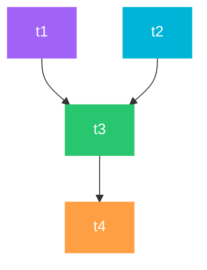

### Gradle Java Plugin

Gradle has many [pre-defined plugins](https://docs.gradle.org/current/userguide/java_plugin.html) and `java` is one of them which is used to work with Java projects. Java plugins have multiple tasks: `build`, `jar`, `compilejava`, `assemble`, `clean`, `test`, etc. They are dependent on each other.

🏗️ **Gradle Java Plugin Tasks:**

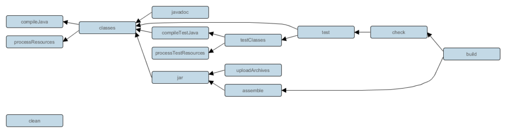

For every Gradle project one `build.gradle` file will be there which is a groovy-based file. It contains the following information:

- 📦 **Plugins** — define what type of project (Java, application, etc.)
- 🗄️ **Repositories** — where to find dependencies (Maven Central, etc.)
- 📚 **Dependencies** — external libraries required by the project

Gradle isn't only used with Java only. By default, Gradle is mostly used for Android-based tools. Even Gradle can be used along with C++, Kotlin, Ruby, Scala, and JavaScript. The `build.gradle` supports every language's internal conversion. It means the same `build.gradle` file supports execution for Java/Kotlin/Ruby/Scala, and etc. Such files are called DSL (domain-specific language).

---

## 4. Gradle CLI Example

Gradle Standard directory structure for standalone apps:

```
GradleApp
    -> src
        -> main
            -> java
                -> com.knowprogram
                    -> Arithmetic.java
        -> test
            -> java
    -> build.gradle
```

1️⃣ **Create `Arithmetic.java`:**

```java
package com.knowprogram;
public class Arithmetic {

    public int sum(int a, int b) {
        return a + b;
    }

    public static void main(String[] args) {
        System.out.println("Welcome to Gradle");
        Arithmetic arithmetic = new Arithmetic();
        System.out.println("Result: "+ arithmetic.sum(10, 331));
    }
}
```

2️⃣ **Create `build.gradle`:**

```groovy
apply plugin: 'java'
version = '1.0'
```

3️⃣ **Build the project:**

Open CMD from the project directory where the `src` folder is located and try the below commands:

```bash
> gradle task --all
> gradle build
```

It will perform multiple tasks including compilation, and creating jar files. The jar file can be found in the generated `build/libs` folder.

4️⃣ **Run the Jar file:**

```bash
> java -jar build/libs/GradleApp-1.0.jar com.knowprogram.Arithmetic
```

5️⃣ **Clean the build:**

It will delete the previously generated `build` folder.

```bash
> gradle clean
```

### Modifying and Rebuilding

Modify the source code:

```java
System.out.println("Welcome to Gradle-1");
```

Use the below command to re-generate the jar file along with deleting the existing:

```bash
> gradle clean build
> java -jar build/libs/GradleApp-1.0.jar com.knowprogram.Arithmetic
```

### Adding a Manifest Entry

In the above command, to run the `Arithmetic` class we are manually specifying the class name with the package. We can prevent that by adding a manifest file and making the `Arithmetic` class an entry point of the jar file. While working with Gradle we can directly specify this in `build.gradle` which adds content to the manifest file of the jar.

**`build.gradle` with manifest:**

```groovy
apply plugin: 'java'
version = '1.0'
jar {
    manifest {
        attributes 'Main-Class': 'com.knowprogram.Arithmetic'
    }
}
```

```bash
> gradle clean build
> java -jar build/libs/GradleApp-1.0.jar
```

### Using the Application Plugin

There is no `run` task in the `java` plugin but we have a `run` task in the `application` plugin. And since we are going to run it through Gradle therefore specifying the Main class for the manifest file is not required.

**`build.gradle` with application plugin:**

```groovy
apply plugin: 'java'
apply plugin: 'application'

version = '1.0'
mainClassName = 'com.knowprogram.Arithmetic'
```

Now, when executed `gradle task --all` then it will list the Application plugin `run` task along with other tasks.

📤 **Output:**

```bash
Application tasks
-----------------
run - Runs this project as a JVM application
```

Now we can run the jar directly as: `gradle run` or `gradle jar run`. However, it is a deprecated feature. Therefore we can create a custom task as follows:

**`build.gradle` with custom run task:**

```groovy
apply plugin: 'java'

version = '1.0'

task runApp(type: JavaExec) {
    main = 'com.knowprogram.Arithmetic'
    classpath = sourceSets.main.runtimeClasspath
}
```

And run it through: `gradle runApp` or `gradle jar runApp`.

---

## 5. Gradle Eclipse Example

The latest STS/Eclipse IDE by default comes with Gradle and we need not add them explicitly. In older Eclipse you can install the **Buildship Gradle** plugin from Eclipse marketplace (Help > Eclipse Market Place > Search for "Buildship Gradle" > Install > Next > Finish).

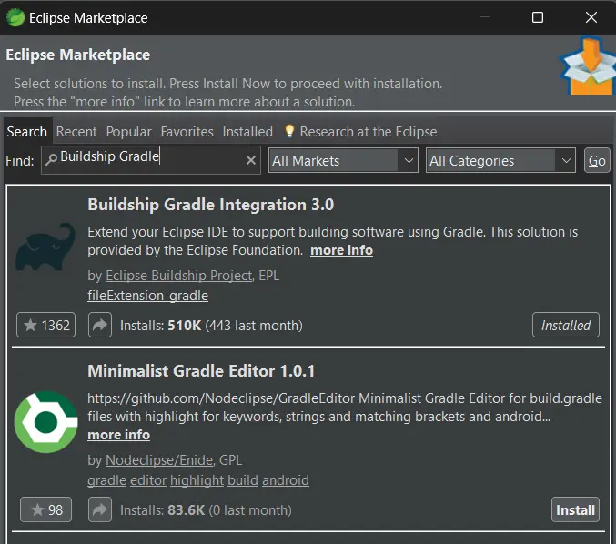

---

## 6. Gradle Project in STS/Eclipse

1️⃣ **File > New > Other > Search for "Gradle Project" > Next**

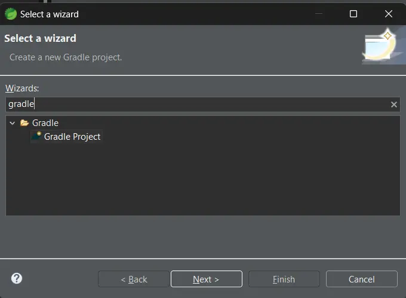

2️⃣ **Enter some project names like "MyFirstGradleApp".**

3️⃣ **Override workspace settings, enable "Show Console View" and "Show Executions View" > Next > Finish.**

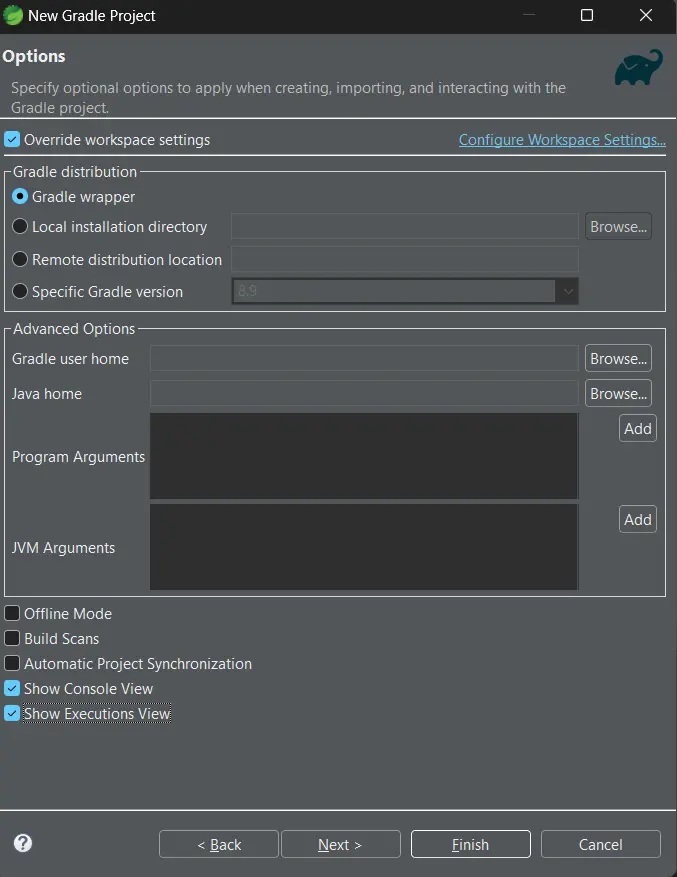

### Gradle Distribution Options

In the **Gradle distribution** section of the above image, the given options work as follows:

| Option 🔧 | Description 📋 |
|-----------|---------------|
| **Gradle Wrapper** | Dynamically download the latest version of Gradle |
| **Local Installation Directory** | Specify the Gradle location installed on our computer |
| **Remote Distribution Location** | Specify the remote distribution location |
| **Specific Gradle Version** | Dynamically download the specified version of Gradle |

### Folder Structure

Following is the folder structure.

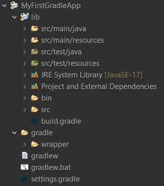

It will contain the following folders:

| Folder 📂 | Purpose 📋 |
|-----------|-----------|
| **`src/main/java`** | Java source files for development |
| **`src/main/resources`** | Non-Java files (properties, XML, etc.) for development |
| **`src/test/java`** | Java source files for testing |
| **`src/test/resources`** | Non-Java files for testing |

The `src/main/java` and `src/main/resources` are used for development purposes whereas `src/test/java` and `src/test/resources` are used for test purposes. The `src/main/java` and `src/test/java` will contain Java files whereas `src/main/resources` and `src/test/resources` are used to place non-Java files like properties files, XML files, and etc.

### Configuring build.gradle

The `build.gradle` comes up with some predefined content.

Delete the content of `build.gradle` file and existing files from `src/main/java` and `src/test/java`. After any modification, Right click on the project > Gradle => Refresh Gradle.

📝 **Note:** The default folder to store all dependencies in our local system is `C:/Users/<user>/.gradle`. Similarly, for the maven, it is `C:/Users/<user>/.m2`.

**`build.gradle`:**

```groovy
// plugins
plugins {
    id 'java'
}

// repositories
repositories {
    mavenCentral()
}

// version
// modify the JDK version
sourceCompatibility=1.8
targetCompatibility=1.8

// dependencies
// JARs requires to run the application
dependencies {
    implementation group: 'com.mysql', name: 'mysql-connector-j', version: '8.4.0'
    implementation group: 'org.hibernate.orm', name: 'hibernate-core', version: '6.5.2.Final'
}

// task
```

When we add dependencies to the `build.gradle` and perform refresh gradle then those dependencies are shown in the "**Project and External Dependencies**" folder.

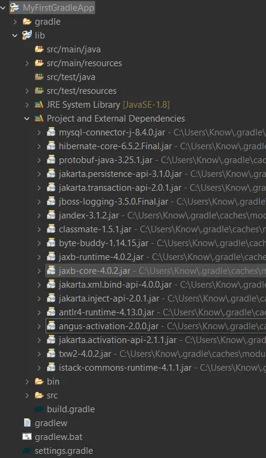

---

## 7. Gradle Project Example

Let us develop a simple Encode & Decode Java Project. It will require **Apache Commons Codec** dependencies.

1️⃣ **Configure `build.gradle`:**

```groovy
// plugins
plugins {
    id 'java'
}

// repositories
repositories {
    mavenCentral()
}

// version
// modify the JDK version
sourceCompatibility=1.8
targetCompatibility=1.8

// dependencies
dependencies {
    implementation group: 'commons-codec', name: 'commons-codec', version: '1.15'
}
```

2️⃣ **Create `TestMain.java`:**

```java
package com.knowprogram;

import org.apache.commons.codec.binary.Base64;

public class TestMain {
    public static void main(String[] args) {
        String input = "Hello";
        byte[] arr = Base64.encodeBase64(input.getBytes());
        String encodedString = new String(arr);
        System.out.println("Encoded Data: " + encodedString);

        byte[] decoded = Base64.decodeBase64(encodedString.getBytes());
        String normal = new String(decoded);
        System.out.println("Decoded Back: " + normal);

    }
}
```

Select the `TestMain.java` and Run it as a Java Application.

### Creating a Fat JAR

We want to convert this project into JAR format. To do that in STS/Eclipse, go to Window > Show View > Other > Search for Gradle and choose both "**Gradle Executions**" and "**Gradle Tasks**" > Open.

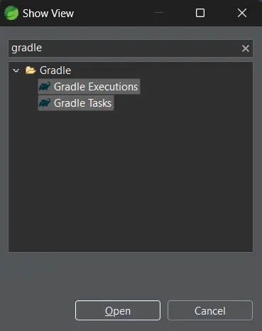

It will enable show view of them as follows:

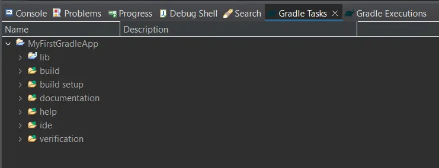

In Gradle Tasks > build > Right Click > Run Gradle Tasks.

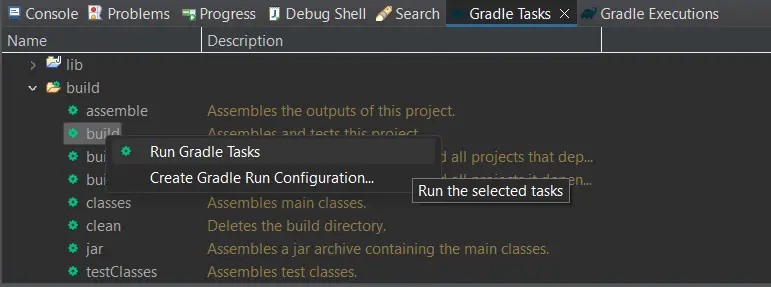

Once the Gradle Task is successfully run then we can find the jar file through File Explorer in the `MyFirstGradleApp/lib/build/libs` folder as a `lib.jar` file.

⚠️ **Caution:** Running `java -jar lib.jar` will give "no main manifest attribute" error because no Main class is specified.

📤 **Output:**

```bash
>java -jar lib.jar
no main manifest attribute, in lib.jar
```

We have to specify the Main class in the Jar. We can also change the name of the jar file. Add the following to the `build.gradle`:

**Fat JAR task in `build.gradle`:**

```groovy
// task
task fatJar(type: Jar) {

    // Include main classes
    from sourceSets.main.output

    // Include test classes
    from sourceSets.test.output

    manifest {
        // Whenever we execute the Jar then execute TestMain class as main class
        attributes 'Main-Class': 'com.knowprogram.TestMain'
    }

    // Set the JAR file name
    archiveBaseName = 'my-test-abc'

    // Include dependencies in the JAR
    from {
        configurations.runtimeClasspath.collect { it.isDirectory() ? it : zipTree(it) }
    }

    // Wait for runtime classpath resolution
    dependsOn configurations.runtimeClasspath
}
```

In Gradle Tasks > other > FatJar. If the option is not available then from the right **view menu** (three horizontal dots) in **Gradle Tasks**, enable the "**Show all tasks**". Perform Gradle refresh.

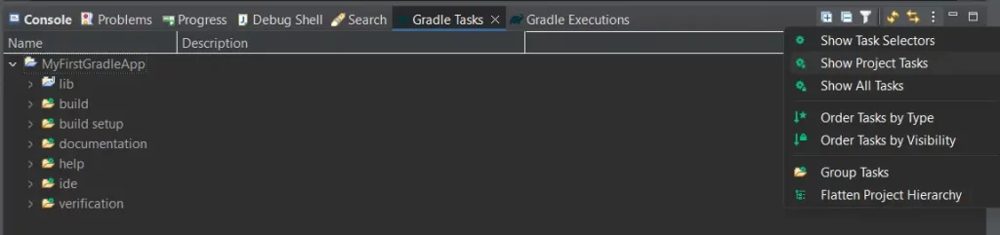

After that "**Refresh Tasks for all projects**", and then the "**FatJar**" option will come.

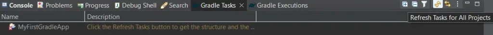

In Gradle Tasks > Other > Fatjar > Right Click > Run Gradle Tasks. We can delete existing jar files through Gradle Tasks > build > clean > Right Click > Run Gradle Tasks and run the `fatJar`. It will generate `my-test-abc.jar`.

📤 **Output:**

```bash
>java -jar my-test-abc.jar
Encoded Data: SGVsbG8=
Decoded Back: Hello
```

### Automatic Project Synchronization

In Maven, whenever we modify the content in `pom.xml` then it auto-detects the changes and downloads/removes the dependencies and settings. But in Gradle, it won't auto-detect the changes of `build.gradle`, we need to manually refresh the project. After any modification, Right click on the project > Gradle => Refresh Gradle.

💡 **Tip:** We can avoid this manual refresh. While creating the Gradle project we can override the workspace settings and enable the "**Automatic Project Synchronization**" option.

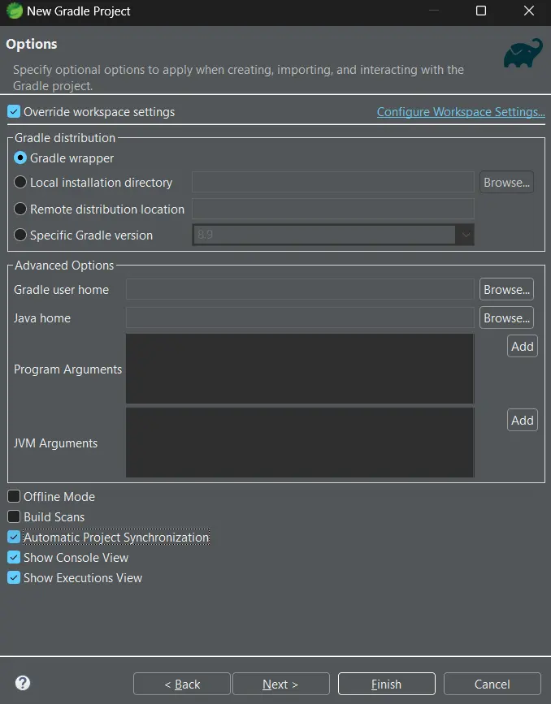

---

## 8. Unit Testing Using Junit and Gradle

Gradle is not only a build automation tool it is a complete project management tool. It can perform unit testing, generate documentation, etc.

Create a Gradle project "**GradleAndUnitTesting**". The `gradle.build` file already comes with JUnit dependencies.

1️⃣ **Configure `build.gradle`:**

```groovy
plugins {
    id 'java'
}

repositories {
    mavenCentral()
}

dependencies {
    testImplementation 'org.junit.jupiter:junit-jupiter:5.9.1'
}

java {
    toolchain {
        languageVersion = JavaLanguageVersion.of(17)
    }
}

tasks.named('test') {
    useJUnitPlatform()
}
```

📝 **Note:** Perform Gradle refresh after modifying the `build.gradle` file. Maven/Gradle gives dependent Jar files automatically when we add main jar file info in the build script. This is called **transitive dependency**.

2️⃣ **Create `MathOperations.java` in `src/main/java`:**

```java
package com.knowprogram;

public class MathOperations {

    public int sum(int x, int y) {
        return x + y;
    }

    public static void main(String[] args) {
        MathOperations operations = new MathOperations();
        System.out.println("Result: " + operations.sum(100, 5));
    }
}
```

3️⃣ **Create `MathOperationsTest.java` in `src/test/main`:**

Each `@Test` annotation method gives one Test case where expected results will be compared with actual results.

```java
package com.knowprogram;

import static org.junit.jupiter.api.Assertions.assertEquals;

import org.junit.jupiter.api.Test;

public class MathOperationsTest {

    @Test
    public void testPositives() {
        int expected = 300;
        int actual = new MathOperations().sum(100, 200);
        assertEquals(expected, actual, "Test Positive");
    }

    @Test
    public void testNegatives() {
        int expected = -300;
        int actual = new MathOperations().sum(-100, -200);
        assertEquals(expected, actual, "Test Negatives");
    }

    @Test
    public void testMixed() {
        int expected = -100;
        int actual = new MathOperations().sum(100, -200);
        assertEquals(expected, actual, "Test Mixed");
    }

    @Test
    public void testZeros() {
        int expected = 0;
        int actual = new MathOperations().sum(0, 0);
        assertEquals(expected, actual, "Test Zeros");
    }
}
```

### Running the Tests

In Gradle Tasks => GradleAndUnitTesting > verification > test > Right-click & Run Gradle Tasks.

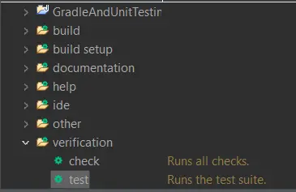

Now open the project directory in File Explorer and go to the `<project-directory>\GradleAndUnitTesting\lib\build\reports\tests\test`.

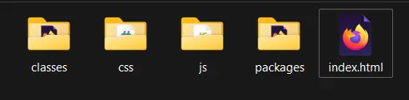

Open `index.html` file.

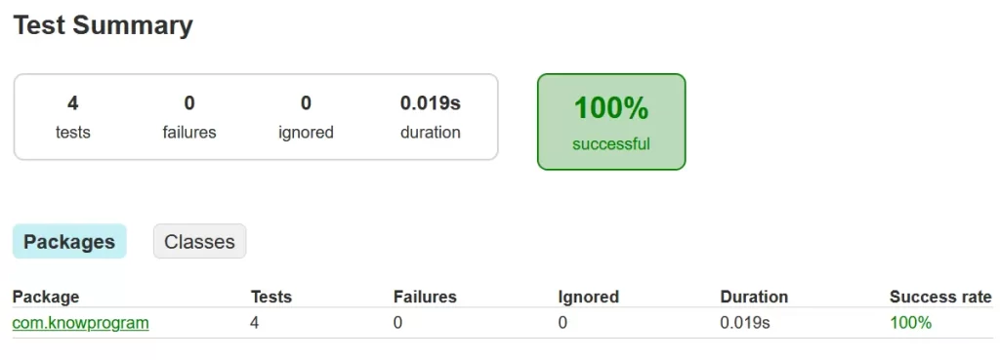

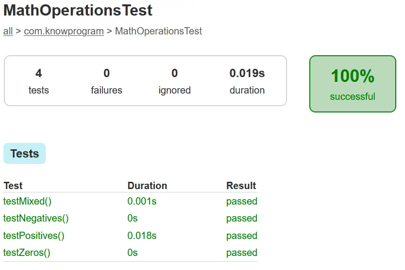

### Testing Failures

Add `@Disabled` one of these test methods, and in `testMixed()` method change this line:
`int expected = -500;`

Now, run the Gradle test.

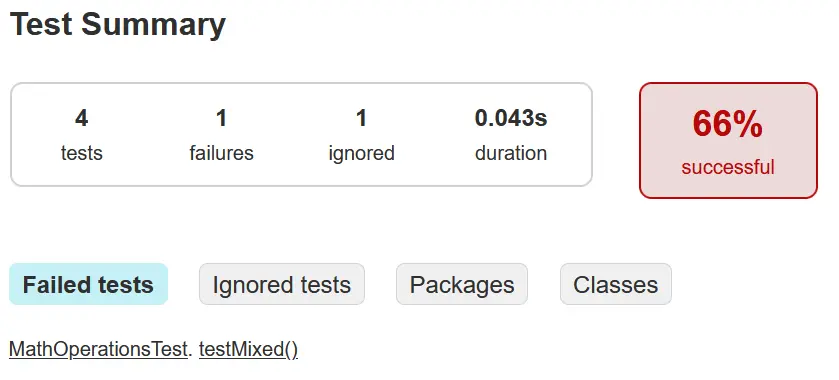

---

## 9. Working with Multiple Repositories

We can specify multiple repositories in the `repositories{}` of `build.gradle`. By default, Gradle uses Maven Central as one of its repositories.

**Maven Central (default):**

```groovy
repositories {
    mavenCentral()
}
```

**Multiple repositories:**

If you need to include other repositories (such as jCenter or custom repositories), you can add them alongside Maven Central:

```groovy
repositories {
    mavenCentral()
    jcenter() // Example: Include jCenter repository
    maven { url 'https://my.custom.repo.com/maven' } // Example: Custom repository URL
}
```

📝 **Note:** It will first search for all dependencies in the maven-central, later if not found then will search in the other repositories.

**Local repository (.m2 folder):**

If you have locally built JAR files that you want to include, you can use the local repository:

```groovy
repositories {
    mavenLocal()
}
```

**Authenticated repository:**

If your repository requires authentication (e.g., username and password), you can configure credentials:

```groovy
repositories {
    maven {
        url 'https://my.private.repo.com/maven'
        credentials {
            username 'myUsername'
            password 'myPassword'
        }
    }
}
```

> 🔒 **Security:** Never hardcode credentials in `build.gradle`. Use environment variables or a `gradle.properties` file instead.

---

## 10. Generating JavaDoc with Gradle

Modify the class file with proper JavaDoc comments:

**`MathOperations.java` with JavaDoc:**

```java
package com.knowprogram;

/**
 * <b> Class performing <i>Arithmetic Operations</i> </b> like
 * sum, sub, mul, div, and e.t.c.
 *
 * @author KnowProgram
 * @See java.lang.Math
 * @since proj1.0
 */
public class MathOperations {

    /**
     * Method Performing <b> addition </b>
     *
     * @param x takes value1
     * @param y takes value2
     * @return gives addition result
     */
    public int sum(int x, int y) {
        return x + y;
    }

    public static void main(String[] args) {
        MathOperations operations = new MathOperations();
        System.out.println("Result: " + operations.sum(100, 5));
    }
}
```

In Gradle Tasks => documentation => javadoc => Right-click & Run Gradle Tasks. Now go to `<project-directory>\GradleAndUnitTesting\lib\build\docs\javadoc` and open `index.html` file.

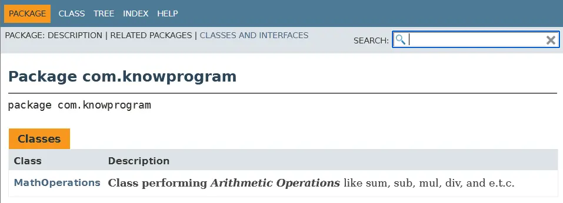

---

## 11. Converting Gradle project to Eclipse/STS Project

Assume we have developed a Gradle project without STS/Eclipse IDE and now we want to use STS/Eclipse IDE to manage this project. Eclipse/STS projects will have special files/folders like `.settings`, `.classpath`, and `.project`. For this purpose, Gradle has an `eclipse` **task** and an `eclipse` **plugin**.

Previously we have developed "GradleApp" using CLI without Eclipse/STS. Let us convert it to the Eclipse/STS project.

1️⃣ **Add the Eclipse plugin to `build.gradle`:**

```groovy
apply plugin: 'eclipse'
```

2️⃣ **List available tasks:**

Now, open CMD and run `gradle task --all`. It will list all tasks including IDE tasks, we can find `eclipse` and `cleanEclipse` tasks.

- 🔧 **`eclipse`** — converts a normal Gradle project to an Eclipse project
- 🧹 **`cleanEclipse`** — reverses the conversion

```bash
> gradle task --all
IDE tasks
---------
cleanEclipse - Cleans all Eclipse files.
eclipse - Generates all Eclipse files.
```

3️⃣ **Execute the conversion:**

Execute the `gradle eclipse` command. It will generate `.settings`, `.classpath`, and `.project` files and folders.

```bash
> gradle eclipse
```

Now we can import it into Eclipse as a Gradle project.

---

## 12. Convert Maven Project to Gradle Project

In Project Explorer go to the folder where the project is located, open CMD, and run the `gradle init --type=pom` command.

```bash
> gradle init --type=pom

Select build script DSL:
  1: Kotlin
  2: Groovy
Enter selection (default: Kotlin) [1..2] 2

Generate build using new APIs and behavior (some features may change in the next minor release)? (default: no) [yes, no]
 yes

> Task :init
Maven to Gradle conversion is an incubating feature.
For more information, please refer to https://docs.gradle.org/8.9/userguide/migrating_from_maven.html in the Gradle documentation.

BUILD SUCCESSFUL in 33s
1 actionable task: 1 executed
```

> 📝 **Note:** Maven to Gradle conversion is still an incubating feature. Refer to the [Gradle migration guide](https://docs.gradle.org/8.9/userguide/migrating_from_maven.html) for more details.
