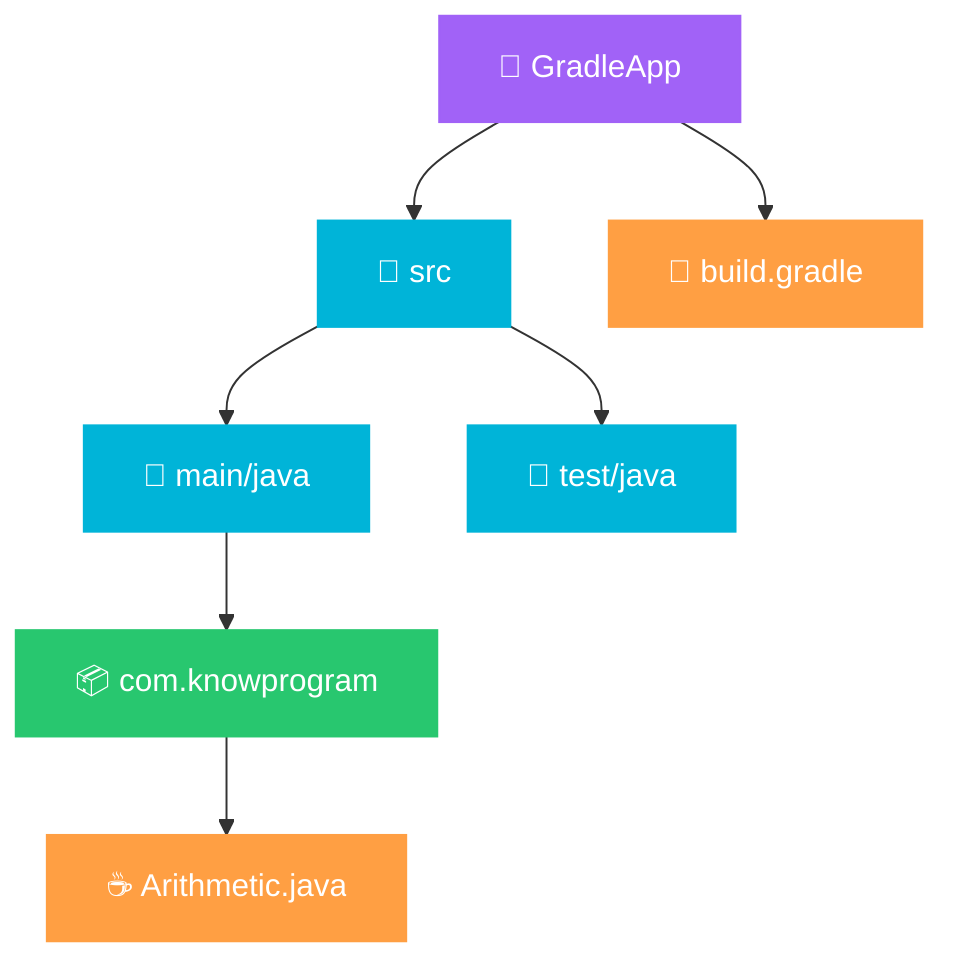
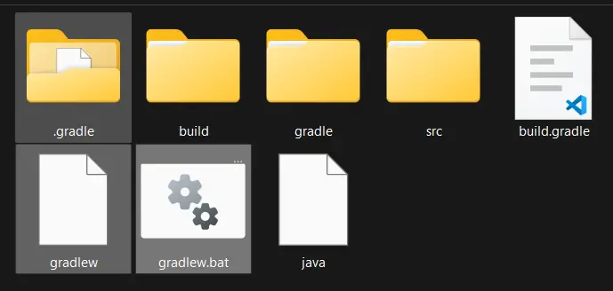
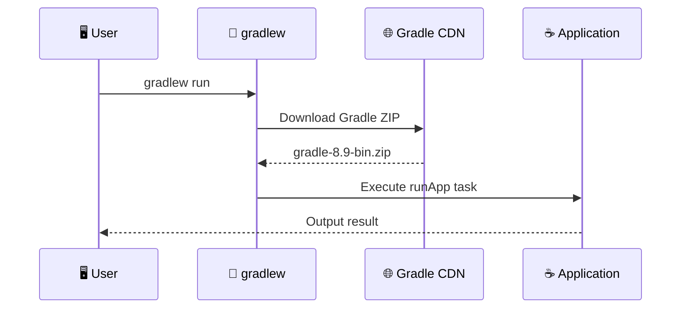
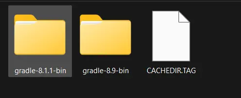

# Gradle Wrapper

**Gradle Wrapper** | Gradle Wrapper lets you run a Gradle project without installing Gradle software on your system. It can dynamically download Gradle at runtime and then run the application.

- [Project Structure](#1-project-structure)
- [Code Setup](#2-code-setup)
- [Generating the Wrapper](#3-generating-the-wrapper)
- [Running Without Gradle Installed](#4-running-without-gradle-installed)
- [Sharing and Version Control](#5-sharing-and-version-control)
- [Specifying a Gradle Version](#6-specifying-a-gradle-version)

---

## 1. Project Structure

📁 **GradleApp directory layout:**

```
GradleApp
├── src
│   ├── main
│   │   └── java
│   │       └── com.knowprogram
│   │           └── Arithmetic.java
│   └── test
│       └── java
├── build.gradle
```



---

## 2. Code Setup

1️⃣ **Create `Arithmetic.java`:**

```java
package com.knowprogram;
public class Arithmetic {

    public int sum(int a, int b) {
        return a + b;
    }

    public static void main(String[] args) {
        System.out.println("Welcome to Gradle");
        Arithmetic arithmetic = new Arithmetic();
        System.out.println("Result: "+ arithmetic.sum(10, 331));
    }
}
```

2️⃣ **Create `build.gradle`:**

```groovy
apply plugin: 'java'
version = '1.0'

task runApp(type: JavaExec) {
    main = 'com.knowprogram.Arithmetic'
    classpath = sourceSets.main.runtimeClasspath
}

// get wrapper support
task myTask(type: Wrapper)
```

🧠 **In Simple Words:**
- The `build.gradle` file defines a `runApp` task that executes the `Arithmetic` class.
- The `myTask` task of type `Wrapper` enables Gradle Wrapper support for the project.

---

## 3. Generating the Wrapper

Execute the `gradle wrapper` command in CMD from the project directory. This generates `gradlew` and `gradlew.bat` files in the project directory.

**Run the wrapper command:**

```bash
> gradle wrapper
```



| File Generated 📄 | Platform 🖥️ | Purpose 🎯 |
|-------------------|-------------|------------|
| **`gradlew`** | Linux / macOS | Shell script to run Gradle without installation |
| **`gradlew.bat`** | Windows | Batch script to run Gradle without installation |

---

## 4. Running Without Gradle Installed

Now, let us remove Gradle's path from the system. In Windows, open "Advanced System Settings" => Edit Path => Remove "Gradle". Open a new CMD because changes will not be reflected in the old CMD.

🧪 **Verify Gradle is removed:**

In the new CMD, run `gradle -v`. It should give the message:

> ⚠️ **Expected:** `'gradle' is not recognized as an internal or external command, operable program, or batch file.`

Now, since Gradle is not configured, let us run the application through `gradlew run` without having Gradle installed in the system.

**Run the application:**

```bash
> gradlew run
```

📤 **Output:**

```
Downloading https://services.gradle.org/distributions/gradle-8.9-bin.zip
............10%.............20%.............30%.............40%.............50%
.............60%.............70%.............80%.............90%.............100%

> Task :runApp
Welcome to Gradle-1
Result: 341
```



🔑 **Key Points:**

- 🌐 The `gradlew run` command first downloads Gradle and then runs the application.
- ⚡ If you run `gradlew run` again, it will **not** re-download Gradle and directly runs the application.
- 💾 On Windows, downloaded Gradle installations are stored in `C:\Users\<user>\.gradle\wrapper\dists`.



---

## 5. Sharing and Version Control

You can send this application folder (containing `gradlew` files) to another computer using Git or SVN. The recipient can run the GradleApp **without installing Gradle** on their computer by simply using `gradlew run`.

| Action 🔧 | Command 💻 | Gradle Required? |
|-----------|-----------|-----------------|
| **Build locally** | `gradle build` | ✅ Yes |
| **Run via wrapper** | `gradlew run` | ❌️ No |
| **Share project** | Git / SVN push | ❌️ No |

> 💡 **Tip:** Always commit `gradlew`, `gradlew.bat`, and the `gradle/wrapper/` directory to version control so that teammates can build without a local Gradle installation.

---

## 6. Specifying a Gradle Version

When you use `gradlew run`, it downloads the latest version of Gradle software. However, if the application was developed using a specific version, you can specify the version information while executing the wrapper command.

🔧 **Specify a version:**

```bash
> gradlew wrapper --gradle-version 6.4.1
```

📝 **Note:** This updates the `gradle/wrapper/gradle-wrapper.properties` file with the specified version URL, ensuring all team members use the same Gradle version.
